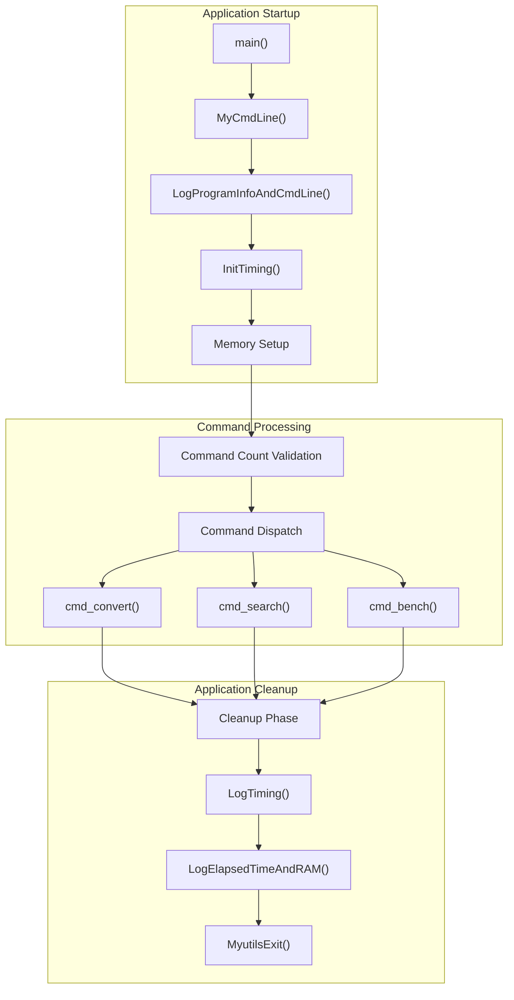
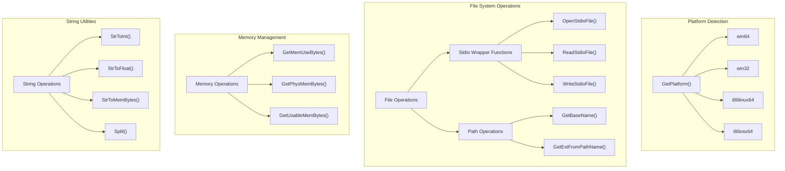
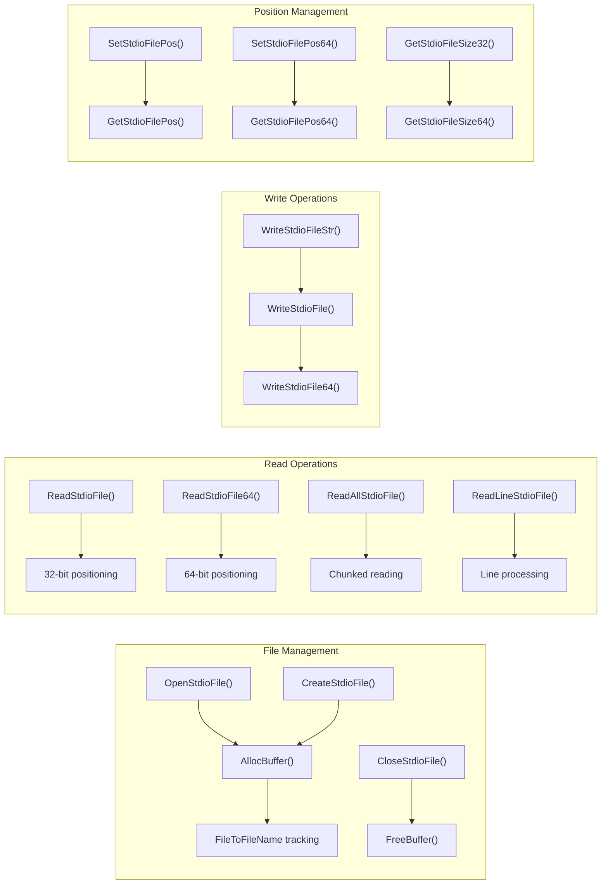
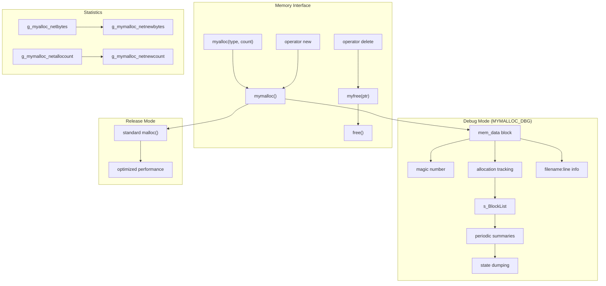
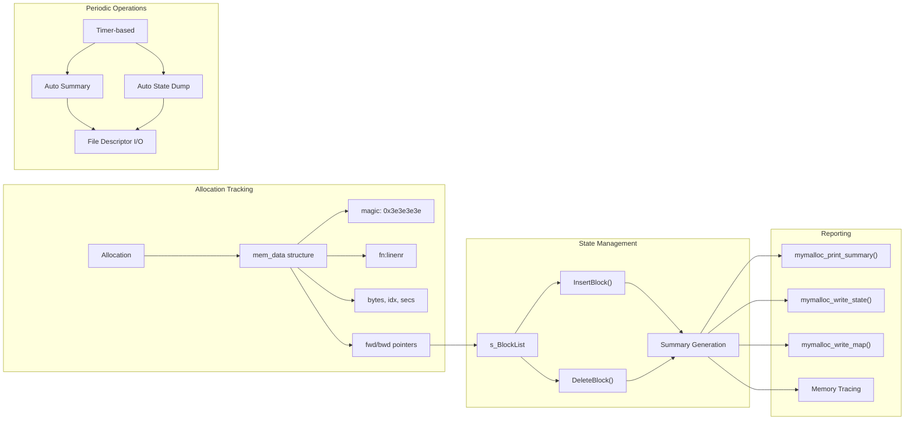
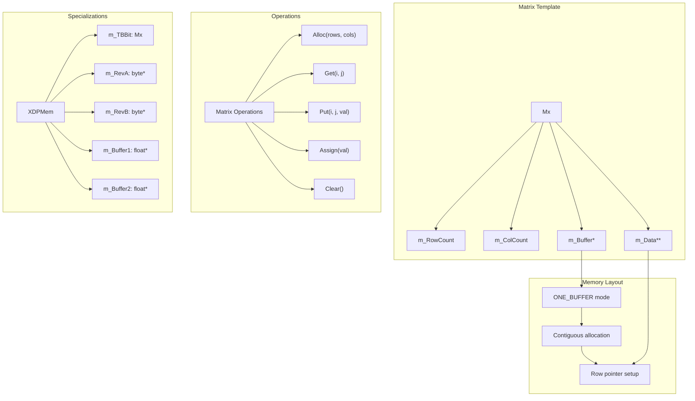
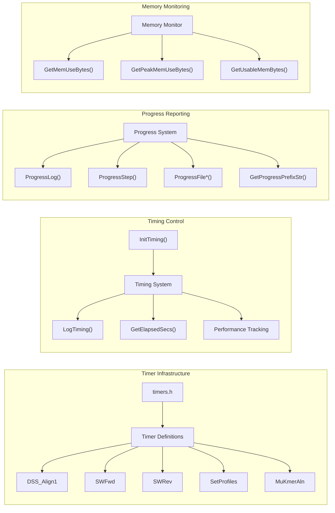
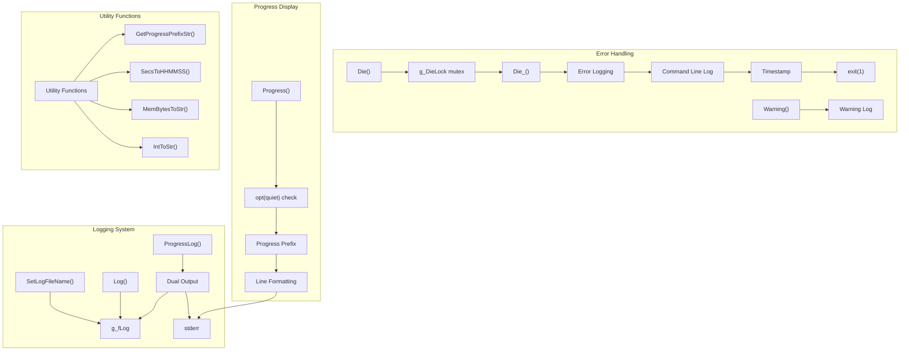
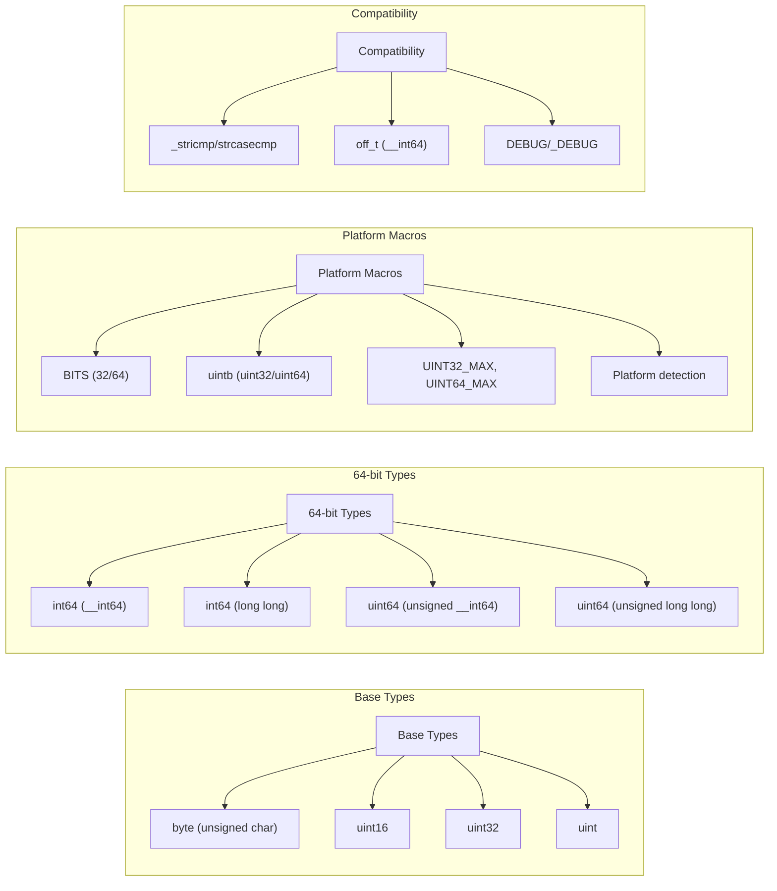

# Developer Reference

Relevant source files

The following files were used as context for generating this wiki page:

- [src/mx.cpp](src/mx.cpp)
- [src/mx.h](src/mx.h)
- [src/mymalloc.h](src/mymalloc.h)
- [src/mymalloc_dbg.cpp](src/mymalloc_dbg.cpp)
- [src/myutils.cpp](src/myutils.cpp)
- [src/myutils.h](src/myutils.h)
- [src/reseek_main.cpp](src/reseek_main.cpp)
- [src/timers.h](src/timers.h)
- [src/xdpmem.h](src/xdpmem.h)

This document covers the internal developer infrastructure supporting the reseek protein search tool, including core utilities, memory management, build system integration, and fundamental data structures. This material is essential for understanding the codebase architecture and for contributing to the project.

For information about the core alignment algorithms, see [Core Alignment Engine](#3). For database search implementation details, see [Database Search System](#4). For build and deployment processes, see [Build System and CI/CD](#8.1).

## Core Application Architecture

The reseek application follows a command-dispatch architecture where the main entry point processes command-line arguments and dispatches to appropriate command implementations.

### Application Entry Point

The application entry point in `reseek_main.cpp` implements a structured initialization and command dispatch system:

**Application Entry Point Flow**

The main function [src/reseek_main.cpp:10-65]() follows a strict initialization sequence:

1. **Command-line Processing**: `MyCmdLine()` parses arguments and sets global option variables
2. **Logging Initialization**: `LogProgramInfoAndCmdLine()` sets up logging and records program start
3. **Memory Tracking**: Optional memory allocation tracking based on command-line flags
4. **Command Validation**: Ensures exactly one command is specified using preprocessor macros
5. **Command Dispatch**: Uses preprocessor expansion to call the appropriate `cmd_*()` function
6. **Cleanup**: Logs timing, memory usage, and performs orderly shutdown

Sources: [src/reseek_main.cpp:10-65]()

## Core Utility System

The `myutils` module provides the foundational infrastructure for the entire application, including platform abstraction, memory management, I/O operations, and logging.

### Platform Abstraction Layer

**Platform-Specific Implementations**

The utility system provides platform-specific implementations for:

- **Memory Usage Tracking**: Windows (`GetProcessMemoryInfo`), Linux (`/proc/*/statm`), macOS (`task_info`)
- **File I/O**: 64-bit file operations with platform-specific seeks and tells
- **Physical Memory Detection**: Platform-specific methods for determining available RAM
- **Directory Listing**: Windows (`FindFirstFile`/`FindNextFile`) vs Unix (`opendir`/`readdir`)

Sources: [src/myutils.cpp:77-104](), [src/myutils.cpp:832-960](), [src/myutils.cpp:962-1012]()

### I/O Abstraction Layer

The I/O system provides a comprehensive wrapper around standard C file operations with enhanced error handling and 64-bit support:

**I/O Features**

Key I/O system capabilities include:

- **Buffered I/O**: Custom buffer allocation with `MY_IO_BUFSIZ` (32KB) for performance
- **64-bit File Support**: Full 64-bit file positioning and size operations
- **Error Handling**: Comprehensive error reporting with file state logging
- **File Tracking**: Global map tracking file handles to filenames for debugging
- **Memory Mapped Reading**: Large file reading with chunked operations

Sources: [src/myutils.cpp:158-183](), [src/myutils.cpp:248-287](), [src/myutils.cpp:416-462]()

## Memory Management System

The reseek application implements a sophisticated memory management system with optional debugging capabilities, performance tracking, and leak detection.

### Memory Management Architecture

**Memory Management Features**

The system provides two operational modes:

1. **Debug Mode** (`MYMALLOC_DBG=1`): Full allocation tracking with metadata
2. **Release Mode** (`MYMALLOC_DBG=0`): Minimal overhead wrapper

**Debug Mode Capabilities**:
- Per-allocation metadata with source file and line number
- Magic number corruption detection
- Linked list tracking of all active allocations
- Periodic memory usage summaries
- State dumping for leak analysis
- Memory access pattern tracing

Sources: [src/mymalloc.h:1-36](), [src/mymalloc_dbg.cpp:10-377]()

### Memory Debugging Interface

The debug memory system provides comprehensive tracking and analysis tools:

**Memory Debugging Configuration**

The debug system supports runtime configuration through command-line options:
- `--myalloc_summary_secs`: Interval for periodic memory summaries
- `--myalloc_dump_secs`: One-time state dump after specified seconds
- `--myalloc_trace`: Enable per-allocation tracing
- `--myalloc_exit_state`: Generate state dump on application exit

Sources: [src/mymalloc_dbg.cpp:64-182](), [src/mymalloc_dbg.cpp:238-377]()

## Matrix and Memory Management

The application provides specialized matrix classes and memory management for dynamic programming operations.

### Matrix Class System

**Matrix Implementation Details**

The `Mx<T>` template class provides:

- **Unified Memory Layout**: Single buffer allocation with computed row pointers for cache efficiency
- **Type Safety**: Template-based type checking for different data types
- **Bounds Checking**: Debug mode boundary validation
- **Resource Management**: Automatic cleanup in destructor

The `XDPMem` class extends this for dynamic programming:

- **Specialized Buffers**: Separate float and int buffers for different DP algorithms
- **Reverse Sequence Storage**: Buffers for reversed sequence data
- **Traceback Support**: Byte matrix for alignment path reconstruction
- **Offset Handling**: Buffer pointers adjusted for 1-based indexing

Sources: [src/mx.h:8-135](), [src/xdpmem.h:15-109]()

## Performance Monitoring and Timing

The application includes comprehensive performance monitoring through a timing system and progress reporting infrastructure.

### Timing System Architecture

**Performance Monitoring Features**

The timing system provides:

- **Hierarchical Timers**: Named timers for different algorithm phases
- **Automatic Reporting**: Integrated timing output at application exit
- **Memory Integration**: Combined timing and memory usage reporting
- **Progress Tracking**: File-based and step-based progress reporting

**Timer Categories**:
- **Alignment Operations**: `DSS_Align1`, `DSS_Align2`, `DSS_Align3`
- **Smith-Waterman**: `SWFwd`, `SWRev`, `SWFast`, `SWFastGapless`
- **Profile Operations**: `SetProfiles`, `SetMuQP`, `SetKmersVec`
- **Database Operations**: `MuKmerAln`, `GetScorePosPair`

Sources: [src/timers.h:1-61](), [src/myutils.cpp:185-188](), [src/myutils.cpp:1265-1556]()

### Logging and Error Handling

The application provides a comprehensive logging and error handling system:

**Logging Features**

The logging system provides:

- **File and Console Output**: Dual logging to file and stderr
- **Thread Safety**: Mutex-protected error handling
- **Contextual Information**: Automatic timestamp and memory usage reporting
- **Formatted Output**: Specialized formatting for time, memory, and numeric values
- **Progress Integration**: Combined progress and logging with optional prefixes

Sources: [src/myutils.cpp:736-817](), [src/myutils.cpp:1316-1450]()

## Type System and Portability

The codebase implements a comprehensive type system for cross-platform compatibility and performance optimization.

### Type Definitions and Platform Support

**Type System Design**

The type system provides:

- **Consistent Naming**: `uint32`, `uint64`, `byte` for clear intent
- **Platform Abstraction**: Compiler-specific `int64` definitions
- **Architecture Awareness**: `BITS` macro for 32/64-bit builds
- **Standard Compliance**: Proper constants and limits definitions

**Platform-Specific Adaptations**:
- **Windows**: `__int64`, `_stricmp`, `off_t` redefinition
- **GCC**: `long long`, `strcasecmp`, standard `off_t`
- **Debug Builds**: Unified `DEBUG` and `_DEBUG` macros

Sources: [src/myutils.h:4-104](), [src/myutils.h:141-143]()

This developer reference provides the foundation for understanding reseek's internal architecture and contributing to the codebase. The modular design, comprehensive error handling, and performance monitoring systems support the complex protein structure alignment algorithms implemented in higher-level modules.

---