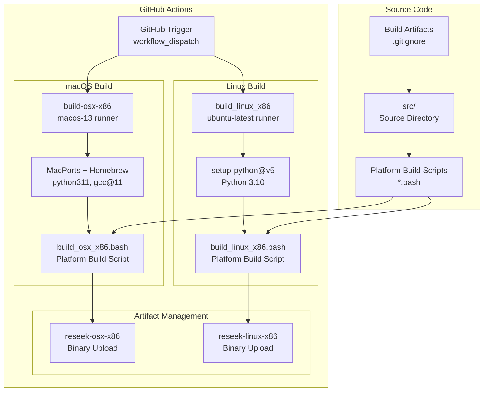

# Build System and CI/CD

<details>
<summary>Relevant source files</summary>

The following files were used as context for generating this wiki page:

- [.github/workflows/build_linux_x86.yml](.github/workflows/build_linux_x86.yml)
- [.github/workflows/build_osx_x86.yml](.github/workflows/build_osx_x86.yml)
- [src/.gitignore](src/.gitignore)
- [src/timers.h](src/timers.h)

</details>


## Purpose and Scope

This page documents the build system and continuous integration/continuous deployment (CI/CD) infrastructure for the reseek protein structure search tool. It covers the GitHub Actions workflows, cross-platform build processes, performance instrumentation, and artifact generation. For information about the core utilities and memory management systems that support the build process, see [Core Utilities and Memory Management](#8.2).

## Build System Overview

The reseek build system is designed for cross-platform compilation with automated CI/CD pipelines. The system supports multiple operating systems and architectures through platform-specific build scripts integrated with GitHub Actions workflows.

### CI/CD Pipeline Architecture



**Sources:** [.github/workflows/build_osx_x86.yml:1-35](), [.github/workflows/build_linux_x86.yml:1-37]()

## Platform-Specific Build Workflows

### macOS x86 Build Pipeline

The macOS build workflow `build-osx-x86` executes on `macos-13` runners and includes comprehensive dependency management:

| Component | Configuration |
|-----------|---------------|
| **Runner** | `macos-13` |
| **Package Managers** | MacPorts, Homebrew |
| **Dependencies** | `python311`, `gcc@11` |
| **Build Script** | `build_osx_x86.bash` |
| **Artifact** | `reseek-osx-x86` |

The workflow performs the following steps:
1. Repository checkout using `actions/checkout@v4`
2. MacPorts installation via `melusina-org/setup-macports@v1`
3. Dependency installation through both MacPorts and Homebrew
4. Execution of platform-specific build script
5. Binary artifact upload to `/Users/runner/work/reseek/reseek/bin/reseek`

### Linux x86 Build Pipeline

The Linux build workflow `build_linux_x86` provides a streamlined build process:

| Component | Configuration |
|-----------|---------------|
| **Runner** | `ubuntu-latest` |
| **Python Setup** | `actions/setup-python@v5` |
| **Python Version** | `3.10` |
| **Build Script** | `build_linux_x86.bash` |
| **Artifact** | `reseek-linux-x86` |

The workflow includes concurrency control with `cancel-in-progress: true` to prevent resource conflicts and features minimal permission requirements with `contents: read`.

**Sources:** [.github/workflows/build_osx_x86.yml:8-34](), [.github/workflows/build_linux_x86.yml:16-36]()

## Build Script Integration

### Build Script Execution Flow

```mermaid
graph LR
    subgraph "Workflow Trigger"
        WF_DISPATCH["workflow_dispatch<br/>Manual Trigger"]
    end
    
    subgraph "Environment Setup"
        CHECKOUT["actions/checkout@v4<br/>Repository Access"]
        DEPS["Dependency Installation<br/>Platform Specific"]
    end
    
    subgraph "Build Process"
        CHMOD["chmod +x<br/>Script Permissions"]
        BASH_EXEC["bash Script Execution<br/>build_*.bash"]
        COMPILE["Native Compilation<br/>src/ directory"]
    end
    
    subgraph "Artifact Generation"
        BINARY_OUTPUT["Binary Generation<br/>bin/reseek"]
        UPLOAD["actions/upload-artifact@v4<br/>GitHub Artifacts"]
    end
    
    WF_DISPATCH --> CHECKOUT
    CHECKOUT --> DEPS
    DEPS --> CHMOD
    CHMOD --> BASH_EXEC
    BASH_EXEC --> COMPILE
    COMPILE --> BINARY_OUTPUT
    BINARY_OUTPUT --> UPLOAD
```



The build scripts are platform-specific shell scripts located in the `src/` directory:
- `build_osx_x86.bash` - macOS x86 compilation
- `build_linux_x86.bash` - Linux x86 compilation

Both scripts are made executable using `chmod +x` before execution and operate within the `$GITHUB_WORKSPACE/src` directory context.

**Sources:** [.github/workflows/build_osx_x86.yml:24-28](), [.github/workflows/build_linux_x86.yml:26-30]()

## Performance Instrumentation

### Timer Infrastructure

The build system includes comprehensive performance measurement capabilities through the timer infrastructure defined in `timers.h`. This system provides granular timing for various components of the build and runtime processes.

### Timer Categories

```mermaid
graph TB
    subgraph "Core Timers"
        T_NONE["None<br/>Default Timer"]
        T_OVERHEAD["GetTimerOverhead<br/>Timer Calibration"]
        T_TEST["TestTimer<br/>Timer Validation"]
    end
    
    subgraph "Memory Management"
        T_ALLOC["MxBase_Alloc<br/>Memory Allocation"]
        T_ALLOC_DATA["MxBase_AllocData<br/>Data Allocation"]
        T_FREE["MxBase_FreeData<br/>Memory Deallocation"]
    end
    
    subgraph "Algorithm Timers"
        T_SORT["Sort<br/>Sorting Operations"]
        T_QUICKSORT["QuickSortInPlace<br/>In-place Sorting"]
        T_SW["SWFwd/SWRev<br/>Smith-Waterman"]
        T_ALIGN["DSS_Align1/2/3<br/>Alignment Phases"]
    end
    
    subgraph "Search Operations"
        T_SCORE["GetScorePosPair<br/>Score Calculation"]
        T_KMERS["SetKmersVec<br/>K-mer Processing"]
        T_PROFILES["SetProfiles<br/>Profile Generation"]
        T_EVALUE["CalcEvalue<br/>E-value Calculation"]
    end
    
    T_NONE --> T_OVERHEAD
    T_OVERHEAD --> T_TEST
    
    T_ALLOC --> T_ALLOC_DATA
    T_ALLOC_DATA --> T_FREE
    
    T_SORT --> T_QUICKSORT
    T_SW --> T_ALIGN
    
    T_SCORE --> T_KMERS
    T_KMERS --> T_PROFILES
    T_PROFILES --> T_EVALUE
```



The timer system includes 60+ distinct timing categories covering:
- Core system operations (`GetTimerOverhead`, `TestTimer`)
- Memory management (`MxBase_Alloc`, `MxBase_AllocData`, `MxBase_FreeData`)
- Algorithm execution (`SWFwd`, `SWRev`, `DSS_Align1`, `DSS_Align2`, `DSS_Align3`)
- Search operations (`SetKmersVec`, `SetProfiles`, `CalcEvalue`)
- Sorting and data structures (`Sort`, `QuickSortInPlace`, `QuickSortOrder`)

**Sources:** [src/timers.h:1-61]()

## Build Artifacts and Deployment

### Artifact Management

The CI/CD system generates platform-specific binary artifacts:

| Platform | Artifact Name | Output Path |
|----------|---------------|-------------|
| **macOS x86** | `reseek-osx-x86` | `/Users/runner/work/reseek/reseek/bin/reseek` |
| **Linux x86** | `reseek-linux-x86` | `/home/runner/work/reseek/reseek/bin/reseek` |

### Build Artifact Exclusions

The build system maintains clean source directories through `.gitignore` configurations:

```
Makefile
MSBuild.log
make.stdout
make.stderr
gitver.txt
vcxproj_make.py
```

These exclusions prevent build artifacts, log files, and generated configuration files from being committed to the repository.

**Sources:** [.github/workflows/build_osx_x86.yml:30-34](), [.github/workflows/build_linux_x86.yml:32-36](), [src/.gitignore:1-7]()

## Workflow Execution Control

### Manual Triggering

Both build workflows use `workflow_dispatch` triggers, requiring manual activation through the GitHub Actions interface. This approach provides controlled build execution for release management and testing purposes.

### Concurrency Management

The Linux build workflow implements concurrency control:
- **Group:** `${{ github.workflow }}-${{ github.ref }}`
- **Cancel in Progress:** `true`

This configuration prevents multiple simultaneous builds on the same branch, optimizing resource usage and preventing conflicts.

**Sources:** [.github/workflows/build_osx_x86.yml:3-4](), [.github/workflows/build_linux_x86.yml:9-12]()

---