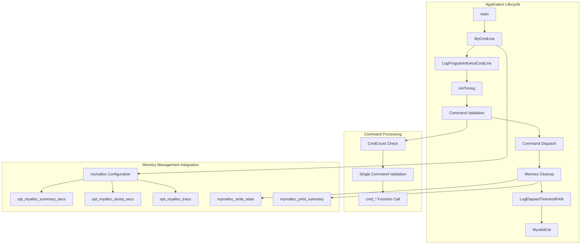
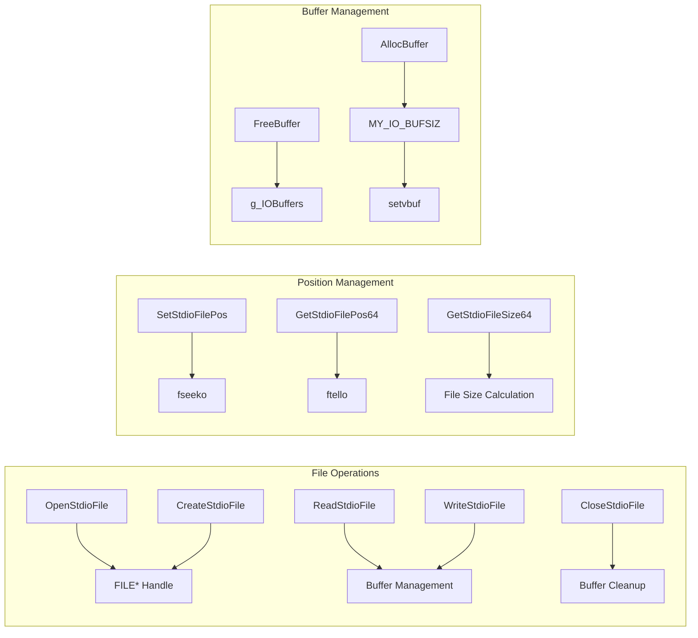
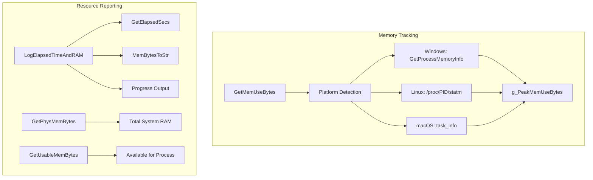
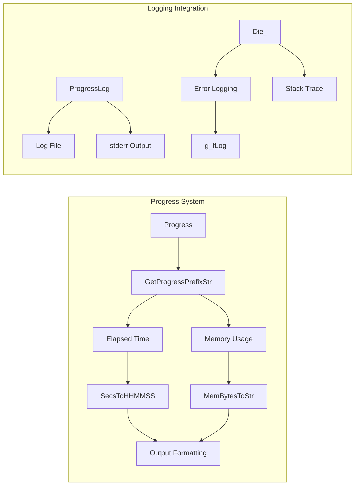
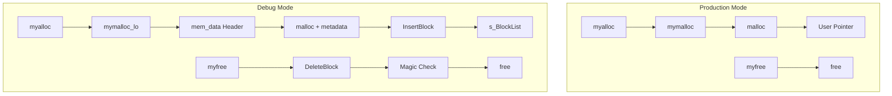
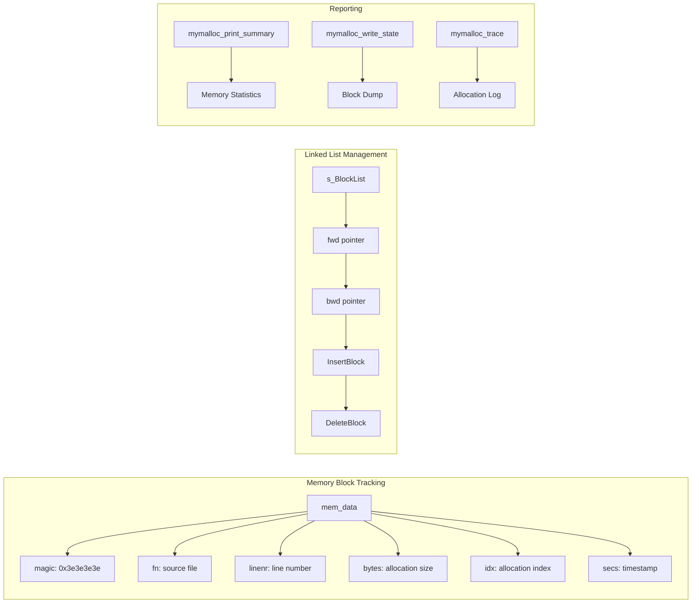
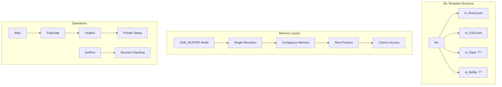
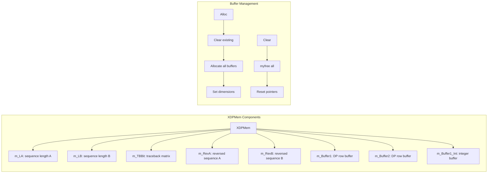
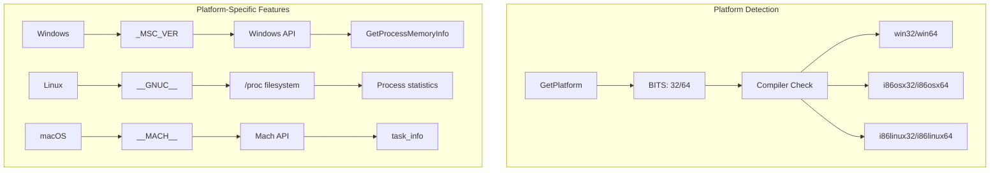

# Core Utilities and Memory Management

Relevant source files

The following files were used as context for generating this wiki page:

- [src/mx.cpp](src/mx.cpp)
- [src/mx.h](src/mx.h)
- [src/mymalloc.h](src/mymalloc.h)
- [src/mymalloc_dbg.cpp](src/mymalloc_dbg.cpp)
- [src/myutils.cpp](src/myutils.cpp)
- [src/myutils.h](src/myutils.h)
- [src/reseek_main.cpp](src/reseek_main.cpp)
- [src/xdpmem.h](src/xdpmem.h)

## Purpose and Scope

This document covers the fundamental infrastructure components of the reseek codebase, including the application entry point, core utility functions, custom memory management system, and specialized memory classes. These components provide the foundation for all other systems in the codebase.

For information about command-line interface and option parsing, see [Commands and Options](#6.1). For build system configuration, see [Build System and CI/CD](#8.1).

## Application Entry Point

The application entry point is implemented in `reseek_main.cpp` and provides the central dispatcher for all reseek commands.

The main function coordinates initialization, command execution, and cleanup through these key phases:

| Phase | Function | Purpose |
|-------|----------|---------|
| Initialization | `MyCmdLine()` | Parse command line arguments |
| Logging Setup | `LogProgramInfoAndCmdLine()` | Initialize logging system |
| Timing | `InitTiming()` | Setup performance monitoring |
| Command Dispatch | Dynamic `cmd_*()` calls | Execute user-specified command |
| Cleanup | `LogElapsedTimeAndRAM()` | Report resource usage |

Sources: [src/reseek_main.cpp:10-65]()

## Core Utility Functions

The `myutils` module provides essential utility functions organized into several categories:

### File I/O Operations

Key file I/O functions include:

- `OpenStdioFile()` - Opens files with custom buffering
- `ReadAllStdioFile64()` - Reads entire files into memory with chunked reading for large files
- `WriteStdioFile()` - Writes data with error checking
- Custom buffering system using `MY_IO_BUFSIZ` (32,000 bytes)

Sources: [src/myutils.cpp:146-636](), [src/myutils.h:145-205]()

### Memory and Resource Tracking

Platform-specific memory tracking implementations:

| Platform | Method | Implementation |
|----------|---------|----------------|
| Windows | `GetProcessMemoryInfo()` | Uses Windows API |
| Linux | `/proc/PID/statm` | Reads process memory statistics |
| macOS | `task_info()` | Uses Mach API |

Sources: [src/myutils.cpp:704-960](), [src/myutils.h:271-274]()

### Progress Tracking and Logging

The progress system provides real-time feedback with memory usage and timing information:

Sources: [src/myutils.cpp:1265-1556](), [src/myutils.h:246-259]()

## Memory Management System

The reseek codebase implements a custom memory management system with optional debug tracking:

### Production Memory Management

The system supports two compilation modes:

| Mode | Features | Performance |
|------|----------|-------------|
| Production | Direct malloc/free | High performance |
| Debug | Leak tracking, magic numbers | Development debugging |

Sources: [src/mymalloc.h:1-36](), [src/mymalloc_dbg.cpp:1-377]()

### Debug Memory Tracking

When `MYMALLOC_DBG` is enabled, the system provides comprehensive memory tracking:

Debug features include:

- **Magic Number Validation**: Detects memory corruption
- **Source Location Tracking**: Records file and line of allocation
- **Leak Detection**: Maintains active allocation list
- **Memory Maps**: Dumps process memory layout (Linux)
- **Periodic Reporting**: Automatic memory usage summaries

Sources: [src/mymalloc_dbg.cpp:12-377]()

## Specialized Memory Classes

### Matrix Template Class

The `Mx<T>` template provides efficient 2D array management:

Key design features:

- **Single Buffer Mode**: Allocates contiguous memory for better cache performance
- **Type Safety**: Template-based with compile-time type checking
- **Automatic Cleanup**: RAII-style memory management
- **Bounds Checking**: Debug-mode range validation

Sources: [src/mx.h:8-138](), [src/mx.cpp:1-16]()

### XDPMem Class

The `XDPMem` class provides specialized memory management for dynamic programming algorithms:

The XDPMem class supports:

- **Sequence Alignment**: Buffers for forward and reverse sequences
- **Traceback Matrix**: 2D array for alignment path reconstruction
- **Double Buffering**: Alternating row buffers for space efficiency
- **Mixed Types**: Both float and integer buffers for different algorithms

Sources: [src/xdpmem.h:15-132]()

## Platform Support

The utilities module provides comprehensive cross-platform support:

Platform-specific implementations:

| Feature | Windows | Linux | macOS |
|---------|---------|--------|-------|
| Memory Usage | `GetProcessMemoryInfo()` | `/proc/PID/statm` | `task_info()` |
| Physical Memory | `GlobalMemoryStatusEx()` | `/proc/meminfo` | `sysctlbyname()` |
| File Operations | Win32 API | POSIX | POSIX |
| Sleep Function | `Sleep()` | `usleep()` | `usleep()` |

Sources: [src/myutils.cpp:77-104](), [src/myutils.cpp:831-960]()

---