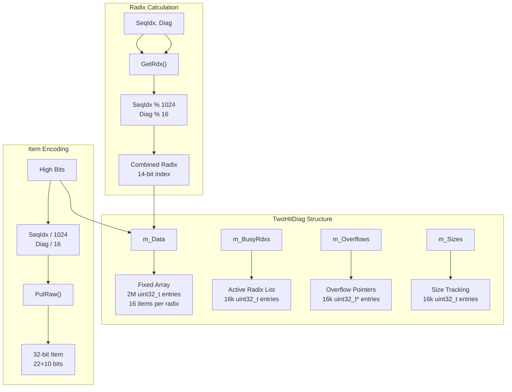
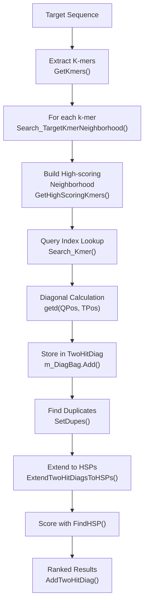
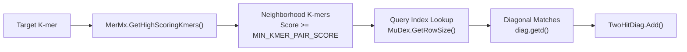
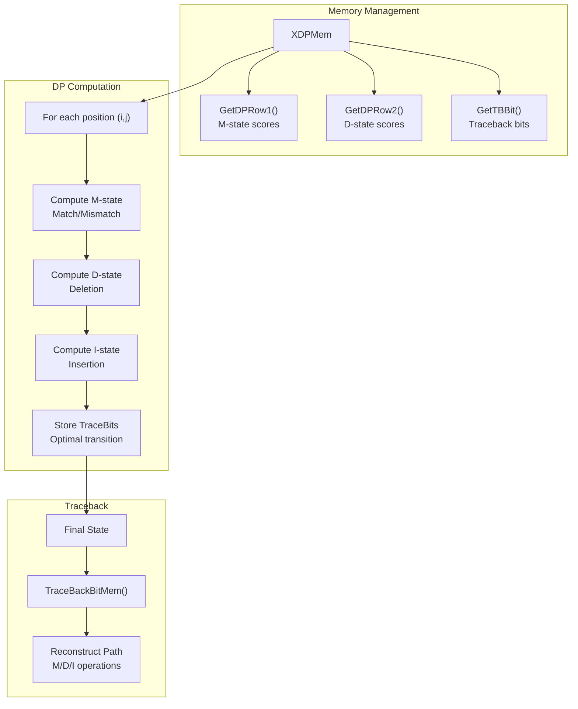
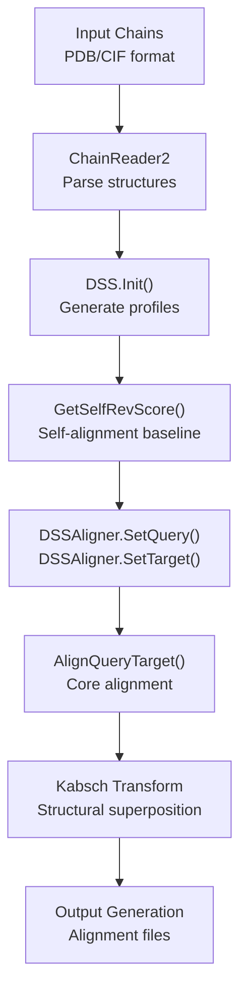
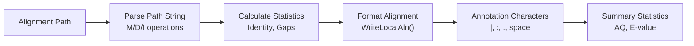
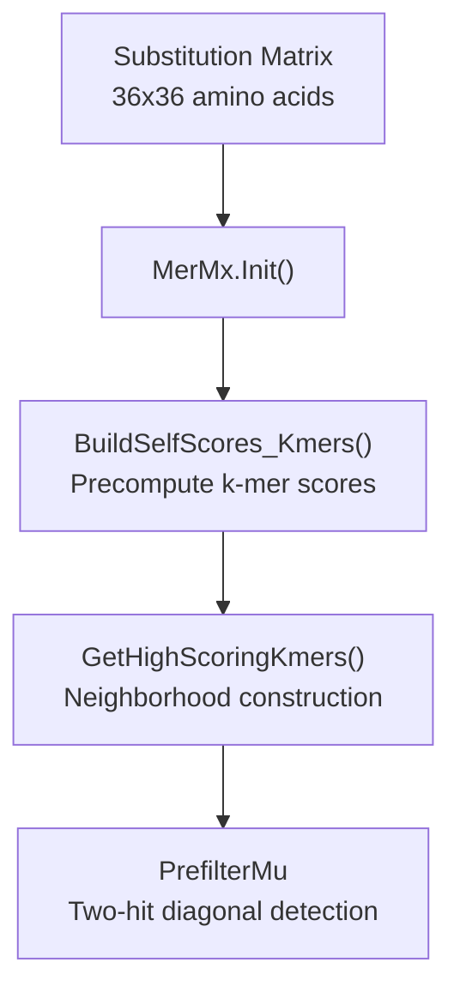
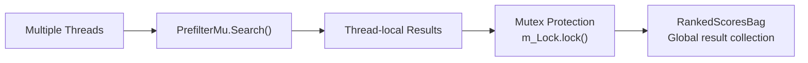

# Advanced Algorithms and Data Structures

<details>
<summary>Relevant source files</summary>

The following files were used as context for generating this wiki page:

- [src/alignpair.cpp](src/alignpair.cpp)
- [src/build_linux_x86d.bash](src/build_linux_x86d.bash)
- [src/cmd_prefiltermu.cpp](src/cmd_prefiltermu.cpp)
- [src/global.cpp](src/global.cpp)
- [src/mumx.cpp](src/mumx.cpp)
- [src/prefiltermu.cpp](src/prefiltermu.cpp)
- [src/prefiltermu.h](src/prefiltermu.h)
- [src/prefiltermuparams.h](src/prefiltermuparams.h)
- [src/prettyaln.cpp](src/prettyaln.cpp)
- [src/twohitdiag.cpp](src/twohitdiag.cpp)
- [src/twohitdiag.h](src/twohitdiag.h)
- [src/viterbifastmem.cpp](src/viterbifastmem.cpp)

</details>


This document covers the sophisticated algorithms and data structures that form the computational core of reseek's protein structure search capabilities. These include memory-efficient hash tables, k-mer based pre-filtering systems, and optimized dynamic programming implementations.

For information about the higher-level alignment engine that uses these algorithms, see [Core Alignment Engine](#3). For database search orchestration, see [Database Search System](#4).

## TwoHitDiag: Memory-Efficient Radix Hash Table

The `TwoHitDiag` class implements a specialized hash table optimized for storing sequence index and diagonal coordinate pairs during k-mer matching. This data structure is critical for the two-hit diagonal detection algorithm used in pre-filtering.

### Architecture and Memory Layout



The `TwoHitDiag` uses a radix-based approach where each radix can store up to 16 items in fixed memory, with overflow handling for busy radixes. The radix is calculated using the low 10 bits of the sequence index and low 4 bits of the diagonal index.

**Sources:** [src/twohitdiag.h:1-161](), [src/twohitdiag.cpp:1-661]()

### Memory Management Strategy

The data structure uses a three-tier memory management approach:

| Component | Size | Purpose |
|-----------|------|---------|
| Fixed Storage | 2M uint32_t | Primary storage for 16 items per radix |
| Busy Tracking | 64KB | Tracks which radixes contain data |
| Overflow Buffers | Variable | Dynamic allocation for busy radixes |

The `Add()` method [src/twohitdiag.cpp:47-99]() handles the complex logic of item placement, overflow detection, and memory expansion.

**Sources:** [src/twohitdiag.h:38-54](), [src/twohitdiag.cpp:29-46]()

## PrefilterMu: K-mer Based Pre-filtering Algorithm

The `PrefilterMu` class implements a sophisticated two-stage pre-filtering system using k-mer neighborhoods and two-hit diagonal detection. This algorithm significantly reduces the search space before expensive alignment computations.

### Algorithm Workflow



The algorithm uses a 5-mer with pattern "1110011" (7 positions, 5 used) and builds neighborhoods of high-scoring k-mers around each target k-mer.

**Sources:** [src/prefiltermu.cpp:145-151](), [src/prefiltermu.cpp:153-178]()

### K-mer Neighborhood Construction

The pre-filtering system builds high-scoring k-mer neighborhoods using the `MerMx` scoring matrix. For each target k-mer, it identifies query k-mers that score above a threshold:



The neighborhood construction uses a minimum k-mer pair score of 36 [src/prefiltermuparams.h:22]() to balance sensitivity and specificity.

**Sources:** [src/prefiltermu.cpp:153-178](), [src/prefiltermuparams.h:1-24]()

## Memory-Efficient Alignment Algorithms

### ViterbiFastMem: Optimized Viterbi Algorithm

The `ViterbiFastMem` function implements a memory-efficient version of the Viterbi algorithm for sequence alignment using banded dynamic programming.



The algorithm uses rolling arrays to minimize memory usage while maintaining O(LA × LB) time complexity for sequences of length LA and LB.

**Sources:** [src/viterbifastmem.cpp:32-192]()

### Gap Penalty Handling

The Viterbi implementation supports sophisticated gap penalty schemes:

```cpp
// Terminal gap penalties (different from internal)
float s_TermOpen = 0;
float s_TermExt = 0;

// Internal gap penalties
float s_Open = -1;
float s_Ext = -0.05f;
```

Gap penalties are configurable through the `gapstr` parameter format: `open_ext_termopen_termext`.

**Sources:** [src/viterbifastmem.cpp:6-30]()

## Alignment Pair Processing

### PairAligner: Comprehensive Alignment Workflow

The `alignpair.cpp` module provides end-to-end alignment processing for protein structure pairs:



The alignment process includes self-reverse scoring to establish baselines and Kabsch transformation for structural superposition.

**Sources:** [src/alignpair.cpp:77-145](), [src/alignpair.cpp:147-209]()

### Pretty Alignment Formatting

The `prettyaln.cpp` module formats alignment results for human readability:



The formatting includes BLOSUM62-based annotation characters and comprehensive alignment statistics.

**Sources:** [src/prettyaln.cpp:26-99]()

## Supporting Data Structures

### MerMx: K-mer Scoring Matrix

The `MerMx` class provides k-mer neighborhood scoring capabilities used by the pre-filtering system:



The matrix supports a 36-letter alphabet for reduced amino acid representation used in 3Di structural alphabets.

**Sources:** [src/mumx.cpp:15-31](), [src/mumx.cpp:33-172]()

### Thread-Safe Result Collection

The pre-filtering system uses thread-safe result collection through the `RankedScoresBag` class:



This design enables parallel processing of target sequences while maintaining result integrity.

**Sources:** [src/cmd_prefiltermu.cpp:16-49](), [src/prefiltermu.cpp:344-373]()

---