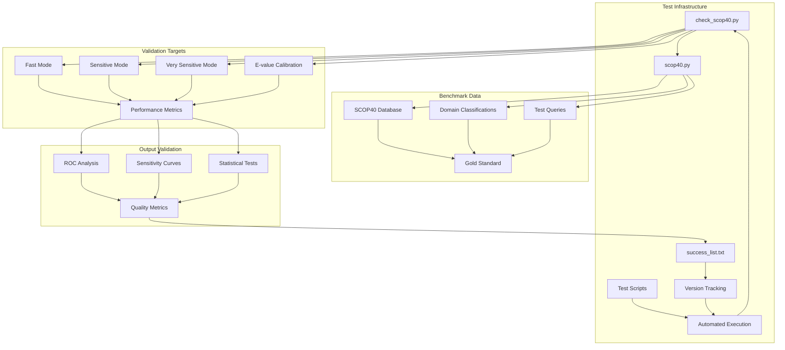
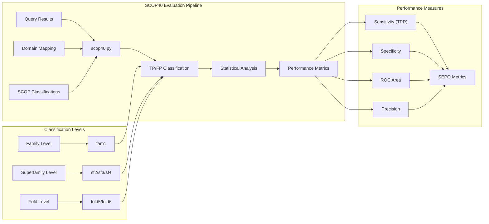
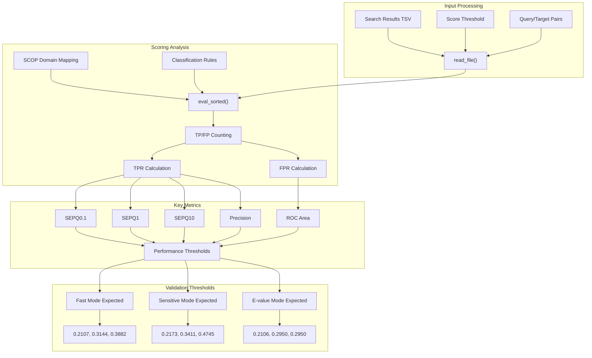
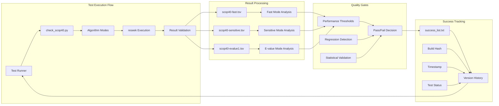
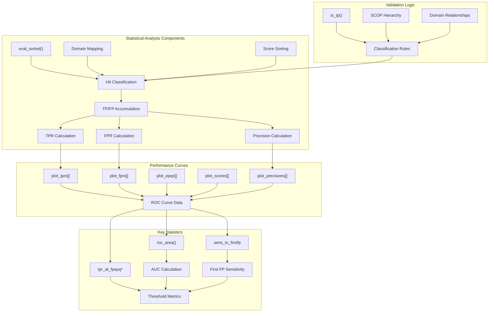

# Testing and Validation

<details>
<summary>Relevant source files</summary>

The following files were used as context for generating this wiki page:

- [test_data/dom_scopid.tsv](test_data/dom_scopid.tsv)
- [test_results/success_list.txt](test_results/success_list.txt)
- [test_scripts/check_scop40.py](test_scripts/check_scop40.py)
- [test_scripts/scop40.py](test_scripts/scop40.py)

</details>


This document covers the comprehensive testing and validation framework for the reseek protein structure search system. The testing infrastructure focuses on performance benchmarking, statistical validation, and quality assurance procedures to ensure search accuracy and reliability.

For information about the benchmarking analysis tools, see [Analysis and Benchmarking](#7). For details about the core alignment algorithms being tested, see [Core Alignment Engine](#3).

## Testing Framework Overview

The reseek testing system implements a multi-layered validation approach combining automated performance benchmarking, statistical analysis, and continuous integration testing. The framework validates search sensitivity, specificity, and computational performance across different algorithm configurations.



**Test Architecture Overview**

The testing framework operates through coordinated Python scripts that execute reseek with different parameter configurations and validate results against known benchmarks.

Sources: [test_scripts/check_scop40.py:1-55](), [test_scripts/scop40.py:1-571](), [test_results/success_list.txt:1-25]()

## SCOP40 Benchmarking System

The primary validation system uses the SCOP40 benchmark, a gold standard dataset for protein structure classification. The `Scop40` class provides comprehensive evaluation capabilities for measuring search performance across different classification levels.



**SCOP40 Benchmark Architecture**

The benchmark system evaluates protein structure search results against hierarchical SCOP classifications to measure true positive and false positive rates at different stringency levels.

### Key Validation Components

| Component | Class/Function | Purpose |
|-----------|----------------|---------|
| Benchmark Controller | `Scop40` | Main evaluation class for SCOP40 analysis |
| Classification Logic | `is_tp()` | Determines true/false positives by SCOP level |
| Performance Metrics | `eval_sorted()` | Calculates sensitivity and specificity |
| Statistical Analysis | `get_summary()` | Generates performance summary statistics |

The `Scop40` class supports multiple evaluation levels:
- **fam1**: Family-level classification (most stringent)
- **sf2/sf3/sf4**: Superfamily-level variants
- **fold5/fold6**: Fold-level classification (most permissive)

Sources: [test_scripts/scop40.py:26-427](), [test_scripts/scop40.py:176-247]()

## Performance Validation Metrics

The validation system calculates comprehensive performance metrics to assess search quality across different algorithm configurations.



**Performance Metrics Calculation Pipeline**

The system processes search results through statistical analysis to generate standardized performance measures for algorithm validation.

### Critical Performance Thresholds

The validation system enforces minimum performance requirements:

```python
# Expected performance thresholds from check_scop40.py
FAST_MODE_THRESHOLDS = {
    'SEPQ0.1': 0.2107,  # Sensitivity at 0.1 false positives per query
    'SEPQ1': 0.3144,    # Sensitivity at 1 false positive per query  
    'SEPQ10': 0.3882    # Sensitivity at 10 false positives per query
}
```

The test framework validates that each algorithm mode meets or exceeds these performance benchmarks, with a tolerance of -0.01 for regression detection.

Sources: [test_scripts/check_scop40.py:44-50](), [test_scripts/scop40.py:249-427]()

## Automated Testing Infrastructure

The testing system maintains automated validation through structured test execution and result tracking.



**Automated Test Execution and Tracking**

The testing infrastructure automatically executes benchmark tests and tracks results over time to detect performance regressions.

### Test Results Format

The `success_list.txt` file maintains a chronological record of successful test runs:

| Field | Description | Example |
|-------|-------------|---------|
| Version | Software version with build hash | `reseekv2.6.i86linux64[a4334f7]` |
| Timestamp | Test execution time | `2025-07-09/08:28:10` |
| Status | Test outcome tracking | Implicit success if listed |

The system tracks 25 successful test runs spanning from version 1.0 to 2.6, demonstrating continuous validation across major releases.

Sources: [test_results/success_list.txt:1-25](), [test_scripts/check_scop40.py:10-54]()

## Statistical Validation Framework

The testing system implements comprehensive statistical analysis to ensure robust performance evaluation.



**Statistical Validation Architecture**

The framework provides detailed statistical analysis including ROC curves, precision-recall metrics, and threshold-based performance measures.

### Classification Logic

The `is_tp()` method implements hierarchical classification rules:

- **Family Level (fam1)**: Same family = TP, different fold = FP, same fold = ignore
- **Superfamily Level (sf2)**: Same superfamily = TP, different = FP
- **Fold Level (fold5/fold6)**: Same fold = TP, different = FP

This hierarchical approach enables evaluation at multiple stringency levels, from strict family-based classification to permissive fold-based matching.

Sources: [test_scripts/scop40.py:176-247](), [test_scripts/scop40.py:249-427](), [test_scripts/scop40.py:460-468]()

## Quality Assurance Procedures

The testing framework enforces quality standards through automated validation and regression detection.

| Quality Check | Implementation | Threshold |
|---------------|---------------|-----------|
| Performance Regression | `check_scop40.py` error detection | -0.01 tolerance |
| Statistical Validation | ROC analysis and AUC calculation | Mode-specific targets |
| Data Integrity | Sort order validation | Score monotonicity |
| Version Tracking | Build hash and timestamp logging | Continuous integration |

The system automatically fails tests that fall below performance thresholds, providing immediate feedback on algorithm changes that may degrade search quality.

Sources: [test_scripts/check_scop40.py:28-54](), [test_scripts/scop40.py:301-305]()