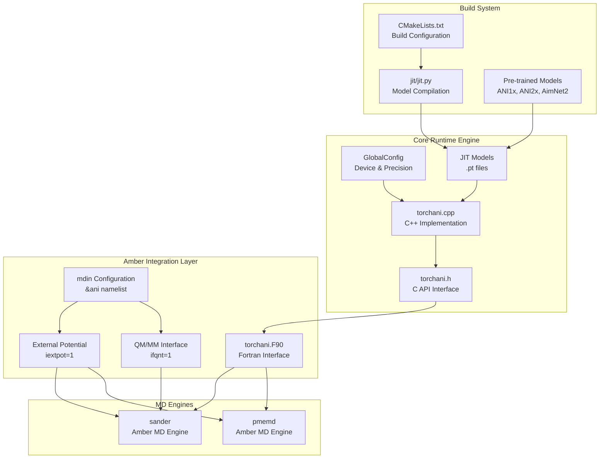
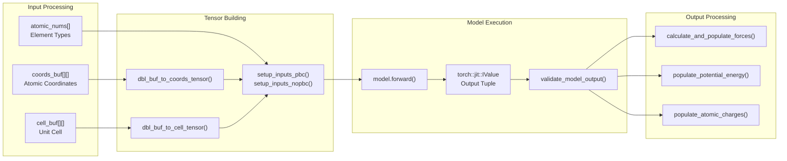
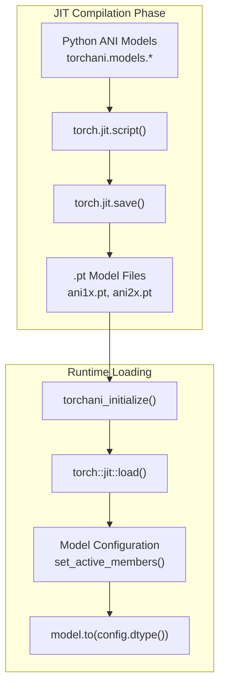
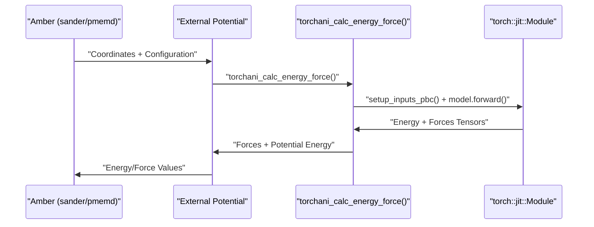
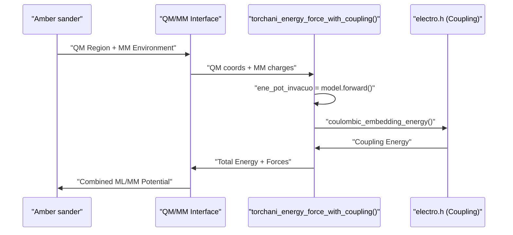

# Overview

Relevant source files

The following files were used as context for generating this wiki page:

- [README.md](README.md)
- [ani-amber-logo-dark.png](ani-amber-logo-dark.png)
- [ani-amber-logo-light.png](ani-amber-logo-light.png)
- [jit/jit.py](jit/jit.py)
- [jit/make_bulk.py](jit/make_bulk.py)
- [src/torchani.cpp](src/torchani.cpp)

## Purpose and Scope

TorchANI-Amber is a high-performance interface that integrates neural network potentials from the ANI family with the Amber molecular dynamics simulation suite. This system enables both full machine learning (ML) simulations where the entire potential energy surface is computed by neural networks, and hybrid ML/MM simulations where quantum mechanical regions are handled by neural networks while molecular mechanical regions use classical force fields.

This document provides a technical overview of the system architecture, core components, and integration mechanisms. For detailed installation instructions, see [Installation and Build](#2.1). For simulation configuration details, see [Simulation Configuration](#4.1). For performance testing information, see [Benchmarking System](#5).

## System Architecture

The following diagram illustrates the overall system architecture, showing how the various components interact during runtime:

**Sources:** [src/torchani.cpp:1-918](), [include/torchani.h](), [jit/jit.py:1-180](), [README.md:9-18]()

## Core Runtime Components

### C++ Computational Engine

The core computational engine is implemented in `torchani.cpp` and provides the primary interface between Amber and PyTorch. Key global components include:

| Component | Type | Purpose |
|-----------|------|---------|
| `model` | `torch::jit::Module` | Loaded JIT-compiled neural network model |
| `torchani_atomic_numbers` | `torch::Tensor` | Atomic numbers tensor for the system |
| `config` | `GlobalConfig` | Device, precision, and runtime configuration |
| `torchani_builtin_models` | `std::vector<std::string>` | List of supported model names |

The following diagram shows the data flow through the C++ engine:

**Sources:** [src/torchani.cpp:22-70](), [src/torchani.cpp:372-563](), [include/build_tensors.h]()

### Model Loading and JIT Compilation

The system uses PyTorch's JIT compilation to convert Python models into optimized `.pt` files that can be loaded by the C++ runtime:

**Sources:** [jit/jit.py:76-93](), [src/torchani.cpp:485-558]()

## Integration Workflows

### Full-ML Simulation Workflow

For simulations where the entire system potential is computed by neural networks:

**Sources:** [src/torchani.cpp:645-702](), [README.md:116-169]()

### ML/MM Simulation Workflow

For hybrid simulations with quantum and classical regions:

**Sources:** [src/torchani.cpp:730-833](), [include/electro.h](), [README.md:172-257]()

## Key Capabilities

### Supported Neural Network Models

The system supports multiple neural network potentials through the `torchani_builtin_models` vector:

| Model Family | Variants | Elements Supported |
|--------------|----------|--------------------|
| ANI-1x | `ani1x`, `ani1x-infer` | H, C, N, O |
| ANI-2x | `ani2x`, `ani2x-infer` | H, C, N, O, F, Cl, S |
| ANI-1ccx | `ani1ccx`, `ani1ccx-infer` | H, C, N, O |
| AimNet2 | `aimnet2-*-dsf/ewald/nocut` | Multiple variants |
| NutMeg | `nutmeg-small/medium/large` | Condensed phase systems |

### Runtime Configuration

The `GlobalConfig` class manages critical runtime parameters:

- **Device Selection**: CPU vs CUDA device configuration
- **Precision Control**: Float32 vs Float64 tensor operations  
- **PBC Support**: Periodic boundary condition handling
- **Atom Masking**: Selective evaluation for efficiency

### Performance Features

- **cuAEV Extension**: CUDA-accelerated atomic environment vectors via `use_cuaev`
- **External Neighborlists**: Amber-managed neighbor lists through `use_amber_neighborlist`
- **JIT Optimizations**: Disabled for accuracy via `torch::jit::setGraphExecutorOptimize(false)`
- **Ensemble Support**: Multiple network evaluation for uncertainty quantification

**Sources:** [src/torchani.cpp:34-69](), [src/torchani.cpp:474-539](), [include/config.h]()

---