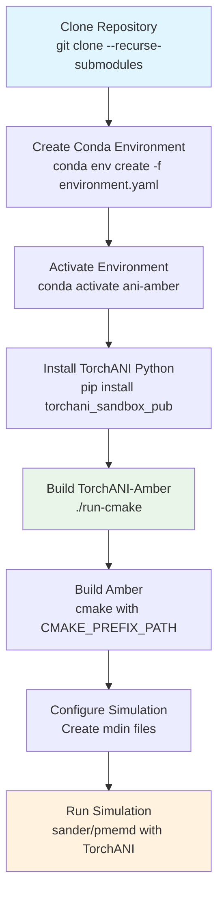
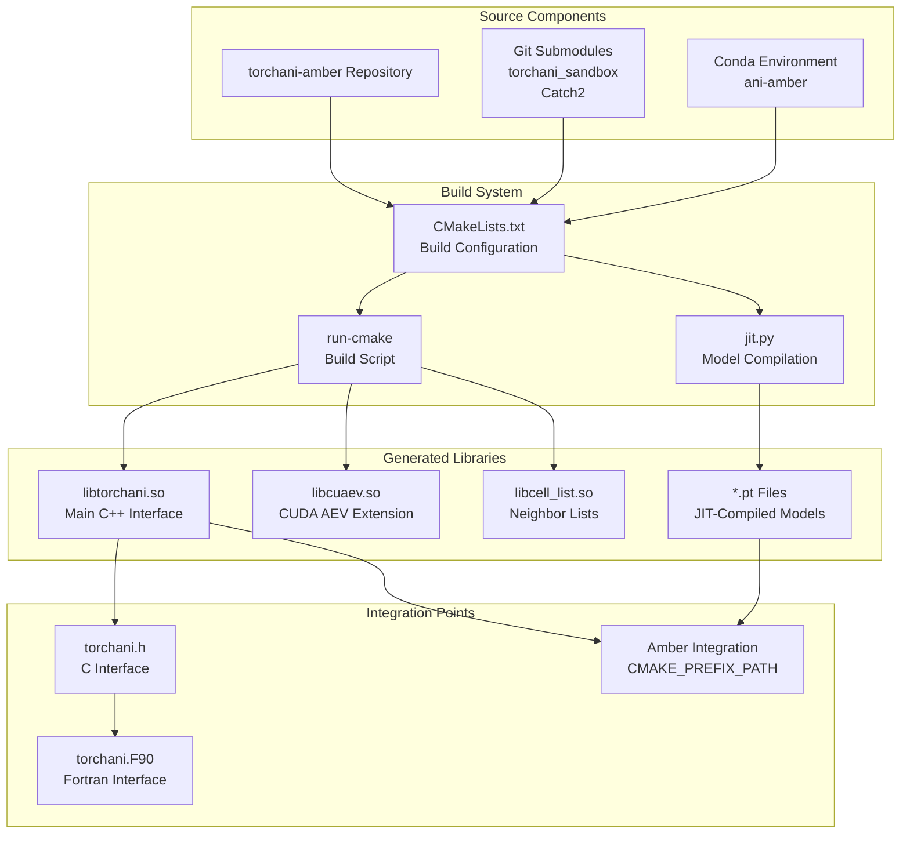
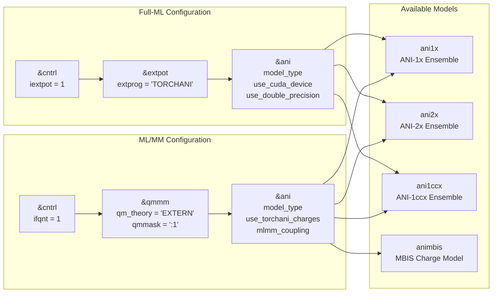

# Getting Started

Relevant source files

The following files were used as context for generating this wiki page:

- [CMakeLists.txt](CMakeLists.txt)
- [README.md](README.md)
- [ani-amber-logo-dark.png](ani-amber-logo-dark.png)
- [ani-amber-logo-light.png](ani-amber-logo-light.png)
- [environment.yaml](environment.yaml)

This page provides an overview of the steps required to install, build, and configure TorchANI-Amber for your first molecular dynamics simulations. TorchANI-Amber integrates neural network potentials with the Amber molecular dynamics suite, enabling both full-ML simulations and ML/MM hybrid approaches.

For detailed installation and build instructions, see [Installation and Build](#2.1). For a complete step-by-step tutorial to run your first simulation, see [Quick Start Tutorial](#2.2). For information about the underlying architecture and API details, see [Core Architecture](#3).

## Prerequisites Overview

Before beginning the installation process, ensure you have access to the following system requirements:

| Component | Requirement | Purpose |
|-----------|-------------|---------|
| **Operating System** | Linux | Required by build system validation |
| **Compiler** | GNU GCC 11.0-13.2 | C++17 support for core libraries |
| **Python Environment** | Conda/Mamba | Dependency management |
| **CUDA Toolkit** | 12.4 | GPU acceleration (optional but recommended) |
| **Memory** | 8GB+ RAM | Model loading and tensor operations |
| **Storage** | 10GB+ free space | Dependencies and compiled libraries |

The system enforces these requirements through validation checks in the build configuration, as seen in [CMakeLists.txt:75-88]().

**Sources:** [CMakeLists.txt:75-88](), [README.md:35-37](), [environment.yaml:34-46]()

## Getting Started Workflow

The TorchANI-Amber setup process follows a structured workflow that ensures all dependencies are properly configured:

#### High-Level Installation Flow

**Sources:** [README.md:39-83](), [CMakeLists.txt:1-12]()

## System Components and Build Targets

TorchANI-Amber consists of several interconnected components that work together to provide neural network potential calculations within Amber:

#### Core Build Architecture

**Sources:** [CMakeLists.txt:234-323](), [CMakeLists.txt:439-461](), [README.md:58-64]()

## Configuration Overview

TorchANI-Amber simulations are configured through Amber's `mdin` input files using specific namelists. The configuration approach differs depending on the simulation type:

#### Simulation Configuration Patterns

**Sources:** [README.md:116-169](), [README.md:172-257]()

## Environment and Dependencies

The build process relies on a carefully configured conda environment that provides all necessary dependencies:

| Dependency Category | Key Components | Purpose |
|-------------------|----------------|---------|
| **Python Runtime** | `python=3.11`, `pip>=24.0` | Core interpreter and package management |
| **PyTorch Stack** | `pytorch=2.5`, `pytorch-cuda=12.4` | Neural network backend and GPU support |
| **CUDA Toolkit** | `cuda-libraries-dev=12.4`, `cuda-nvcc=12.4` | GPU compilation and runtime |
| **Build Tools** | `cmake=3.31.1`, `gxx_linux-64=12.2` | Build system and compilers |
| **Amber Dependencies** | `fftw=3.3.10`, `netcdf-fortran=4.6.1` | MD simulation support |

The environment configuration is defined in [environment.yaml:1-68]() and automatically validated during the build process through [CMakeLists.txt:95-113]().

**Sources:** [environment.yaml:8-46](), [CMakeLists.txt:95-113]()

## Next Steps

To proceed with your TorchANI-Amber installation and setup:

1. **Installation**: Follow the detailed build instructions in [Installation and Build](#2.1), which covers environment setup, dependency resolution, and compilation of all required libraries.

2. **First Simulation**: Complete the hands-on tutorial in [Quick Start Tutorial](#2.2) to configure and run your first simulation with step-by-step guidance.

3. **Advanced Configuration**: For detailed information about simulation parameters, model options, and ML/MM setup, see [Simulation Configuration](#4.1).

4. **Performance Optimization**: To benchmark your installation and optimize performance, consult the [Benchmarking System](#5) documentation.

The build process typically takes 15-30 minutes depending on your system specifications and whether you're using GPU acceleration. Ensure you have a stable internet connection for downloading dependencies during the conda environment creation phase.

**Sources:** [README.md:29-95](), [CMakeLists.txt:214-224]()

---