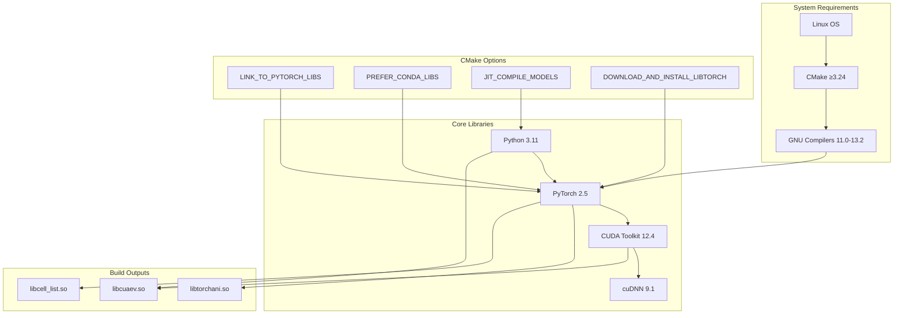
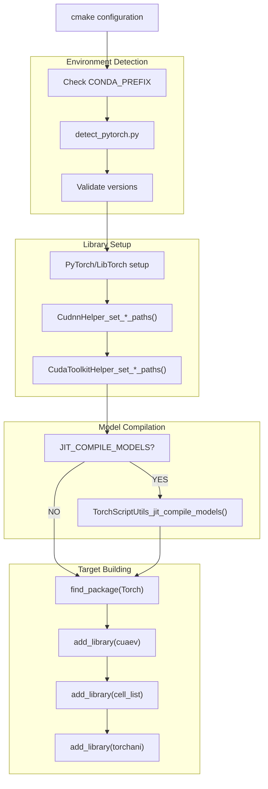
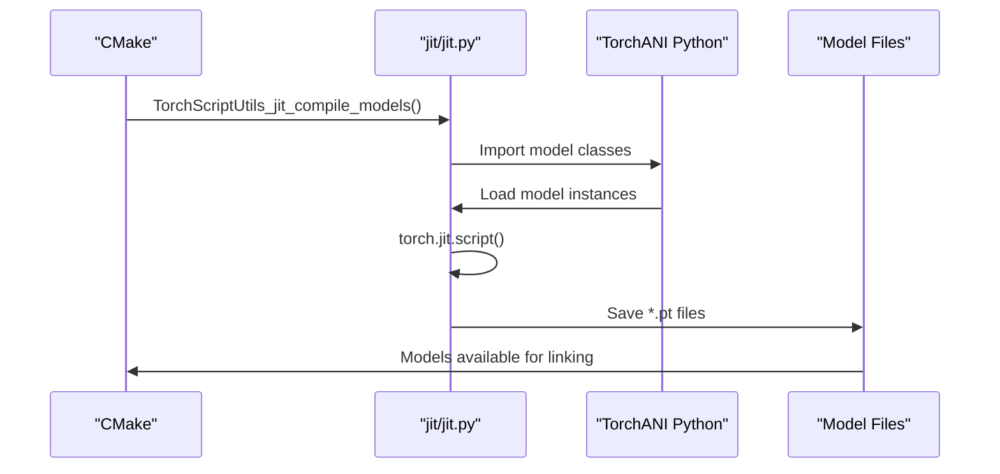

# Installation and Build

<details>
<summary>Relevant source files</summary>

The following files were used as context for generating this wiki page:

- [CMakeLists.txt](CMakeLists.txt)
- [benchmark/templates/mlmm.mdin.jinja](benchmark/templates/mlmm.mdin.jinja)
- [cmake/CudaToolkitHelper.cmake](cmake/CudaToolkitHelper.cmake)
- [cmake/CudnnHelper.cmake](cmake/CudnnHelper.cmake)
- [cmake/LibtorchHelper.cmake](cmake/LibtorchHelper.cmake)
- [cmake/LinuxBuild.cmake](cmake/LinuxBuild.cmake)
- [cmake/OutOfSourceBuild.cmake](cmake/OutOfSourceBuild.cmake)
- [cmake/PytorchHelper.cmake](cmake/PytorchHelper.cmake)
- [cmake/TorchScriptUtils.cmake](cmake/TorchScriptUtils.cmake)
- [environment.yaml](environment.yaml)
- [run-cmake](run-cmake)

</details>


This document provides comprehensive instructions for building TorchANI-Amber from source, including dependency management, environment setup, and build configuration. It covers the CMake-based build system that handles complex dependency resolution for PyTorch, CUDA, and cuDNN libraries, and produces the core shared libraries required for Amber integration.

For information about configuring and running simulations with the built libraries, see [Quick Start Tutorial](#2.2). For details about the underlying build system architecture, see [Build System Deep Dive](#6.1).

## Prerequisites and System Requirements

TorchANI-Amber requires a Linux system with specific compiler and library versions. The build system enforces strict version compatibility to ensure proper integration with PyTorch and CUDA libraries.

### System Requirements

| Component | Requirement | Notes |
|-----------|-------------|-------|
| Operating System | Linux only | Enforced by `LinuxBuild_ensure()` |
| CMake | ≥ 3.24 | Specified in `CMakeLists.txt:2` |
| Compilers | GNU 11.0-13.2 | g++, gcc, gfortran required |
| Python | 3.11 | For PyTorch integration and JIT compilation |

### Core Dependencies

| Library | Version | Purpose |
|---------|---------|---------|
| PyTorch/LibTorch | 2.5.x | Neural network backend |
| CUDA Toolkit | 12.4 | GPU acceleration |
| cuDNN | 9.1 | Deep learning primitives |

**Build Dependencies Diagram**



Sources: [CMakeLists.txt:47-51](), [CMakeLists.txt:74-88](), [environment.yaml:8-47]()

## Environment Setup

The recommended approach is to use the provided conda environment, which automatically handles all dependency versions and compatibility requirements.

### Conda Environment Installation

```bash
# Clone the repository with submodules
git clone --recursive https://github.com/roitberg-group/torchani-amber.git
cd torchani-amber

# Create and activate the conda environment
conda env create -f environment.yaml
conda activate ani-amber
```

The `environment.yaml` defines the `ani-amber` environment with all required dependencies, including:

- **Core Runtime**: `pytorch=2.5`, `pytorch-cuda=12.4`
- **Build Tools**: `cmake=3.31.1`, GNU compiler suite
- **CUDA Development**: `cuda-libraries-dev=12.4`, `cuda-nvcc=12.4`
- **Additional Libraries**: OpenMPI, NetCDF-Fortran for Amber integration

### Manual Dependency Installation

For custom installations without conda, ensure these components are available:

1. **PyTorch with CUDA**: Install PyTorch 2.5 compiled with CUDA 12.4 support
2. **CUDA Toolkit Development**: Full CUDA 12.4 installation with headers and nvcc
3. **cuDNN**: Version 9.1 compatible with CUDA 12.4
4. **GNU Compilers**: g++, gcc, gfortran versions 11.0-13.2

Sources: [environment.yaml:1-68](), [CMakeLists.txt:95-112]()

## Build Configuration

The build system provides extensive configuration options through CMake variables and the `run-cmake` wrapper script. The configuration process handles dependency detection, version validation, and library path setup.

### CMake Configuration Options

| Option | Default | Description |
|--------|---------|-------------|
| `LINK_TO_PYTORCH_LIBS` | ON | Link to existing PyTorch installation |
| `DOWNLOAD_AND_INSTALL_LIBTORCH` | OFF | Download LibTorch binaries |
| `PREFER_CONDA_LIBS` | ON | Use conda environment libraries |
| `JIT_COMPILE_MODELS` | ON | Compile ANI models to TorchScript |
| `USE_CUSTOM_CUDNN` | OFF | Use custom cuDNN installation |
| `COMPILE_WITH_CXX11ABI` | OFF | Use C++11 ABI (requires LibTorch) |

### Dependency Resolution Process

**Build Configuration Flow**



Sources: [CMakeLists.txt:114-165](), [CMakeLists.txt:167-212](), [cmake/detect_pytorch.py]()

### Version Validation

The build system enforces exact version matching for critical dependencies:

```cpp
// Required versions from CMakeLists.txt:47-51
REQUIRED_TORCH_VERSION = "2.5"
REQUIRED_CUDATK_VERSION = "12.4" 
REQUIRED_CUDNN_VERSION = "9.1"
```

Version validation occurs through the `detect_pytorch.py` script, which queries the PyTorch installation and reports version mismatches as fatal errors.

Sources: [CMakeLists.txt:47-51](), [CMakeLists.txt:119-150]()

## Build Process

### Using the run-cmake Script

The `run-cmake` script provides a convenient wrapper around the CMake build process with sensible defaults:

```bash
# Standard build with conda libraries
./run-cmake

# Build without running tests
./run-cmake -T

# Build only (no install)
./run-cmake -I

# Debug build
./run-cmake -g

# Use custom libraries instead of conda
./run-cmake -C
```

### Manual CMake Build

For more control over the build process:

```bash
# Configure
cmake -S. -Bbuild \
    -DCMAKE_BUILD_TYPE=Release \
    -DCMAKE_INSTALL_PREFIX=$HOME/.local \
    -DLINK_TO_PYTORCH_LIBS=ON \
    -DPREFER_CONDA_LIBS=ON \
    -DJIT_COMPILE_MODELS=ON

# Build
cmake --build build

# Test
./build/tests

# Install
cmake --install build
```

### Build Targets

The build process creates three primary shared libraries:

| Library | Source Location | Purpose |
|---------|----------------|---------|
| `libcuaev.so` | `submodules/torchani_sandbox/torchani/csrc/` | CUDA-accelerated AEV calculations |
| `libcell_list.so` | `submodules/torchani_sandbox/torchani/csrc/` | Neighbor list generation |
| `libtorchani.so` | `src/*.cpp` | Main TorchANI interface library |

### Compilation Flags and Optimizations

The CUDA library `libcuaev.so` is built with specific optimizations:

```cpp
// From CMakeLists.txt:263-275
TORCHANI_OPT           // Enable CUDA intrinsics for math functions
-use_fast_math         // Enable fast math library
CUB_NS_QUALIFIER       // Wrapped CUB namespace for PyTorch compatibility
```

Sources: [run-cmake:1-114](), [CMakeLists.txt:234-287](), [CMakeLists.txt:289-323]()

## JIT Model Compilation

When `JIT_COMPILE_MODELS=ON` (default), the build system automatically compiles ANI neural network models to TorchScript format for optimized runtime performance.

### JIT Compilation Process



The JIT compilation is controlled by several options:

- `JIT_DISABLE_OPTIMIZATIONS`: Disable TorchScript optimizations
- `JIT_FORCE_RECOMPILATION`: Force recompilation of existing `.pt` files

Sources: [CMakeLists.txt:215-223](), [cmake/TorchScriptUtils.cmake:1-29]()

## Installation and Library Paths

### Installation Directories

The CMake install process creates the following directory structure:

```
$CMAKE_INSTALL_PREFIX/
├── lib/Torchani/
│   ├── libtorchani.so
│   ├── libcuaev.so
│   └── libcell_list.so
├── include/Torchani/
│   └── torchani.h
├── share/Torchani/
│   └── Fortran/torchani.F90
└── share/cmake/Torchani/
    ├── TorchaniConfig.cmake
    ├── TorchaniConfigVersion.cmake
    └── TorchaniTargets.cmake
```

### RPATH Configuration

The build system automatically configures RPATH settings to ensure libraries can find their dependencies at runtime:

```cpp
// From CMakeLists.txt:340-364
TORCHANI_LIBRARIES_INSTALL_RPATH = {
    LIBTORCH_LIBRARY_DIR,      // PyTorch libraries
    CUDA_TOOLKIT_ROOT_DIR,     // CUDA runtime
    CMAKE_INSTALL_FULL_LIBDIR  // TorchANI libraries
}
```

This prevents runtime linking issues when using conda environments or custom CUDA installations.

Sources: [CMakeLists.txt:404-461](), [CMakeLists.txt:340-364]()

## Build Verification

### Running Tests

The build includes a comprehensive test suite using the Catch2 framework:

```bash
# Run tests after build
./build/tests

# Or use CTest
cd build && ctest
```

### Verifying Installation

Check that all libraries are properly installed and linked:

```bash
# Verify library installation
ls $HOME/.local/lib/Torchani/

# Check library dependencies
ldd $HOME/.local/lib/Torchani/libtorchani.so

# Verify CMake package detection
cmake --find-package -DNAME=Torchani -DCOMPILER_ID=GNU -DLANGUAGE=CXX
```

### Common Build Issues

| Issue | Cause | Solution |
|-------|-------|---------|
| PyTorch version mismatch | Wrong PyTorch version | Install PyTorch 2.5 exactly |
| CUDA not found | Missing CUDA development packages | Install `cuda-libraries-dev` |
| Compiler not supported | Non-GNU compiler | Use g++/gcc/gfortran 11.0-13.2 |
| cuDNN missing | cuDNN not in expected location | Set `USE_CUSTOM_CUDNN=ON` or use conda |

Sources: [CMakeLists.txt:378-391](), [CMakeLists.txt:74-88](), [CMakeLists.txt:125-149]()

---