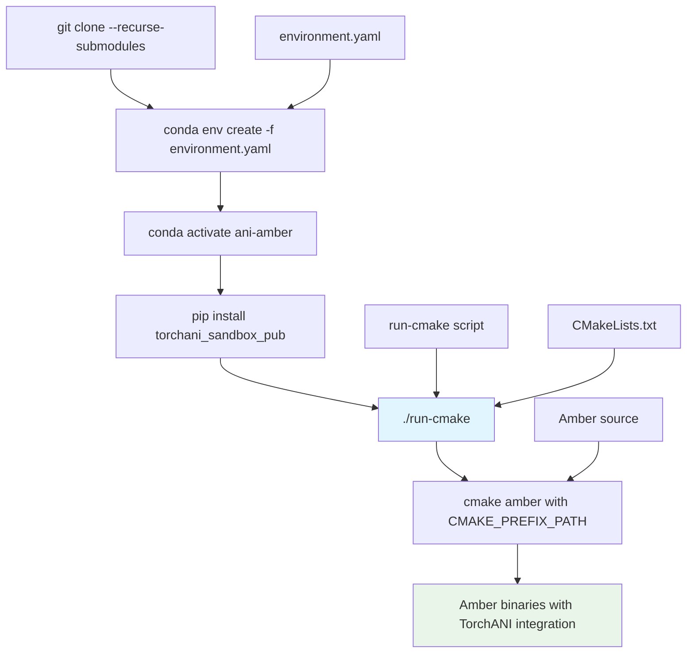
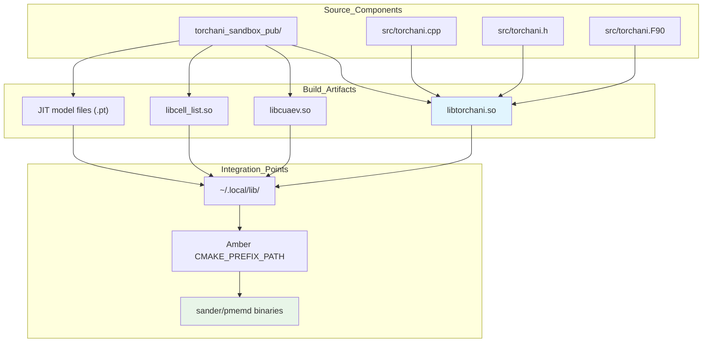
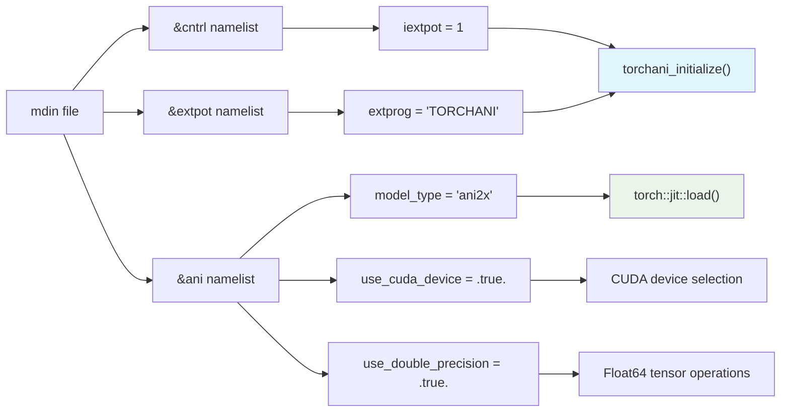
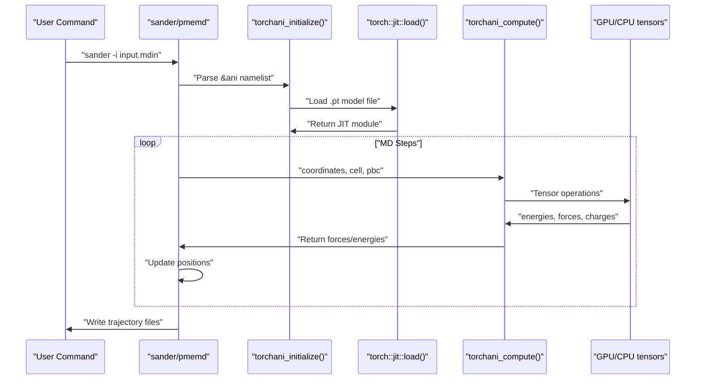

# Quick Start Tutorial

<details>
<summary>Relevant source files</summary>

The following files were used as context for generating this wiki page:

- [README.md](README.md)
- [ani-amber-logo-dark.png](ani-amber-logo-dark.png)
- [ani-amber-logo-light.png](ani-amber-logo-light.png)
- [benchmark/templates/scaling.mdin.jinja](benchmark/templates/scaling.mdin.jinja)

</details>


This tutorial guides you through running your first molecular dynamics simulation with TorchANI-Amber, from initial setup to execution. You will learn to configure both full-ML simulations (entire system uses neural networks) and ML/MM hybrid simulations (neural networks for QM region, classical force fields for MM region).

For detailed installation procedures, see [Installation and Build](#2.1). For comprehensive configuration options, see [Simulation Configuration](#4.1). For performance optimization, see [Benchmarking System](#5).

## Prerequisites and Environment Setup

TorchANI-Amber requires a conda environment with PyTorch, CUDA toolkit, and molecular dynamics dependencies. The system uses JIT-compiled neural network models that must be compatible with the LibTorch backend.

### Required Components

| Component | Purpose | Notes |
|-----------|---------|--------|
| `environment.yaml` | Conda environment specification | Includes PyTorch, CUDA, cuDNN, GFortran |
| `run-cmake` | Build automation script | Handles CMake configuration and testing |
| Amber source | MD simulation engine | Must be compiled with TorchANI integration |
| CUDA Toolkit | GPU acceleration | Required even for CPU-only runs |

**Installation Workflow**



Sources: [README.md:39-95]()

## Build Process Overview

The TorchANI-Amber build system creates shared libraries that integrate with Amber's external potential interface. The process involves compiling C++ extensions, linking PyTorch libraries, and generating JIT-compatible model files.

**Build System Components**



Sources: [README.md:54-95]()

## Configuration File Structure

TorchANI-Amber simulations require specific namelist configurations in `mdin` files. The structure differs between full-ML and ML/MM simulation types, with different required namelists and parameters.

### Full-ML Configuration

Full-ML simulations use the external potential interface with three required namelists:

| Namelist | Required Parameters | Purpose |
|----------|-------------------|---------|
| `&cntrl` | `iextpot = 1` | Enable external potential |
| `&extpot` | `extprog = 'TORCHANI'` | Specify TorchANI as external program |
| `&ani` | `model_type`, `use_cuda_device` | Configure neural network parameters |

**Namelist Configuration Flow**



Sources: [README.md:116-169](), [benchmark/templates/scaling.mdin.jinja:1-48]()

### ML/MM Configuration

ML/MM simulations use the QM/MM interface with different namelists:

| Namelist | Required Parameters | Purpose |
|----------|-------------------|---------|
| `&cntrl` | `ifqnt = 1` | Enable QM/MM calculations |
| `&qmmm` | `qm_theory = 'EXTERN'`, `qmmask` | Configure QM region and coupling |
| `&ani` | Standard parameters + ML/MM options | Configure neural network and coupling |

## Running Your First Simulation

### Step 1: Environment Activation

```bash
conda activate ani-amber
```

The `ani-amber` environment must be active during runtime because the compiled binaries depend on CUDA and PyTorch libraries within the conda environment.

### Step 2: Prepare Input Files

Create the standard Amber input files:
- `.prmtop` topology file
- `.inpcrd` or `.rst7` coordinate file  
- `mdin` configuration file with TorchANI namelists

### Step 3: Basic Full-ML Simulation

**Example mdin Configuration**

```
&cntrl
    iextpot = 1
    imin = 0
    nstlim = 1000
    dt = 0.002
    ntc = 2, ntf = 2
    temp0 = 300.0
    ntt = 3
/
&extpot
    extprog = "TORCHANI"
/
&ani
    model_type = "ani2x"
    use_double_precision = .true.
    use_cuda_device = .true.
    use_cuaev = .true.
/
```

**Execution Command**

```bash
sander -O -i input.mdin -p system.prmtop -c system.inpcrd -o output.mdout
```

### Step 4: Basic ML/MM Simulation

**Example mdin Configuration**

```
&cntrl
    ifqnt = 1
    imin = 0
    nstlim = 1000
    dt = 0.002
/
&qmmm
    qm_theory = 'EXTERN'
    qm_ewald = 0
    qmmm_int = 1
    qmmask = ':1'
    qmcut = 15.0
/
&ani
    model_type = 'ani2x'
    use_cuda_device = .true.
    use_torchani_charges = .false.
    mlmm_coupling = 0
/
```

Sources: [README.md:152-257]()

## Runtime Execution Flow

The following diagram shows how TorchANI-Amber integrates with Amber during simulation execution:

**Simulation Runtime Architecture**



Sources: [README.md:114-169]()

## Verification and Testing

### Quick Validation Test

Run a short simulation to verify the installation:

```bash
# Create minimal test case (10 steps)
sander -O -i test.mdin -p system.prmtop -c system.inpcrd -o test.out
```

Check for successful initialization messages in the output:
- `TorchANI initialization successful`
- `Model loaded: [model_type]`
- `Device: CUDA:0` or `Device: CPU`

### Common Issues and Solutions

| Issue | Symptom | Solution |
|-------|---------|----------|
| CUDA library missing | `libcudart.so not found` | Ensure conda environment is activated |
| Model load failure | `Could not load model` | Verify `model_type` parameter |
| Memory errors | `CUDA out of memory` | Reduce system size or use CPU |

Sources: [README.md:347-349]()

## Next Steps

After successfully running your first simulation:

1. **Performance Optimization**: Use the [Bench CLI Tool](#5.1) to optimize GPU settings and scaling
2. **Advanced Configuration**: Explore [ML/MM Setup and Coupling](#4.2) for hybrid simulations  
3. **Custom Models**: See [Model Wrappers](#3.3) for using custom neural network potentials
4. **Production Runs**: Review [Input Templates and Examples](#4.3) for simulation-specific configurations

The benchmark templates in [benchmark/templates/scaling.mdin.jinja:1-48]() provide examples of production-ready configurations with various performance optimizations.

Sources: [README.md:1-451](), [benchmark/templates/scaling.mdin.jinja:1-48]()

---