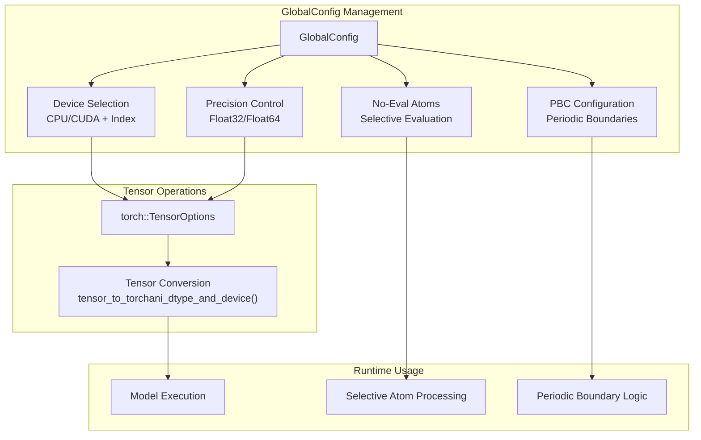
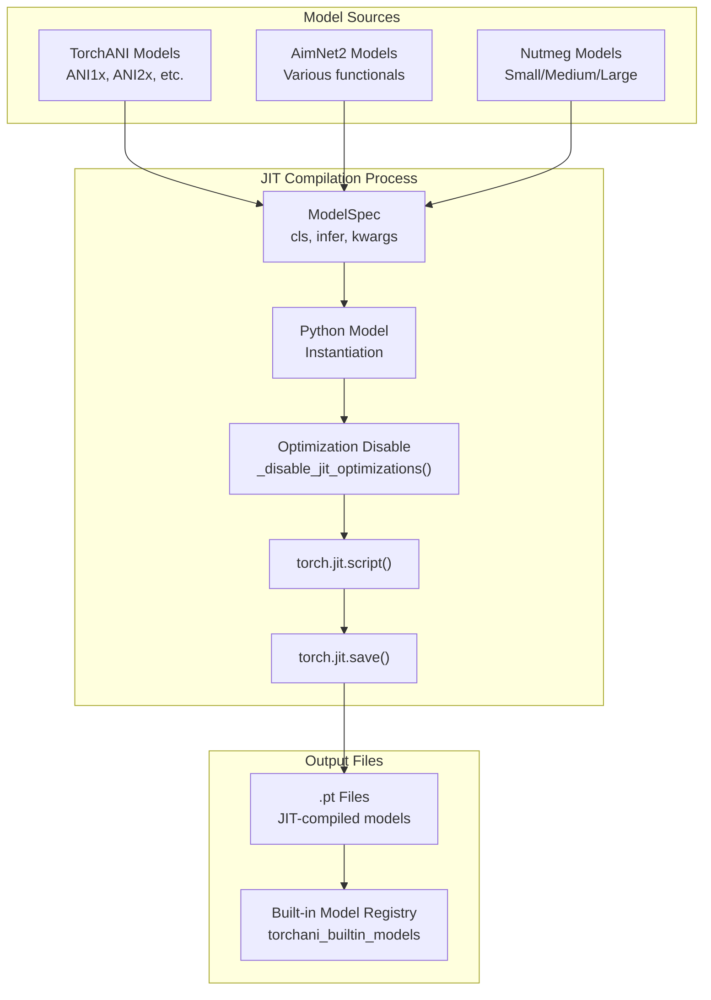
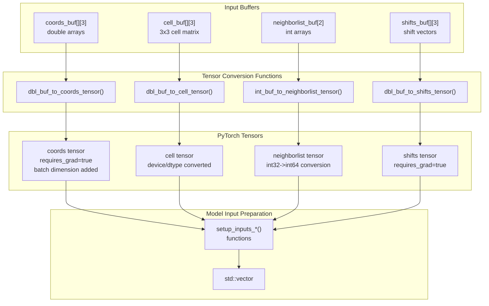
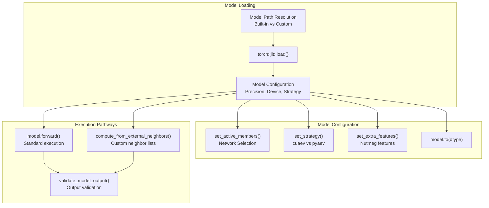
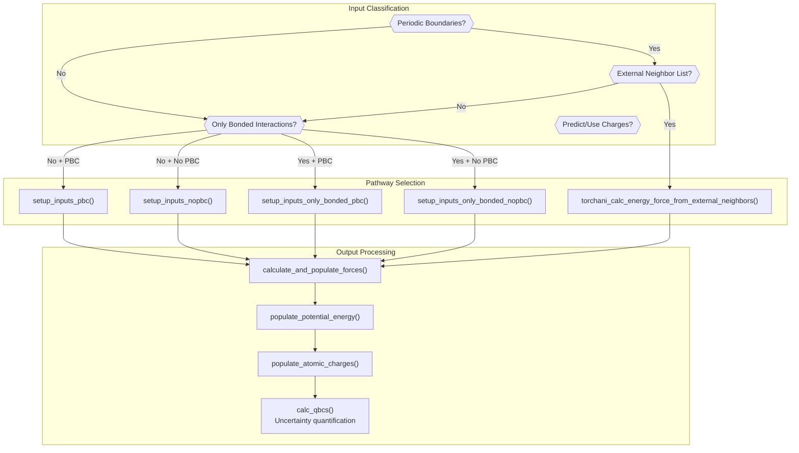

# Core Architecture

Relevant source files

The following files were used as context for generating this wiki page:

- [jit/jit.py](jit/jit.py)
- [jit/make_bulk.py](jit/make_bulk.py)
- [src/build_tensors.cpp](src/build_tensors.cpp)
- [src/build_tensors.h](src/build_tensors.h)
- [src/config.h](src/config.h)
- [src/torchani.cpp](src/torchani.cpp)

This document describes the core runtime architecture of TorchANI-Amber, focusing on the C++ engine, JIT compilation system, and tensor operations that form the computational foundation. For information about build system configuration, see [Build System Deep Dive](#6.1). For API usage details, see [API Reference](#3.2). For Python model wrappers, see [Model Wrappers](#3.3).

## Global Configuration System

The architecture centers around a `GlobalConfig` class that manages device placement, precision, and computational settings throughout the system. This singleton-like configuration object ensures consistent tensor operations across all components.

**Configuration Management Overview**
Sources: [src/config.h:1-65](), [src/torchani.cpp:23-26]()

The `GlobalConfig` class provides centralized control over:
- **Device Management**: CPU vs CUDA device selection with device indexing
- **Precision Control**: Float32 vs Float64 precision for all tensor operations  
- **PBC Handling**: Automatic periodic boundary condition tensor creation
- **Selective Evaluation**: Support for excluding specific atoms from neural network evaluation

Key methods include `set_device_and_precision()` for initialization and `tensor_to_torchani_dtype_and_device()` for consistent tensor conversion throughout the pipeline.

## JIT Compilation Pipeline

The system uses a sophisticated JIT compilation pipeline that converts Python-based neural network models into optimized `.pt` files for C++ execution.

**JIT Compilation System**
Sources: [jit/jit.py:1-180](), [src/torchani.cpp:34-69](), [src/torchani.cpp:475-478]()

The compilation process involves:

1. **Model Specification**: `ModelSpec` dataclass defines model class, inference mode, and compilation kwargs
2. **Selective Compilation**: Only compiles missing `.pt` files unless force recompilation is requested
3. **Optimization Control**: Disables various PyTorch JIT optimizations to ensure numerical accuracy
4. **Registry Management**: Maintains `torchani_builtin_models` vector with all available model names
5. **Error Handling**: Graceful fallback for models that fail compilation

The system supports both training and inference-optimized model variants, with inference models using `to_infer_model()` for reduced memory usage.

## Tensor Building and Data Conversion

A critical architectural component handles conversion between raw C/Fortran buffers and PyTorch tensors with proper device placement and gradient tracking.

**Tensor Building Architecture**
Sources: [src/build_tensors.cpp:1-71](), [src/build_tensors.h:1-46](), [src/torchani.cpp:72-153]()

Key tensor conversion functions:

| Function | Purpose | Special Handling |
|----------|---------|-----------------|
| `dbl_buf_to_coords_tensor()` | Coordinate conversion | Adds batch dimension, enables gradients |
| `dbl_buf_to_cell_tensor()` | Unit cell conversion | 3x3 matrix handling |
| `int_buf_to_neighborlist_tensor()` | Neighbor list conversion | int32 → int64 widening |
| `dbl_buf_to_shifts_tensor()` | Shift vector conversion | Gradient tracking enabled |

All conversion functions use the global `GlobalConfig` to ensure consistent device placement and dtype conversion via `tensor_to_torchani_dtype_and_device()`.

## Model Loading and Execution Engine

The core execution engine manages JIT model loading, method resolution, and configuration for different computational scenarios.

**Model Execution Architecture**
Sources: [src/torchani.cpp:371-563](), [src/torchani.cpp:621-635](), [src/torchani.cpp:688-701]()

The execution engine provides:

1. **Dynamic Model Loading**: Resolves built-in model names to file paths or accepts custom paths
2. **Method-Based Configuration**: Uses optional model methods for runtime configuration
3. **Execution Strategy Selection**: Supports both standard neighbor computation and external neighbor lists
4. **Output Validation**: Ensures model outputs match expected tuple structure

Key execution optimizations include disabling TF32/FP16 for numerical accuracy and JIT graph optimizations for deterministic behavior.

## Computation Pathways

The system supports multiple computation pathways depending on simulation requirements and model capabilities.

**Computation Pathway Architecture**
Sources: [src/torchani.cpp:645-702](), [src/torchani.cpp:704-722](), [src/torchani.cpp:859-879](), [src/torchani.cpp:881-916]()

Available computation pathways:

| Function | Use Case | Key Features |
|----------|----------|-------------|
| `torchani_calc_energy_force()` | Standard MD | PBC support, bonded-only option |
| `torchani_calc_energy_force_from_external_neighbors()` | Custom neighbor lists | External neighbor list input |
| `torchani_energy_force_atomic_charges()` | Charge prediction | Charge output with derivatives |
| `torchani_energy_force_with_coupling()` | QM/MM embedding | Environmental charge coupling |
| `torchani_energy_force_qbc()` | Uncertainty quantification | Ensemble standard deviation |
| `torchani_data_for_monitored_mlmm()` | Advanced QM/MM | Combined charge and QBC derivatives |

Each pathway handles automatic differentiation for force calculation via `torch::autograd::grad()` and includes unit conversion from Hartree to kcal/mol using the constant `HARTREE_TO_KCALMOL = 627.5094738898777`.

Sources: [src/torchani.cpp:1-918](), [src/config.h:1-65](), [src/build_tensors.cpp:1-71](), [src/build_tensors.h:1-46](), [jit/jit.py:1-180]()

---