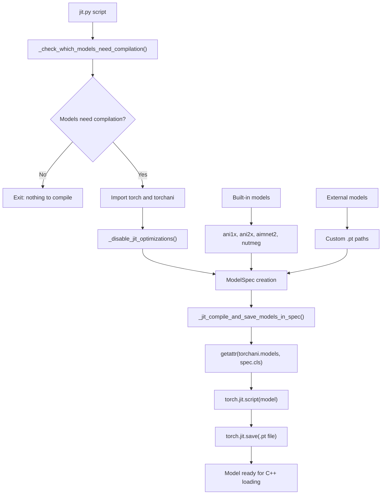
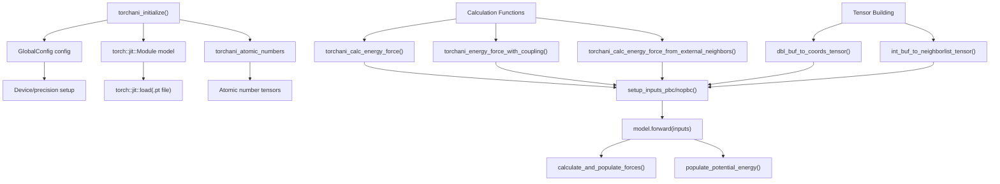
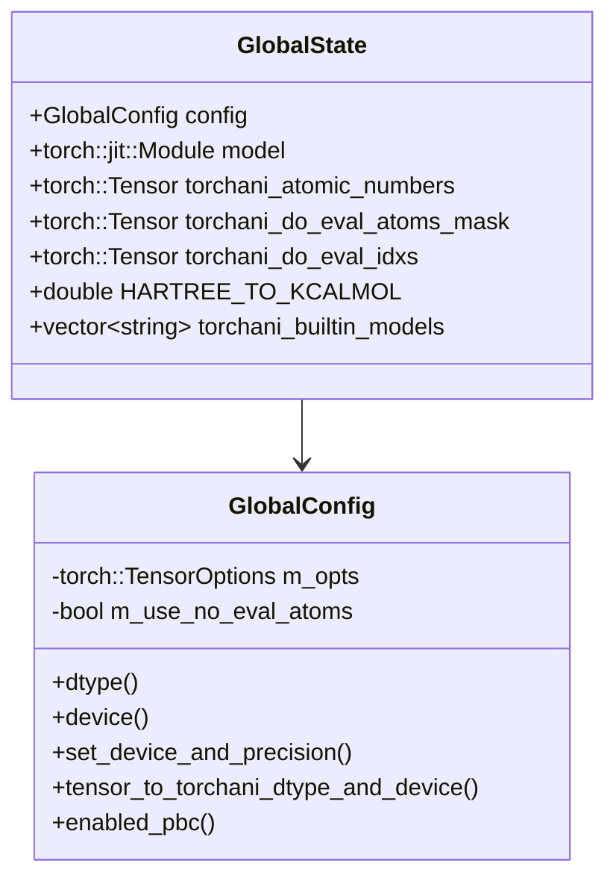
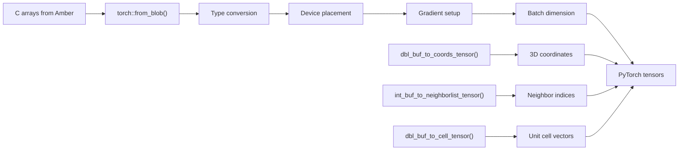
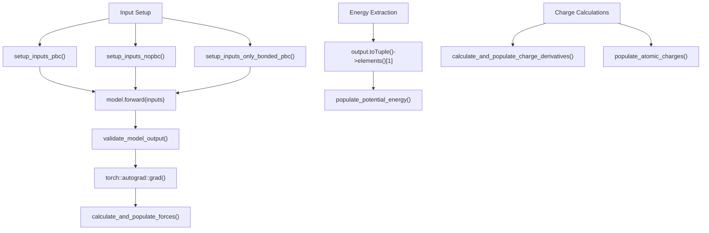
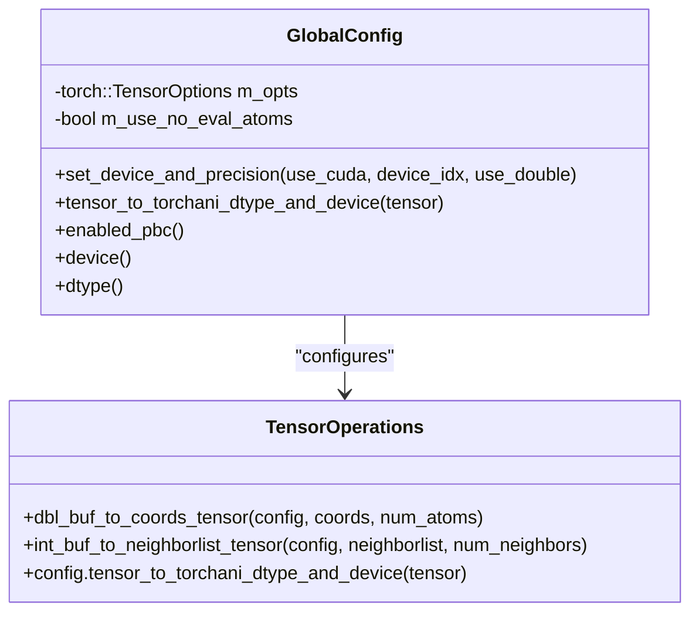

# C++ Engine and JIT System

<details>
<summary>Relevant source files</summary>

The following files were used as context for generating this wiki page:

- [jit/jit.py](jit/jit.py)
- [jit/make_bulk.py](jit/make_bulk.py)
- [src/build_tensors.cpp](src/build_tensors.cpp)
- [src/build_tensors.h](src/build_tensors.h)
- [src/config.h](src/config.h)
- [src/torchani.cpp](src/torchani.cpp)

</details>


## Purpose and Scope

This document covers the core C++ implementation that powers TorchANI-Amber's neural network potential calculations and the JIT (Just-In-Time) compilation system that prepares PyTorch models for high-performance execution. The C++ engine handles tensor operations, automatic differentiation for force calculations, and interfaces with PyTorch's LibTorch backend for model inference.

For information about the C and Fortran API interfaces that wrap this engine, see [API Reference](#3.2). For details about Python model wrappers, see [Model Wrappers](#3.3).

## JIT Compilation System

The JIT compilation system transforms PyTorch models into optimized `.pt` files that can be loaded and executed efficiently by the C++ engine. This system is implemented primarily in Python and handles the compilation of various neural network potential models.

### JIT Compilation Workflow



**Sources:** [jit/jit.py:1-180]()

### Model Compilation Process

The `ModelSpec` class defines the compilation parameters for each model:

| Property | Description | Usage |
|----------|-------------|--------|
| `cls` | Model class name | Maps to `torchani.models` attributes |
| `infer` | Inference-only optimization | Reduces model size for deployment |
| `kwargs` | Model parameters | Sets neighborlist and strategy options |

The compilation process involves several key functions:

- `_jit_compile_and_save_models_in_spec()` - Core compilation logic
- `_reset_jit_registry()` - Clears PyTorch JIT state between compilations
- `_disable_jit_optimizations()` - Prevents optimization bugs during compilation

**Sources:** [jit/jit.py:15-93]()

## C++ Engine Core

The C++ engine is the performance-critical component that loads JIT-compiled models and executes neural network calculations. It manages global state, coordinates tensor operations, and handles automatic differentiation for force calculations.

### Engine Architecture



**Sources:** [src/torchani.cpp:22-70](), [src/torchani.cpp:371-563]()

### Global State Management

The engine maintains several global variables that persist across function calls:



The `GlobalConfig` class encapsulates device and precision settings, providing methods to convert tensors to the appropriate format for model execution.

**Sources:** [src/torchani.cpp:22-32](), [src/config.h:12-64]()

## Tensor Building System

The tensor building system converts C-style arrays from Amber into PyTorch tensors with proper device placement, data types, and gradient requirements. This system is crucial for bridging Amber's memory layout with PyTorch's tensor operations.

### Tensor Conversion Pipeline



**Sources:** [src/build_tensors.cpp:18-70]()

### Key Tensor Building Functions

| Function | Input | Output | Purpose |
|----------|-------|--------|---------|
| `dbl_buf_to_coords_tensor()` | `double coords[][3]` | `torch::Tensor` | Atomic coordinates with gradients |
| `int_buf_to_neighborlist_tensor()` | `int* neighborlist[2]` | `torch::Tensor` | Neighbor pair indices |
| `dbl_buf_to_cell_tensor()` | `double cell[][3]` | `torch::Tensor` | Periodic cell vectors |
| `dbl_buf_to_tensor()` | `void* buf` | `torch::Tensor` | Generic tensor conversion |

The coordinate tensors are marked with `requires_grad_(true)` to enable automatic differentiation for force calculations.

**Sources:** [src/build_tensors.h:12-45]()

## Force and Energy Calculations

The engine provides multiple calculation pathways for different simulation scenarios, each optimized for specific use cases.

### Calculation Function Architecture



**Sources:** [src/torchani.cpp:72-153](), [src/torchani.cpp:250-298]()

### Force Calculation Process

The force calculation uses PyTorch's automatic differentiation:

1. **Setup**: Coordinates are wrapped in tensors with `requires_grad=True`
2. **Forward Pass**: Model computes energy from coordinates
3. **Backward Pass**: `torch::autograd::grad()` computes energy derivatives
4. **Force Extraction**: Forces = negative gradient × unit conversion factor
5. **Memory Transfer**: Results copied back to C arrays for Amber

The `HARTREE_TO_KCALMOL` constant (627.5094738898777) converts from atomic units to kcal/mol.

**Sources:** [src/torchani.cpp:250-298](), [src/torchani.cpp:31]()

## Model Integration and Validation

The engine includes robust model loading, validation, and configuration management to ensure compatibility with different neural network potential models.

### Model Loading and Configuration

```mermaid
flowchart TD
    A["`torchani_initialize()`"] --> B{"`Built-in model?`"}
    B -->|Yes| C["`Construct path from jit_models_dir`"]
    B -->|No| D["`Use provided path directly`"]
    
    C --> E["`Check model subdirectory`"]
    E --> F["`aimnet2/`, `nutmeg/`, or root`"]
    F --> G["`torch::jit::load(model_path)`"]
    D --> G
    
    G --> H["`model.to(config.dtype())`"]
    H --> I["`Configure model methods`"]
    I --> J["`set_active_members(network_index)`"]
    I --> K["`set_strategy(cuaev/pyaev)`"]
    I --> L["`set_extra_features(file_data)`"]
    
    M["`JIT Optimizations`"] --> N["`torch::jit::setGraphExecutorOptimize(false)`"]
    N --> O["`Disable TF32, FP16 for accuracy`"]
```

The built-in model list includes ANI, AimNet2, and NutMeg variants, with automatic path resolution based on model type.

**Sources:** [src/torchani.cpp:389-562](), [src/torchani.cpp:34-69]()

## Configuration Management

The `GlobalConfig` class centralizes device and precision management, ensuring consistent tensor operations across the entire engine.

### Configuration System



The configuration system handles:
- **Device Selection**: CPU vs CUDA with specific device indices
- **Precision Management**: Float32 vs Float64 for different accuracy requirements
- **PBC Settings**: Automatic periodic boundary condition tensor generation
- **Atom Masking**: Support for excluding atoms from neural network evaluation

**Sources:** [src/config.h:9-64]()

---