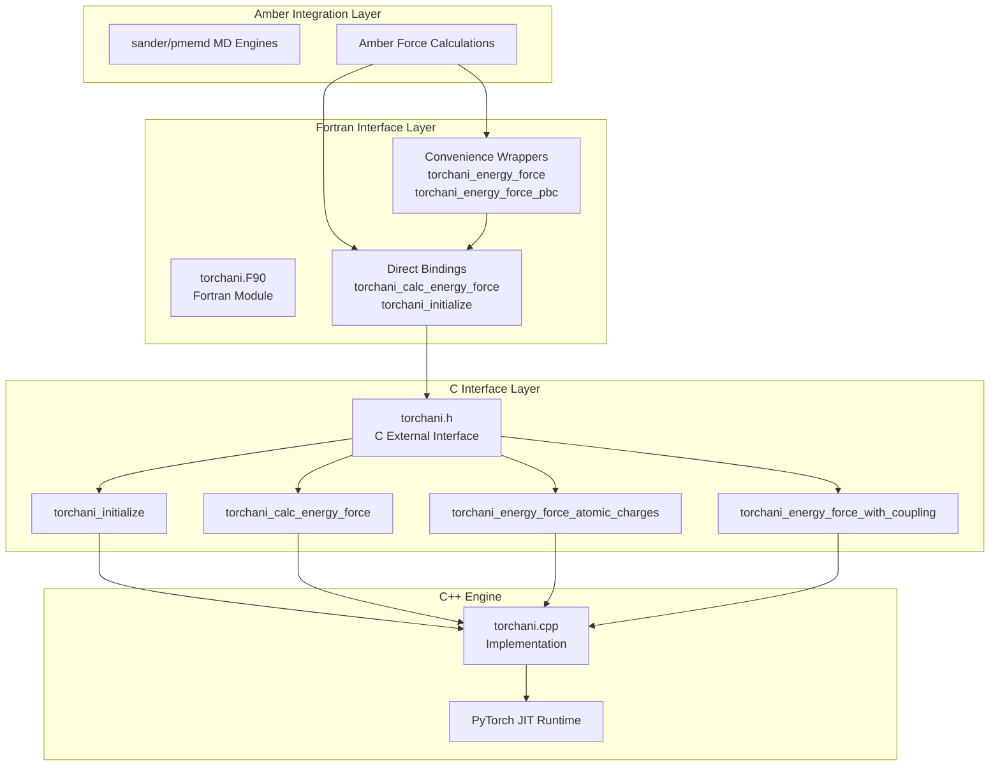
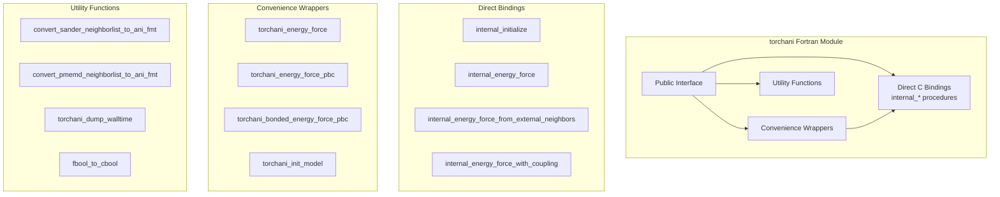
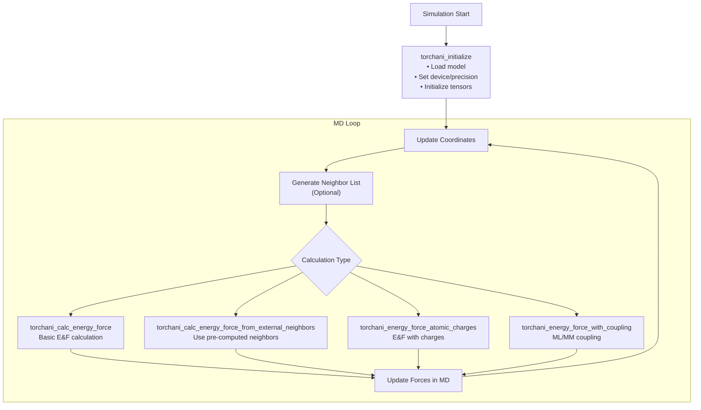

# API Reference

<details>
<summary>Relevant source files</summary>

The following files were used as context for generating this wiki page:

- [.gitmodules](.gitmodules)
- [include/torchani.h](include/torchani.h)
- [src-fortran/torchani.F90](src-fortran/torchani.F90)
- [tests/tests.cpp](tests/tests.cpp)

</details>


This document provides a complete reference for the C and Fortran APIs that enable integration of TorchANI neural network potentials with Amber molecular dynamics simulations. The APIs handle model initialization, energy and force calculations, charge predictions, and ML/MM coupling for various simulation scenarios.

For information about the underlying C++ engine implementation, see [C++ Engine and JIT System](#3.1). For simulation configuration details, see [Simulation Configuration](#4.1).

## API Architecture Overview

The TorchANI-Amber API is structured in two layers: a core C interface that directly wraps the C++ implementation, and a Fortran interface that provides both direct bindings and convenience wrappers for Amber integration.

**API Layer Architecture**



Sources: [include/torchani.h:1-109](), [src-fortran/torchani.F90:1-782]()

## C API Reference

The C API provides the core interface functions for model initialization and various types of energy/force calculations. All functions use C-compatible data types and follow C calling conventions.

### Initialization Function

**`torchani_initialize`**

Initializes a TorchANI model for subsequent energy and force calculations.

```c
void torchani_initialize(
    int num_atoms,
    int atomic_nums[],      // Shape (num_atoms,)
    int no_eval_atoms[],    // Shape (num_atoms,)
    const char* model_type,
    int device_index,
    int network_index,
    bool use_double_precision,
    bool use_cuda_device,
    bool use_cuaev
);
```

| Parameter | Type | Description |
|-----------|------|-------------|
| `num_atoms` | `int` | Total number of atoms in the system |
| `atomic_nums` | `int[]` | Array of atomic numbers for each atom |
| `no_eval_atoms` | `int[]` | Mask array: 1 = skip evaluation, 0 = evaluate |
| `model_type` | `const char*` | Model name: "ani1x", "ani1ccx", "ani2x", "animbis" |
| `device_index` | `int` | CUDA device index (0 for first GPU, ignored for CPU) |
| `network_index` | `int` | Network ensemble index (-1 for all networks) |
| `use_double_precision` | `bool` | Use double precision calculations |
| `use_cuda_device` | `bool` | Enable CUDA acceleration |
| `use_cuaev` | `bool` | Use CUDA-accelerated AEV calculations |

Sources: [include/torchani.h:4-14]()

### Core Energy and Force Functions

**`torchani_calc_energy_force`**

Calculates energy and forces for a molecular system with optional periodic boundary conditions.

```c
void torchani_calc_energy_force(
    int num_atoms,
    double coords[][3],        // Shape (num_atoms, 3)
    double cell[][3],          // Shape (3, 3)
    bool use_pbc,
    int* molecule_idxs_buf,    // Shape (num_atoms,)
    bool calc_only_bonded,
    int net_charge,
    /* outputs */
    double forces[][3],        // Shape (num_atoms, 3)
    double* potential_energy   // Scalar
);
```

**`torchani_calc_energy_force_from_external_neighbors`**

Calculates energy and forces using a pre-computed neighbor list, typically from Amber's neighbor list generation.

```c
void torchani_calc_energy_force_from_external_neighbors(
    int num_atoms,
    int num_neighbors,
    double coords[][3],        // Shape (num_atoms, 3)
    int* neighborlist[2],      // Shape (2, num_neighbors)
    double shifts[][3],        // Shape (num_neighbors, 3)
    int* molecule_idxs_buf,    // Shape (num_atoms,)
    bool calc_only_bonded,
    int net_charge,
    /* outputs */
    double forces[][3],        // Shape (num_atoms, 3)
    double* potential_energy
);
```

Sources: [include/torchani.h:16-41]()

### Charge Prediction Functions

**`torchani_energy_force_atomic_charges`**

Calculates energy, forces, and atomic charges for charge-capable models like animbis.

```c
void torchani_energy_force_atomic_charges(
    int num_atoms,
    double coords[][3],        // Shape (num_atoms, 3)
    /* outputs */
    double forces[][3],        // Shape (num_atoms, 3)
    double atomic_charges[],   // Shape (num_atoms,)
    double* potential_energy   // Scalar
);
```

**`torchani_energy_force_atomic_charges_with_derivatives`**

Extended charge calculation that also provides charge derivatives for ML/MM coupling.

```c
void torchani_energy_force_atomic_charges_with_derivatives(
    int num_atoms,
    double coords[][3],        // Shape (num_atoms, 3)
    /* outputs */
    double forces[][3],        // Shape (num_atoms, 3)
    double atomic_charges[],   // Shape (num_atoms,)
    double* atomic_charges_grad,  // Shape (num_atoms, num_atoms, 3)
    double* potential_energy   // Scalar
);
```

The `atomic_charges_grad` array stores derivatives where element `[i, j, k]` represents the derivative of the charge on atom `k` with respect to the `i`-th coordinate of atom `j`.

Sources: [include/torchani.h:43-64]()

### ML/MM Coupling Functions

**`torchani_energy_force_with_coupling`**

Performs energy and force calculations with electrostatic coupling to external point charges for ML/MM simulations.

```c
void torchani_energy_force_with_coupling(
    int num_atoms,
    int num_env_charges,
    double distortion_k,
    double coords_buf[][3],
    double atomic_alphas_buf[],        // Shape (num_atoms,)
    double env_charge_coords_buf[][3], // Shape (num_env_charges, 3)
    double env_charges_buf[],          // Shape (num_env_charges,)
    bool predict_charges,
    bool use_simple_polarization_correction,
    bool use_charge_derivatives,
    /* outputs */
    double forces_on_atoms_buf[][3],     // Shape (num_atoms, 3)
    double forces_on_env_charges_buf[][3], // Shape (num_env_charges, 3)
    double atomic_charges_buf[],         // Shape (num_atoms,)
    double* ene_pot_invacuo_buf,
    double* ene_pot_embed_pol_buf,
    double* ene_pot_embed_dist_buf,
    double* ene_pot_embed_coulomb_buf,
    double* ene_pot_total_buf
);
```

This function decomposes the total potential energy into vacuum, polarization, distortion, and Coulomb embedding components for detailed analysis of ML/MM interactions.

Sources: [include/torchani.h:87-107]()

## Fortran Interface Reference

The Fortran interface provides both direct C bindings and higher-level convenience wrappers that simplify common usage patterns in Amber simulations.

### Module Structure

**Fortran API Organization**



Sources: [src-fortran/torchani.F90:1-24]()

### Key Fortran Wrapper Functions

**`torchani_initialize`**

High-level Fortran wrapper for model initialization with automatic array size detection and type conversion.

```fortran
subroutine torchani_initialize(
    atomic_nums,
    no_eval_atoms,
    device_index,
    model_type,
    network_index,
    use_double_precision,
    use_cuda_device,
    use_cuaev
)
```

**`torchani_energy_force`**

Simplified energy/force calculation for non-periodic systems.

```fortran
subroutine torchani_energy_force(
    num_atoms,
    coords,
    forces,
    potential_energy
)
```

**`torchani_energy_force_pbc`**

Energy/force calculation with periodic boundary conditions.

```fortran
subroutine torchani_energy_force_pbc(
    num_atoms,
    coords,
    cell,
    forces,
    potential_energy
)
```

Sources: [src-fortran/torchani.F90:283-543]()

### Neighbor List Conversion Utilities

The Fortran interface provides specialized functions to convert Amber's neighbor list formats to the format expected by TorchANI.

**`convert_sander_neighborlist_to_ani_fmt`**

Converts sander's image-based neighbor list to TorchANI format.

**`convert_pmemd_neighborlist_to_ani_fmt`**

Converts pmemd's neighbor list format to TorchANI format.

These utilities handle the complex mapping between Amber's internal neighbor representations and TorchANI's expectations, including proper handling of periodic boundary conditions and translation vectors.

Sources: [src-fortran/torchani.F90:591-713]()

## Function Call Flow Patterns

**Typical API Usage Flow**



Sources: [tests/tests.cpp:94-146](), [include/torchani.h:4-107]()

## Parameter Specifications

### Model Types

| Model Type | Description | Charge Prediction | Elements Supported |
|------------|-------------|-------------------|-------------------|
| `"ani1x"` | ANI-1x model | No | H, C, N, O |
| `"ani1ccx"` | ANI-1ccx model | No | H, C, N, O |
| `"ani2x"` | ANI-2x model | No | H, C, N, O |
| `"animbis"` | ANI with MBIS charges | Yes | H, C, N, O |

### Array Layouts and Memory Management

- **Coordinates**: Row-major layout `coords[atom_idx][xyz]`
- **Forces**: Row-major layout `forces[atom_idx][xyz]`
- **Cell matrix**: Row-major layout `cell[3][3]` representing unit cell vectors
- **Neighbor lists**: Format `neighborlist[pair_idx][atom1/atom2]`
- **Charge derivatives**: Layout `[num_atoms, num_atoms, 3]` with Fortran ordering

### Boolean Parameter Conventions

The C API uses C99 `bool` types, while the Fortran interface automatically converts between Fortran logical types and C boolean types using the `fbool_to_cbool` utility function.

Sources: [include/torchani.h:1-109](), [src-fortran/torchani.F90:733-740]()

---