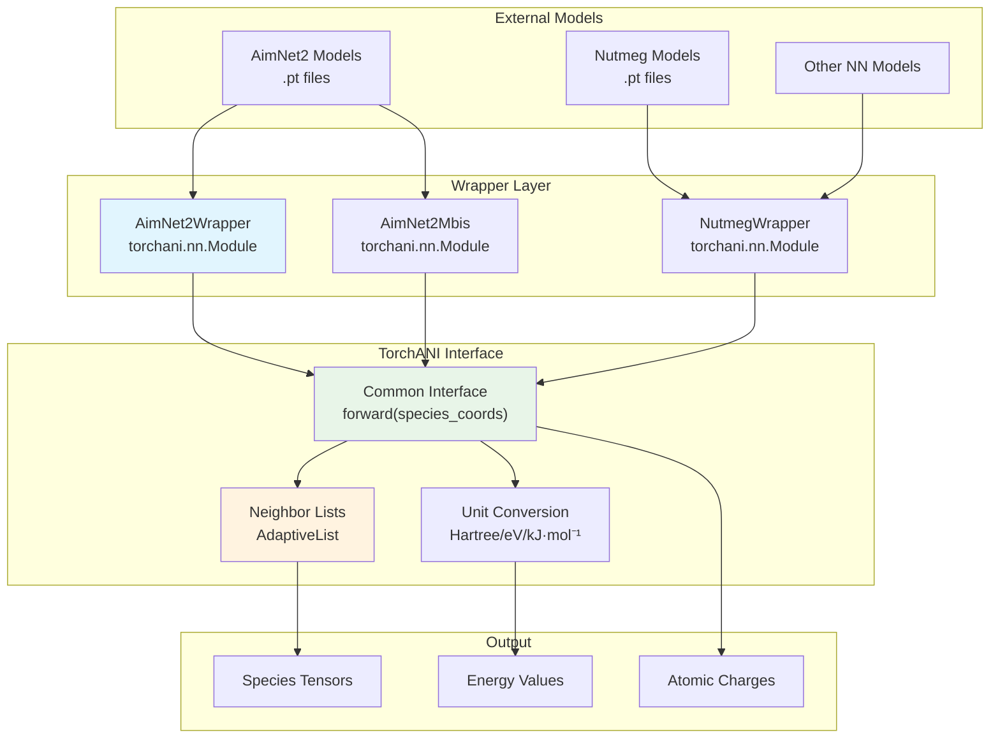
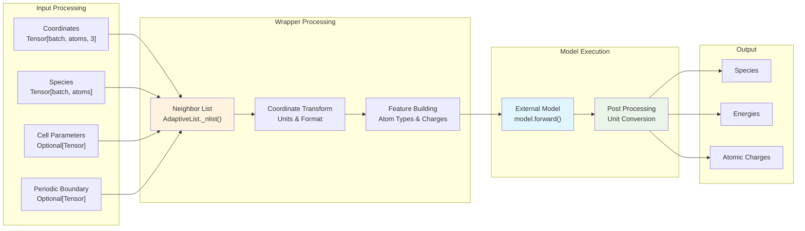
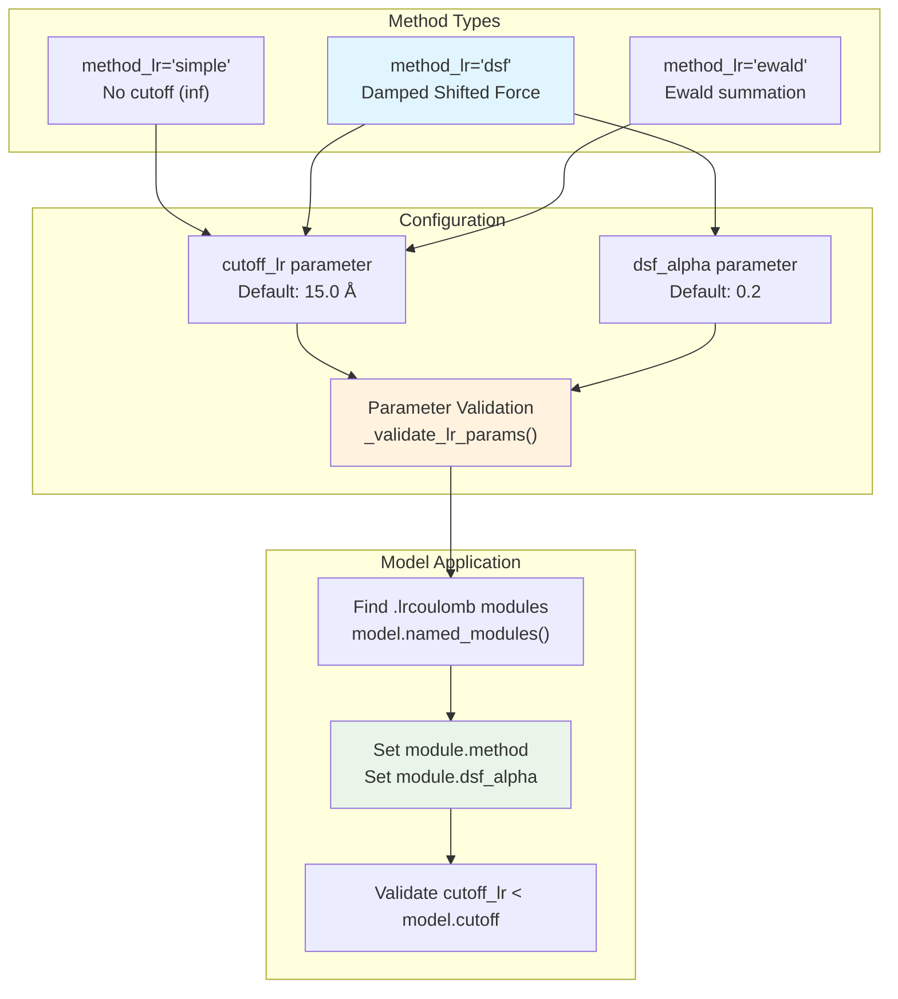
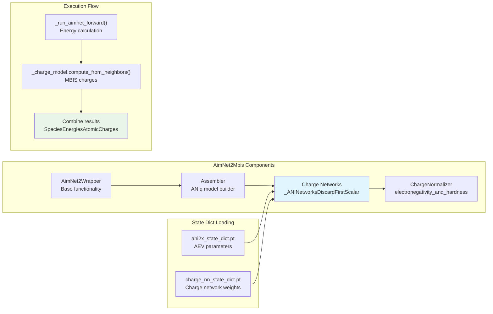
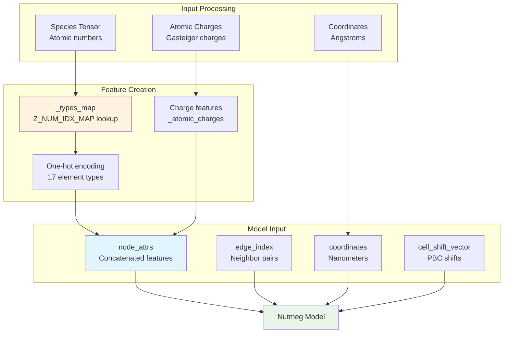
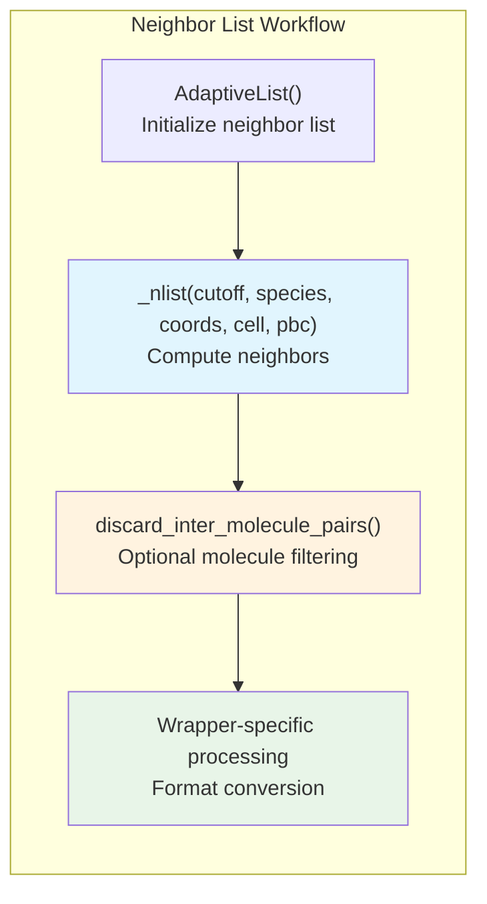

# Model Wrappers

<details>
<summary>Relevant source files</summary>

The following files were used as context for generating this wiki page:

- [jit/aimnet2_wrapper.py](jit/aimnet2_wrapper.py)
- [jit/nutmeg_wrapper.py](jit/nutmeg_wrapper.py)

</details>


This document covers the model wrapper system that enables integration of external neural network potentials into TorchANI-Amber. Model wrappers provide a standardized interface for different neural network architectures, handling coordinate transformations, neighbor list calculations, and unit conversions.

For information about the core C++ integration layer, see [C++ Engine and JIT System](#3.1). For simulation configuration details, see [Simulation Configuration](#4.1).

## Purpose and Architecture

Model wrappers serve as adaptation layers that allow external neural network potentials to interface with the TorchANI-Amber system. They handle the differences in input formats, coordinate systems, and output structures between various neural network implementations.

### Wrapper System Architecture



**Sources:** [jit/aimnet2_wrapper.py:54-338](), [jit/nutmeg_wrapper.py:18-152]()

### Data Flow Through Wrappers



**Sources:** [jit/aimnet2_wrapper.py:120-195](), [jit/nutmeg_wrapper.py:106-151]()

## AimNet2 Wrapper System

The AimNet2 wrapper system provides integration for AimNet2 neural network potentials, supporting multiple long-range electrostatic treatment methods and charge prediction schemes.

### AimNet2Wrapper Class

The `AimNet2Wrapper` class provides the primary interface for AimNet2 models:

| Component | Description | Configuration |
|-----------|-------------|---------------|
| `method_lr` | Long-range method | `"simple"`, `"dsf"`, `"ewald"` |
| `cutoff_lr` | Long-range cutoff | `None` (auto), or float value |
| `dsf_alpha` | DSF damping parameter | `None` (auto), or float value |
| `output_hartree` | Energy units | `True` (Hartree), `False` (eV) |

**Core Methods:**

- `from_jit_file(path, device, **kwargs)` - Load model from JIT file
- `forward(species_coords, cell, pbc, charge, atomic, ensemble_values)` - Main inference
- `_calc_neighbors(species, coords, cell, pbc)` - Neighbor list calculation

### Long-Range Electrostatic Methods



**Sources:** [jit/aimnet2_wrapper.py:74-95](), [jit/aimnet2_wrapper.py:100-104]()

### AimNet2Mbis Charge Prediction

The `AimNet2Mbis` class extends `AimNet2Wrapper` to use MBIS (Minimal Basis Iterative Stockholder) charge prediction instead of Hirshfeld charges:



**Sources:** [jit/aimnet2_wrapper.py:257-338](), [jit/aimnet2_wrapper.py:268-298]()

## Nutmeg Wrapper System

The `NutmegWrapper` class provides integration for Nutmeg neural network potentials, which use different atomic representations and units.

### Atomic Number Mapping

Nutmeg models use a specific mapping from atomic numbers to internal indices:

| Atomic Number | Element | Internal Index |
|---------------|---------|----------------|
| 1 | H | 0 |
| 6 | C | 3 |
| 7 | N | 4 |
| 8 | O | 5 |
| 9 | F | 6 |
| 16 | S | 11 |
| 17 | Cl | 12 |
| 35 | Br | 15 |
| 53 | I | 16 |

### Feature Engineering



**Sources:** [jit/nutmeg_wrapper.py:19-37](), [jit/nutmeg_wrapper.py:70-81](), [jit/nutmeg_wrapper.py:134-149]()

### Unit Conversion System

The Nutmeg wrapper handles multiple unit conversions:

| Conversion | Factor | Purpose |
|------------|--------|---------|
| kJ/mol → Hartree | `1 / HARTREE_TO_KJOULEMOL` | Energy units |
| Angstrom → Nanometer | `0.1` | Distance units |
| Cutoff scaling | `/self._angstrom_to_nm` | Neighbor list cutoff |

**Sources:** [jit/nutmeg_wrapper.py:54-56]()

## Common Interface Patterns

All model wrappers implement a consistent interface for integration with the TorchANI-Amber system.

### Standard Forward Method Signature

```python
def forward(
    self,
    species_coords: Tuple[Tensor, Tensor],
    cell: Optional[Tensor] = None,
    pbc: Optional[Tensor] = None,
    charge: int = 0,
    atomic: bool = False,
    ensemble_values: bool = False,
    _molecule_idxs: Optional[Tensor] = None,
) -> Union[SpeciesEnergiesAtomicCharges, Tuple[Tensor, Tensor]]
```

### Neighbor List Management

All wrappers use the `AdaptiveList` neighbor list implementation:



**Sources:** [jit/aimnet2_wrapper.py:99](), [jit/aimnet2_wrapper.py:232-254](), [jit/nutmeg_wrapper.py:60](), [jit/nutmeg_wrapper.py:82-104]()

### JIT Compilation Support

Model wrappers support TorchScript compilation for deployment:

```python
# Example compilation pattern
model = AimNet2Wrapper.from_jit_file("model.pt")
scripted_model = torch.jit.script(model)
torch.jit.save(scripted_model, "compiled_model.pt")
```

**Sources:** [jit/aimnet2_wrapper.py:481-487](), [jit/nutmeg_wrapper.py:156-159]()

---