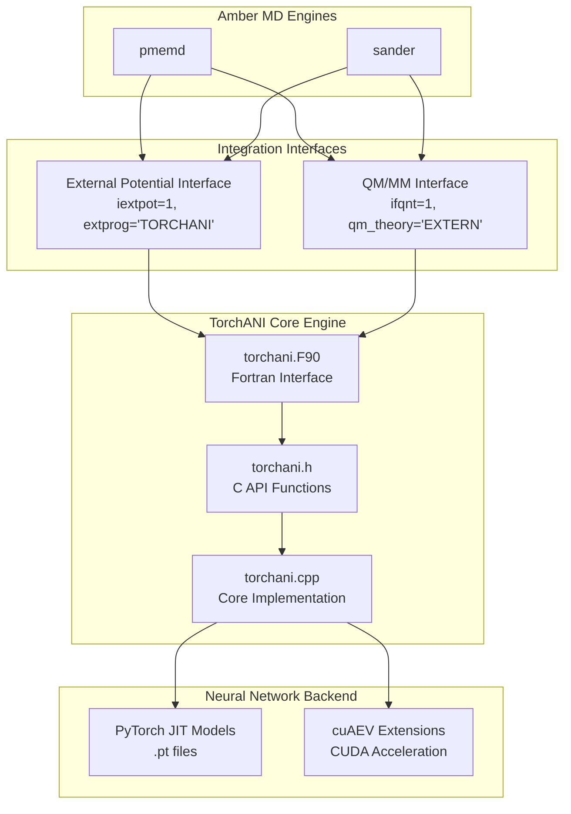
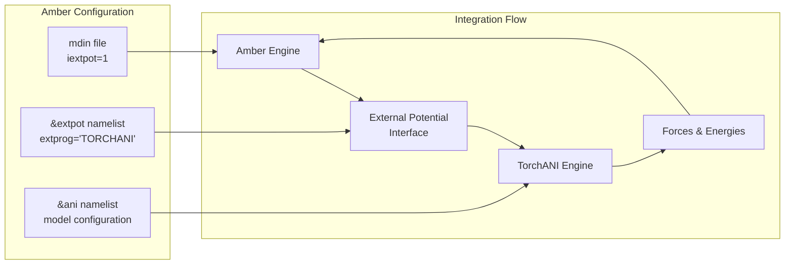
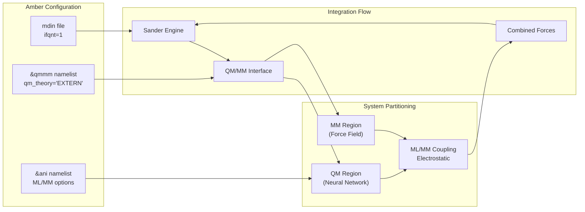
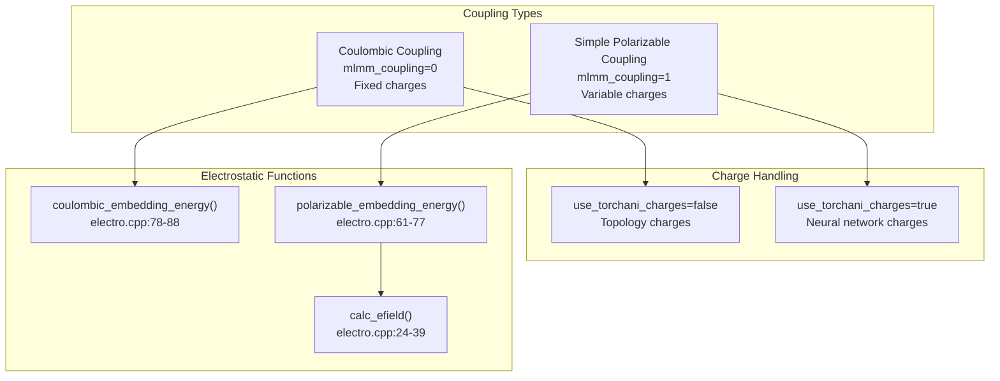
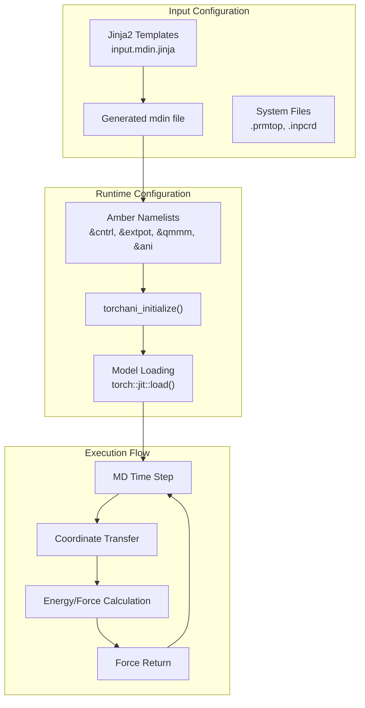

# Amber Integration

Relevant source files

The following files were used as context for generating this wiki page:

- [README.md](README.md)
- [ani-amber-logo-dark.png](ani-amber-logo-dark.png)
- [ani-amber-logo-light.png](ani-amber-logo-light.png)
- [src/electro.cpp](src/electro.cpp)
- [src/electro.h](src/electro.h)
- [tests/templates/input.mdin.jinja](tests/templates/input.mdin.jinja)
- [tests/test_amber_integration.py](tests/test_amber_integration.py)

This document provides a comprehensive overview of how TorchANI integrates with the Amber molecular dynamics simulation suite. It covers the architecture, integration modes, and configuration mechanisms that enable neural network potentials to be used within Amber's `pmemd` and `sander` engines.

For detailed configuration options and namelist parameters, see [Simulation Configuration](#4.1). For ML/MM setup specifics and coupling schemes, see [ML/MM Setup and Coupling](#4.2). For example configurations and templates, see [Input Templates and Examples](#4.3).

## Integration Architecture

TorchANI-Amber provides two primary integration pathways with Amber: external potential interface for full-ML simulations and QM/MM interface for hybrid ML/MM simulations. Both pathways utilize the same core C++ engine but interface with different Amber subsystems.

Sources: [README.md:9-18](), [README.md:172-184](), [tests/test_amber_integration.py:32-76]()

## Integration Modes

TorchANI-Amber supports two distinct integration modes, each targeting different simulation scenarios and utilizing different Amber interfaces.

### Full-ML Mode

In full-ML mode, the entire molecular system's potential energy is calculated using neural network models. This mode uses Amber's external potential interface (`iextpot=1`) and requires the `&extpot` namelist with `extprog='TORCHANI'`.

### ML/MM Mode

ML/MM mode partitions the system into QM and MM regions, using neural networks for the QM region and classical force fields for the MM region. This mode requires `ifqnt=1` and uses Amber's QM/MM subsystem with `qm_theory='EXTERN'`.

Sources: [README.md:116-170](), [README.md:172-257](), [tests/templates/input.mdin.jinja:3-47]()

## Electrostatic Coupling Mechanisms

The ML/MM interface implements sophisticated electrostatic coupling schemes to handle the interaction between QM and MM regions.

The electrostatic coupling is implemented through dedicated functions in the `electro` namespace that calculate electric fields, polarization energies, and Coulombic interactions between QM and MM regions.

Sources: [src/electro.cpp:78-88](), [src/electro.cpp:61-77](), [src/electro.h:4-18](), [README.md:197-212]()

## Configuration Flow

The configuration process involves template-based mdin file generation, namelist parsing, model initialization, and runtime execution through Amber's MD loop.

Sources: [tests/templates/input.mdin.jinja:1-98](), [tests/test_amber_integration.py:344-380]()

## Interface API Structure

The integration is implemented through a layered API structure that provides both C and Fortran interfaces to accommodate Amber's mixed-language codebase.

| Interface Layer | File | Purpose |
|----------------|------|---------|
| Fortran Interface | `torchani.F90` | Amber-compatible Fortran bindings |
| C API | `torchani.h` | C function declarations and types |
| Core Implementation | `torchani.cpp` | PyTorch JIT model execution |
| Electrostatic Coupling | `electro.cpp` | ML/MM interaction calculations |

The API supports both full-ML calculations where TorchANI handles the entire system potential and ML/MM calculations where it integrates with Amber's QM/MM infrastructure.

## Configuration Namelist Overview

TorchANI-Amber uses Amber's namelist system for configuration, with different namelists required for different integration modes:

| Namelist | Required For | Key Parameters |
|----------|-------------|----------------|
| `&cntrl` | All modes | `iextpot=1` (full-ML) or `ifqnt=1` (ML/MM) |
| `&extpot` | Full-ML only | `extprog='TORCHANI'` |
| `&qmmm` | ML/MM only | `qm_theory='EXTERN'`, `qmmask` |
| `&ani` | All modes | `model_type`, `use_cuda_device`, coupling options |

The `&ani` namelist contains TorchANI-specific options including model selection, precision settings, CUDA configuration, and ML/MM coupling parameters.

Sources: [README.md:123-151](), [README.md:180-207](), [tests/templates/input.mdin.jinja:48-96]()

---