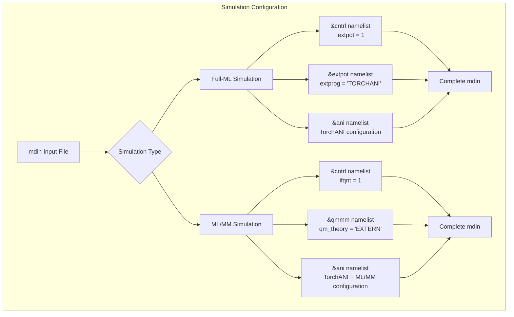
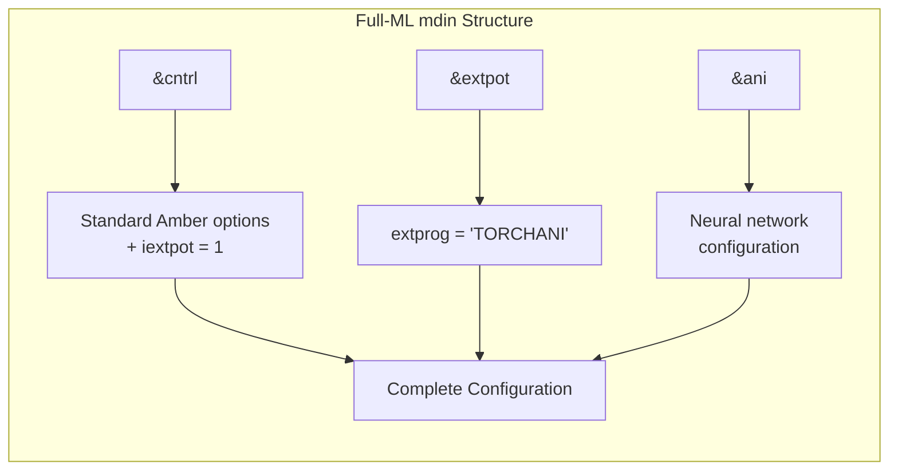
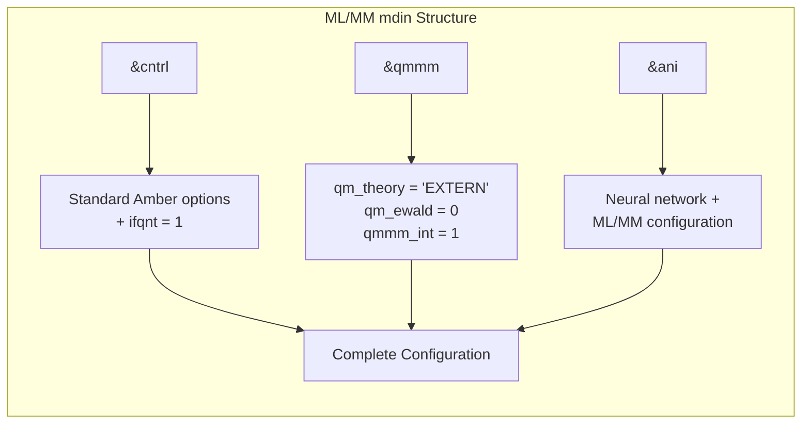
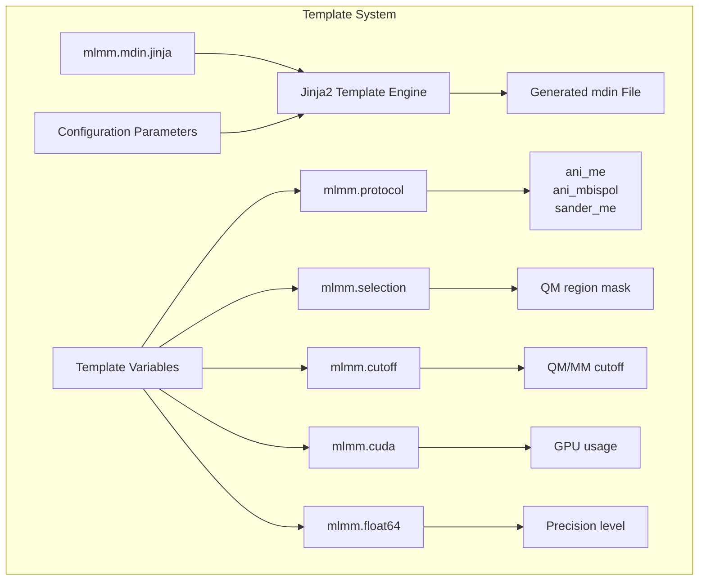
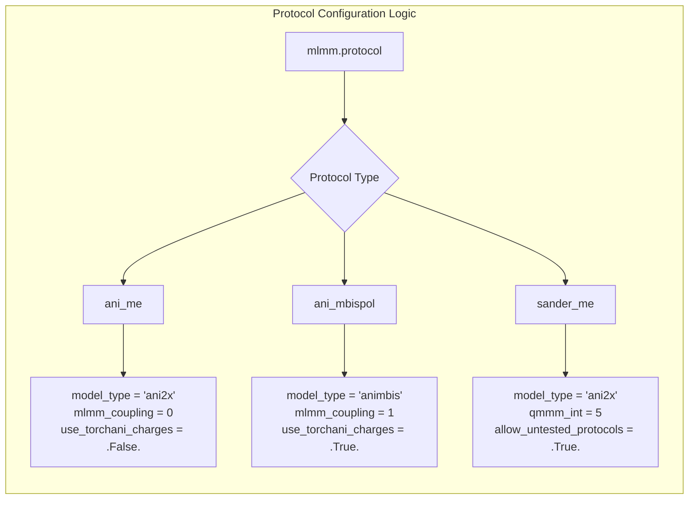

# Simulation Configuration

<details>
<summary>Relevant source files</summary>

The following files were used as context for generating this wiki page:

- [README.md](README.md)
- [ani-amber-logo-dark.png](ani-amber-logo-dark.png)
- [ani-amber-logo-light.png](ani-amber-logo-light.png)
- [benchmark/templates/mlmm.mdin.jinja](benchmark/templates/mlmm.mdin.jinja)
- [run-cmake](run-cmake)

</details>


This page covers how to configure molecular dynamics simulations with TorchANI-Amber through `mdin` input files. It explains the required namelists, configuration options, and provides examples for both full-ML and ML/MM simulation types.

For information about ML/MM coupling mechanisms and charge prediction methods, see [ML/MM Setup and Coupling](#4.2). For ready-to-use configuration templates, see [Input Templates and Examples](#4.3).

## Configuration Overview

TorchANI-Amber integrates with Amber through specific namelist configurations in `mdin` files. The configuration approach depends on the simulation type:

### Configuration Types



Sources: [README.md:116-122](), [README.md:172-183]()

## Full-ML Configuration

Full-ML simulations use neural network potentials for the entire molecular system. This requires three specific namelists:

### Required Namelists Structure



### Core Configuration Options

The `&ani` namelist contains the primary TorchANI configuration:

| Parameter | Type | Default | Description |
|-----------|------|---------|-------------|
| `model_type` | string | `"ani1x"` | Neural network model (`"ani1x"`, `"ani1ccx"`, `"ani2x"`, `"anidr"`) |
| `use_double_precision` | bool | `.true.` | Use float64 parameters for accurate dynamics |
| `use_cuda_device` | bool | `.true.` | Enable GPU acceleration |
| `use_cuaev` | bool | - | Use cuAEV CUDA extension for supported models |
| `use_amber_neighborlist` | bool | - | Use Amber's neighborlist calculation |
| `model_index` | int | `-1` | Select specific model from ensemble (-1 = use full ensemble) |
| `cuda_device_index` | int | `0` | GPU device index |

Sources: [README.md:123-151]()

### Example Full-ML Configuration

```fortran
&cntrl
    iextpot = 1 ! Required to run full-ML TorchANI-Amber
    ! ... Add the rest of the Sander options here
/
&extpot
    extprog = "TORCHANI"  ! Required to run full-ML TorchANI-Amber
/
&ani
    model_type = "ani2x"
    use_double_precision = .true.
    use_cuda_device = .true.
    use_cuaev = .true.
    ! ... Add the rest of the TorchANI-Amber config options here
/
```

Sources: [README.md:152-169]()

## ML/MM Configuration

ML/MM simulations partition the system into QM (quantum mechanical) and MM (molecular mechanical) regions, with the QM region handled by neural networks.

### ML/MM Namelist Structure



### Required QM/MM Parameters

The `&qmmm` namelist requires specific settings:

| Parameter | Value | Purpose |
|-----------|-------|---------|
| `qm_theory` | `'EXTERN'` | Use external program (TorchANI) for QM region |
| `qm_ewald` | `0` | Required for Sander EXTERN QM/MM |
| `qmmm_int` | `1` | Let TorchANI-Amber handle ML/MM coupling |
| `qmmask` | Selection string | Define QM region (e.g., `':1'` for first molecule) |
| `qmcut` | Distance | Recommended: `15.0` Å |

Sources: [README.md:181-183](), [README.md:223-228]()

### ML/MM Specific Options

The `&ani` namelist includes additional ML/MM configuration:

#### Output Control
| Parameter | Type | Description |
|-----------|------|-------------|
| `write_xyz` | bool | Dump QM region coordinates to `.xyz` file |
| `write_forces` | bool | Dump QM atom forces to `.dat` file |
| `write_charges` | bool | Dump QM atom charges to `.dat` file |
| `write_charges_grad` | bool | Dump charge derivatives to `.dat` file |

#### Coupling Configuration
| Parameter | Type | Description |
|-----------|------|-------------|
| `use_torchani_charges` | bool | Use NN-predicted charges (requires charge-predicting model) |
| `mlmm_coupling` | int | Coupling type: `0` (coulombic), `1` (simple polarizable) |

Sources: [README.md:187-207]()

### Recommended ML/MM Configurations

#### Configuration 1: Variable NN-Predicted Charges
```fortran
&cntrl
    ifqnt = 1  ! Required for all ML/MM TorchANI-Amber dynamics
    ! ... Add extra simulation settings here
/
&qmmm
    qm_theory = 'EXTERN'  ! Required for all ML/MM TorchANI-Amber dynamics
    qm_ewald = 0  ! Required for Sander EXTERN QM/MM
    qmmm_int = 1  ! Required, let TorchANI-Amber handle the ML/MM coupling
    qmmask = ':1',  ! Select the first molecule as the QM-region
    qmcut = 15.0  ! Recommended
/
&ani
    model_type = 'animbis'  ! Charge-predicting model
    use_torchani_charges = .true.  ! Use geometry dependent, nn-predicted charges
    mlmm_coupling = 1  ! Simple polarizable coupling
/
```

#### Configuration 2: Fixed Topology Charges
```fortran
&cntrl
    ifqnt = 1  ! Required for all ML/MM TorchANI-Amber dynamics
    ! ... Add extra simulation settings here
/
&qmmm
    qm_theory = 'EXTERN'  ! Required for all ML/MM TorchANI-Amber dynamics
    qm_ewald = 0  ! Required for Sander EXTERN QM/MM
    qmmm_int = 1  ! Required, let TorchANI-Amber handle the ML/MM coupling
    qmmask = ':1'  ! Select the first molecule as the QM-region
    qmcut = 15.0  ! Recommended
/
&ani
    model_type = 'ani2x'  ! Select any model
    use_torchani_charges = .false.  ! Use fixed topology charges
    mlmm_coupling = 0  ! Coulombic coupling
/
```

Sources: [README.md:215-257]()

## Configuration Templates

TorchANI-Amber provides Jinja2 templates for automated configuration generation, particularly useful for benchmarking and systematic studies.

### Template Structure



Sources: [benchmark/templates/mlmm.mdin.jinja:1-88]()

### Template Parameters

The ML/MM template accepts these key parameters:

| Parameter | Values | Description |
|-----------|--------|-------------|
| `mlmm.protocol` | `"ani_me"`, `"ani_mbispol"`, `"sander_me"` | ML/MM coupling protocol |
| `mlmm.selection` | Amber mask | QM region selection |
| `mlmm.cutoff` | Float | QM/MM interaction cutoff |
| `mlmm.cuda` | Boolean | Enable CUDA acceleration |
| `mlmm.float64` | Boolean | Use double precision |
| `dump_traj` | Boolean | Control output verbosity |

Sources: [benchmark/templates/mlmm.mdin.jinja:36-84]()

### Protocol-Specific Configuration

The template automatically configures different ML/MM protocols:



Sources: [benchmark/templates/mlmm.mdin.jinja:39-70]()

## Advanced Configuration Options

For experimental features and advanced use cases, additional options are available:

### Experimental Features

| Feature | Parameters | Description |
|---------|------------|-------------|
| Switching | `use_switching_function`, `switching_program`, `qlow`, `qhigh` | Mix NN potential with external QM program |
| ExtCoupling | `use_extcoupling`, `extcoupling_program` | Use external program for QM/MM interaction |
| Numerical Forces | `use_numerical_qmmm_forces` | Calculate ML/MM coupling numerically |

### Element-Specific Polarizabilities

Fixed atomic polarizabilities can be specified using `pol_<element>` format:
- `pol_H`, `pol_C`, `pol_N`, `pol_O`, etc. (up to `Ne`)

Sources: [README.md:376-421]()

---