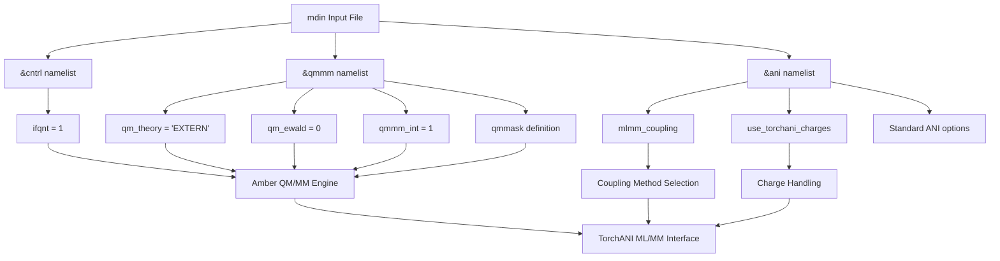
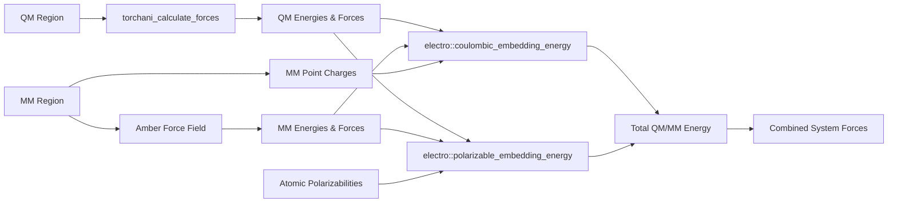
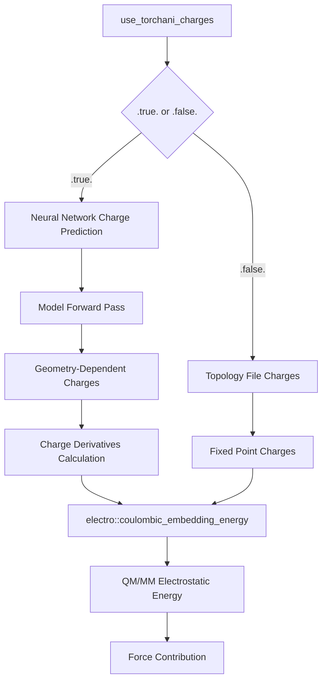

# ML/MM Setup and Coupling

<details>
<summary>Relevant source files</summary>

The following files were used as context for generating this wiki page:

- [README.md](README.md)
- [ani-amber-logo-dark.png](ani-amber-logo-dark.png)
- [ani-amber-logo-light.png](ani-amber-logo-light.png)
- [src/electro.cpp](src/electro.cpp)
- [src/electro.h](src/electro.h)
- [tests/templates/input.mdin.jinja](tests/templates/input.mdin.jinja)
- [tests/test_amber_integration.py](tests/test_amber_integration.py)

</details>


This document covers the setup and configuration of quantum mechanics/molecular mechanics (QM/MM) simulations using TorchANI-Amber, where a portion of the system is treated with neural network potentials (QM region) while the remainder uses classical force fields (MM region). For information about full-ML simulations where the entire system uses neural networks, see [Simulation Configuration](#4.1). For implementation details of the core C++ engine, see [C++ Engine and JIT System](#3.1).

## Overview

ML/MM simulations in TorchANI-Amber partition the molecular system into two regions: a QM region calculated using neural network potentials and an MM region using classical Amber force fields. The interface handles the electrostatic and van der Waals interactions between these regions through various coupling schemes.

## Configuration Requirements

### Basic Namelist Setup

ML/MM simulations require three key namelists in the `mdin` input file:

**Control Namelist (`&cntrl`)**
- `ifqnt = 1` - Enables QM/MM functionality
- Standard MD parameters (timestep, temperature, etc.)

**QM/MM Namelist (`&qmmm`)**
- `qm_theory = 'EXTERN'` - Specifies external QM program (TorchANI)
- `qm_ewald = 0` - Required for external QM/MM
- `qmmm_int = 1` - Default, lets TorchANI handle ML/MM coupling
- `qmmask = ':1'` - Defines QM region atoms
- `qmcut = 15.0` - QM/MM interaction cutoff distance

**ANI Namelist (`&ani`)**
- Standard TorchANI parameters plus ML/MM specific options

Sources: [README.md:172-183](), [tests/templates/input.mdin.jinja:36-42]()

### ML/MM Configuration Flow



Sources: [README.md:177-183](), [tests/templates/input.mdin.jinja:3-47]()

## Coupling Schemes

TorchANI-Amber supports two primary coupling methods controlled by the `mlmm_coupling` parameter:

### Coulombic Coupling (mlmm_coupling = 0)

This represents mechanical embedding where QM and MM regions interact through fixed point charges:

- Uses topology-defined charges from the parameter file
- QM region charges remain constant during simulation
- Simpler implementation, faster computation
- Recommended with `use_torchani_charges = .false.`

### Simple Polarizable Coupling (mlmm_coupling = 1)

This advanced method includes polarization effects:

- Supports geometry-dependent charge prediction
- Includes distortion energy corrections
- More accurate for systems with significant charge transfer
- Recommended with `use_torchani_charges = .true.` and charge-predicting models

Sources: [README.md:205-212](), [tests/templates/input.mdin.jinja:66-84]()

### Coupling Implementation Architecture



Sources: [src/electro.h:4-18](), [src/electro.cpp:78-89]()

## Charge Prediction and Handling

### Geometry-Dependent Charges

When `use_torchani_charges = .true.`, the system uses neural network-predicted charges:

- Currently supported by `animbis` model type
- Charges predicted at each MD step based on geometry
- Charge derivatives contribute to forces via `use_charges_derivatives`
- MBIS atomic charges at wB97X/def2-TZVPP level for ANI-mbis

### Fixed Topology Charges

When `use_torchani_charges = .false.`:

- Uses charges from Amber topology file
- Charges remain constant throughout simulation
- Faster computation, suitable for mechanical embedding

Sources: [README.md:198-204](), [tests/templates/input.mdin.jinja:67-77]()

### Charge Handling Implementation



Sources: [README.md:201-204](), [tests/test_amber_integration.py:33-36]()

## Recommended Configurations

The system provides two main recommended setups:

### Configuration 1: Variable Neural Network Charges
```
mlmm_coupling = 1
use_torchani_charges = .true.
model_type = "animbis"
```

### Configuration 2: Fixed Topology Charges  
```
mlmm_coupling = 0
use_torchani_charges = .false.
model_type = "ani2x"  # or any standard model
```

Sources: [README.md:209-212]()

## Advanced Options

### Experimental Features

**Switching Function (`use_switching_function`)**
- Dynamically switches between neural network and external QM methods
- Based on prediction uncertainty between ensemble models
- Controlled by `qlow` and `qhigh` parameters

**External Coupling (`use_extcoupling`)**
- Uses external QM program for QM/MM interactions
- Supports DFTB, ORCA, and LIO programs
- Specified via `extcoupling_program`

**Alternative QM/MM Integration (`qmmm_int = 5`)**
- Lets Amber handle MM/ML coupling directly
- May provide better PBC handling
- Always uses force field charges regardless of `&ani` settings

Sources: [README.md:356-421]()

### Output Control Options

The interface provides several debugging and analysis outputs:

| Option | Purpose | Output Format |
|--------|---------|---------------|
| `write_xyz` | QM region coordinates | `.xyz` file |
| `write_forces` | Forces on QM atoms | `.dat` file |
| `write_charges` | QM atomic charges | `.dat` file |
| `write_charges_grad` | Charge derivatives | `.dat` file |

Sources: [README.md:187-196](), [tests/templates/input.mdin.jinja:85-90]()

## Implementation Details

### Core Electrostatic Functions

The ML/MM coupling is implemented through two main functions in the `electro` namespace:

**`coulombic_embedding_energy`** - Calculates simple Coulombic interactions between QM and MM charges
**`polarizable_embedding_energy`** - Computes polarization energy including electric field effects and atomic polarizabilities

Both functions handle unit conversions between Amber (Angstrom/elementary charge) and atomic units (Bohr/Hartree).

Sources: [src/electro.h:13-17](), [src/electro.cpp:78-89]()

### Testing Framework

The ML/MM functionality is extensively tested with multiple configurations:

- Different coupling protocols (`me`, `mbispol`) 
- CUDA vs CPU execution
- Various precision levels (float32/float64)
- Shake constraints on/off
- Vacuum vs explicit solvent

Sources: [tests/test_amber_integration.py:80-86](), [tests/test_amber_integration.py:33-36]()

---