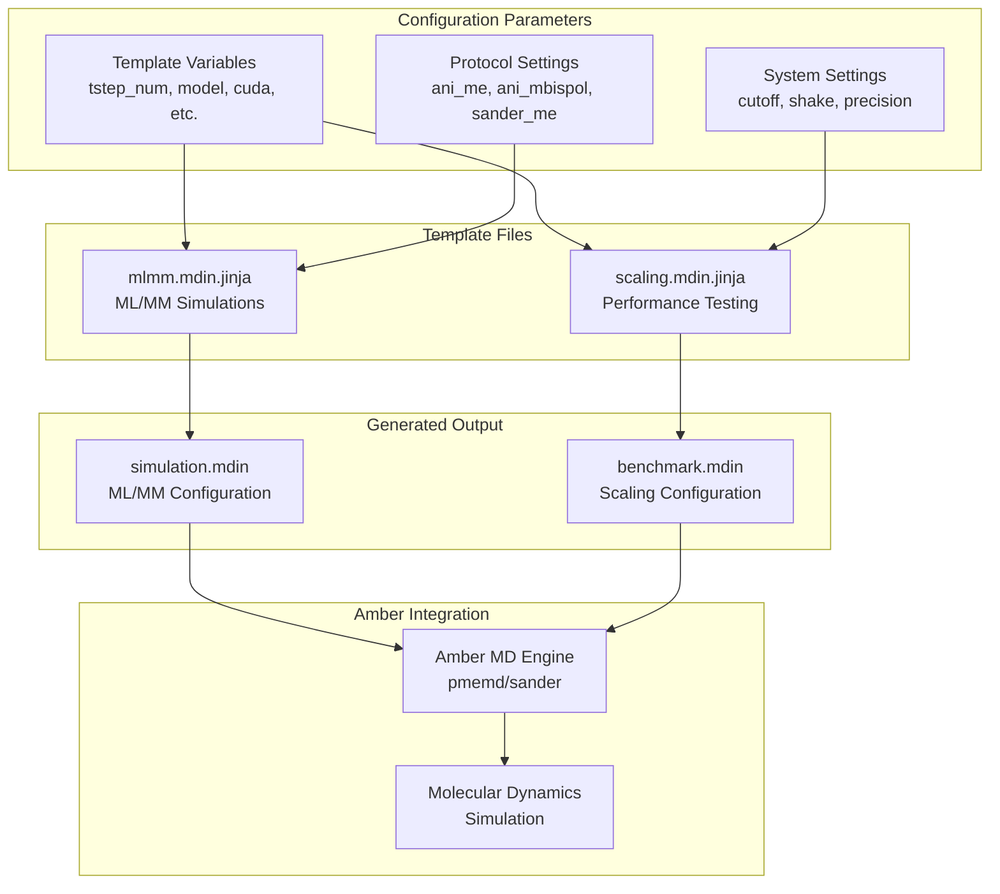
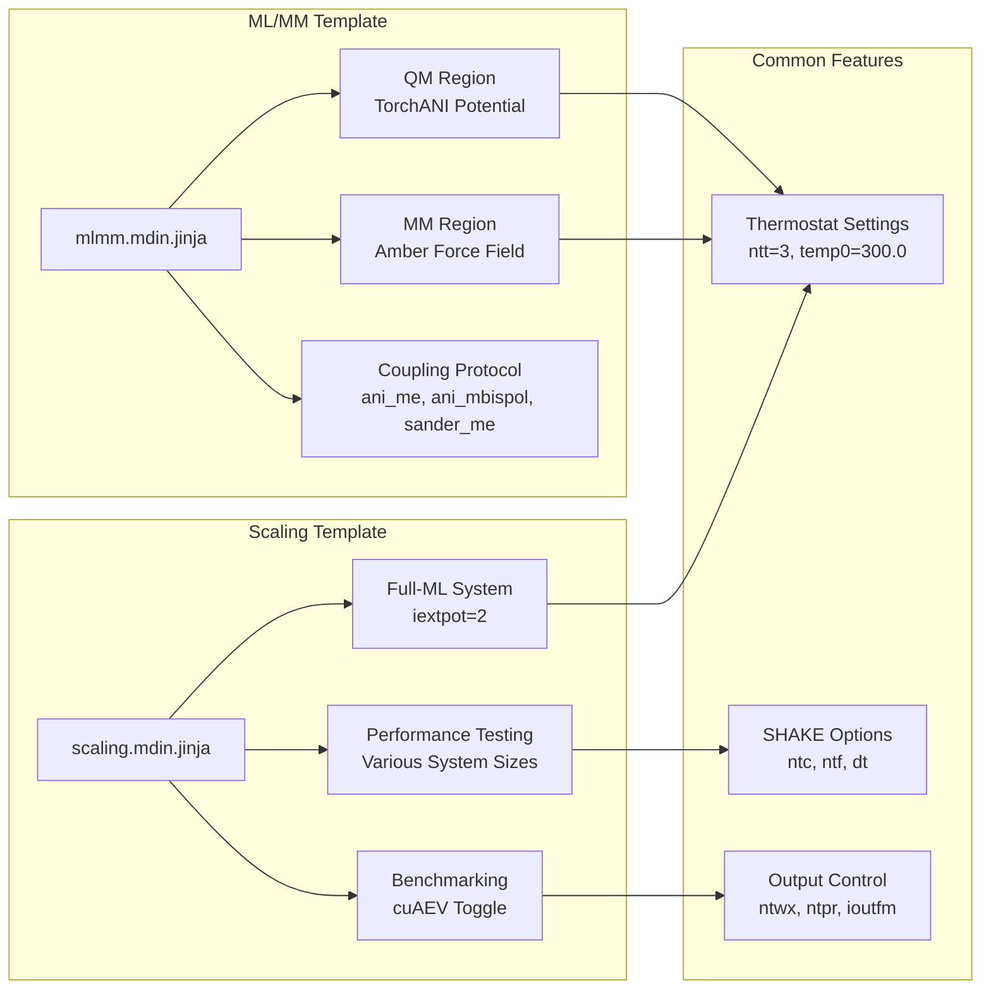

# Input Templates and Examples

<details>
<summary>Relevant source files</summary>

The following files were used as context for generating this wiki page:

- [benchmark/templates/mlmm.mdin.jinja](benchmark/templates/mlmm.mdin.jinja)
- [benchmark/templates/scaling.mdin.jinja](benchmark/templates/scaling.mdin.jinja)
- [run-cmake](run-cmake)

</details>


This page documents the Jinja2 template system used to generate Amber `mdin` input files for TorchANI-Amber simulations. The template system provides parameterized configurations for different simulation types, including full-ML simulations and ML/MM hybrid approaches.

For detailed information about simulation configuration parameters, see [Simulation Configuration](#4.1). For ML/MM setup procedures, see [ML/MM Setup and Coupling](#4.2). For benchmarking workflows that use these templates, see [Bench CLI Tool](#5.1).

## Template System Architecture

The TorchANI-Amber system uses Jinja2 templates to generate standardized `mdin` input files for different simulation scenarios. This templating approach ensures consistent configuration while allowing parameterization for various system sizes, simulation protocols, and hardware configurations.



Sources: [benchmark/templates/mlmm.mdin.jinja](), [benchmark/templates/scaling.mdin.jinja]()

## Template Types and Use Cases

TorchANI-Amber provides specialized templates for different simulation workflows. Each template is optimized for specific use cases and contains appropriate namelist configurations.



Sources: [benchmark/templates/mlmm.mdin.jinja:1-88](), [benchmark/templates/scaling.mdin.jinja:1-49]()

## ML/MM Template Configuration

The `mlmm.mdin.jinja` template supports QM/MM simulations with TorchANI handling the quantum mechanical region. The template includes conditional logic for different coupling protocols and charge prediction methods.

### Core ML/MM Settings

| Parameter | Template Variable | Default | Description |
|-----------|------------------|---------|-------------|
| QM/MM Enable | `mlmm` | - | Boolean flag to enable QM/MM |
| QM Selection | `mlmm.selection` | - | Atom mask for QM region |
| QM Cutoff | `mlmm.cutoff` | - | QM-MM interaction cutoff |
| Coupling Protocol | `mlmm.protocol` | - | `ani_me`, `ani_mbispol`, `sander_me` |

### Protocol-Specific Configuration

The template uses conditional blocks to configure different ML/MM coupling approaches:

**ANI Mechanical Embedding (`ani_me`)**:
- `qmmm_int = 1` (ANI-controlled coupling)
- `mlmm_coupling = 0` 
- `use_torchani_charges = .False.`
- `model_type = "ani2x"`

**ANI Multi-Body Interaction Scheme Polarization (`ani_mbispol`)**:
- `qmmm_int = 1` (ANI-controlled coupling)
- `mlmm_coupling = 1`
- `use_torchani_charges = .True.`
- `model_type = "animbis"`

**Sander Mechanical Embedding (`sander_me`)**:
- `qmmm_int = 5` (Sander-controlled coupling)
- `mlmm_coupling = 0`
- `use_torchani_charges = .False.`
- `allow_untested_protocols = .True.`

Sources: [benchmark/templates/mlmm.mdin.jinja:28-46](), [benchmark/templates/mlmm.mdin.jinja:47-85]()

### Output Control Variables

The template includes conditional output settings based on the `dump_traj` variable:

```

ntwx = 1
ntpr = 1
write_charges = .True.
write_forces = .True.
write_xyz = .True.

ntwx = {{ tstep_num }}
ntpr = {{ tstep_num }}
write_charges = .False.

```

Sources: [benchmark/templates/mlmm.mdin.jinja:21-27](), [benchmark/templates/mlmm.mdin.jinja:74-84]()

## Scaling Template Configuration

The `scaling.mdin.jinja` template is designed for performance benchmarking and scaling studies. It configures full-ML simulations where the entire system uses TorchANI potentials via the external potential interface.

### External Potential Setup

The template configures TorchANI as an external potential using:

```
iextpot = 2  ! Use ANI as an external potential
extprog = "torchani"  ! Use ANI as an external potential
```

### Performance-Related Parameters

| Parameter | Template Variable | Options | Description |
|-----------|------------------|---------|-------------|
| GPU Usage | `cuda` | `True`/`False` | Enable CUDA acceleration |
| cuAEV Extension | `cuaev` | `True`/`False` | Use optimized CUDA AEV |
| Model Type | `model` | `ani1x`, `ani2x`, etc. | Neural network model |
| Neighborlist | `use_amber_neighborlist` | `True`/`False` | Use Amber neighborlist |
| Precision | - | `False` (float32) | Use single precision |

### SHAKE Configuration

The template includes conditional SHAKE settings:

```

dt = 0.002,  ! Timestep [ps] (2 fs)
ntc = 2, ntf = 2,  ! Shake ON for H

dt = 0.001,  ! Timestep [ps] (1 fs) 
ntc = 1, ntf = 1,  ! Shake OFF

```

Sources: [benchmark/templates/scaling.mdin.jinja:12-18](), [benchmark/templates/scaling.mdin.jinja:33-47]()

## Template Variable Reference

### Common Variables

| Variable | Type | Purpose | Used In |
|----------|------|---------|---------|
| `tstep_num` | Integer | Number of simulation steps | Both templates |
| `dump_traj` | Boolean | Enable trajectory output | Both templates |
| `cutoff` | Float | Non-bonded cutoff distance | Scaling template |
| `cuda` | Boolean | Enable GPU acceleration | Both templates |

### ML/MM Specific Variables

| Variable | Type | Purpose |
|----------|------|---------|
| `mlmm.selection` | String | QM atom selection mask |
| `mlmm.cutoff` | Float | QM-MM interaction cutoff |
| `mlmm.protocol` | String | Coupling protocol type |
| `mlmm.cuda` | Boolean | GPU usage for QM region |
| `mlmm.float64` | Boolean | Double precision for QM |
| `mlmm.use_torch_coupling` | Boolean | Use PyTorch for coupling |

### Scaling Specific Variables

| Variable | Type | Purpose |
|----------|------|---------|
| `cuaev` | Boolean | Enable cuAEV optimization |
| `model` | String | Neural network model name |
| `shake` | Boolean | Enable SHAKE constraints |
| `use_amber_neighborlist` | Boolean | Use Amber neighborlist |
| `use_all_amber_nonbond` | Boolean | Use all Amber non-bonded terms |

Sources: [benchmark/templates/mlmm.mdin.jinja:4](), [benchmark/templates/scaling.mdin.jinja:7](), [benchmark/templates/mlmm.mdin.jinja:36-58](), [benchmark/templates/scaling.mdin.jinja:37-46]()

## Common Simulation Examples

### Example 1: Basic ML/MM Simulation

Template variables for a simple alanine dipeptide ML/MM simulation:

```python
{
    "tstep_num": 1000,
    "dump_traj": False,
    "mlmm": {
        "selection": ":1-3",
        "cutoff": 8.0,
        "protocol": "ani_me", 
        "cuda": True,
        "float64": False,
        "use_torch_coupling": True
    }
}
```

### Example 2: Performance Scaling Study

Template variables for benchmarking with cuAEV optimization:

```python
{
    "tstep_num": 100,
    "dump_traj": False,
    "cutoff": 8.0,
    "cuda": True,
    "cuaev": True,
    "model": "ani2x",
    "shake": True,
    "use_amber_neighborlist": True
}
```

### Example 3: Development Testing with Full Output

Template variables for debugging with complete trajectory output:

```python
{
    "tstep_num": 10,
    "dump_traj": True,
    "mlmm": {
        "selection": ":1-9",
        "cutoff": 8.0,
        "protocol": "ani_mbispol",
        "cuda": False,
        "float64": True,
        "use_torch_coupling": False
    }
}
```

Sources: [benchmark/templates/mlmm.mdin.jinja:15](), [benchmark/templates/scaling.mdin.jinja:13](), [benchmark/templates/mlmm.mdin.jinja:21-27]()

---