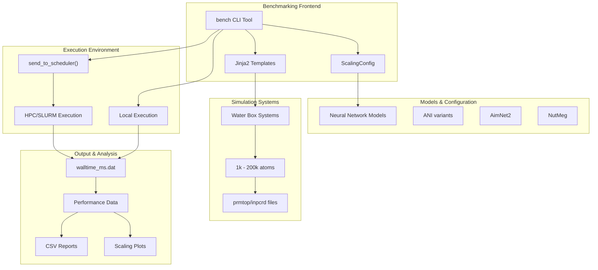
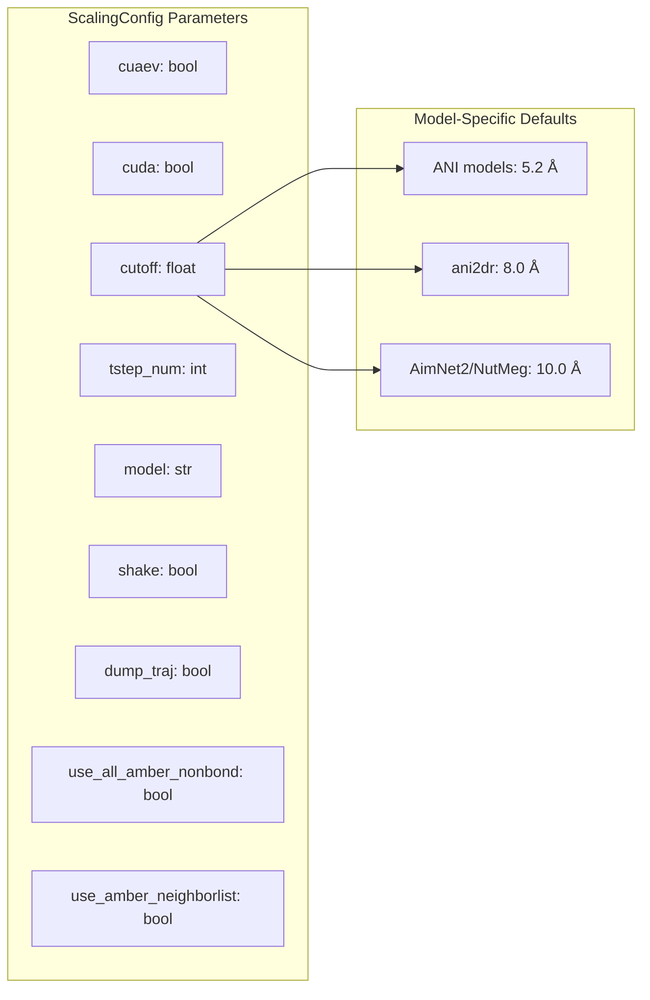
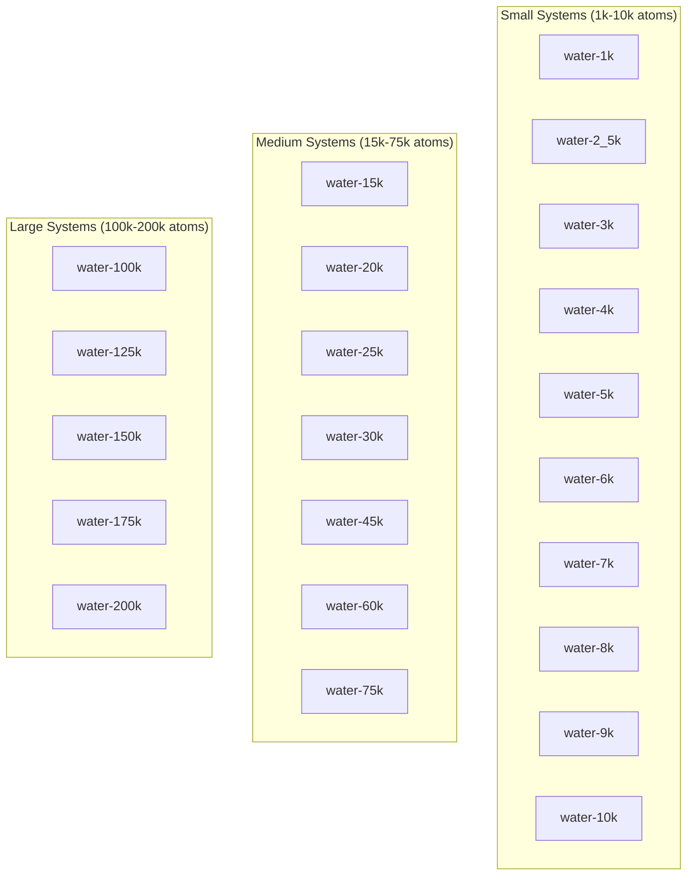
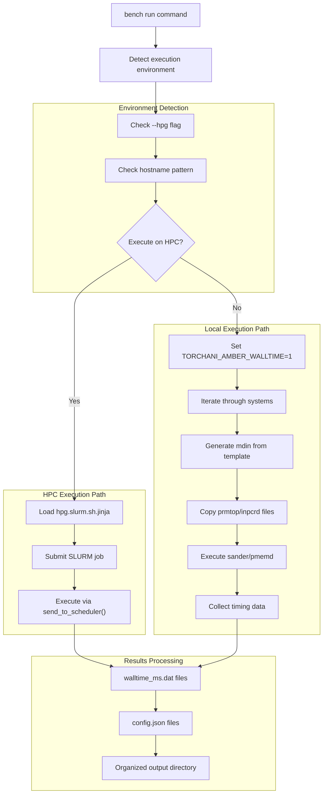
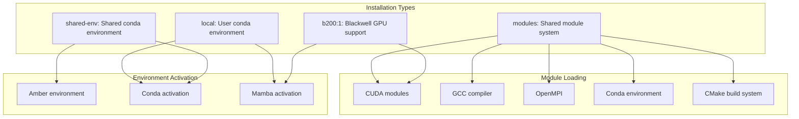
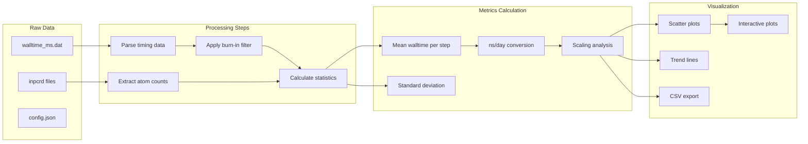
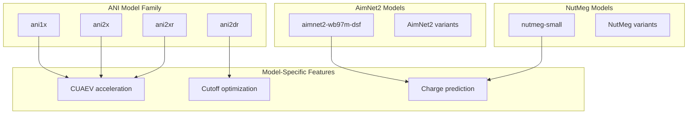

# Benchmarking System

Relevant source files

The following files were used as context for generating this wiki page:

- [benchmark/bench](benchmark/bench)
- [benchmark/templates/hpg.slurm.sh.jinja](benchmark/templates/hpg.slurm.sh.jinja)

The benchmarking system provides a comprehensive framework for performance testing and scaling studies of TorchANI-Amber simulations. It enables automated execution of molecular dynamics simulations across different system sizes, neural network models, and hardware configurations, with integrated analysis and visualization tools.

For information about configuring individual simulations, see [Simulation Configuration](#4.1). For details about the command-line interface specifically, see [Bench CLI Tool](#5.1).

## System Architecture

The benchmarking framework consists of a Python-based CLI tool that orchestrates simulation execution, data collection, and performance analysis across both local and HPC environments.

Sources: [benchmark/bench:1-471]()

## Benchmark Types and Configuration

The system supports different benchmark types through the `BenchKind` enum and configurable parameters via the `ScalingConfig` dataclass.

### Benchmark Categories

| Benchmark Type | Purpose | Implementation Status |
|----------------|---------|----------------------|
| `SCALING` | Performance scaling across system sizes | Implemented |
| `REMD` | Replica Exchange MD benchmarks | Not implemented |

### Configuration Parameters

The `ScalingConfig` dataclass defines the core benchmark parameters:

Sources: [benchmark/bench:33-52](), [benchmark/bench:241-247]()

## System Size Matrix

The benchmarking framework uses predefined water box systems spanning multiple orders of magnitude in system size:

Sources: [benchmark/bench:177-200]()

## Execution Workflow

The benchmark execution follows a structured workflow that handles both local and HPC environments:

Sources: [benchmark/bench:224-237](), [benchmark/bench:278-307]()

## HPC Integration

The system provides sophisticated HPC integration through SLURM templates and environment management:

### SLURM Configuration

| Parameter | Purpose | Configuration |
|-----------|---------|---------------|
| `job-name` | Job identification | `{{ unique_id }}-v{{ version }}-{{ name }}` |
| `partition` | Queue selection | Configurable via `--gpu` parameter |
| `gres` | GPU resources | `gpu:{{ gpu }}` specification |
| `time` | Walltime limit | `{{ hours }}:00:00` format |
| `nodes` | Node allocation | Fixed at 1 node |
| `cpus-per-task` | CPU cores | Fixed at 1 core |

### Environment Management

The SLURM template supports multiple installation configurations:

Sources: [benchmark/templates/hpg.slurm.sh.jinja:1-32]()

## Performance Analysis and Visualization

The benchmarking system includes comprehensive analysis capabilities through the `plot` command:

### Data Processing Pipeline

### Performance Metrics

The system generates two primary performance metrics:

| Metric | Units | Calculation | Purpose |
|--------|-------|-------------|---------|
| Walltime per timestep | milliseconds | Direct measurement | Low-level performance |
| Simulation rate | ns/day | `86.4 / walltime_ms` | Production throughput |

Sources: [benchmark/bench:309-467](), [benchmark/bench:441-444]()

## Model Support and Optimization

The benchmarking framework supports multiple neural network models with model-specific optimizations:

### Supported Models

### Hardware Optimization

The system automatically detects and configures hardware-specific optimizations:

| Feature | Detection Method | Configuration |
|---------|------------------|---------------|
| CUDA availability | `torch.cuda.is_available()` | Automatic GPU usage |
| CUAEV acceleration | Model name pattern matching | ANI models only |
| Amber neighborlist | User configuration | Optional optimization |
| Amber nonbonded | User configuration | Performance trade-off |

Sources: [benchmark/bench:26](), [benchmark/bench:156-158](), [benchmark/bench:239-252](), [benchmark/bench:282-285]()

---