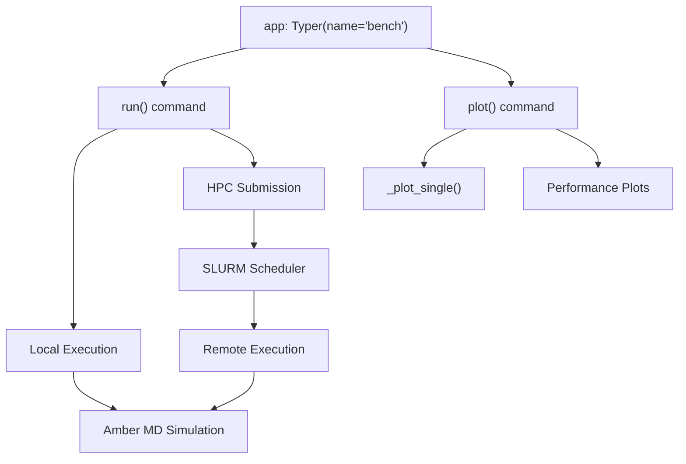
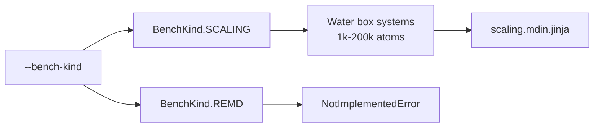
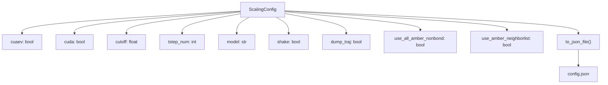
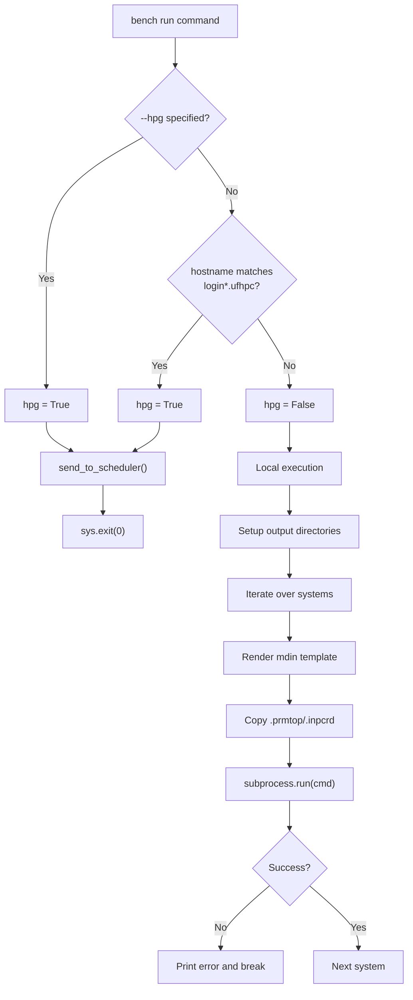
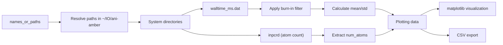
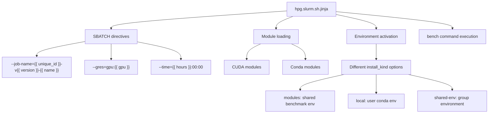
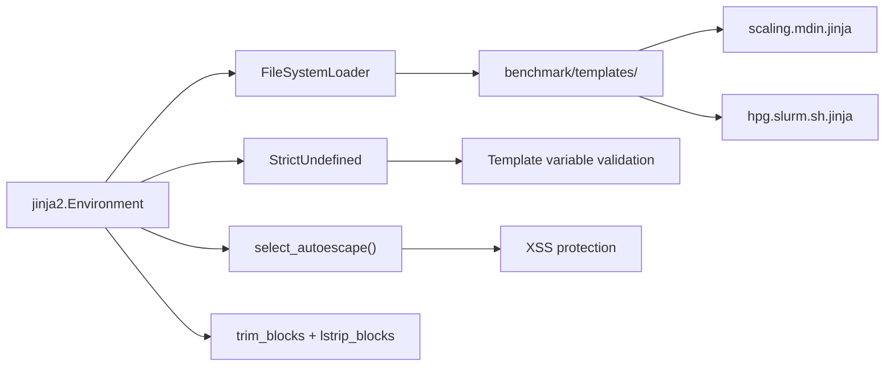
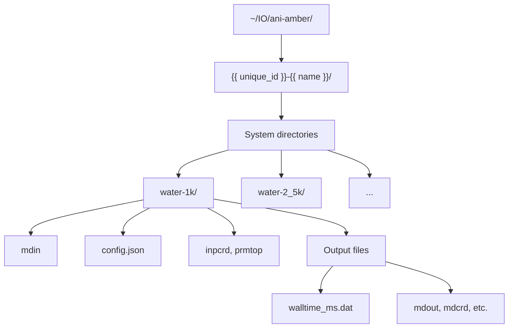

# Bench CLI Tool

Relevant source files

The following files were used as context for generating this wiki page:

- [benchmark/bench](benchmark/bench)
- [benchmark/templates/hpg.slurm.sh.jinja](benchmark/templates/hpg.slurm.sh.jinja)

The `bench` CLI tool provides a comprehensive benchmarking framework for TorchANI-Amber molecular dynamics simulations. It automates the execution of scaling studies and performance analysis across different system sizes, neural network models, and hardware configurations. The tool supports both local execution and HPC cluster submission with SLURM scheduling.

For information about interpreting benchmark results and performance metrics, see [Performance Testing and Analysis](#5.2).

## CLI Commands Overview

The `bench` tool provides two primary commands implemented using the Typer framework:

| Command | Purpose | Key Options |
|---------|---------|-------------|
| `run` | Execute benchmark simulations | `--model`, `--systems`, `--hpg`, `--tsteps` |
| `plot` | Generate performance plots from results | `--ns-per-day`, `--burn-in-tstep-num`, `--labels` |

**CLI Application Structure**

Sources: [benchmark/bench:21-31](), [benchmark/bench:54-150](), [benchmark/bench:309-340]()

## Run Command

The `run` command orchestrates benchmark execution with extensive configuration options for different simulation scenarios.

### Core Parameters

| Parameter | Type | Default | Description |
|-----------|------|---------|-------------|
| `--model` | str | "ani2xr" | Neural network model to benchmark |
| `--tsteps` | int | 1000 | Number of MD timesteps to execute |
| `--systems` | List[str] | Auto-detected | System sizes for scaling studies |
| `--hpg` | bool | Auto-detected | Enable HPC cluster submission |
| `--cuda` | bool | Auto-detected | Use CUDA acceleration |

### Benchmark Types

The tool supports different benchmark kinds through the `BenchKind` enum:

The scaling benchmark automatically selects water box systems ranging from 1,000 to 200,000 atoms when no specific systems are provided [benchmark/bench:177-200]().

### Configuration Management

Benchmark parameters are managed through the `ScalingConfig` dataclass:

Sources: [benchmark/bench:38-52](), [benchmark/bench:264-274]()

### Execution Workflow

**Local vs HPC Execution Decision Tree**

Sources: [benchmark/bench:224-237](), [benchmark/bench:280-307]()

## Plot Command

The `plot` command generates performance visualizations from benchmark output data.

### Key Options

| Option | Type | Default | Description |
|--------|------|---------|-------------|
| `--burn-in-tstep-num` | int | 50 | Skip initial timesteps in analysis |
| `--ns-per-day` | bool | False | Plot simulation speed vs walltime |
| `--labels` | List[str] | Auto-generated | Custom labels for plot series |
| `--max-num-atoms` | int | 1e12 | Filter systems by atom count |

### Data Processing Pipeline

The plotting function automatically converts walltime measurements to ns/day performance metrics using the conversion factor `86.4 / means` [benchmark/bench:441-444]().

Sources: [benchmark/bench:309-385](), [benchmark/bench:387-467]()

## HPC Integration

The tool integrates with SLURM schedulers through the `send_to_scheduler` function and Jinja2 templates.

### SLURM Template System

The template supports multiple installation configurations based on the `install_kind` parameter [benchmark/templates/hpg.slurm.sh.jinja:17-29]().

### GPU Resource Management

| GPU Type | CUDA Version | Environment |
|----------|--------------|-------------|
| `b200:1` | 12.8 | ani-amber-blackwell |
| Standard | 12.4 | ani-amber-bench |
| Shared | 12.4 | ani-amber-gcc1104-cuda1204 |

Sources: [benchmark/templates/hpg.slurm.sh.jinja:1-32](), [benchmark/bench:227-236]()

## Configuration and Templates

### Jinja2 Template Environment

The tool uses a Jinja2 environment configured for strict template processing:

### Model-Specific Configuration

The tool automatically configures cutoff distances and CUAEV settings based on the selected model:

| Model Pattern | Cutoff (Å) | CUAEV Enabled |
|---------------|------------|---------------|
| `ani2dr` | 8.0 | True |
| `nutmeg*` | 10.0 | False |
| `aimnet*` | 10.0 | False |
| Default | 5.2 | True for `ani*` models |

Special handling exists for NutMeg models, which require charge file specification [benchmark/bench:282-285]().

Sources: [benchmark/bench:161-167](), [benchmark/bench:239-247](), [benchmark/bench:282-285]()

## Output Management

### Directory Structure

### Environment Variables

The tool sets `TORCHANI_AMBER_WALLTIME=1` to enable walltime measurement collection from the Amber integration [benchmark/bench:278]().

### Performance Data Collection

Walltime data is collected per timestep and written to `walltime_ms.dat` files. The plotting system processes this data with configurable burn-in periods to exclude initialization overhead from performance analysis.

Sources: [benchmark/bench:254-259](), [benchmark/bench:288-294](), [benchmark/bench:418-433]()

---