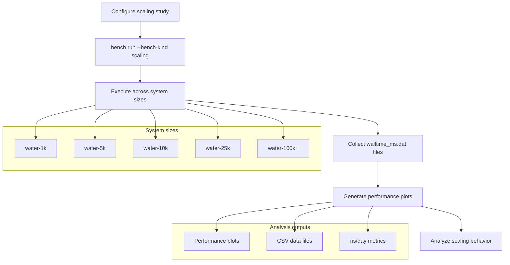
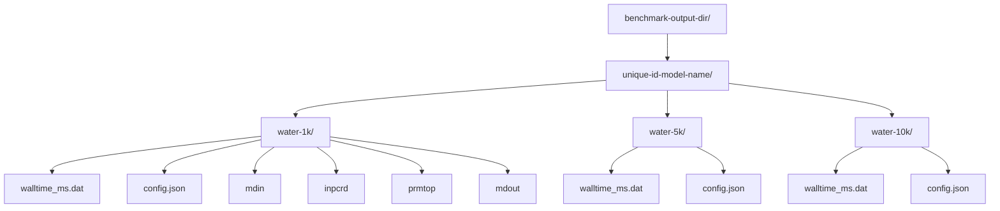
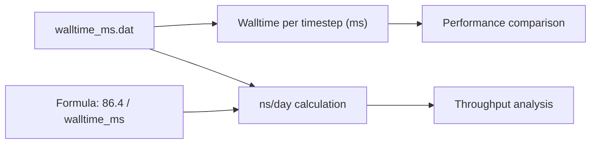
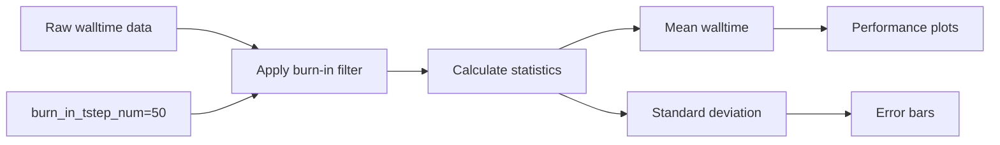
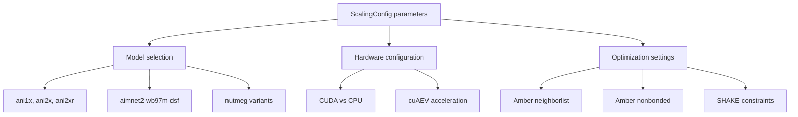
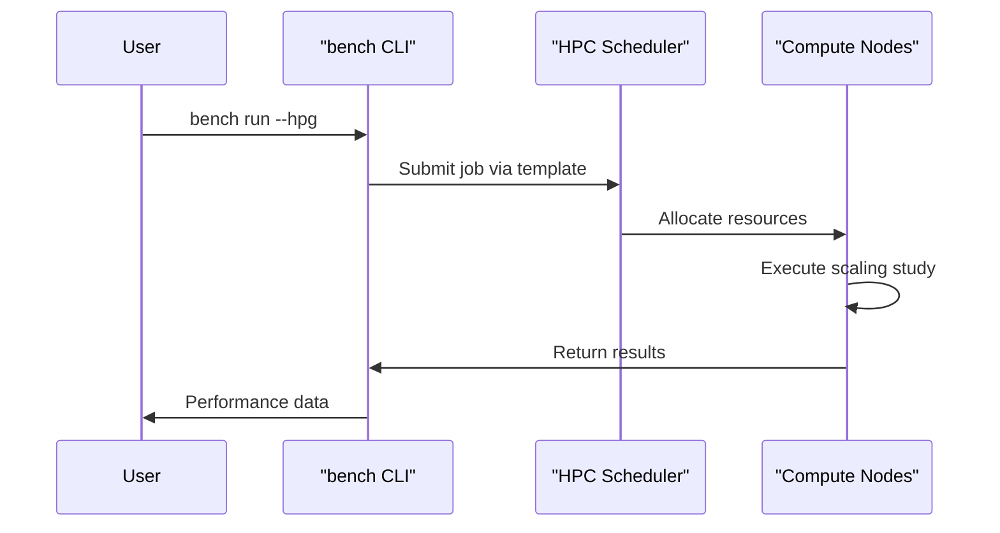
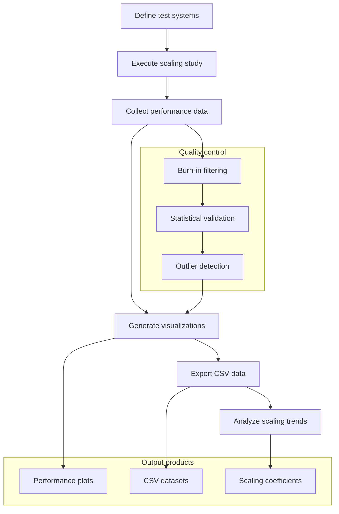

# Performance Testing and Analysis

<details>
<summary>Relevant source files</summary>

The following files were used as context for generating this wiki page:

- [benchmark/bench](benchmark/bench)
- [benchmark/templates/hpg.slurm.sh.jinja](benchmark/templates/hpg.slurm.sh.jinja)
- [tests/test_values_cpu_1ccx_ensemble.txt](tests/test_values_cpu_1ccx_ensemble.txt)
- [tests/test_values_cpu_1x_ensemble.txt](tests/test_values_cpu_1x_ensemble.txt)
- [tests/test_values_cpu_2x_ensemble.txt](tests/test_values_cpu_2x_ensemble.txt)
- [tests/test_values_cpu_mbis_ensemble.txt](tests/test_values_cpu_mbis_ensemble.txt)
- [tests/test_values_cuda_1ccx_ensemble.txt](tests/test_values_cuda_1ccx_ensemble.txt)
- [tests/test_values_cuda_1x_ensemble.txt](tests/test_values_cuda_1x_ensemble.txt)
- [tests/test_values_cuda_2x_ensemble.txt](tests/test_values_cuda_2x_ensemble.txt)
- [tests/test_values_cuda_mbis_ensemble.txt](tests/test_values_cuda_mbis_ensemble.txt)

</details>


This page covers the performance testing and analysis capabilities of TorchANI-Amber, focusing on how to conduct scaling studies, interpret benchmark results, and generate performance visualizations. For information about the bench CLI tool itself and basic usage, see [Bench CLI Tool](#5.1).

## Purpose and Scope

The performance testing system provides comprehensive tools for analyzing TorchANI-Amber's computational performance across different system sizes, hardware configurations, and model types. The analysis framework supports:

- Scaling studies across different molecular system sizes
- Performance comparison between different neural network models
- Hardware performance analysis (CPU vs GPU, different GPU types)
- HPC cluster scaling analysis
- Automated visualization and reporting

Sources: [benchmark/bench:1-470]()

## Scaling Study Workflow

The typical scaling study workflow involves running benchmarks across multiple system sizes and then analyzing the results to understand performance characteristics.



The scaling study automatically tests predefined system sizes ranging from 1,000 to 200,000 atoms, allowing comprehensive performance characterization.

Sources: [benchmark/bench:169-200](), [benchmark/bench:277-307]()

## Benchmark Data Structure

Each benchmark execution generates a structured output directory containing performance data and configuration information:



**Key Data Files:**

| File | Purpose |
|------|---------|
| `walltime_ms.dat` | Per-timestep walltime measurements in milliseconds |
| `config.json` | ScalingConfig parameters for reproducibility |
| `mdin` | Generated Amber input file |
| `mdout` | Amber simulation output |

The `walltime_ms.dat` file contains one measurement per line, with each value representing the walltime for a single MD timestep.

Sources: [benchmark/bench:418-421](), [benchmark/bench:291-294]()

## Performance Visualization

The plotting system provides automated visualization of benchmark results with multiple analysis modes:

### Basic Performance Plotting

```bash
bench plot ani2xr-scaling aimnet2-scaling --label "ANI-2xr" --label "AimNet2"
```

### Throughput Analysis

```bash
bench plot ani2xr-scaling --ns-per-day --ymax 6
```

The plotting system generates two key metrics:



**Performance Metrics:**

| Metric | Formula | Purpose |
|--------|---------|---------|
| Walltime per timestep | Direct from data | Raw performance measurement |
| ns/day throughput | `86.4 / walltime_ms` | Simulation productivity metric |

Sources: [benchmark/bench:441-445](), [benchmark/bench:324-327]()

## Statistical Analysis and Burn-in

The analysis system incorporates statistical rigor through burn-in periods and error analysis:



The system automatically:
- Excludes initial timesteps (default: 50) to account for initialization overhead
- Calculates mean and standard deviation for each system size
- Generates CSV output with statistical summaries

Sources: [benchmark/bench:421-433](), [benchmark/bench:460-466]()

## Model and Hardware Performance Analysis

The benchmarking system supports comparative analysis across different configurations:

### Model Comparison Framework



**Key Configuration Parameters:**

| Parameter | Options | Impact |
|-----------|---------|--------|
| `cuaev` | true/false | Enables CUDA-accelerated AEV computation |
| `cuda` | true/false | GPU vs CPU execution |
| `use_amber_neighborlist` | true/false | Amber vs TorchANI neighbor detection |
| `use_all_amber_nonbond` | true/false | Hybrid force calculation |
| `shake` | true/false | Bond constraint algorithm |

Sources: [benchmark/bench:39-48](), [benchmark/bench:239-247]()

## HPC Scaling Analysis

For large-scale performance studies, the system integrates with HPC schedulers:



The HPC integration automatically:
- Detects HPC environment based on hostname pattern
- Submits jobs via SLURM templates
- Manages environment modules and conda activation
- Handles GPU resource allocation

Sources: [benchmark/bench:224-237](), [benchmark/templates/hpg.slurm.sh.jinja:1-32]()

## Automated Analysis Pipeline

A complete performance analysis typically follows this pipeline:



The system ensures reproducibility by:
- Saving complete configuration in `config.json`
- Using consistent system definitions
- Applying standardized analysis methods
- Generating machine-readable output formats

Sources: [benchmark/bench:264-274](), [benchmark/bench:413-466]()

---