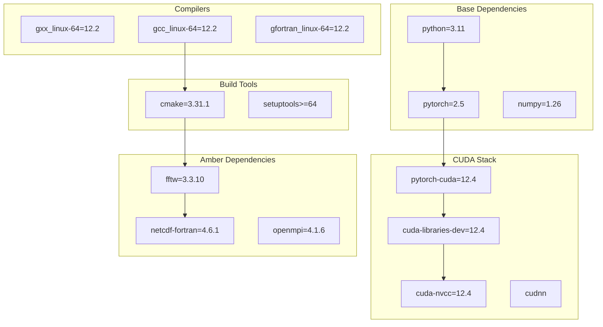
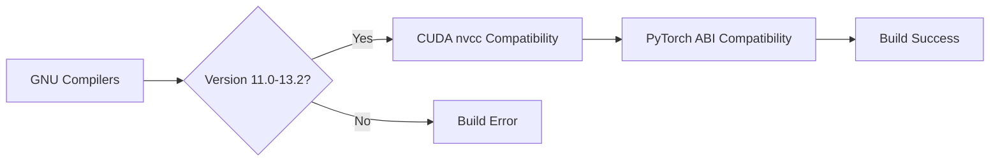
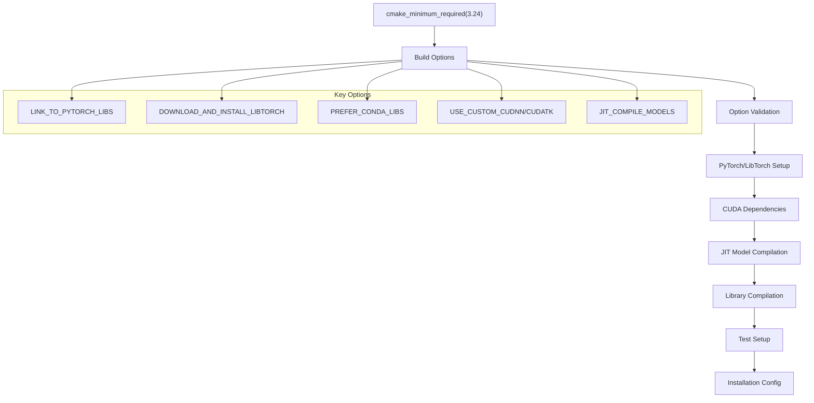
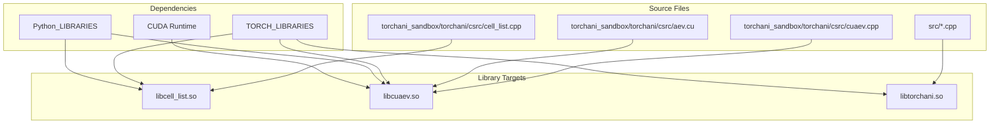
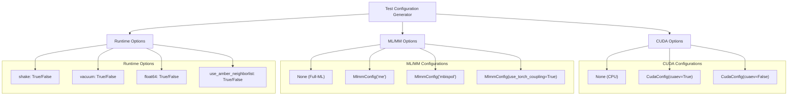
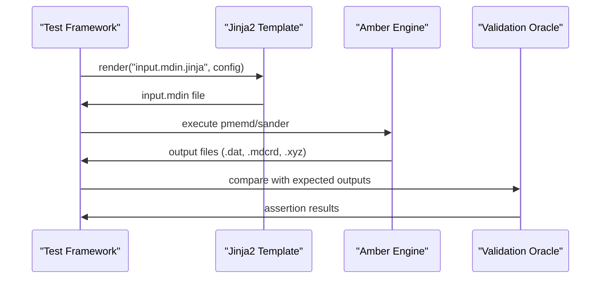
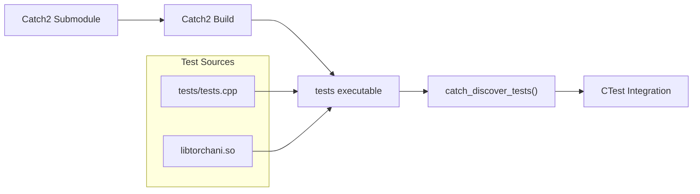
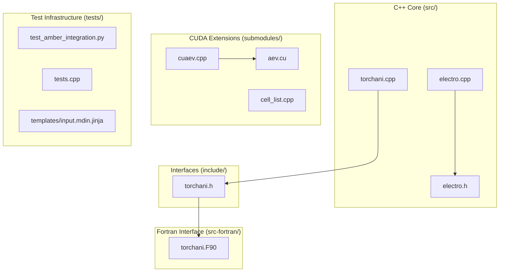
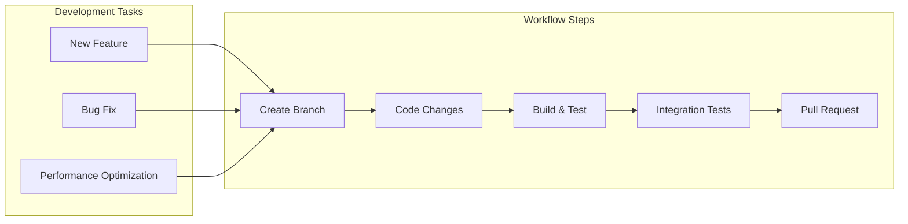

# Development Guide

Relevant source files

The following files were used as context for generating this wiki page:

- [CMakeLists.txt](CMakeLists.txt)
- [environment.yaml](environment.yaml)
- [src/electro.cpp](src/electro.cpp)
- [src/electro.h](src/electro.h)
- [tests/templates/input.mdin.jinja](tests/templates/input.mdin.jinja)
- [tests/test_amber_integration.py](tests/test_amber_integration.py)

This guide provides essential information for developers contributing to TorchANI-Amber, covering the development environment, build system, testing infrastructure, and contribution workflow. This document focuses on the technical aspects of working with the codebase and build system.

For detailed build system configuration options, see [Build System Deep Dive](#6.1). For comprehensive testing procedures and framework details, see [Testing Framework](#6.2). For development workflow and code quality standards, see [Code Quality and Development Workflow](#6.3).

## Development Environment Setup

TorchANI-Amber requires a carefully configured development environment due to its complex dependency chain involving PyTorch, CUDA, cuDNN, and Amber molecular dynamics engines.

### Conda Environment Configuration

The project uses a conda environment specification that ensures compatibility across all components:

Sources: [environment.yaml:1-68]()

The environment enforces strict version compatibility, particularly for the CUDA stack where PyTorch 2.5 must match CUDA 12.4 and the corresponding cuDNN version.

### Compiler Requirements

The build system enforces specific compiler versions to ensure compatibility with CUDA and PyTorch:

Sources: [CMakeLists.txt:74-88]()

## Build System Architecture

The CMake build system is designed to handle the complex dependency resolution required for a project that bridges Python ML frameworks with high-performance C++ execution.

### Build Configuration Flow

Sources: [CMakeLists.txt:36-93]()

### Library Compilation Targets

The build system creates three main shared libraries:

Sources: [CMakeLists.txt:234-323]()

The `libcuaev.so` library includes CUDA-specific optimizations with the `TORCHANI_OPT` flag and fast math compilation options.

## Testing Infrastructure

TorchANI-Amber employs a comprehensive testing strategy that validates integration with Amber MD engines across multiple configuration combinations.

### Test Configuration Matrix

The testing framework uses parameterized tests to validate functionality across different runtime configurations:

Sources: [tests/test_amber_integration.py:77-111]()

### Test Execution Framework

The test framework generates Amber input files using Jinja2 templates that adapt to different configuration combinations:

Sources: [tests/test_amber_integration.py:113-125](), [tests/templates/input.mdin.jinja:1-98]()

### Unit Test Infrastructure

The project uses Catch2 for C++ unit testing with CMake integration:

Sources: [CMakeLists.txt:378-391]()

## Code Organization

The codebase follows a multi-language architecture with clear separation between computational kernels, interfaces, and integration layers.

### Core Implementation Structure

Sources: [CMakeLists.txt:289-323](), [src/electro.cpp:1-90](), [src/electro.h:1-19]()

### Key Computational Modules

The `electro` namespace provides core electrostatic calculation functionality:

- `coulombic_embedding_energy()`: Calculates Coulombic QM/MM interaction energy
- `polarizable_embedding_energy()`: Computes polarizable embedding energy using atomic polarizabilities

Sources: [src/electro.h:4-18](), [src/electro.cpp:78-89]()

## Development Workflow

### Build Process

1. **Environment Setup**: Activate the `ani-amber` conda environment
2. **Configuration**: Run CMake with appropriate options for your development setup
3. **Compilation**: Build the shared libraries and test executables
4. **Testing**: Execute the test suite to validate functionality

### Common Development Scenarios

### Testing Strategy

The testing approach validates both individual components and full system integration:

- **Unit Tests**: C++ components tested with Catch2 framework
- **Integration Tests**: Full Amber MD simulations with expected output comparison
- **Configuration Tests**: Parameterized testing across CUDA/CPU, ML/MM modes
- **Regression Tests**: Automated comparison against reference outputs

Sources: [tests/test_amber_integration.py:127-383]()

The development environment supports rapid iteration through automated build configuration detection and comprehensive test coverage across deployment scenarios.

---