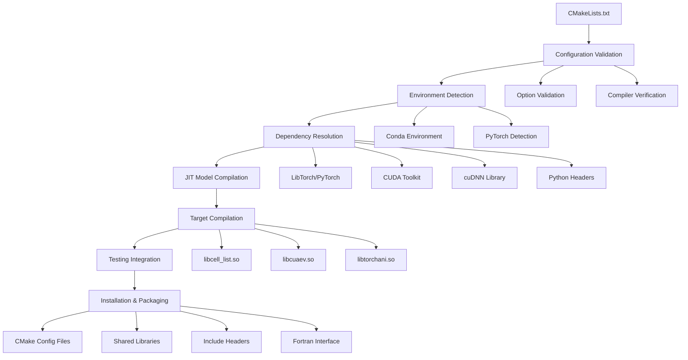
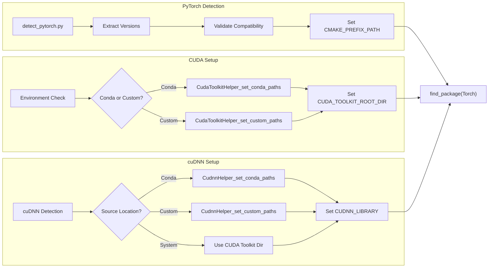
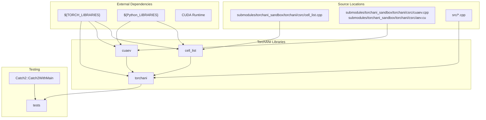
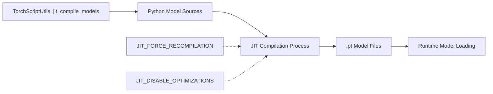
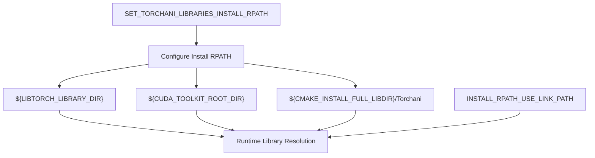
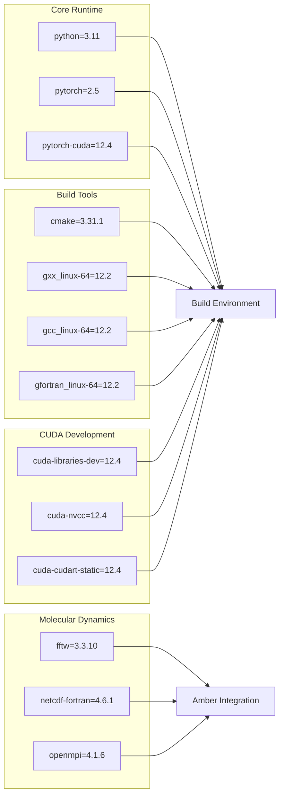
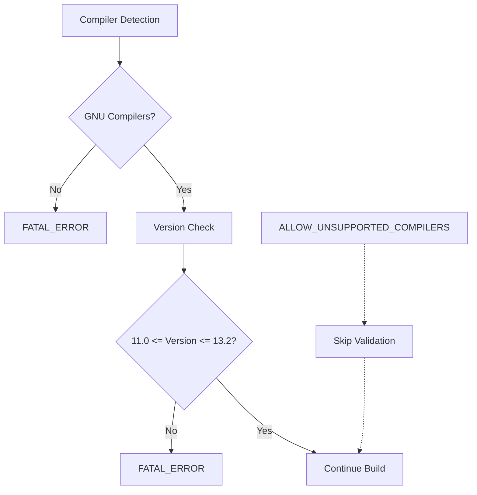

# Build System Deep Dive

Relevant source files

The following files were used as context for generating this wiki page:

- [CMakeLists.txt](CMakeLists.txt)
- [cmake/Msg.cmake](cmake/Msg.cmake)
- [cmake/TorchaniConfig.cmake.in](cmake/TorchaniConfig.cmake.in)
- [cmake/detect_pytorch.py](cmake/detect_pytorch.py)
- [environment.yaml](environment.yaml)

This document provides a comprehensive overview of the CMake-based build system used in TorchANI-Amber. It covers the build configuration process, dependency resolution, target compilation, and installation procedures. For information about using the build artifacts in simulations, see [Amber Integration](#4). For testing the build outputs, see [Testing Framework](#6.2).

## Build System Architecture

The TorchANI-Amber build system is implemented as a sophisticated CMake project that manages complex dependencies including PyTorch/LibTorch, CUDA toolkit, cuDNN, and Python extensions. The system supports multiple build configurations and deployment scenarios.

### Build Process Overview

Sources: [CMakeLists.txt:1-462]()

### Configuration Options and Flags

The build system provides extensive configuration through CMake options that control dependency handling and compilation behavior:

| Option | Default | Description |
|--------|---------|-------------|
| `LINK_TO_PYTORCH_LIBS` | ON | Link to existing PyTorch installation |
| `DOWNLOAD_AND_INSTALL_LIBTORCH` | OFF | Download LibTorch if PyTorch unavailable |
| `PREFER_CONDA_LIBS` | ON | Prioritize libraries from active conda environment |
| `COMPILE_WITH_CXX11ABI` | OFF | Use C++11 ABI (requires LibTorch mode) |
| `USE_CUSTOM_CUDNN` | OFF | Use cuDNN from `./external/cudnn<version>` |
| `USE_CUSTOM_CUDATK` | OFF | Use CUDA Toolkit from `/usr/local/cuda-<version>` |
| `JIT_COMPILE_MODELS` | ON | JIT-compile ANI models during build |
| `JIT_FORCE_RECOMPILATION` | OFF | Force recompilation of existing `.pt` files |
| `SET_TORCHANI_LIBRARIES_INSTALL_RPATH` | ON | Set RPATH for installed libraries |

Sources: [CMakeLists.txt:38-46](), [CMakeLists.txt:91-93]()

### Dependency Resolution Workflow

The dependency resolution process handles three critical components:

**PyTorch/LibTorch Detection**: The system uses [cmake/detect_pytorch.py:1-16]() to extract version information and installation paths from an existing PyTorch installation. This script extracts torch version, CUDA version, cuDNN version, and the PyTorch root directory.

**CUDA Toolkit Resolution**: Depending on configuration, the system either uses CUDA from the active conda environment or searches custom paths. The `CudaToolkitHelper` modules set `CUDA_TOOLKIT_ROOT_DIR` and `CMAKE_CUDA_COMPILER` variables.

**cuDNN Library Management**: Similar to CUDA, cuDNN can be sourced from conda, custom directories, or assumed to be co-located with the CUDA Toolkit.

Sources: [CMakeLists.txt:115-165](), [CMakeLists.txt:167-186](), [CMakeLists.txt:188-212](), [cmake/detect_pytorch.py:1-16]()

## Target Compilation Process

### Library Target Hierarchy

### Compilation Specifications

**cell_list Library**: Built from TorchANI sandbox submodule sources with C++17 standard and PyTorch/Python linking.

**cuaev Library**: CUDA-enabled library with specific optimizations:
- `TORCHANI_OPT` preprocessor definition enables CUDA intrinsics
- `-use_fast_math` NVCC flag for fast math library
- Custom CUB namespace definitions to avoid conflicts with PyTorch

**torchani Library**: Main interface library with comprehensive warning flags and special linking requirements:
- Force-loading of `cuaev` and `cell_list` using `LINKER:-force_load`
- `--no-as-needed` linker flag to ensure proper dependency resolution

Sources: [CMakeLists.txt:234-287](), [CMakeLists.txt:289-323]()

### JIT Model Compilation

The build system includes a JIT compilation step for ANI models when `JIT_COMPILE_MODELS` is enabled:

This process converts Python-defined ANI models into TorchScript format for efficient C++ runtime loading.

Sources: [CMakeLists.txt:215-223]()

## Installation and Packaging

### RPATH Configuration

The build system implements sophisticated RPATH handling to ensure runtime library resolution:

The RPATH configuration prevents re-linking issues during installation and ensures libraries can locate dependencies regardless of system-wide CUDA installations.

Sources: [CMakeLists.txt:340-364]()

### CMake Package Configuration

The build system generates complete CMake package configuration for downstream usage:

| File | Purpose |
|------|---------|
| `TorchaniConfig.cmake` | Main configuration file with paths and targets |
| `TorchaniConfigVersion.cmake` | Version compatibility checking |
| `TorchaniTargets.cmake` | Exported target definitions |

**Installation Structure**:
- Libraries: `${CMAKE_INSTALL_LIBDIR}/Torchani/`
- Headers: `${CMAKE_INSTALL_INCLUDEDIR}/Torchani/`
- CMake files: `${CMAKE_INSTALL_DATAROOTDIR}/cmake/Torchani/`
- Fortran interface: `${CMAKE_INSTALL_DATAROOTDIR}/Torchani/Fortran/`

Sources: [CMakeLists.txt:393-461](), [cmake/TorchaniConfig.cmake.in:1-13]()

## Environment and Dependency Management

### Conda Environment Specification

The project defines a comprehensive conda environment that aligns with build requirements:

The environment specification enforces exact version matching for critical components like PyTorch (2.5), CUDA (12.4), and compiler toolchain (GCC 12.2).

Sources: [environment.yaml:1-68]()

### Compiler and Version Validation

The build system includes strict compiler validation:

This validation ensures compatibility with CUDA toolkit requirements and PyTorch ABI constraints.

Sources: [CMakeLists.txt:74-88]()

---