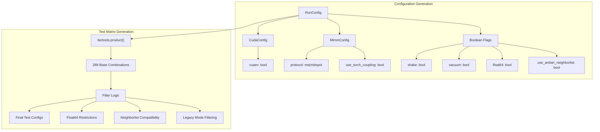
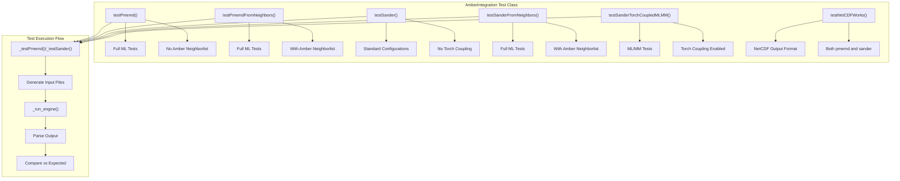
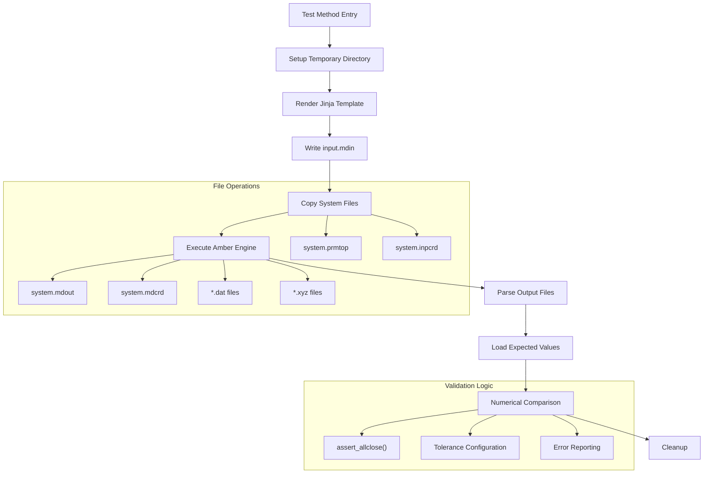
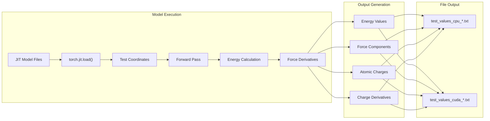
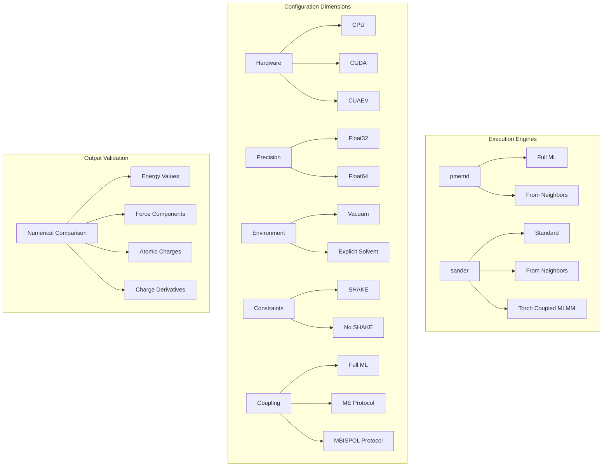

# Testing Framework

<details>
<summary>Relevant source files</summary>

The following files were used as context for generating this wiki page:

- [src/electro.cpp](src/electro.cpp)
- [src/electro.h](src/electro.h)
- [tests/generate_test_values.py](tests/generate_test_values.py)
- [tests/templates/input.mdin.jinja](tests/templates/input.mdin.jinja)
- [tests/test_amber_integration.py](tests/test_amber_integration.py)
- [tests/test_values_cpu_1ccx_ensemble.txt](tests/test_values_cpu_1ccx_ensemble.txt)
- [tests/test_values_cpu_1x_ensemble.txt](tests/test_values_cpu_1x_ensemble.txt)
- [tests/test_values_cpu_2x_ensemble.txt](tests/test_values_cpu_2x_ensemble.txt)
- [tests/test_values_cpu_dr_ensemble.txt](tests/test_values_cpu_dr_ensemble.txt)
- [tests/test_values_cpu_mbis_ensemble.txt](tests/test_values_cpu_mbis_ensemble.txt)
- [tests/test_values_cuda_1ccx_ensemble.txt](tests/test_values_cuda_1ccx_ensemble.txt)
- [tests/test_values_cuda_1x_ensemble.txt](tests/test_values_cuda_1x_ensemble.txt)
- [tests/test_values_cuda_2x_ensemble.txt](tests/test_values_cuda_2x_ensemble.txt)
- [tests/test_values_cuda_dr_ensemble.txt](tests/test_values_cuda_dr_ensemble.txt)
- [tests/test_values_cuda_mbis_ensemble.txt](tests/test_values_cuda_mbis_ensemble.txt)

</details>


## Overview

The TorchANI-Amber testing framework provides comprehensive integration testing for the entire system, validating the correctness of neural network potential calculations, Amber MD engine integration, and ML/MM coupling mechanisms. The framework systematically tests combinations of computational backends (CPU/CUDA), precision levels, molecular environments, and coupling protocols to ensure robust operation across diverse simulation scenarios.

For information about the build system that compiles the test executables, see [6.1](#6.1). For performance testing and benchmarking tools, see [5.2](#5.2).

## Test Configuration System

The testing framework uses a sophisticated configuration system based on dataclasses to systematically generate test scenarios across multiple dimensions of variability.

### Configuration Classes

The `RunConfig` class in [tests/test_amber_integration.py:44-75]() serves as the primary configuration container, composed of:

- `CudaConfig`: Controls GPU execution and CUAEV acceleration
- `MlmmConfig`: Defines ML/MM coupling protocols (`me` or `mbispol`)  
- Boolean flags for shake constraints, vacuum/explicit solvent, precision, and neighborlist options



**Test Matrix Generation**

The framework generates test configurations using `itertools.product()` across all parameter combinations in [tests/test_amber_integration.py:87-110](), then applies filtering logic to remove invalid or unsupported combinations:

| Filter Type | Condition | Rationale |
|-------------|-----------|-----------|
| Float64 Restriction | Only MLMM + CUDA + CUAEV + Vacuum | Performance optimization |
| Neighborlist Incompatibility | No MLMM with Amber neighborlist | Not implemented |
| Vacuum FullML | No FullML + Vacuum + Amber neighborlist | Not applicable |

Sources: [tests/test_amber_integration.py:32-110]()

## Integration Test Suite

The test suite is organized into parameterized test methods that systematically validate different execution engines and coupling modes.

### Test Method Organization



### Input File Generation

Each test generates Amber input files using Jinja2 templates. The `input.mdin.jinja` template in [tests/templates/input.mdin.jinja:1-98]() supports both legacy and modern configuration formats:

**Template Structure:**
- Control namelist (`&cntrl`) with dynamics parameters
- QM/MM namelist (`&qmmm`) for ML/MM simulations  
- External potential namelist (`&extpot`) for full ML simulations
- TorchANI-specific namelist (`&ani`) with model and device configuration

Sources: [tests/test_amber_integration.py:127-243](), [tests/templates/input.mdin.jinja:1-98]()

## Test Execution Workflow

The test execution follows a standardized workflow that isolates each test case and validates outputs against expected results.

### Execution Pipeline



### Engine Execution

The `_run_engine()` method in [tests/test_amber_integration.py:344-379]() handles subprocess execution of both `pmemd` and `sander` with standardized command-line arguments:

```
engine -i input.mdin -p system.prmtop -c system.inpcrd 
       -o system.mdout -r system.restart -x system.mdcrd 
       -inf system.mdinfo -O
```

Sources: [tests/test_amber_integration.py:151-379]()

## Test Data Generation and Validation

### Reference Data Generation

The `generate_test_values.py` script creates reference datasets by executing JIT-compiled neural network models directly through PyTorch:



**Test Value Files Structure:**
Each `.txt` file contains numerical values in sequence:
1. Energy (kcal/mol)
2. Force components (3 × num_atoms)
3. QBC values (for ensemble models)
4. QBC derivatives (for ensemble models)  
5. Atomic charges (for charge-predicting models)
6. Charge derivatives (for charge-predicting models)

### Tolerance Configuration

The validation system applies different numerical tolerances based on computational context:

| Configuration | rtol | atol | Rationale |
|---------------|------|------|-----------|
| CPU Standard | 1e-7 | 1e-5 | High precision baseline |
| CUDA Standard | 0.0 | 1.0002e-3 | GPU numerical differences |
| Amber Neighborlist | 0.0005 | 1.5e-3 | Mapping approximations |

Sources: [tests/test_amber_integration.py:183-194](), [tests/test_amber_integration.py:301-312](), [tests/generate_test_values.py:13-119]()

## Environment Variables and Controls

The testing framework provides several environment variables for debugging and development workflows:

### Control Variables

| Variable | Effect | Use Case |
|----------|--------|----------|
| `TORCHANI_AMBER_KEEP_TEST_DIRS=1` | Preserve test directories | Debugging failed tests |
| `TORCHANI_AMBER_OVERWRITE_EXPECTED=1` | Update expected output files | Creating new baselines |
| `TORCHANI_AMBER_LEGACY_TEST=1` | Enable legacy compatibility mode | Testing older branches |

### Output Parsing and Comparison

The `parse_amber_output()` method in [tests/test_amber_integration.py:334-342]() handles different output formats:

- **XYZ format**: Filters out comment lines containing "TORCHANI"
- **MDCRD format**: Removes header line with filename
- **DAT format**: Direct numerical parsing

Sources: [tests/test_amber_integration.py:1-10](), [tests/test_amber_integration.py:152-157](), [tests/test_amber_integration.py:195-202]()

## Test Coverage Matrix

The parameterized testing approach ensures comprehensive coverage across the configuration space:



Sources: [tests/test_amber_integration.py:77-110](), [tests/test_amber_integration.py:135-266]()

---