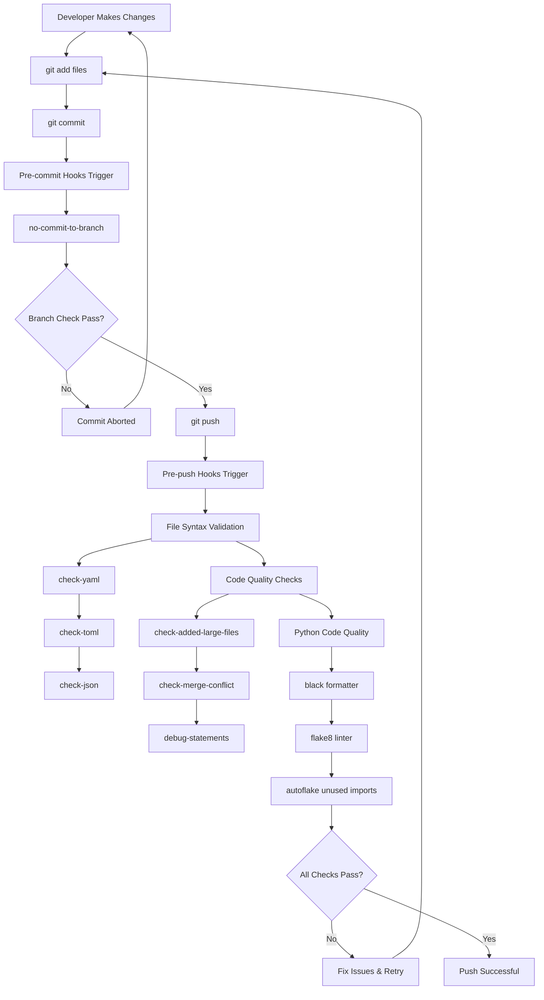
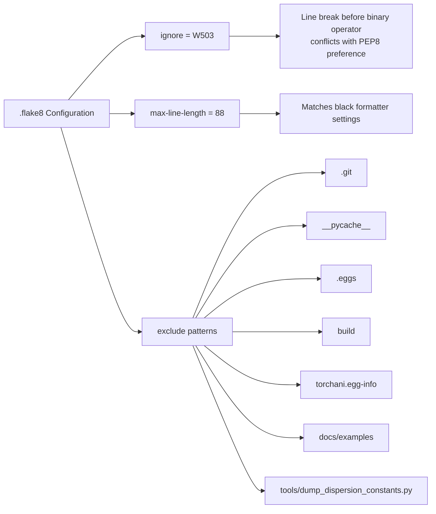
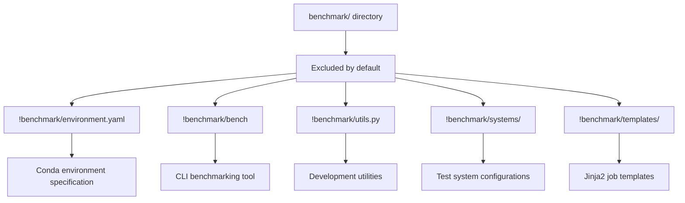
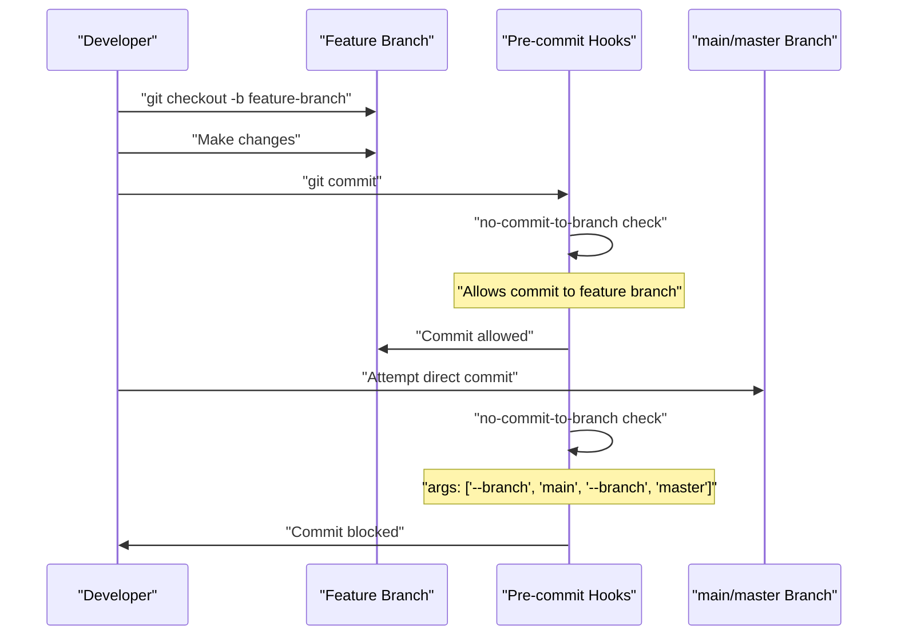
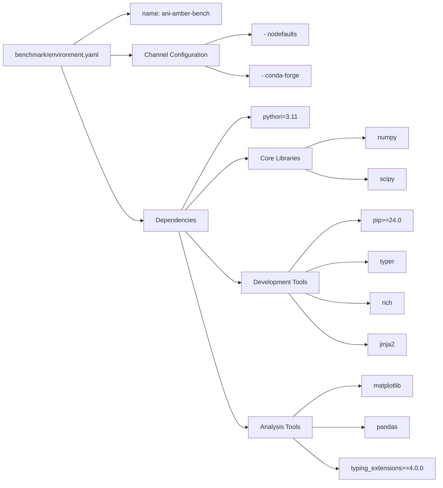
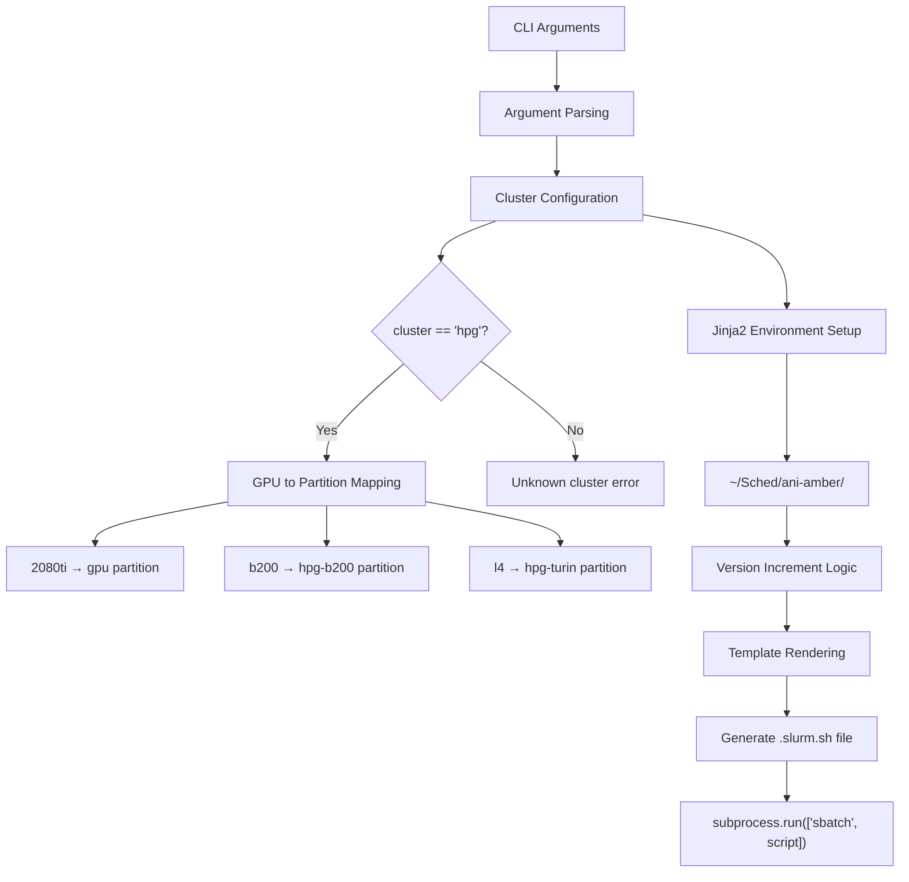

# Code Quality and Development Workflow

Relevant source files

The following files were used as context for generating this wiki page:

- [.flake8](.flake8)
- [.gitignore](.gitignore)
- [.pre-commit-config.yaml](.pre-commit-config.yaml)
- [benchmark/environment.yaml](benchmark/environment.yaml)
- [benchmark/utils.py](benchmark/utils.py)
- [external/README.md](external/README.md)

This document covers the development workflow, code quality tools, pre-commit hooks, and contribution guidelines for TorchANI-Amber. It provides essential information for developers contributing to the codebase, including automated quality checks, git workflows, and environment management practices.

For information about the build system and dependency management, see [Build System Deep Dive](#6.1). For testing infrastructure and test execution, see [Testing Framework](#6.2).

## Development Workflow Overview

TorchANI-Amber employs a structured development workflow that emphasizes code quality, automated testing, and systematic integration practices. The workflow integrates multiple quality assurance tools and follows established patterns for collaborative development.

### Pre-commit Hook System

The development workflow centers around a comprehensive pre-commit hook system that enforces code quality standards before changes enter the repository.

Sources: [.pre-commit-config.yaml:1-40]()

### Code Quality Tools Configuration

The project employs several code quality tools with specific configurations tailored to the codebase requirements.

| Tool | Purpose | Configuration File | Key Settings |
|------|---------|-------------------|--------------|
| `black` | Python code formatting | `.pre-commit-config.yaml` | Version 22.6.0, runs on pre-push |
| `flake8` | Python linting | `.flake8` | Max line length 88, ignores W503 |
| `autoflake` | Remove unused imports | `.pre-commit-config.yaml` | Version v1.4, runs on pre-push |
| `pre-commit` | Hook orchestration | `.pre-commit-config.yaml` | Multiple stages and repositories |

The `flake8` configuration specifically addresses Python coding standards:

Sources: [.flake8:1-15](), [.pre-commit-config.yaml:23-40]()

## Repository Management

### Git Ignore Patterns

The repository maintains strict control over tracked files through comprehensive ignore patterns that prevent accidental inclusion of generated content and development artifacts.

| Category | Patterns | Purpose |
|----------|----------|---------|
| Build artifacts | `build/*`, `*.x`, `*.mod` | CMake and compilation outputs |
| Generated models | `jit/*.pt`, `aimnet2/`, `nutmeg/` | JIT-compiled neural network models |
| Development cache | `.mypy_cache/`, `__pycache__/`, `.ccls-cache` | Language server and Python caches |
| Test outputs | `test/test_values*.txt`, `tests/dump_*` | Temporary test result files |
| Benchmark results | `benchmark/*` (selective) | Performance test outputs |
| Runtime artifacts | `*.mdcrd`, `*.restart`, `*mdout` | Amber simulation outputs |

The selective inclusion pattern for benchmark directory preserves essential development tools while excluding generated results:

Sources: [.gitignore:1-51]()

### Branch Protection and Workflow

The pre-commit configuration enforces branch protection policies that prevent direct commits to primary branches, encouraging a proper development workflow through feature branches and pull requests.

Sources: [.pre-commit-config.yaml:6-8]()

## Environment Management

### Development Environment Specification

The project provides standardized environment specifications for consistent development setups across different systems and contributors.

The benchmark environment configuration demonstrates the project's approach to dependency management:

Sources: [benchmark/environment.yaml:1-16]()

## Development Utilities

### Scheduler Integration for HPC Development

The development workflow includes sophisticated utilities for high-performance computing environments, particularly for testing and benchmarking on cluster systems.

The `send_to_scheduler` function in `benchmark/utils.py` demonstrates the integration between development tools and HPC infrastructure:

Sources: [benchmark/utils.py:14-79]()

### Model Support Matrix

The development framework supports a comprehensive range of neural network models through a standardized interface:

| Model Family | Variants | Purpose |
|--------------|----------|---------|
| ANI | `ani1x`, `ani1ccx`, `ani2x`, `ani2xr`, `ani2dr` | Legacy ANI models |
| ANI Specialized | `animbis`, `aniala`, `anir2s` variants | Specialized systems |
| AIMNet2 | `b973c` and `wb97m` functionals | Advanced charge prediction |
| NutMeg | `small`, `medium`, `large` | Variable complexity models |

The `SUPPORTED_MODELS` list serves as the authoritative registry for model validation and benchmarking workflows.

Sources: [benchmark/utils.py:82-109]()

## Contribution Guidelines

### Code Quality Standards

Contributors must ensure their code adheres to the established quality standards enforced by the automated toolchain:

1. **Python Code Formatting**: All Python code must pass `black` formatting with default settings
2. **Linting Compliance**: Code must satisfy `flake8` requirements with project-specific configurations
3. **Import Management**: Unused imports are automatically detected and must be removed
4. **Branch Workflow**: Direct commits to `main` or `master` branches are prohibited
5. **File Size Limits**: Large files are blocked from commits to maintain repository efficiency

### Development Environment Setup

New contributors should establish their development environment using the provided specifications:

1. Create conda environment: `conda env create -f benchmark/environment.yaml`
2. Install pre-commit hooks: `pre-commit install`
3. Verify tool functionality: `pre-commit run --all-files`
4. Configure IDE/editor to use project-specific settings (88-character line limit, etc.)

### Integration Testing

Before submitting contributions, developers should run the full suite of quality checks locally to ensure compatibility with the automated systems. The pre-commit framework provides immediate feedback on code quality issues, enabling rapid iteration during development.

Sources: [.pre-commit-config.yaml:1-40](), [.flake8:1-15](), [benchmark/environment.yaml:1-16]()