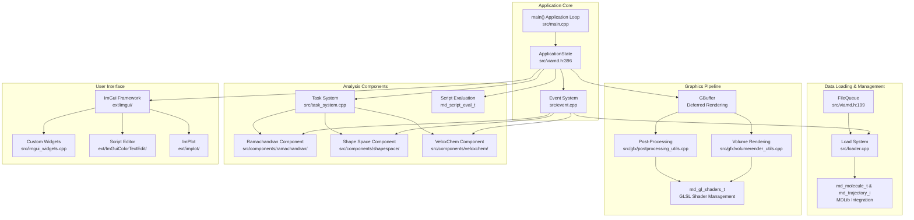
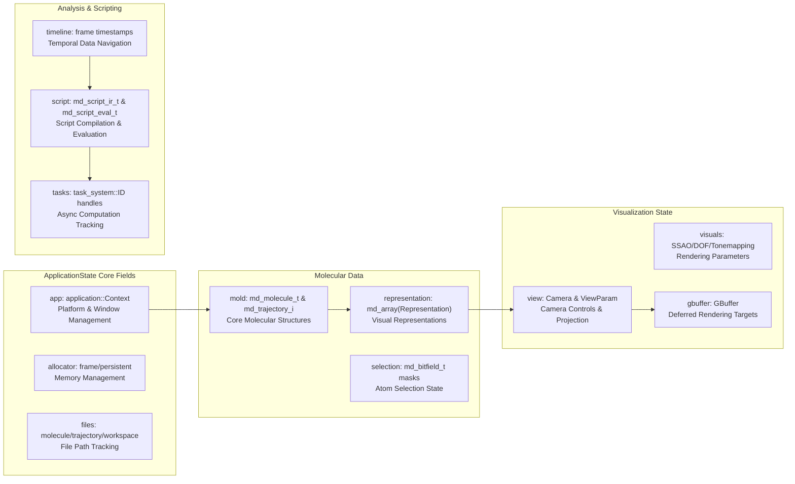
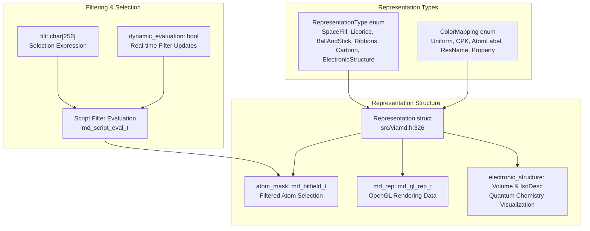
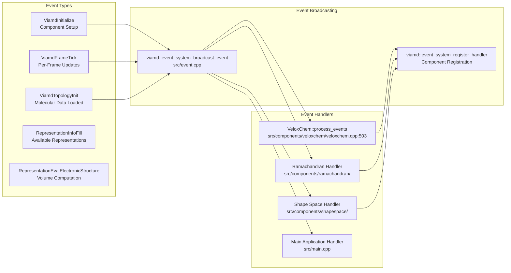
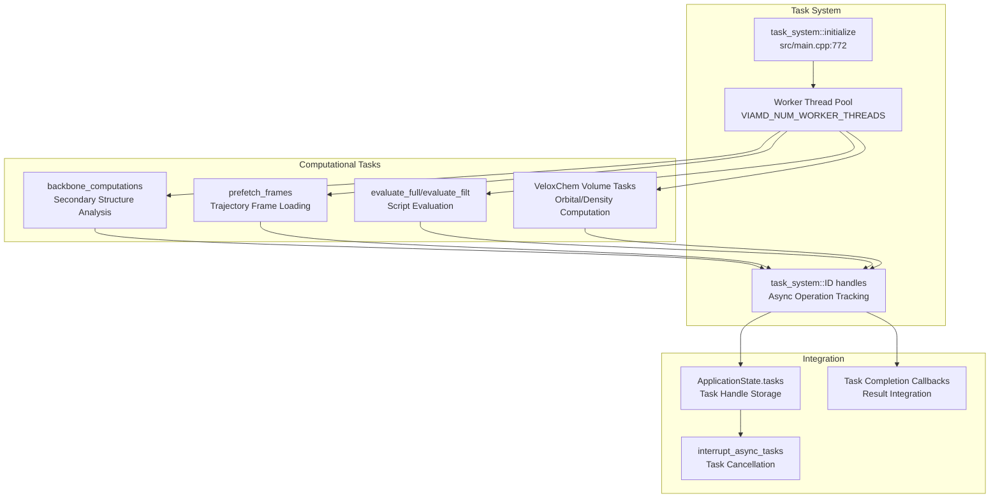
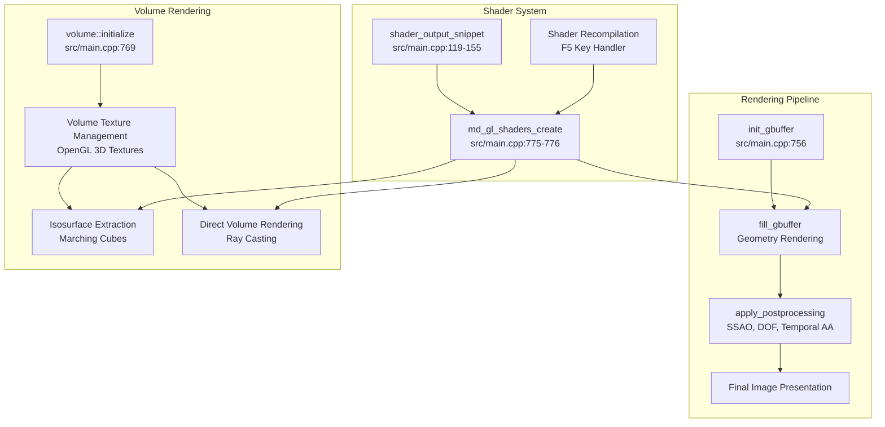

# Overview

Relevant source files

The following files were used as context for generating this wiki page:

- [.github/workflows/macos.yml](.github/workflows/macos.yml)
- [.github/workflows/ubuntu22.yml](.github/workflows/ubuntu22.yml)
- [.github/workflows/windows.yml](.github/workflows/windows.yml)
- [CMakeLists.txt](CMakeLists.txt)
- [README.md](README.md)
- [src/components/veloxchem/veloxchem.cpp](src/components/veloxchem/veloxchem.cpp)
- [src/main.cpp](src/main.cpp)
- [src/viamd.h](src/viamd.h)

This document provides a high-level introduction to VIAMD (Visual Interactive Analysis of Molecular Dynamics), summarizing its purpose, core architecture, and key components. For detailed information about specific subsystems, see the [Core Application Architecture](#2), [Graphics and Visualization Pipeline](#3), [Analysis and Computation](#4), and [User Interface Framework](#5).

## Purpose and Scope

VIAMD is an interactive analysis tool for molecular dynamics (MD) simulations written in C/C++. The application enables scientists to visualize molecular trajectories, perform computational analysis, and interact with molecular data through a comprehensive scripting language. VIAMD supports multiple molecular file formats and provides specialized analysis capabilities including Ramachandran plots, shape space analysis, and quantum chemistry visualization through VeloxChem integration.

The software is designed as a real-time, interactive application that processes molecular trajectories and provides immediate visual feedback through a modern graphics pipeline built on OpenGL. The core architecture follows an event-driven pattern with parallel task execution for computationally intensive operations.

Sources: [README.md:1-5](), [src/main.cpp:99-117]()

## System Architecture Overview

VIAMD follows a modular architecture centered around a main application state (`ApplicationState`) that coordinates between subsystems through an event-driven communication pattern.

The architecture separates concerns into distinct subsystems that communicate through the central `ApplicationState` and event system. This design enables modular development and clean separation between rendering, analysis, and user interface components.

Sources: [src/main.cpp:661-943](), [src/viamd.h:396-808](), [src/event.cpp]()

## Core Data Structures

The application state is managed through several key data structures that represent the current state of loaded molecular data, user interface, and computational tasks.

### ApplicationState Structure

The `ApplicationState` serves as the central data hub, containing all necessary state for molecular visualization, user interactions, and computational analysis.

Sources: [src/viamd.h:396-808]()

### Representation System

The representation system provides flexible visualization of molecular data through configurable rendering types, color mappings, and dynamic filtering capabilities.

Sources: [src/viamd.h:326-394](), [src/viamd.h:57-103]()

## Event-Driven Communication

VIAMD uses an event system to coordinate between components, enabling loose coupling and modular design.

Components register as event handlers and receive relevant events through the centralized broadcasting system, enabling coordinated responses to application state changes.

Sources: [src/components/veloxchem/veloxchem.cpp:503-561](), [src/main.cpp:778](), [src/main.cpp:913]()

## Key Subsystem Integration Points

### Task System Integration

The task system enables parallel execution of computationally intensive operations while maintaining responsive user interaction through proper task lifecycle management.

Sources: [src/main.cpp:770-772](), [src/viamd.h:472-478](), [src/task_system.cpp]()

### Graphics Pipeline Integration

The graphics pipeline provides both traditional molecular rendering and advanced volume visualization capabilities through a unified shader system and deferred rendering approach.

Sources: [src/main.cpp:756](), [src/main.cpp:769](), [src/main.cpp:775-776](), [src/main.cpp:119-155]()

This overview establishes the foundation for understanding VIAMD's architecture. For detailed exploration of specific subsystems, refer to the dedicated sections on [Core Application Architecture](#2), [Graphics and Visualization Pipeline](#3), [Analysis and Computation](#4), [User Interface Framework](#5), and [Build System and Dependencies](#6).

---