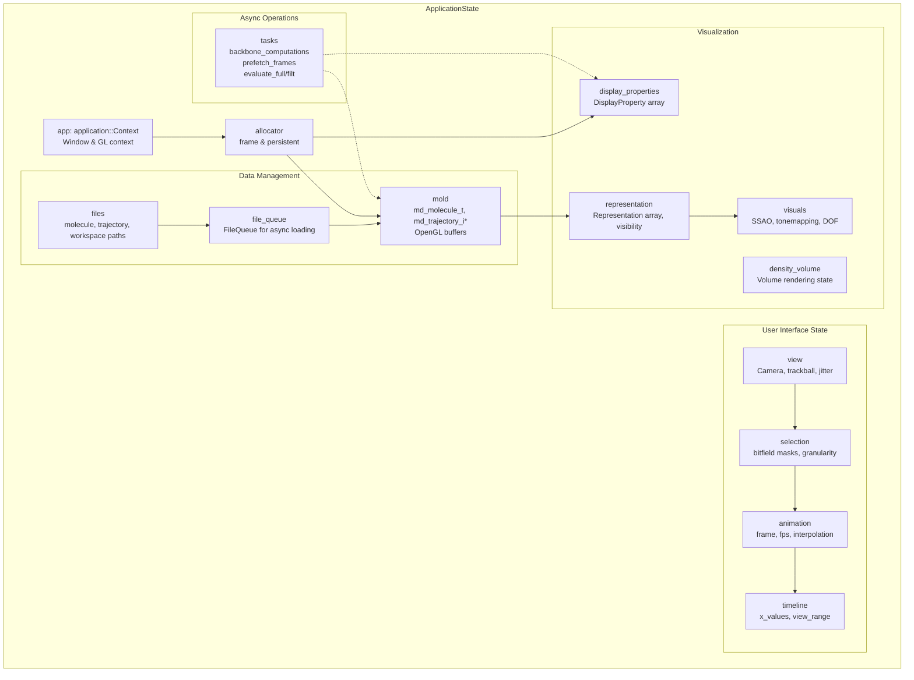
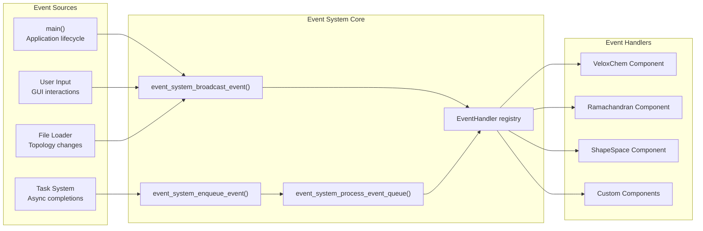
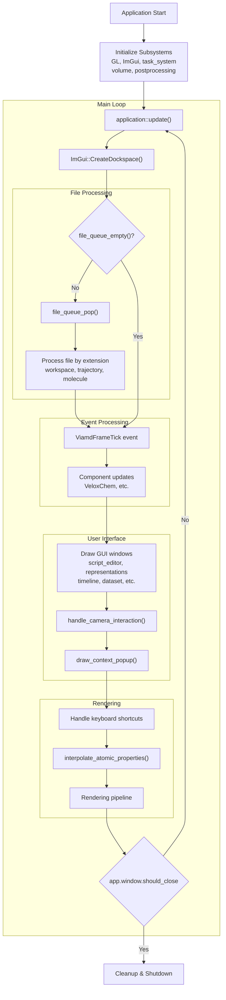
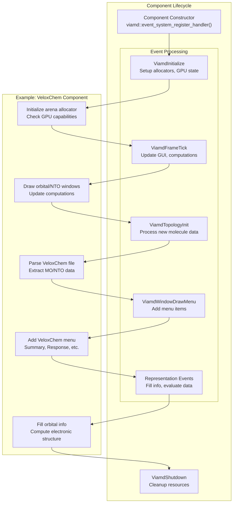
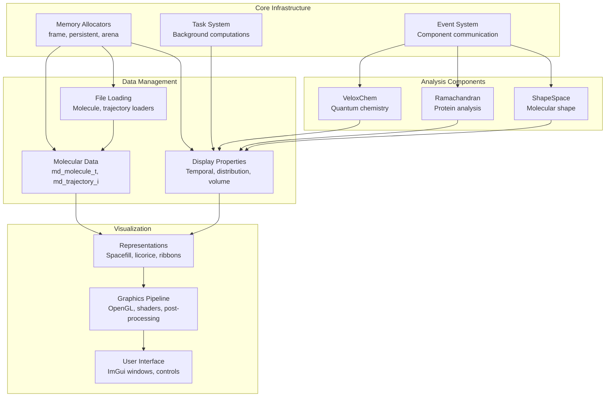

# Core Application Architecture

<details>
<summary>Relevant source files</summary>

The following files were used as context for generating this wiki page:

- [src/app/application.cpp](src/app/application.cpp)
- [src/color_utils.cpp](src/color_utils.cpp)
- [src/color_utils.h](src/color_utils.h)
- [src/components/veloxchem/veloxchem.cpp](src/components/veloxchem/veloxchem.cpp)
- [src/event.cpp](src/event.cpp)
- [src/loader.cpp](src/loader.cpp)
- [src/loader.h](src/loader.h)
- [src/main.cpp](src/main.cpp)
- [src/viamd.h](src/viamd.h)

</details>


This document provides a comprehensive overview of VIAMD's core application architecture, focusing on the central data structures, event-driven communication system, and main application loop that form the foundation of the entire application. This covers the fundamental architectural patterns and key components that enable molecular visualization and analysis functionality.

For information about specific graphics and rendering systems, see [Graphics and Visualization Pipeline](#3). For details about analysis components and computational workflows, see [Analysis and Computation](#4).

## Central Application State

At the heart of VIAMD's architecture is the `ApplicationState` structure, which serves as the central repository for all application data and state. This structure acts as the primary coordination point between different subsystems and provides a unified interface for state management.

### ApplicationState Structure

The `ApplicationState` contains organized sections for different functional areas:

| Section | Purpose | Key Components |
|---------|---------|----------------|
| Application Context | Core application and windowing | `application::Context app` |
| Memory Management | Allocator interfaces | `frame` and `persistent` allocators |
| File Management | File loading and workspace state | `files`, `file_queue`, `load_dataset` |
| Camera & View | 3D view and camera controls | `view`, `screenshot` parameters |
| Molecular Data | Core molecular structures | `mold` containing `md_molecule_t`, trajectory |
| Visualization | Display properties and representations | `display_properties`, `representation` |
| Selection | Atom/residue selection state | `selection` with bitfield masks |
| Animation | Timeline and playback | `animation`, `timeline` state |
| Async Tasks | Background computation handles | `tasks` with task system IDs |

**ApplicationState Architecture Diagram**



Sources: [src/viamd.h:396-791](), [src/main.cpp:720-727]()

## Event-Driven Architecture

VIAMD uses a centralized event system to coordinate communication between different components and subsystems. This architecture enables loose coupling between components while maintaining organized data flow.

### Event System Components

The event system consists of several key elements:

- **Event Types**: Predefined event categories like `ViamdInitialize`, `ViamdFrameTick`, `ViamdTopologyInit`
- **Event Handlers**: Components that implement `EventHandler` interface to receive events
- **Event Broadcasting**: Immediate event distribution to all registered handlers
- **Event Queue**: Delayed event processing with timestamp-based scheduling

**Event Flow Architecture**



### Key Event Types

| Event Type | Purpose | Payload |
|------------|---------|---------|
| `ViamdInitialize` | Component initialization | `ApplicationState*` |
| `ViamdFrameTick` | Per-frame updates | `ApplicationState*` |
| `ViamdTopologyInit` | New molecule loaded | `ApplicationState*` |
| `ViamdWindowDrawMenu` | Menu drawing phase | None |
| `RepresentationInfoFill` | Fill representation metadata | `RepresentationInfo*` |
| `RepresentationEvalElectronicStructure` | Compute electronic structure | `EvalElectronicStructure*` |

Sources: [src/event.cpp:1-79](), [src/components/veloxchem/veloxchem.cpp:503-546]()

## Main Application Loop

The main application loop orchestrates the entire application lifecycle, coordinating file loading, event processing, user interface updates, and rendering operations.

### Loop Structure and Flow

**Main Loop Flow Diagram**



### File Processing Pipeline

The application processes files through a priority-based queue system:

1. **File Queue Management**: Files are added with priority based on type (workspace > molecule > trajectory > scripts)
2. **Loader Selection**: Appropriate loaders are selected based on file extension
3. **Loading Process**: Files are loaded using format-specific loaders from the MDLib
4. **State Updates**: `ApplicationState` is updated with new molecular data
5. **Event Broadcasting**: `ViamdTopologyInit` events notify components of changes

Sources: [src/main.cpp:829-1007](), [src/main.cpp:842-911]()

## Component Integration Pattern

VIAMD uses a component-based architecture where specialized analysis and visualization components integrate through the event system. This enables modular functionality while maintaining clean separation of concerns.

### Component Lifecycle

**Component Integration Pattern**



### Component Registration

Components implement the `EventHandler` interface and register themselves during construction:

```cpp
struct VeloxChem : viamd::EventHandler {
    VeloxChem() { viamd::event_system_register_handler(*this); }
    
    void process_events(const viamd::Event* events, size_t num_events) final {
        // Handle specific event types
    }
};
```

Sources: [src/components/veloxchem/veloxchem.cpp:288-289](), [src/event.cpp:17-19]()

## Core Subsystems Overview

VIAMD's architecture consists of several major subsystems that work together through the central `ApplicationState`:

### Memory Management

- **Frame Allocator**: Linear allocator reset each frame for temporary data
- **Persistent Allocator**: Heap allocator for long-lived data structures
- **Arena Allocators**: Used by components for grouped allocations

### Task System Integration

Asynchronous operations are managed through the task system with handles stored in `ApplicationState.tasks`:

- `backbone_computations`: Secondary structure and angle calculations
- `prefetch_frames`: Trajectory frame caching
- `evaluate_full/filt`: Script evaluation tasks

### Display Properties System

The `DisplayProperty` array manages temporal, distribution, and volume data for visualization:

- **Temporal Properties**: Time-series data for timeline plots
- **Distribution Properties**: Histogram data for distribution analysis  
- **Volume Properties**: 3D scalar field data for volume rendering

**Core Subsystem Dependencies**



Sources: [src/main.cpp:92-95](), [src/viamd.h:472-478](), [src/viamd.h:468-470]()

---