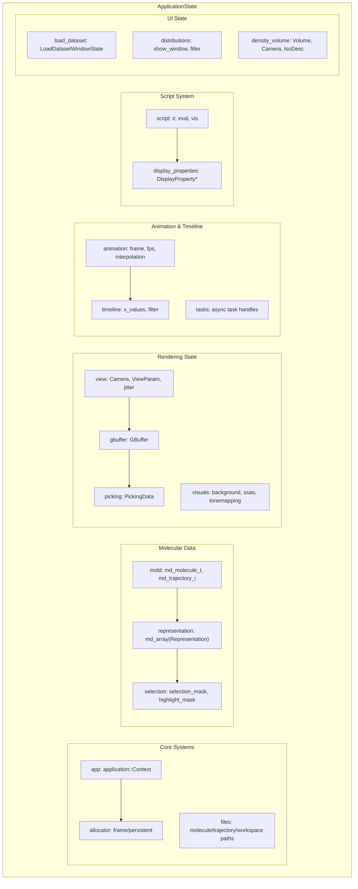
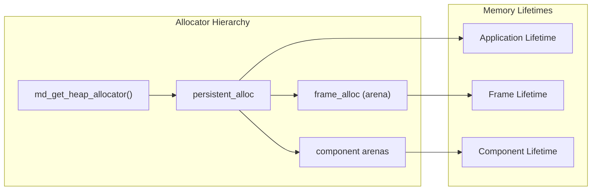
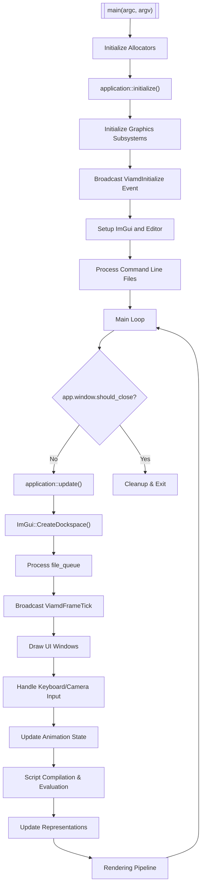
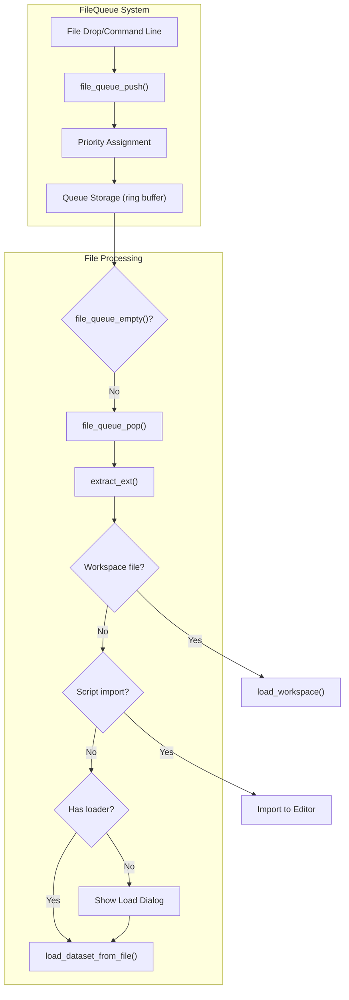
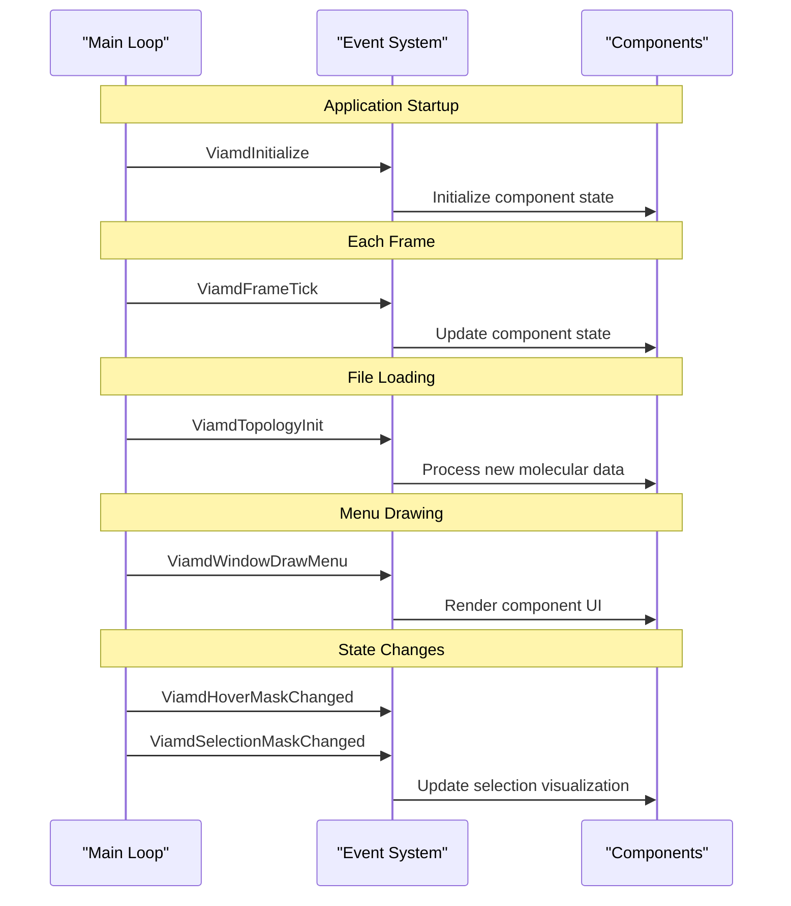
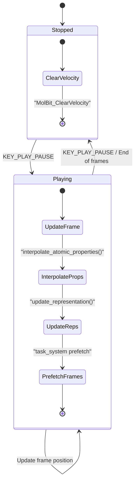
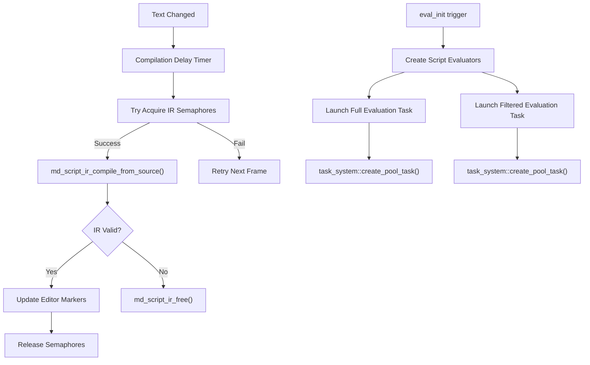
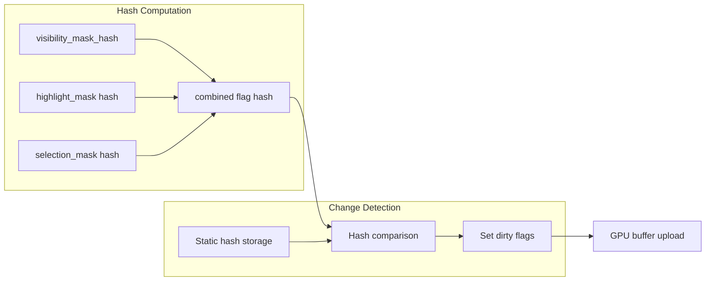

# Main Application Loop and State Management

Relevant source files

The following files were used as context for generating this wiki page:

- [src/components/veloxchem/veloxchem.cpp](src/components/veloxchem/veloxchem.cpp)
- [src/main.cpp](src/main.cpp)
- [src/viamd.h](src/viamd.h)

This document covers the core application loop, the central `ApplicationState` structure, and state management patterns in VIAMD. It explains how the application coordinates between different subsystems and manages the lifecycle of molecular data, UI state, and rendering resources.

For information about the event system architecture and inter-component communication, see [Event System](#2.3). For details about molecular data structures and display components, see [Molecular Data Structures and Display](#2.4).

## ApplicationState Structure

The `ApplicationState` structure serves as the central hub for all application state, containing subsystem data, UI state, and molecular information. This structure is passed throughout the application to provide unified access to all components.

### Core State Components

**ApplicationState Component Breakdown**
Sources: [src/viamd.h:396-808]()

### Memory Management Architecture

**Memory Management Strategy**
Sources: [src/main.cpp:662-669](), [src/main.cpp:93-94]()

## Main Application Loop

The main application loop coordinates initialization, event processing, state updates, and rendering. The loop structure follows a clear pattern of input processing, state updates, and output generation.

### Application Lifecycle

**Main Application Loop Flow**
Sources: [src/main.cpp:830-1431]()

### File Processing System

The application uses a priority-based file queue to handle file loading operations. Files are processed based on their type and priority to ensure proper loading order.

**File Processing Priority System**
Sources: [src/main.cpp:326-378](), [src/main.cpp:842-911]()

## Event System Integration

The main loop integrates with the event system to coordinate between different components. Key events are broadcast at specific points in the application lifecycle.

### Event Broadcasting Points

**Event System Integration Points**
Sources: [src/main.cpp:778](), [src/main.cpp:913](), [src/components/veloxchem/veloxchem.cpp:508-547]()

## State Update Patterns

The application follows consistent patterns for state updates, ensuring proper coordination between subsystems and maintaining data consistency.

### Animation and Timeline Management

**Animation State Management**
Sources: [src/main.cpp:970-1045](), [src/main.cpp:1079-1102]()

### Script Compilation and Evaluation

The script system manages compilation and evaluation of user scripts with careful synchronization to prevent conflicts.

**Script System State Management**
Sources: [src/main.cpp:1110-1338]()

## Rendering Integration

The main loop coordinates with the rendering pipeline to ensure proper frame generation and resource management.

### Rendering State Updates

| Update Type | Trigger | Function | Sources |
|-------------|---------|----------|---------|
| View Parameters | Camera changes | `update_view_param()` | [src/main.cpp:1396]() |
| MD Buffers | Molecular data changes | `update_md_buffers()` | [src/main.cpp:1430]() |
| Representations | Filter/color changes | `update_representation()` | [src/main.cpp:1088-1095]() |
| G-Buffer | Framebuffer resize | `init_gbuffer()` | [src/main.cpp:1390-1394]() |

### Hash-Based Change Detection

The application uses hash-based change detection to minimize expensive GPU operations:

**Hash-Based Change Detection System**
Sources: [src/main.cpp:1403-1428]()

Sources: [src/main.cpp:661-1431](), [src/viamd.h:396-808](), [src/components/veloxchem/veloxchem.cpp:503-790]()

---