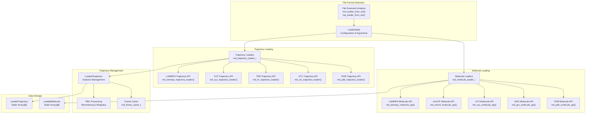
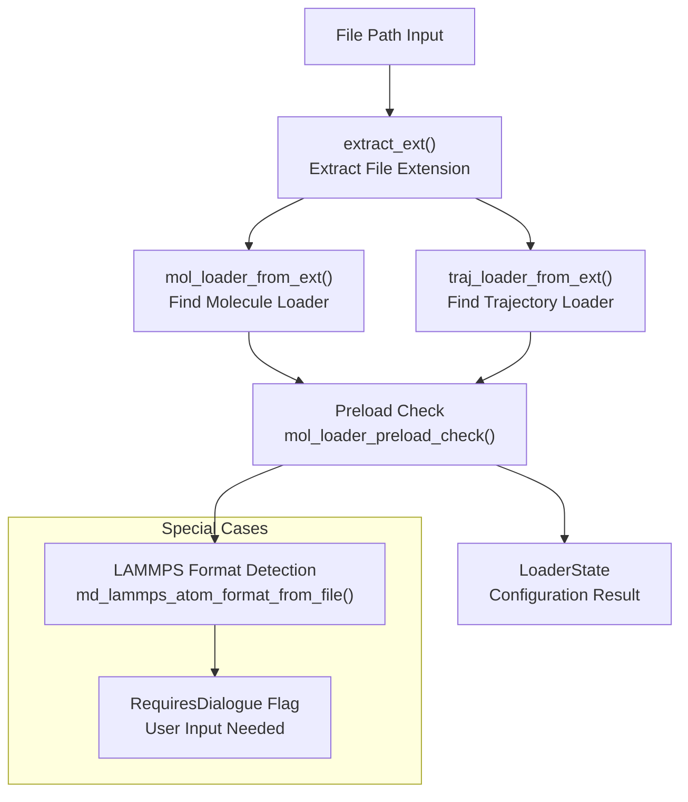
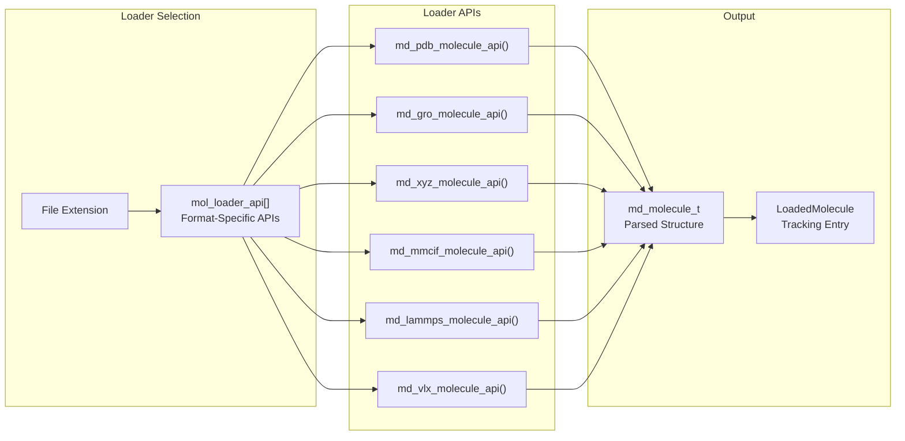
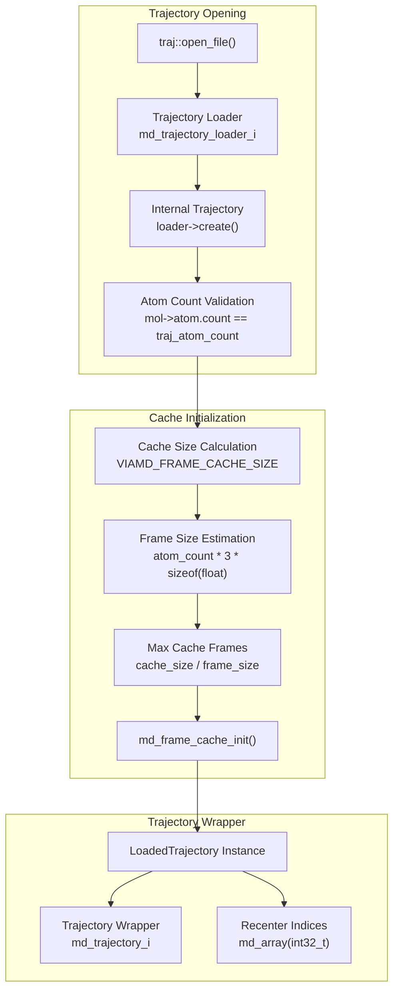
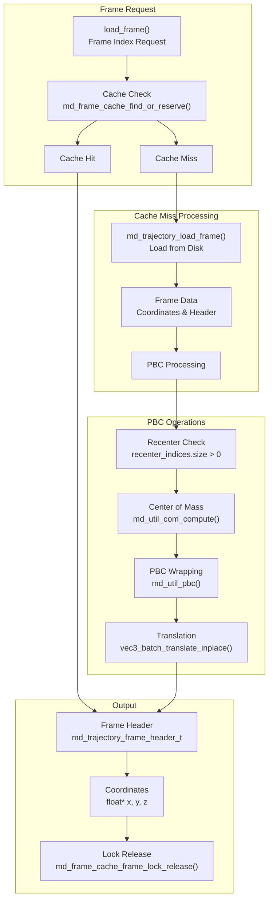

# File Loading System

<details>
<summary>Relevant source files</summary>

The following files were used as context for generating this wiki page:

- [src/app/application.cpp](src/app/application.cpp)
- [src/color_utils.cpp](src/color_utils.cpp)
- [src/color_utils.h](src/color_utils.h)
- [src/event.cpp](src/event.cpp)
- [src/loader.cpp](src/loader.cpp)
- [src/loader.h](src/loader.h)

</details>


## Purpose and Scope

The File Loading System is responsible for parsing and loading molecular data from various file formats into VIAMD's internal data structures. It handles both static molecular structure files and dynamic trajectory files, providing a unified interface for accessing molecular coordinates, topology, and metadata. The system includes intelligent format detection, frame caching for trajectory data, and periodic boundary condition (PBC) handling.

For information about the core molecular data structures used by the loaded data, see [Molecular Data Structures and Display](#2.4). For details about the task system used for parallel loading operations, see [Task System and Parallel Processing](#4.1).

## Architecture Overview

The File Loading System follows a modular architecture with separate handling for molecule and trajectory data, built around format-specific loader APIs and a centralized management system.



Sources: [src/loader.cpp:29-113](), [src/loader.h:27-63]()

## Supported File Formats

The system supports multiple molecular file formats through dedicated loader APIs, organized into molecule (static structure) and trajectory (dynamic coordinate) categories.

| Format | Extension(s) | Molecule Loader | Trajectory Loader | Description |
|--------|-------------|----------------|-------------------|-------------|
| PDB | `.pdb` | ✓ | ✓ | Standard Protein Data Bank format |
| GRO | `.gro` | ✓ | ✗ | Gromacs structure format |
| XTC | `.xtc` | ✗ | ✓ | Gromacs compressed trajectory |
| TRR | `.trr` | ✗ | ✓ | Gromacs lossless trajectory |
| XYZ | `.xyz`, `.xmol`, `.arc` | ✓ | ✓ | Simple coordinate format |
| mmCIF | `.cif` | ✓ | ✗ | PDBx/mmCIF crystallographic format |
| LAMMPS | `.data` | ✓ | ✗ | LAMMPS data file |
| LAMMPS Trajectory | `.lammpstrj` | ✗ | ✓ | LAMMPS trajectory format |
| VeloxChem | `.out`, `.h5` | ✓ | ✗ | Quantum chemistry output (optional) |

Sources: [src/loader.cpp:42-76](), [src/loader.cpp:88-113](), [src/loader.cpp:232-299]()

## Loader Detection and Initialization

The system automatically detects appropriate loaders based on file extensions and initializes the necessary state for loading operations.



The `init_loader_state()` function serves as the main entry point for loader initialization:

```cpp
bool init_loader_state(LoaderState* state, str_t file_path, md_allocator_i* alloc)
```

This function analyzes the file extension, determines compatible loaders, and performs format-specific preload checks. For LAMMPS files, it attempts automatic format detection and sets flags if user dialogue is required.

Sources: [src/loader.cpp:330-352](), [src/loader.cpp:190-210]()

## Molecule Loading

Molecule loading handles static structural data through format-specific APIs that implement the `md_molecule_loader_i` interface.



The system maintains a static array of loaded molecules with simple key-based tracking:

```cpp
static LoadedMolecule loaded_molecules[8] = {};
static int64_t num_loaded_molecules = 0;
```

Each `LoadedMolecule` contains a unique key and allocator reference for memory management.

Sources: [src/loader.cpp:66-76](), [src/loader.cpp:115-158](), [src/loader.cpp:375-397]()

## Trajectory Loading and Caching

Trajectory loading involves more complex processing due to the dynamic nature of coordinate data and the need for efficient frame access through caching.



The `LoadedTrajectory` structure encapsulates all trajectory-related state:

```cpp
struct LoadedTrajectory {
    uint64_t key;
    const md_molecule_t* mol;
    md_trajectory_loader_i* loader;
    md_trajectory_i* traj;
    md_frame_cache_t cache;
    md_allocator_i* alloc;
    md_array(int32_t) recenter_indices;
};
```

Frame cache size is dynamically calculated based on available system memory and trajectory characteristics, with a default target of `VIAMD_FRAME_CACHE_SIZE` megabytes.

Sources: [src/loader.cpp:120-129](), [src/loader.cpp:561-615](), [src/loader.cpp:599-607]()

## Frame Loading with PBC Handling

Frame loading implements sophisticated caching and periodic boundary condition (PBC) processing to ensure efficient access to trajectory data.



The frame loading process includes automatic recentering based on user-defined atom selections:

```cpp
bool set_recenter_target(md_trajectory_i* traj, const md_bitfield_t* atom_mask)
```

When recentering is enabled, the system computes the center of mass of the selected atoms and translates all coordinates to center the system within the periodic box.

Sources: [src/loader.cpp:490-559](), [src/loader.cpp:520-538](), [src/loader.cpp:639-656]()

## Management and Lifecycle

The system provides comprehensive management functions for both molecules and trajectories, including memory cleanup and cache control.

| Function Category | Key Functions | Purpose |
|------------------|---------------|---------|
| Loader Discovery | `loader_count()`, `loader_names()`, `loader_extensions()` | Enumerate available loaders |
| State Management | `init_loader_state()`, `free_loader_state()` | Configure loading parameters |
| Trajectory Control | `traj::open_file()`, `traj::close()` | Trajectory lifecycle |
| Cache Management | `traj::clear_cache()`, `traj::num_cache_frames()` | Cache optimization |
| Recentering | `traj::set_recenter_target()`, `traj::has_recenter_target()` | PBC handling |

The system maintains static arrays with fixed capacity for loaded objects:

```cpp
static LoadedMolecule loaded_molecules[8] = {};
static LoadedTrajectory loaded_trajectories[8] = {};
```

This design provides predictable memory usage and efficient lookup operations while supporting typical use cases with multiple concurrent molecular systems.

Sources: [src/loader.cpp:131-187](), [src/loader.cpp:363-373](), [src/loader.cpp:617-680]()

---