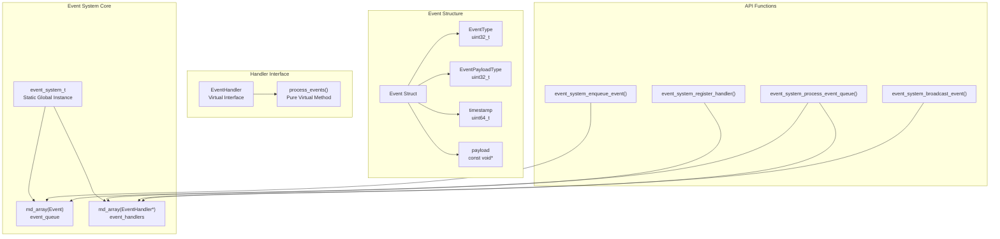
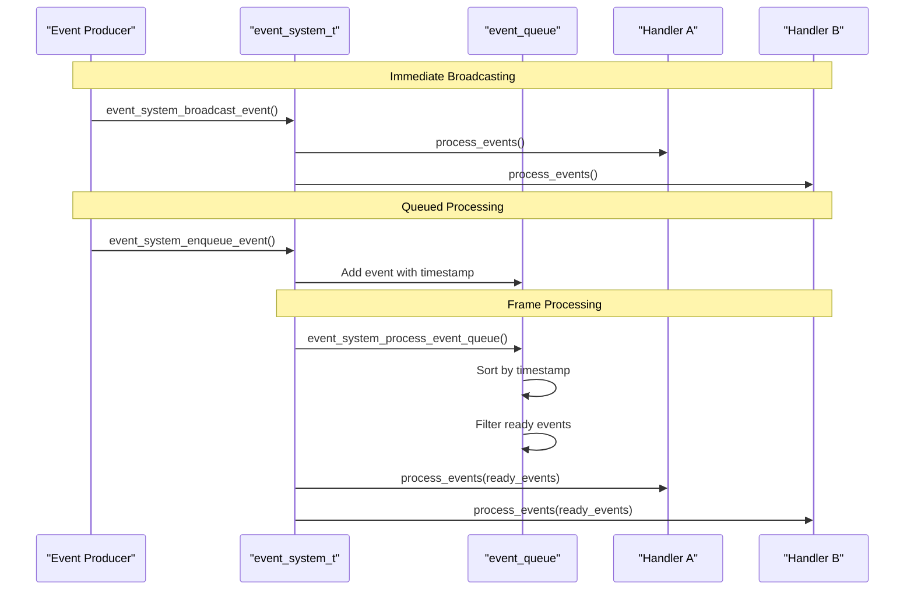
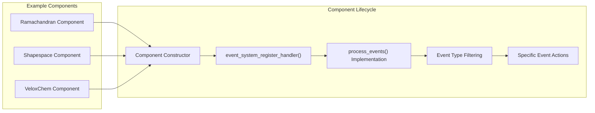
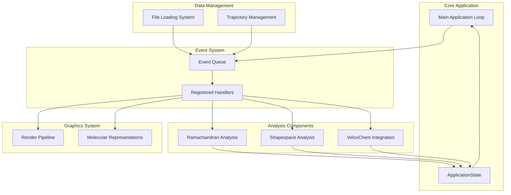

# Event System

<details>
<summary>Relevant source files</summary>

The following files were used as context for generating this wiki page:

- [src/app/application.cpp](src/app/application.cpp)
- [src/color_utils.cpp](src/color_utils.cpp)
- [src/color_utils.h](src/color_utils.h)
- [src/components/ramachandran/ramachandran.cpp](src/components/ramachandran/ramachandran.cpp)
- [src/components/shapespace/shapespace.cpp](src/components/shapespace/shapespace.cpp)
- [src/event.cpp](src/event.cpp)
- [src/event.h](src/event.h)
- [src/loader.cpp](src/loader.cpp)
- [src/loader.h](src/loader.h)
- [src/task_system.cpp](src/task_system.cpp)
- [src/task_system.h](src/task_system.h)

</details>


The event system is the central communication mechanism in VIAMD that enables loose coupling between components through an asynchronous message-passing architecture. Components register as event handlers and communicate by broadcasting and processing events, allowing for modular design and extensible functionality.

For information about the main application loop that drives event processing, see [Main Application Loop and State Management](#2.1). For details about the task system that handles parallel processing, see [Task System and Parallel Processing](#4.1).

## Core Architecture

The event system consists of a global event manager that maintains registered handlers and processes event queues. Components implement the `EventHandler` interface to receive and process events of interest.



**Sources:** [src/event.h:65-89](), [src/event.cpp:10-16]()

## Event Types and Classifications

Events are categorized into several functional groups, each serving specific purposes within the application lifecycle and component communication.

| Category | Event Types | Purpose |
|----------|-------------|---------|
| **Application Lifecycle** | `ViamdInitialize`, `ViamdShutdown`, `ViamdFrameTick` | Core application state management |
| **Rendering Pipeline** | `ViamdRenderOpaque`, `ViamdRenderTransparent` | Graphics rendering coordination |
| **UI Management** | `ViamdWindowDrawMenu` | User interface updates |
| **Data Persistence** | `ViamdSerialize`, `ViamdDeserialize` | Workspace state management |
| **Molecular Data** | `ViamdTopologyInit`, `ViamdTopologyFree`, `ViamdTrajectoryInit`, `ViamdTrajectoryFree` | Molecular structure lifecycle |
| **Selection System** | `ViamdHoverMaskChanged`, `ViamdSelectionMaskChanged` | Interactive selection updates |
| **Representation** | `RepresentationInfoFill`, `RepresentationEvalElectronicStructure`, `RepresentationEvalAtomProperty` | Molecular visualization updates |

**Sources:** [src/event.h:16-52](), [src/event.h:54-63]()

## Event Processing Flow

The event system operates through two primary mechanisms: immediate broadcasting for synchronous communication and queued processing for asynchronous, delayed events.



The event processing occurs in several stages within `event_system_process_event_queue()`:

1. **Sorting**: Events are sorted by timestamp in descending order
2. **Filtering**: Only events with timestamps <= current time are processed
3. **Broadcasting**: Ready events are sent to all registered handlers
4. **Queue Management**: Processed events are removed from the queue

**Sources:** [src/event.cpp:32-43](), [src/event.cpp:45-76]()

## Component Event Handler Implementation

Components integrate with the event system by inheriting from `EventHandler` and implementing the `process_events` method. The typical pattern involves registering during construction and filtering events by type.



### Component Registration Pattern

Components follow a consistent pattern for event system integration:

```cpp
// Constructor registration
ComponentName() { 
    viamd::event_system_register_handler(*this); 
}

// Event processing implementation
void process_events(const viamd::Event* events, size_t num_events) final {
    for (size_t i = 0; i < num_events; ++i) {
        const viamd::Event e = events[i];
        switch (e.type) {
        case viamd::EventType_ViamdInitialize:
            // Handle initialization
            break;
        case viamd::EventType_ViamdFrameTick:
            // Handle per-frame updates
            break;
        // Additional event types...
        }
    }
}
```

**Sources:** [src/components/ramachandran/ramachandran.cpp:516](), [src/components/ramachandran/ramachandran.cpp:518-548](), [src/components/shapespace/shapespace.cpp:74](), [src/components/shapespace/shapespace.cpp:76-127]()

## Event System Integration Points

The event system integrates with several major application subsystems to coordinate functionality across the entire VIAMD application.



### Key Integration Points

1. **Application Lifecycle**: `ViamdInitialize` and `ViamdShutdown` events coordinate component startup and cleanup
2. **Frame Processing**: `ViamdFrameTick` events drive per-frame updates across all components
3. **Data Loading**: `ViamdTopologyInit` and `ViamdTrajectoryInit` events notify components of new molecular data
4. **UI Coordination**: `ViamdWindowDrawMenu` events allow components to add menu items
5. **State Persistence**: `ViamdSerialize` and `ViamdDeserialize` events handle workspace save/load operations

**Sources:** [src/components/ramachandran/ramachandran.cpp:522-540](), [src/components/shapespace/shapespace.cpp:80-125](), [src/loader.cpp:1-683]()

## Delayed Event Processing

The event system supports delayed event execution through timestamp-based queuing, enabling temporal coordination and deferred processing.

### Timestamp Management

Events include a `timestamp` field that determines when they should be processed. The `event_system_enqueue_event()` function accepts a `delay_in_ms` parameter to schedule future execution:

```cpp
// Schedule event for future processing
event_system_enqueue_event(
    EventType_SomeEvent, 
    EventPayloadType_SomePayload, 
    payload_ptr, 
    500  // 500ms delay
);
```

The processing queue sorts events by timestamp and only processes those whose time has arrived, ensuring proper temporal ordering of operations.

**Sources:** [src/event.cpp:21-30](), [src/event.cpp:51-63]()

---