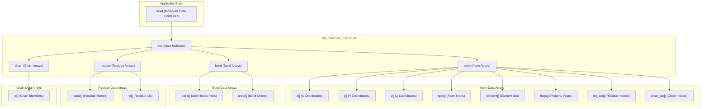
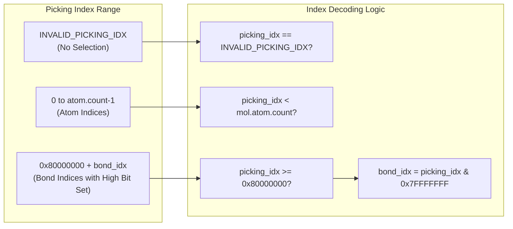
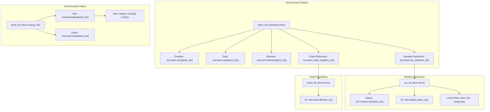
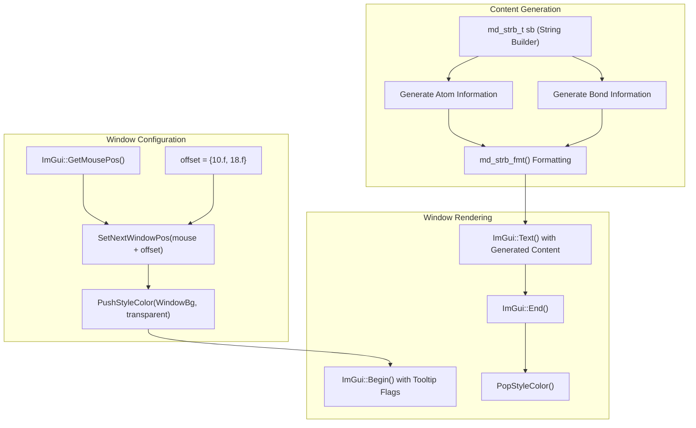

# Molecular Data Structures and Display

Relevant source files

The following files were used as context for generating this wiki page:

- [src/viamd.cpp](src/viamd.cpp)

This document covers the core molecular data structures used throughout VIAMD and the interactive display system that presents molecular information to users. This includes the fundamental organization of molecular data (atoms, bonds, residues, chains), the picking system for interactive selection, and the information windows that display detailed molecular component data.

For information about loading molecular data from files, see [File Loading System](#2.2). For details about the graphics rendering pipeline that visualizes these structures, see [Graphics and Visualization Pipeline](#3). For analysis components that operate on this molecular data, see [Analysis and Computation](#4).

## Core Molecular Data Structure Organization

VIAMD organizes molecular data in a hierarchical structure centered around the `md_molecule_t` type from the MDLib library. The data is structured in a structure-of-arrays pattern for efficient memory access and vectorization.

### Molecular Data Hierarchy

**Sources:** [src/viamd.cpp:9-44]()

### Atom Property Flags System

Atoms contain a comprehensive flags system that categorizes molecular properties and hybridization states:

| Flag Category | Flags | Purpose |
|---------------|-------|---------|
| **Molecular Type** | `MD_FLAG_HETATM`, `MD_FLAG_AMINO_ACID`, `MD_FLAG_NUCLEOTIDE`, `MD_FLAG_NUCLEOBASE`, `MD_FLAG_WATER`, `MD_FLAG_ION` | Classify molecular component types |
| **Hybridization** | `MD_FLAG_SP`, `MD_FLAG_SP2`, `MD_FLAG_SP3` | Indicate atomic hybridization states |
| **Chemical Properties** | `MD_FLAG_AROMATIC` | Mark aromatic atoms |

**Sources:** [src/viamd.cpp:55-72]()

## Interactive Picking System

The picking system enables interactive selection of molecular components through a unified indexing scheme that distinguishes between atoms and bonds.

### Picking Index Encoding

**Sources:** [src/viamd.cpp:11](), [src/viamd.cpp:18](), [src/viamd.cpp:81-82]()

### Molecular Component Access Patterns

The system provides hierarchical access to molecular components through index relationships:

**Sources:** [src/viamd.cpp:19-44](), [src/viamd.cpp:82-100]()

## Information Display System

The `draw_info_window` function implements a context-sensitive tooltip system that displays detailed information about picked molecular components.

### Display Window Implementation

The information window follows an immediate-mode GUI pattern with dynamic positioning and content generation:

**Sources:** [src/viamd.cpp:103-112]()

### Atom Information Display Format

For selected atoms, the system displays comprehensive information including hierarchy and properties:

| Information Type | Format | Example |
|------------------|--------|---------|
| **Basic Identity** | `atom[global_idx][local_idx]: type element symbol (x, y, z)` | `atom[1234][5]: CA C Carbon (12.34, 56.78, 90.12)` |
| **Residue Context** | `res[res_idx]: name id` | `res[123]: ALA 45` |
| **Chain Context** | `chain[chain_idx]: id` | `chain[1]: A` |
| **Property Flags** | `flags: FLAG1 FLAG2 ...` | `flags: AMINO SP3 AROMATIC` |

**Sources:** [src/viamd.cpp:47-72]()

### Bond Information Display Format

For selected bonds, the system shows bond characteristics and geometry:

| Information Type | Format | Description |
|------------------|--------|-------------|
| **Bond Identity** | `bond: atom1_type{bond_char}atom2_type` | Visual representation of bonded atoms |
| **Bond Order** | `order: {1,2,3,4}` | Chemical bond order |
| **Bond Length** | `length: {distance}` | Calculated 3D distance between atoms |

Bond type characters: `-` (single), `=` (double), `#` (triple), `$` (quadruple), `?` (unknown)

**Sources:** [src/viamd.cpp:84-100]()

## Data Organization and Memory Layout

### Structure-of-Arrays Pattern

The molecular data uses a structure-of-arrays layout optimized for:

- **Cache Efficiency**: Related data elements are stored contiguously
- **Vectorization**: SIMD operations can process multiple elements simultaneously  
- **Memory Access Patterns**: Algorithms can efficiently iterate over specific properties

### Index-Based Relationships

The system maintains relationships through index arrays rather than pointers:

- `mol.atom.res_idx[]` maps atoms to residues
- `mol.atom.chain_idx[]` maps atoms to chains  
- `mol.bond.pairs[]` contains atom index pairs for bonds

This approach enables:
- **Stable References**: Indices remain valid across data modifications
- **Serialization**: Data can be easily saved/loaded without pointer fixup
- **Parallel Access**: Multiple threads can safely read index-based data

**Sources:** [src/viamd.cpp:29-33](), [src/viamd.cpp:39-44](), [src/viamd.cpp:84]()

---