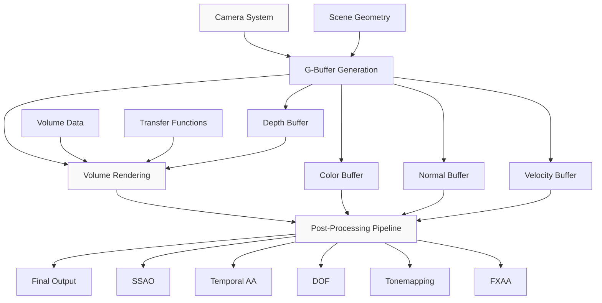
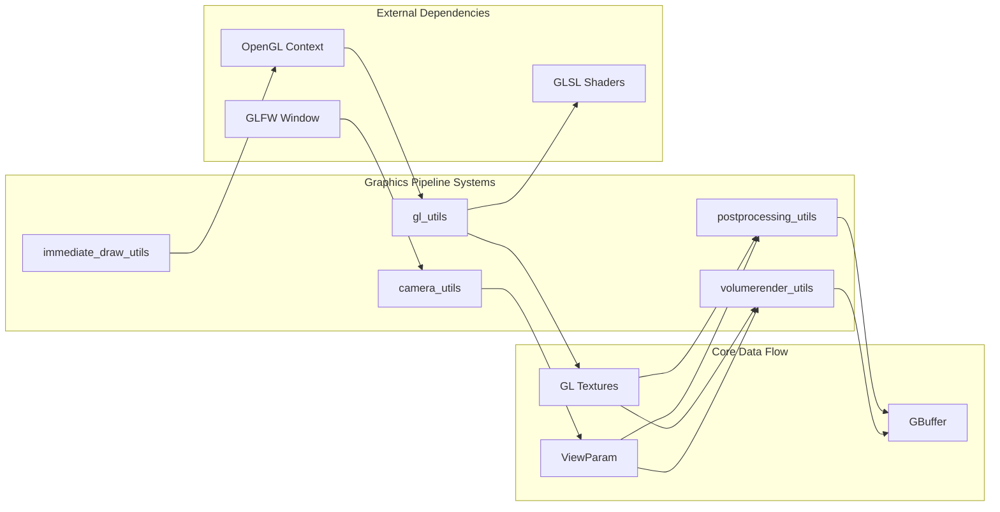
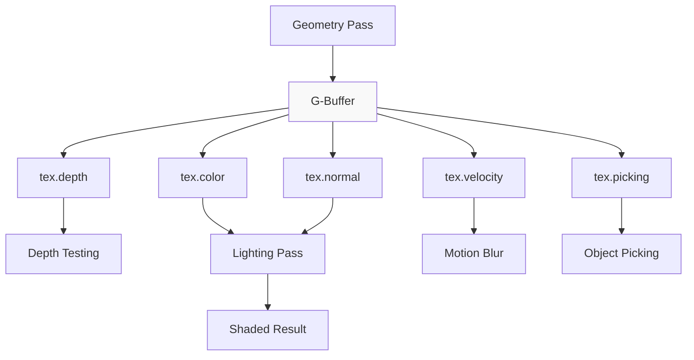
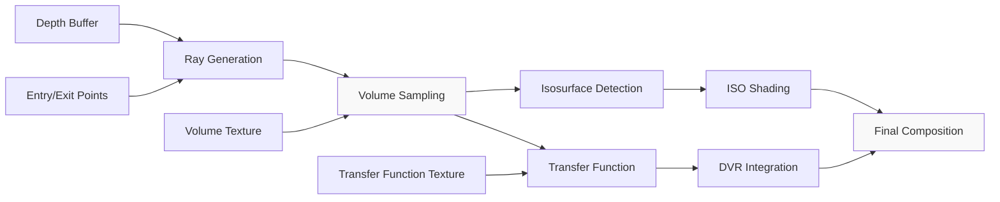
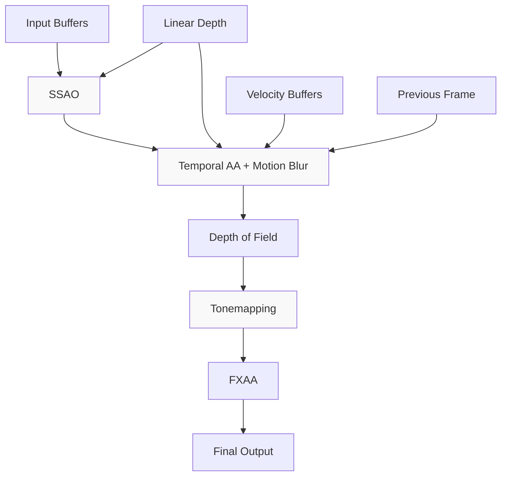
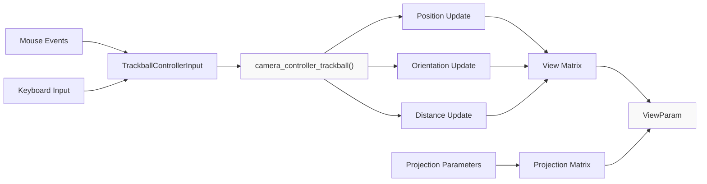
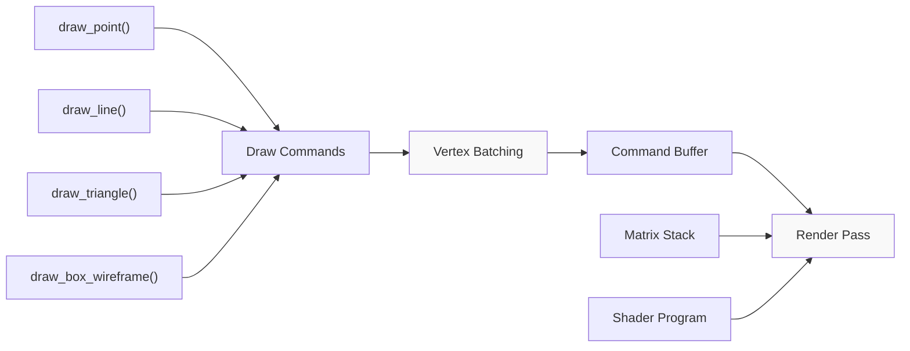
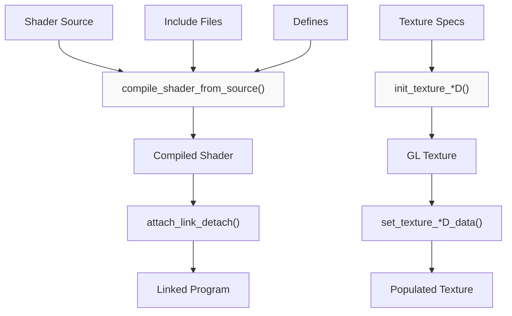

# Graphics and Visualization Pipeline

Relevant source files

The following files were used as context for generating this wiki page:

- [src/gfx/camera_utils.cpp](src/gfx/camera_utils.cpp)
- [src/gfx/camera_utils.h](src/gfx/camera_utils.h)
- [src/gfx/gl_utils.cpp](src/gfx/gl_utils.cpp)
- [src/gfx/gl_utils.h](src/gfx/gl_utils.h)
- [src/gfx/immediate_draw_utils.cpp](src/gfx/immediate_draw_utils.cpp)
- [src/gfx/immediate_draw_utils.h](src/gfx/immediate_draw_utils.h)
- [src/gfx/postprocessing_utils.cpp](src/gfx/postprocessing_utils.cpp)
- [src/gfx/postprocessing_utils.h](src/gfx/postprocessing_utils.h)
- [src/gfx/view_param.h](src/gfx/view_param.h)
- [src/gfx/volumerender_utils.cpp](src/gfx/volumerender_utils.cpp)
- [src/gfx/volumerender_utils.h](src/gfx/volumerender_utils.h)

## Purpose and Scope

This section provides an overview of VIAMD's complete graphics and visualization pipeline, covering the architecture and integration of 3D rendering, volume visualization, and post-processing systems. The pipeline is designed to handle both traditional molecular geometry rendering and advanced volumetric visualization of electronic structure data.

For detailed information about specific components, see:
- Deferred rendering and post-processing implementation details: [Rendering Pipeline and Post-Processing](#3.1)
- Volume ray-casting and transfer functions: [Volume Rendering System](#3.2)  
- Camera controls and projection matrices: [Camera System and Controls](#3.3)
- Shader programs and rendering techniques: [GLSL Shaders](#3.4)

## Pipeline Architecture

The graphics pipeline follows a deferred rendering approach with specialized volume rendering capabilities and extensive post-processing effects. The system is designed around several key components that work together to produce high-quality molecular visualizations.

### High-Level Pipeline Flow

**Pipeline Flow Overview**

Sources: [src/gfx/postprocessing_utils.h:62-120](), [src/gfx/volumerender_utils.h:43-108](), [src/gfx/view_param.h:5-31]()

### Core Data Structures

The pipeline operates on several key data structures that coordinate rendering state and parameters across different systems:

| Structure | Purpose | Key Fields | File |
|-----------|---------|------------|------|
| `GBuffer` | Deferred rendering buffers | `tex.depth`, `tex.color`, `tex.normal`, `tex.velocity` | [postprocessing_utils.h:18-40]() |
| `ViewParam` | View/projection matrices | `matrix.curr`, `matrix.prev`, `jitter` | [view_param.h:5-31]() |
| `Camera` | Camera state and parameters | `position`, `orientation`, `fov_y` | [camera_utils.h:1-4]() |
| `RenderDesc` | Volume rendering parameters | `texture.volume`, `matrix`, `iso`, `dvr` | [volumerender_utils.h:43-108]() |

### System Integration

**System Integration Diagram**

Sources: [src/gfx/camera_utils.cpp:1-286](), [src/gfx/postprocessing_utils.cpp:1-1600](), [src/gfx/volumerender_utils.cpp:1-561]()

## Rendering Systems

### Deferred Rendering Pipeline

The core rendering uses a deferred approach with multiple render targets stored in a `GBuffer`. This allows for efficient post-processing and complex lighting calculations:

**G-Buffer Structure and Usage**

The `GBuffer` structure manages multiple render targets with specific purposes:
- **Depth**: Z-buffer for depth testing and volume ray termination
- **Color**: Base surface colors and material properties  
- **Normal**: Surface normals for lighting calculations
- **Velocity**: Screen-space motion vectors for temporal effects
- **Picking**: Object IDs for interactive selection

Sources: [src/gfx/postprocessing_utils.h:18-40](), [src/gfx/postprocessing_utils.cpp:57-193]()

### Volume Rendering Integration

Volume rendering operates as a separate pass that can composite with or replace the deferred geometry results:

**Volume Rendering Pipeline**

The volume renderer supports both Direct Volume Rendering (DVR) and isosurface extraction through a unified ray-casting approach. Key functions include:

- `render_volume()`: Main entry point taking a `RenderDesc`
- Entry/exit point generation using cube geometry
- Ray-casting with early termination using depth buffer
- Support for multiple isosurfaces with individual colors

Sources: [src/gfx/volumerender_utils.cpp:349-558](), [src/gfx/volumerender_utils.h:43-108]()

### Post-Processing Effects

The post-processing pipeline applies a series of effects in a specific order to enhance visual quality:

**Post-Processing Effect Chain**

Each effect is implemented as a separate shader program with specific uniform parameters controlled by the `postprocessing::Descriptor` structure. Key effects include:

- **SSAO**: Horizon-Based Ambient Occlusion using depth buffer sampling
- **Temporal AA**: Reduces aliasing by accumulating multiple jittered frames
- **Motion Blur**: Screen-space blur based on velocity vectors
- **Depth of Field**: Bokeh-style blur with circle of confusion
- **Tonemapping**: HDR to LDR conversion with multiple curve options

Sources: [src/gfx/postprocessing_utils.cpp:286-1600](), [src/gfx/postprocessing_utils.h:62-136]()

## Camera and View Management

### Camera Control System

The camera system provides multiple control schemes optimized for molecular visualization:

**Camera Control Flow**

The trackball controller provides intuitive 3D navigation with separate rotation, panning, and zoom operations. The system maintains camera state as position, orientation (quaternion), and focus distance for stable interpolation.

Key functions:
- `camera_controller_trackball()`: Main input processing
- `camera_interpolate_look_at()`: Smooth camera transitions
- `camera_perspective_projection_matrix()`: Projection matrix generation with jitter support

Sources: [src/gfx/camera_utils.cpp:202-235](), [src/gfx/camera_utils.h:23-115]()

### View Parameter Management

The `ViewParam` structure encapsulates all view-related matrices and state needed by the rendering pipeline:

| Field | Purpose | Usage |
|-------|---------|-------|
| `matrix.curr` | Current frame matrices | Primary rendering |
| `matrix.prev` | Previous frame matrices | Temporal effects |
| `matrix.inv` | Inverse matrices | Screen-space calculations |
| `jitter.curr/prev` | Temporal jitter offsets | Anti-aliasing |
| `clip_planes` | Near/far planes | Depth reconstruction |

Sources: [src/gfx/view_param.h:5-31]()

## Immediate Mode Drawing

For debug visualization and UI overlays, the system includes an immediate mode drawing API:

**Immediate Drawing System**

The immediate drawing system provides a simple API for rendering basic primitives without complex state management. It batches geometry into vertex and index buffers and renders everything in a single pass.

Key functions:
- `immediate::draw_*()`: Primitive drawing functions
- `immediate::set_model_view_matrix()`: Matrix management
- `immediate::render()`: Execute batched commands

Sources: [src/gfx/immediate_draw_utils.cpp:13-544](), [src/gfx/immediate_draw_utils.h:5-66]()

## OpenGL Utilities and Resources

### Shader and Texture Management

The `gl_utils` module provides essential OpenGL resource management:

**OpenGL Resource Management**

The utilities handle shader compilation with include support, texture creation and data upload, and error checking throughout the pipeline.

Key functions:
- `gl::compile_shader_from_source()`: Shader compilation with includes and defines
- `gl::init_texture_*D()`: Texture creation with format validation
- `gl::set_texture_*D_data()`: Efficient data upload

Sources: [src/gfx/gl_utils.cpp:1-401](), [src/gfx/gl_utils.h:6-30]()

---