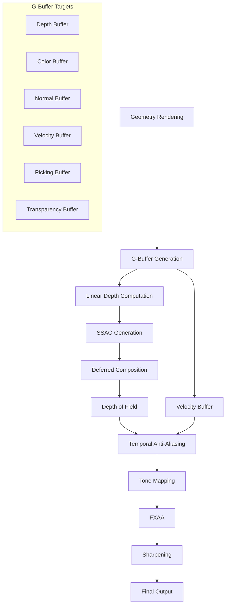
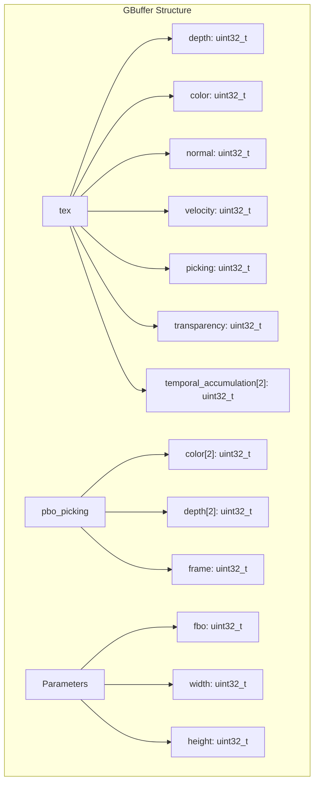
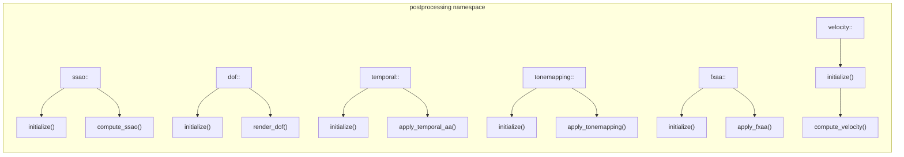
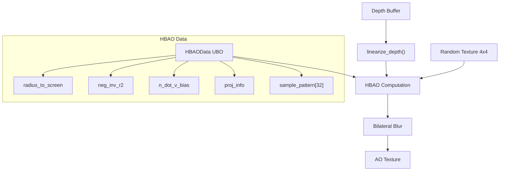
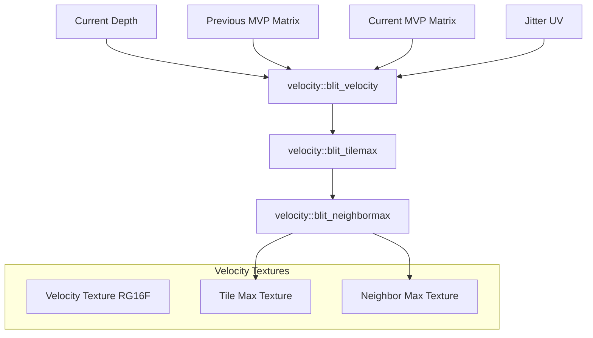
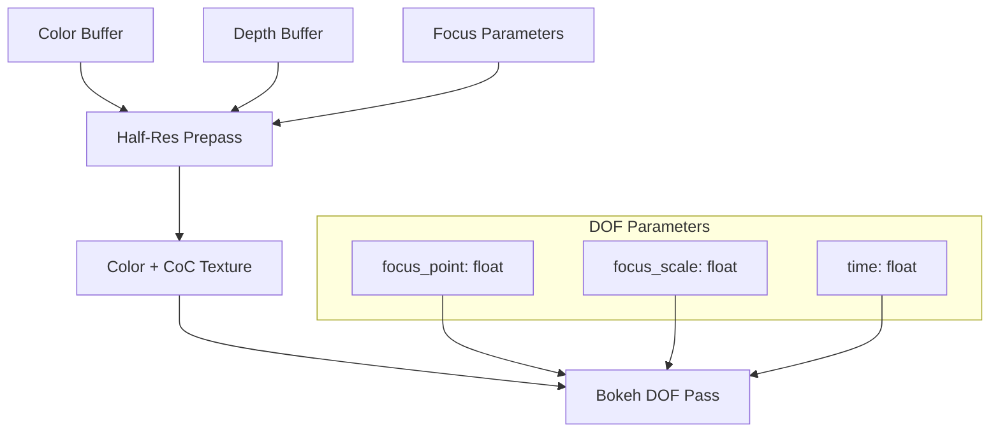
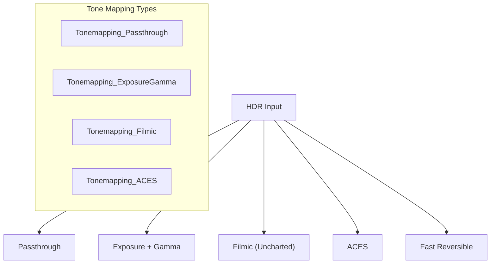
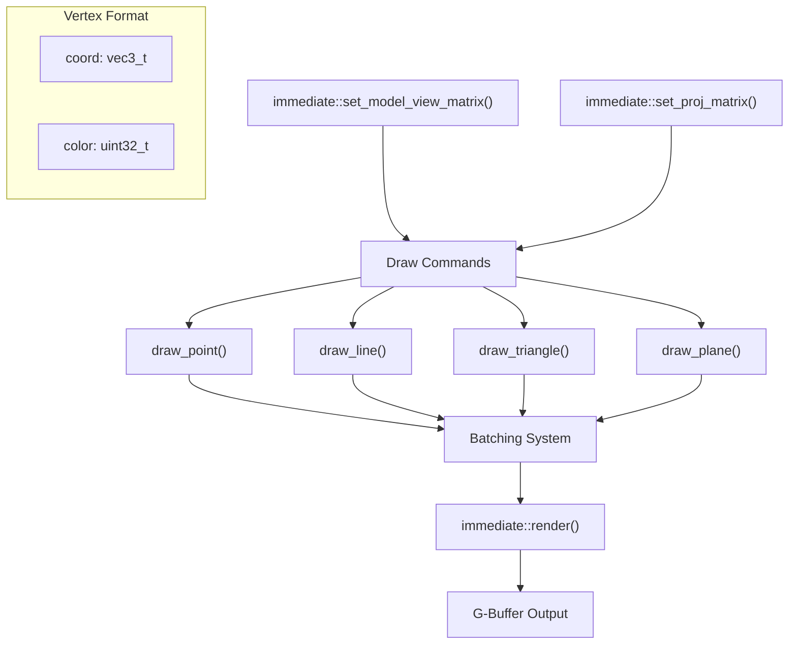
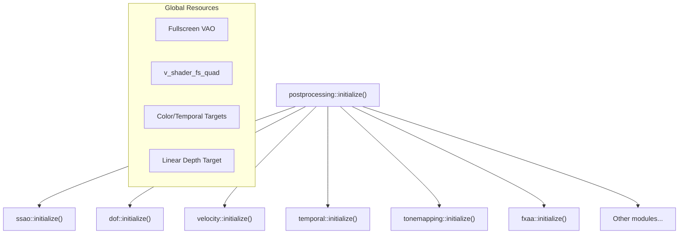

# Rendering Pipeline and Post-Processing

Relevant source files

The following files were used as context for generating this wiki page:

- [src/gfx/immediate_draw_utils.cpp](src/gfx/immediate_draw_utils.cpp)
- [src/gfx/immediate_draw_utils.h](src/gfx/immediate_draw_utils.h)
- [src/gfx/postprocessing_utils.cpp](src/gfx/postprocessing_utils.cpp)
- [src/gfx/postprocessing_utils.h](src/gfx/postprocessing_utils.h)

This document covers the deferred rendering pipeline and comprehensive post-processing system in VIAMD. The system implements a modern deferred shading approach with G-buffer management, followed by a chain of post-processing effects including SSAO, temporal anti-aliasing, depth of field, and various tonemapping operators.

For volume rendering specifics, see [Volume Rendering System](#3.2). For camera controls and view parameters, see [Camera System and Controls](#3.3). For GLSL shader implementations, see [GLSL Shaders](#3.4).

## Architecture Overview

The rendering pipeline follows a deferred shading architecture where geometry is first rendered to a G-buffer containing multiple render targets, followed by a composition pass and post-processing chain.

### Pipeline Flow Diagram

Sources: [src/gfx/postprocessing_utils.cpp:1-1500](), [src/gfx/postprocessing_utils.h:1-142]()

## G-Buffer Architecture

The G-buffer system manages multiple render targets to store geometric and material information for deferred shading.

### G-Buffer Layout

| Attachment | Format | Purpose |
|------------|--------|---------|
| `GL_COLOR_ATTACHMENT0` | `GL_R11F_G11F_B10F` | HDR Color |
| `GL_COLOR_ATTACHMENT1` | `GL_RG16_SNORM` | Encoded Normals |
| `GL_COLOR_ATTACHMENT2` | `GL_RG16F` | Velocity Vectors |
| `GL_COLOR_ATTACHMENT3` | `GL_R32UI` | Picking IDs |
| `GL_COLOR_ATTACHMENT4` | `GL_RGBA8` | Transparency |
| `GL_COLOR_ATTACHMENT5` | `GL_RGB16` | Temporal Accumulation |

### G-Buffer Data Structure

Sources: [src/gfx/postprocessing_utils.h:18-40]()

## Post-Processing Effect Chain

The post-processing system is organized into modular namespaces, each handling specific effects with their own initialization and rendering functions.

### Effect Modules

Sources: [src/gfx/postprocessing_utils.cpp:286-441](), [src/gfx/postprocessing_utils.cpp:443-460](), [src/gfx/postprocessing_utils.cpp:921-953]()

## Screen Space Ambient Occlusion (SSAO)

The SSAO implementation uses Horizon-Based Ambient Occlusion (HBAO) based on NVIDIA's technique, with support for both perspective and orthographic projections.

### SSAO Pipeline

The `HBAOData` structure contains all parameters needed for HBAO computation:

| Field | Type | Purpose |
|-------|------|---------|
| `radius_to_screen` | `float` | Screen-space radius scaling |
| `neg_inv_r2` | `float` | Negative inverse radius squared |
| `n_dot_v_bias` | `float` | Normal dot view bias |
| `proj_info` | `vec4_t` | Projection matrix information |
| `sample_pattern` | `vec4_t[32]` | Pre-computed sample pattern |

Sources: [src/gfx/postprocessing_utils.cpp:286-441](), [src/gfx/postprocessing_utils.cpp:306-364]()

## Temporal Anti-Aliasing and Motion Blur

The temporal anti-aliasing system combines current and previous frames using velocity vectors to reduce aliasing and optionally add motion blur effects.

### Velocity Buffer Generation

### Temporal AA Implementation

The system supports two modes via separate shader programs:
- `temporal::with_motion_blur` - Includes motion blur sampling
- `temporal::no_motion_blur` - Pure temporal anti-aliasing

Key parameters:
- `feedback_min/max` - Controls temporal feedback strength
- `motion_scale` - Scales motion blur intensity
- `jitter_uv` - Sub-pixel jittering for sample distribution

Sources: [src/gfx/postprocessing_utils.cpp:825-919](), [src/gfx/postprocessing_utils.cpp:921-953]()

## Depth of Field System

The depth of field implementation uses a two-pass approach with half-resolution preprocessing and full-resolution composition.

### DOF Pipeline

The half-resolution prepass computes circle of confusion (CoC) values alongside downsampled color, which are then used in the full-resolution bokeh pass for efficient depth of field rendering.

Sources: [src/gfx/postprocessing_utils.cpp:648-698]()

## Tone Mapping Operators

The system provides multiple tone mapping operators for HDR to LDR conversion:

### Available Operators

| Mode | Purpose | Parameters |
|------|---------|------------|
| `Passthrough` | No tone mapping | None |
| `ExposureGamma` | Simple exposure + gamma | `exposure`, `gamma` |
| `Filmic` | Uncharted 2 tone mapper | `exposure`, `gamma` |
| `ACES` | ACES filmic tone mapper | `exposure`, `gamma` |
| `Fast Reversible` | Reversible for temporal AA | None |

Sources: [src/gfx/postprocessing_utils.cpp:558-646]()

## Immediate Mode Rendering Integration

The immediate mode drawing system provides debug and utility rendering that integrates with the deferred pipeline.

### Immediate Rendering Flow

The immediate mode system outputs to the same G-buffer as the main geometry, using a simple vertex format with position and packed color. Draw commands are batched by primitive type and matrix state to minimize state changes.

Sources: [src/gfx/immediate_draw_utils.cpp:89-116](), [src/gfx/immediate_draw_utils.cpp:206-274](), [src/gfx/immediate_draw_utils.h:7-10]()

## Implementation Details

### Initialization and Resource Management

The post-processing system uses a centralized initialization approach:

Each module manages its own OpenGL resources (programs, textures, framebuffers) with proper cleanup in corresponding `shutdown()` functions.

### Shader Program Management

The system uses a common pattern for shader program creation via `setup_program_from_source()`:

1. Compile fragment shader with optional defines
2. Link with shared fullscreen quad vertex shader
3. Store uniform locations for efficient updates
4. Error handling with detailed logging

Sources: [src/gfx/postprocessing_utils.cpp:999-1112](), [src/gfx/postprocessing_utils.cpp:259-282]()

---