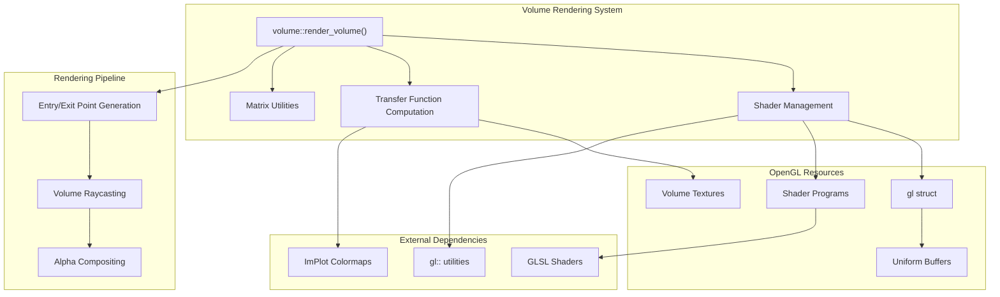
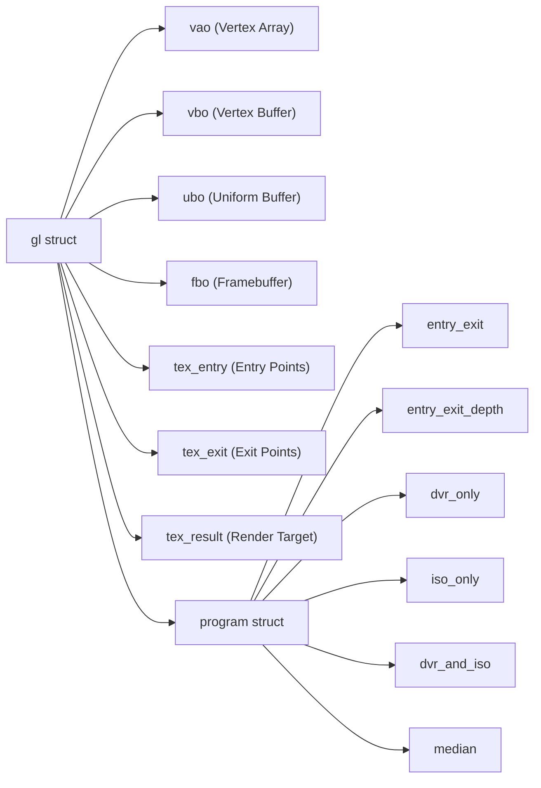
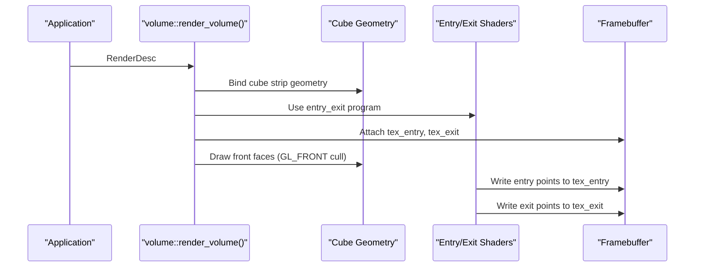
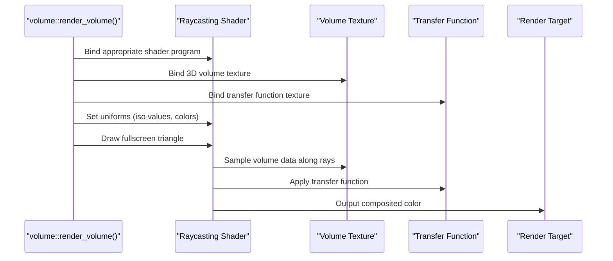
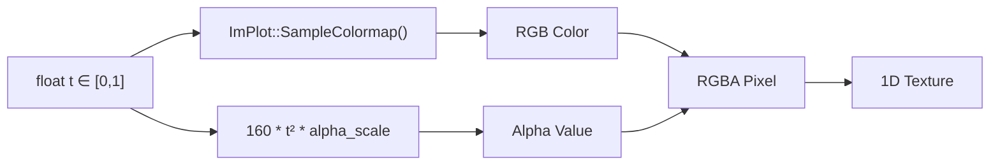
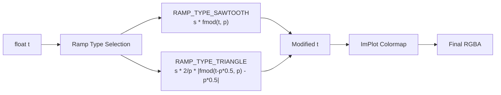
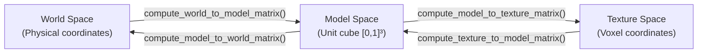
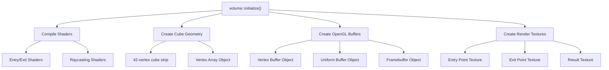

# Volume Rendering System

<details>
<summary>Relevant source files</summary>

The following files were used as context for generating this wiki page:

- [src/gfx/gl_utils.cpp](src/gfx/gl_utils.cpp)
- [src/gfx/gl_utils.h](src/gfx/gl_utils.h)
- [src/gfx/volumerender_utils.cpp](src/gfx/volumerender_utils.cpp)
- [src/gfx/volumerender_utils.h](src/gfx/volumerender_utils.h)

</details>


The Volume Rendering System provides advanced 3D visualization capabilities for volumetric data in VIAMD, including direct volume rendering (DVR), isosurface extraction, and hybrid rendering modes. This system handles the complete pipeline from volume data input to final rendered output with support for transfer functions, temporal effects, and physically-based shading.

For information about the overall graphics pipeline and post-processing effects, see [Rendering Pipeline and Post-Processing](#3.1). For shader-specific implementation details, see [GLSL Shaders](#3.4).

## System Architecture

The volume rendering system is implemented in the `volume` namespace and consists of several key components working together to provide real-time volumetric visualization.

### Core Components Overview



Sources: [src/gfx/volumerender_utils.h:1-113](), [src/gfx/volumerender_utils.cpp:96-119]()

### OpenGL Resource Management

The system maintains a static `gl` structure containing all OpenGL resources needed for volume rendering:



Sources: [src/gfx/volumerender_utils.cpp:98-119]()

## Rendering Pipeline

### Two-Pass Rendering Process

The volume rendering system uses a two-pass approach to achieve accurate ray-volume intersection:

#### Pass 1: Entry/Exit Point Generation



Sources: [src/gfx/volumerender_utils.cpp:462-477](), [src/gfx/volumerender_utils.cpp:196-203]()

#### Pass 2: Volume Raycasting



Sources: [src/gfx/volumerender_utils.cpp:514-543]()

### Shader Program Selection

The system dynamically selects appropriate shader programs based on enabled rendering modes:

| DVR Enabled | ISO Enabled | Selected Program |
|-------------|-------------|------------------|
| ✓ | ✗ | `gl.program.dvr_only` |
| ✗ | ✓ | `gl.program.iso_only` |
| ✓ | ✓ | `gl.program.dvr_and_iso` |

Sources: [src/gfx/volumerender_utils.cpp:516](), [src/gfx/volumerender_utils.cpp:111-118]()

## Transfer Function System

### Transfer Function Computation

The system provides two transfer function computation methods:

#### Simple Transfer Function


#### Advanced Transfer Function with Ramps


Sources: [src/gfx/volumerender_utils.cpp:277-303](), [src/gfx/volumerender_utils.cpp:305-347]()

### Ramp Types

| Ramp Type | Formula | Visual Pattern | Use Case |
|-----------|---------|----------------|----------|
| `RAMP_TYPE_SAWTOOTH` | `s * fmod(t, p)` | `/|/|/|/|` | Periodic alpha variation |
| `RAMP_TYPE_TRIANGLE` | `s * (2/p) * |fmod(t-p*0.5, p) - p*0.5|` | `/\/\/\/\` | Smooth periodic transitions |

Sources: [src/gfx/volumerender_utils.h:19-22](), [src/gfx/volumerender_utils.cpp:327-335]()

## Configuration and Parameters

### RenderDesc Structure

The `RenderDesc` structure serves as the primary configuration interface for volume rendering:

```mermaid
graph TB
    RenderDesc["RenderDesc"] --> RenderTarget["render_target"]
    RenderDesc --> Texture["texture"]
    RenderDesc --> Matrix["matrix"]
    RenderDesc --> ClipVolume["clip_volume"]
    RenderDesc --> Temporal["temporal"]
    RenderDesc --> ISO["iso"]
    RenderDesc --> DVR["dvr"]
    RenderDesc --> Shading["shading"]
    
    RenderTarget --> RTDepth["depth texture"]
    RenderTarget --> RTColor["color texture"]
    RenderTarget --> RTDimensions["width, height"]
    
    Texture --> VolumeTex["volume (3D texture)"]
    Texture --> TFTex["transfer_function (1D texture)"]
    
    Matrix --> Model["model matrix"]
    Matrix --> View["view matrix"]
    Matrix --> Proj["proj matrix"]
    Matrix --> InvProj["inv_proj matrix"]
    
    ISO --> ISOValues["values array"]
    ISO --> ISOColors["colors array"]
    ISO --> ISOCount["count"]
    
    DVR --> DVREnabled["enabled flag"]
    DVR --> DVRMinTF["min_tf_value"]
    DVR --> DVRMaxTF["max_tf_value"]
    
    Shading --> EnvRadiance["env_radiance"]
    Shading --> DirRadiance["dir_radiance"]
    Shading --> Roughness["roughness"]
    Shading --> IOR["ior (Index of Refraction)"]
```



Sources: [src/gfx/volumerender_utils.h:43-108]()

### Uniform Data Structure

The `UniformData` structure contains all shader uniform parameters:

| Parameter | Type | Purpose |
|-----------|------|---------|
| `view_to_model_mat` | `mat4_t` | Transform rays from view to model space |
| `model_to_view_mat` | `mat4_t` | Transform positions from model to view space |
| `inv_proj_mat` | `mat4_t` | Reconstruct view space position from depth |
| `model_view_proj_mat` | `mat4_t` | Combined transformation matrix |
| `clip_volume_min/max` | `vec3_t` | Define visible volume subset |
| `tf_min`, `tf_inv_ext` | `float` | Transfer function range parameters |
| `gradient_spacing_*` | `vec3_t`, `mat4_t` | Gradient computation spacing |
| `env_radiance`, `dir_radiance` | `vec3_t` | Lighting parameters |
| `roughness`, `F0` | `float` | Material properties |

Sources: [src/gfx/volumerender_utils.cpp:121-144]()

## Matrix Transformations

### Coordinate Space Transformations

The system provides utilities for transforming between different coordinate spaces:



#### Model-to-World Transformation
```cpp
// Transform from unit cube [0,1]³ to world AABB
mat4_t model_to_world = {
    ext.x,    0,    0, 0,
        0, ext.y,    0, 0,
        0,    0, ext.z, 0,
    off.x, off.y, off.z, 1
};
```

#### World-to-Model Transformation  
```cpp
// Transform from world AABB to unit cube [0,1]³
mat4_t world_to_model = {
    1.0f/ext.x,         0,         0, 0,
             0, 1.0f/ext.y,         0, 0,
             0,         0, 1.0f/ext.z, 0,
        -off.x,    -off.y,    -off.z, 1
};
```

Sources: [src/gfx/volumerender_utils.cpp:241-261](), [src/gfx/volumerender_utils.cpp:252-261]()

## Initialization and Resource Management

### System Initialization

The `initialize()` function sets up all required OpenGL resources:



Sources: [src/gfx/volumerender_utils.cpp:146-237]()

### Cube Geometry Generation

The system uses a triangle strip to generate a unit cube for ray-volume intersection:

```cpp
// 42-vertex triangle strip for unit cube generation
constexpr uint8_t cube_strip[42] = {
    0,0,0, 0,1,0, 1,0,0, 1,1,0, 1,1,1, 0,1,0, 0,1,1,
    0,0,1, 1,1,1, 1,0,1, 1,0,0, 0,0,1, 0,0,0, 0,1,0
};
```

Sources: [src/gfx/volumerender_utils.cpp:198-199]()

## Integration with Graphics Pipeline

### Render Target Management

The volume rendering system integrates with the main graphics pipeline through flexible render target configuration:

| Render Target Mode | Description | Integration |
|-------------------|-------------|-------------|
| Direct Framebuffer | Renders directly to bound framebuffer | Main scene rendering |
| Intermediate Texture | Renders to specified color texture | Post-processing pipeline |
| Depth-aware Rendering | Uses depth texture for occlusion | Mixed geometry/volume scenes |

Sources: [src/gfx/volumerender_utils.cpp:500-512](), [src/gfx/volumerender_utils.cpp:438-443]()

### Temporal Effects

The system supports temporal jittering for improved visual quality:

```cpp
static float time = 0.0f;
time += 1.0f / 100.0f;
if (!desc.temporal.enabled) {
    time = 0.0f;
}
```

This temporal offset is used in shaders to reduce temporal aliasing artifacts in volume rendering.

Sources: [src/gfx/volumerender_utils.cpp:400-405]()

---