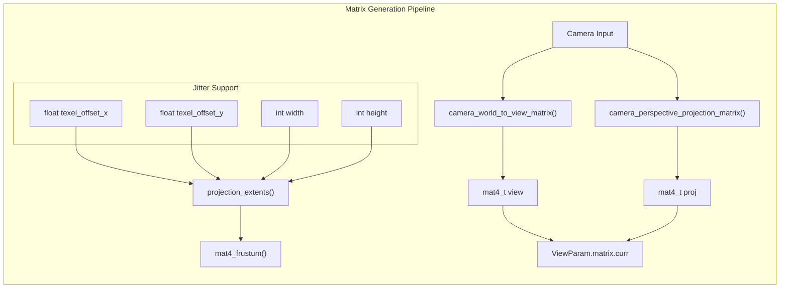
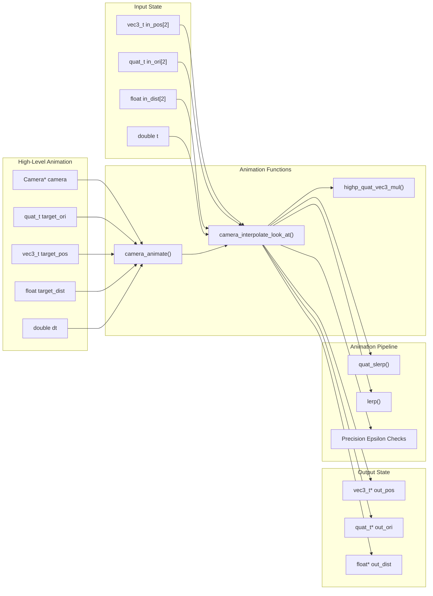
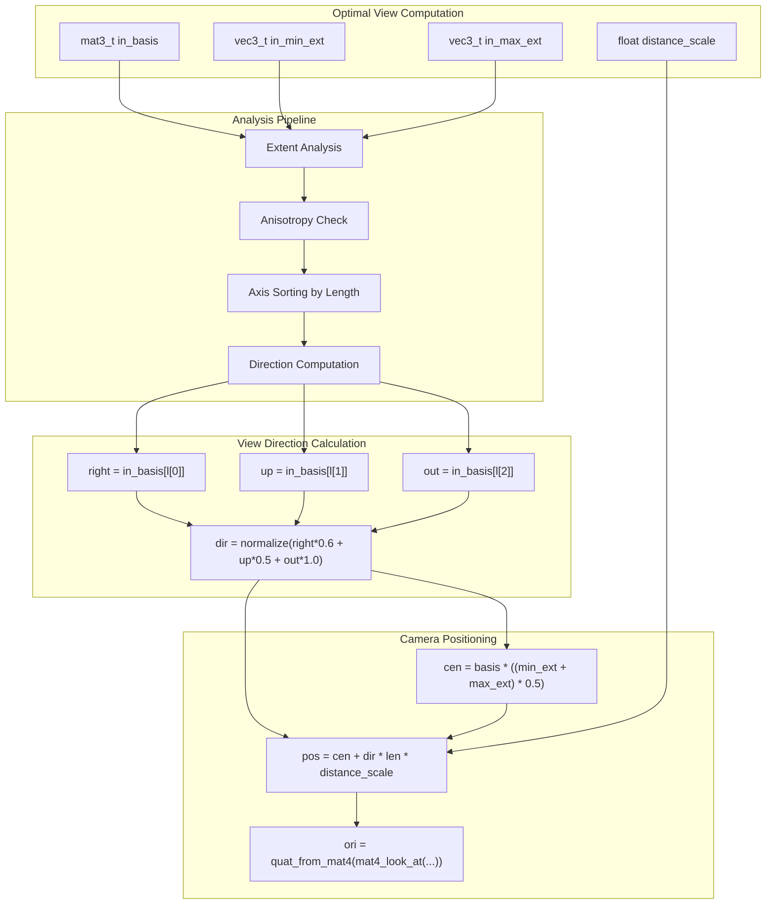
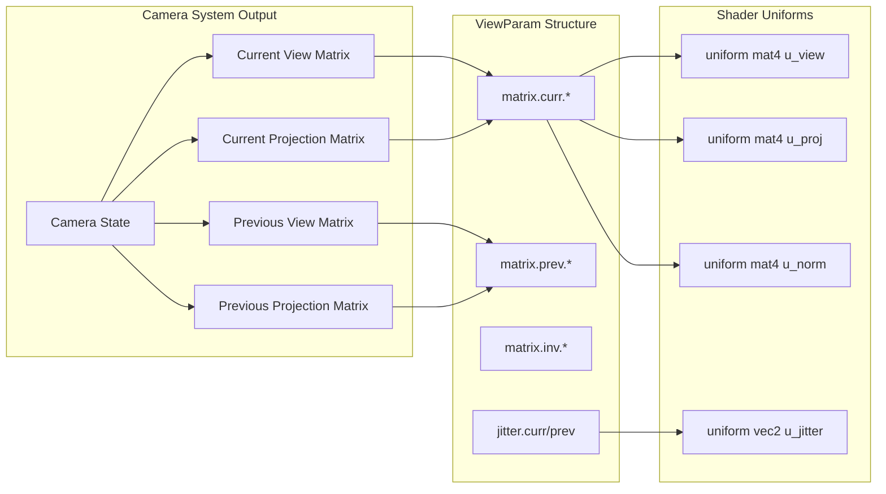

# Camera System and Controls

Relevant source files

The following files were used as context for generating this wiki page:

- [src/gfx/camera_utils.cpp](src/gfx/camera_utils.cpp)
- [src/gfx/camera_utils.h](src/gfx/camera_utils.h)
- [src/gfx/view_param.h](src/gfx/view_param.h)

This document covers VIAMD's camera system, which provides 3D navigation and view control for molecular visualization. The system includes trackball controls, projection matrix generation, camera animation, and automatic view computation.

For information about the rendering pipeline that uses these camera parameters, see [Rendering Pipeline and Post-Processing](#3.1). For details about volume rendering view calculations, see [Volume Rendering System](#3.2).

## Camera Data Structure and Core Components

The camera system is built around the `Camera` struct and related view parameter structures that manage 3D scene navigation and projection.

```mermaid
graph TB
    subgraph "Core Camera Structure"
        Camera["Camera"]
        Camera --> position["vec3_t position"]
        Camera --> orientation["quat_t orientation"]
        Camera --> fov_y["float fov_y"]
        Camera --> near_plane["float near_plane"]
        Camera --> far_plane["float far_plane"]
        Camera --> focus_distance["float focus_distance"]
    end

    subgraph "View Parameter Block"
        ViewParam["ViewParam"]
        ViewParam --> matrix_curr["matrix.curr.view/proj/norm"]
        ViewParam --> matrix_prev["matrix.prev.*"]
        ViewParam --> matrix_inv["matrix.inv.*"]
        ViewParam --> jitter["jitter.curr/prev"]
        ViewParam --> clip_planes["clip_planes.near/far"]
        ViewParam --> resolution["vec2_t resolution"]
    end

    subgraph "Matrix Generation Functions"
        camera_world_to_view_matrix["camera_world_to_view_matrix()"]
        camera_view_to_world_matrix["camera_view_to_world_matrix()"]
        camera_perspective_projection_matrix["camera_perspective_projection_matrix()"]
        camera_inverse_perspective_projection_matrix["camera_inverse_perspective_projection_matrix()"]
    end

    Camera --> camera_world_to_view_matrix
    Camera --> camera_view_to_world_matrix
    Camera --> camera_perspective_projection_matrix
    Camera --> camera_inverse_perspective_projection_matrix

    matrix_curr --> ViewParam_output["Shader Uniforms"]
    matrix_prev --> ViewParam_output
    matrix_inv --> ViewParam_output
```

The `Camera` struct stores the fundamental view parameters including position in world space, orientation as a quaternion, field of view, clipping planes, and focus distance for trackball controls. The `ViewParam` structure packages the computed matrices and temporal information needed by shaders.

**Sources**: [src/gfx/camera_utils.h:1-32](), [src/gfx/view_param.h:5-31]()

## Matrix Generation System

The camera system provides comprehensive matrix generation functions for transforming between coordinate spaces and handling projection with optional sub-pixel jittering for temporal anti-aliasing.

| Function | Purpose | Parameters |
|----------|---------|------------|
| `camera_world_to_view_matrix` | World to camera space transform | `Camera` struct |
| `camera_view_to_world_matrix` | Camera to world space transform | `Camera` struct |
| `camera_perspective_projection_matrix` | Standard perspective projection | `Camera`, aspect ratio |
| `camera_perspective_projection_matrix` (overload) | Jittered perspective projection | `Camera`, width, height, texel offsets |
| `camera_inverse_perspective_projection_matrix` | Inverse projection matrices | Same as above |
| `camera_orthographic_projection_matrix` | Orthographic projections | Left, right, bottom, top bounds |

The matrix generation system supports both standard and jittered projection matrices. Jittering enables temporal anti-aliasing by sub-pixel offsets computed through the `projection_extents` helper function.

**Sources**: [src/gfx/camera_utils.cpp:21-81](), [src/gfx/camera_utils.h:93-106]()

## Trackball Control System

The trackball controller provides intuitive 3D navigation through rotation, panning, and dollying operations. The system maintains a focus point and rotates around it while supporting smooth distance-based scaling.

```mermaid
graph TB
    subgraph "Trackball Controller Components"
        TrackballControllerInput["TrackballControllerInput"]
        TrackballControllerInput --> rotate_button["bool rotate_button"]
        TrackballControllerInput --> pan_button["bool pan_button"] 
        TrackballControllerInput --> dolly_button["bool dolly_button"]
        TrackballControllerInput --> dolly_delta["float dolly_delta"]
        TrackballControllerInput --> mouse_coord_prev["vec2_t mouse_coord_prev"]
        TrackballControllerInput --> mouse_coord_curr["vec2_t mouse_coord_curr"]
        TrackballControllerInput --> screen_size["vec2_t screen_size"]
        TrackballControllerInput --> fov_y["float fov_y"]
    end

    subgraph "Trackball Parameters"
        TrackballControllerParam["TrackballControllerParam"]
        TrackballControllerParam --> pan_scale["float pan_scale"]
        TrackballControllerParam --> pan_exponent["float pan_exponent"]
        TrackballControllerParam --> dolly_drag_scale["float dolly_drag_scale"]
        TrackballControllerParam --> dolly_drag_exponent["float dolly_drag_exponent"]
        TrackballControllerParam --> min_distance["float min_distance"]
        TrackballControllerParam --> max_distance["float max_distance"]
    end

    subgraph "Control Operations"
        camera_controller_trackball["camera_controller_trackball()"]
        trackball_func["trackball()"]
        project_to_sphere["project_to_sphere()"]
    end

    TrackballControllerInput --> camera_controller_trackball
    TrackballControllerParam --> camera_controller_trackball
    camera_controller_trackball --> trackball_func
    trackball_func --> project_to_sphere

    subgraph "Output"
        position_out["vec3_t* position"]
        orientation_out["quat_t* orientation"] 
        distance_out["float* distance"]
    end

    camera_controller_trackball --> position_out
    camera_controller_trackball --> orientation_out
    camera_controller_trackball --> distance_out
```

The trackball implementation uses virtual sphere projection to convert 2D mouse movements into 3D rotations. The `project_to_sphere` function maps screen coordinates to a virtual trackball sphere, while the `trackball` function computes the rotation quaternion between two sphere points.

### Trackball Operation Modes

| Operation | Trigger | Behavior |
|-----------|---------|----------|
| **Rotation** | `rotate_button` + mouse drag | Rotates around focus point using virtual sphere |
| **Panning** | `pan_button` + mouse drag | Translates camera parallel to view plane |
| **Dollying** | `dolly_button` + mouse drag or `dolly_delta` | Moves camera toward/away from focus point |

The controller supports configurable scaling parameters with exponential distance relationships, allowing smooth navigation across different molecular scales.

**Sources**: [src/gfx/camera_utils.cpp:96-235](), [src/gfx/camera_utils.h:23-86]()

## Camera Animation and Interpolation

The camera system provides smooth transitions between view states through quaternion-based interpolation that maintains focus point relationships and handles precision issues in long animations.

The interpolation system maintains focus point consistency by computing implicit look-at positions and interpolating them separately from camera positions. This prevents drift during long animations. The `highp_quat_vec3_mul` function provides double-precision quaternion-vector multiplication to combat floating-point errors.

### Animation Precision Handling

The system employs epsilon-based comparisons to avoid unnecessary computations:

- **Quaternion epsilon**: `1.0e-7` for orientation similarity
- **Position epsilon**: `1.0e-7` for spatial proximity  
- **Distance epsilon**: `1.0e-7` for focus distance similarity

When values are within epsilon thresholds, the system uses the target value directly instead of interpolating, preventing numerical drift.

**Sources**: [src/gfx/camera_utils.cpp:134-286](), [src/gfx/camera_utils.h:91-115]()

## Automatic View Computation

The system provides automatic camera positioning through the `camera_compute_optimal_view` function, which analyzes molecular geometry to compute optimal viewing angles and distances.

The optimal view algorithm performs several steps:

1. **Extent Analysis**: Computes bounding box dimensions and determines anisotropy ratio
2. **Axis Sorting**: Orders coordinate axes by extent length when anisotropy > 1.1
3. **Direction Computation**: Creates viewing direction using weighted axis combination
4. **Camera Positioning**: Places camera at computed distance along viewing direction

The algorithm prioritizes views that show the longest molecular axis horizontally and positions the camera at an optimal distance based on the molecular size.

**Sources**: [src/gfx/camera_utils.cpp:237-271](), [src/gfx/camera_utils.h:113]()

## Integration with Rendering Pipeline

The camera system interfaces with the rendering pipeline through the `ViewParam` structure, which packages current and previous frame matrices for temporal effects.

The `ViewParam` structure maintains both current and previous frame matrices to support temporal rendering effects like motion blur and temporal anti-aliasing. The inverse matrices enable efficient screen-space to world-space transformations in shaders.

**Sources**: [src/gfx/view_param.h:5-31]()

---