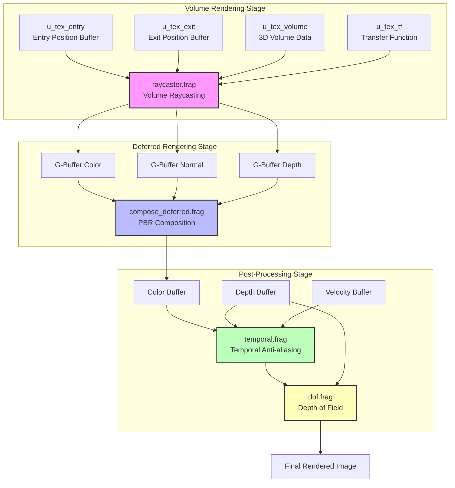
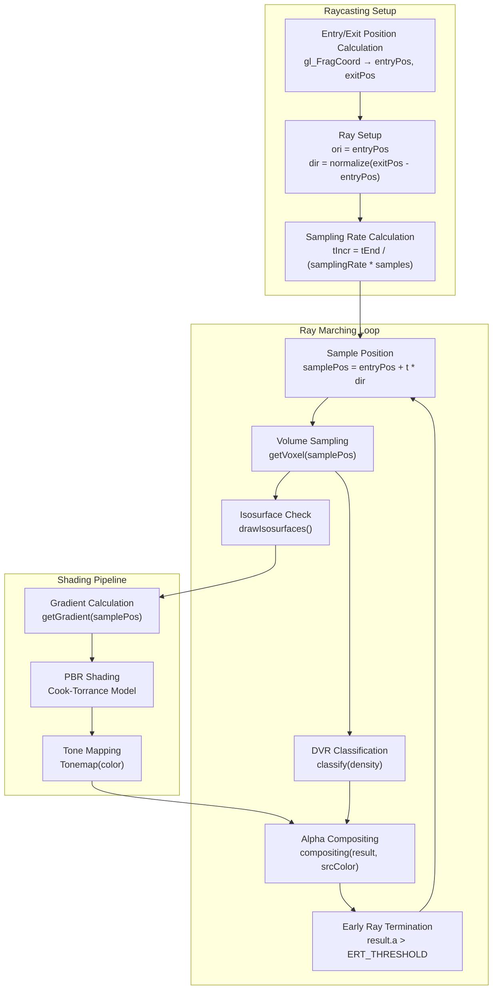
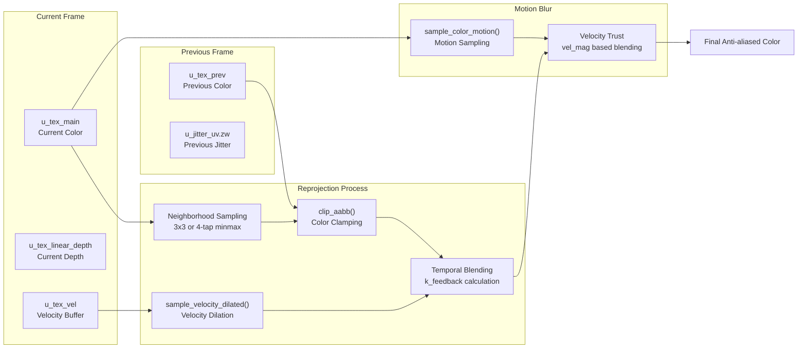
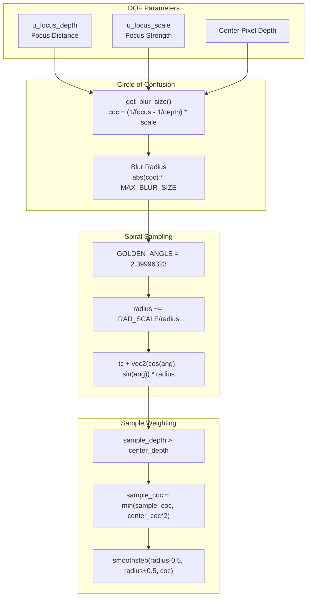
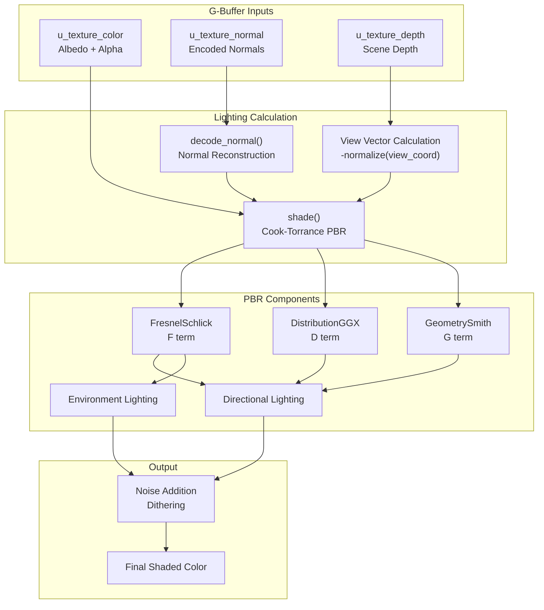

# GLSL Shaders

<details>
<summary>Relevant source files</summary>

The following files were used as context for generating this wiki page:

- [src/shaders/compose_deferred.frag](src/shaders/compose_deferred.frag)
- [src/shaders/dof/dof.frag](src/shaders/dof/dof.frag)
- [src/shaders/temporal.frag](src/shaders/temporal.frag)
- [src/shaders/volume/raycaster.frag](src/shaders/volume/raycaster.frag)

</details>


This document covers the GLSL shader system in VIAMD, including volume rendering, post-processing effects, and deferred rendering shaders. The shaders implement advanced rendering techniques for molecular visualization, including direct volume rendering, isosurface extraction, temporal anti-aliasing, depth of field, and physically-based shading.

For information about the overall rendering pipeline architecture, see [Rendering Pipeline and Post-Processing](#3.1). For volume rendering system details, see [Volume Rendering System](#3.2).

## Shader Pipeline Overview

VIAMD's shader system implements a multi-stage rendering pipeline that processes molecular data through volume rendering, deferred shading, and post-processing effects.

**Shader Pipeline Architecture**



Sources: [src/shaders/volume/raycaster.frag](), [src/shaders/compose_deferred.frag](), [src/shaders/temporal.frag](), [src/shaders/dof/dof.frag]()

## Volume Rendering Shaders

The volume rendering system uses GPU-based raycasting to visualize 3D molecular data, supporting both direct volume rendering and isosurface extraction.

### Volume Raycaster

The primary volume rendering shader `raycaster.frag` implements a comprehensive raycasting algorithm with support for multiple rendering modes.

**Volume Raycasting Implementation**



**Key Shader Functions:**

| Function | Purpose | Location |
|----------|---------|----------|
| `getVoxel(vec3)` | Sample volume texture | [src/shaders/volume/raycaster.frag:79-81]() |
| `classify(float)` | Transfer function lookup | [src/shaders/volume/raycaster.frag:83-87]() |
| `compositing(vec4, vec4, float)` | Alpha blending | [src/shaders/volume/raycaster.frag:89-94]() |
| `getGradient(vec3)` | Central difference gradient | [src/shaders/volume/raycaster.frag:96-104]() |
| `drawIsosurface(...)` | Isosurface intersection | [src/shaders/volume/raycaster.frag:213-269]() |
| `shade(vec4, vec3, vec3)` | PBR shading calculation | [src/shaders/volume/raycaster.frag:146-191]() |

**Isosurface Parameters:**

The shader supports up to `MAX_ISOVALUE_COUNT` isosurfaces simultaneously through the `IsovalueParameters` uniform block:

```glsl
struct IsovalueParameters {
    float values[MAX_ISOVALUE_COUNT];
    vec4  colors[MAX_ISOVALUE_COUNT];
    int count;
};
```

Sources: [src/shaders/volume/raycaster.frag:1-391]()

## Post-Processing Shaders

The post-processing pipeline applies temporal anti-aliasing and depth of field effects to improve visual quality.

### Temporal Anti-Aliasing

The `temporal.frag` shader implements temporal reprojection to reduce aliasing artifacts and provide motion blur effects.

**Temporal Reprojection Pipeline**



**Color Space Options:**

The shader supports multiple color space transformations and clamping methods:

| Option | Purpose | Default |
|--------|---------|---------|
| `USE_YCOCG` | YCoCg color space processing | 0 |
| `USE_CLIPPING` | AABB clipping vs simple clamping | 1 |
| `USE_MOTION_BLUR` | Motion blur rendering | 1 |
| `MINMAX_3X3` | 3x3 neighborhood sampling | 0 |
| `MINMAX_3X3_ROUNDED` | Rounded 3x3 + 5-tap | 1 |

Sources: [src/shaders/temporal.frag:1-561]()

### Depth of Field

The `dof.frag` shader implements single-pass bokeh depth of field using golden angle spiral sampling.

**DOF Sampling Pattern**



**DOF Constants:**

| Constant | Value | Purpose |
|----------|-------|---------|
| `GOLDEN_ANGLE` | 2.39996323 | Spiral sampling angle |
| `MAX_BLUR_SIZE` | 15.0 | Maximum blur radius |
| `RAD_SCALE` | 1.5 | Radius increment scale |

Sources: [src/shaders/dof/dof.frag:1-102]()

## Deferred Rendering Shaders

The deferred composition shader combines G-buffer data with physically-based lighting calculations.

### Deferred Composition

The `compose_deferred.frag` shader implements the final lighting pass for deferred rendering.

**PBR Lighting Implementation**



**Lighting Uniforms:**

| Uniform | Type | Purpose |
|---------|------|---------|
| `u_bg_color` | vec3 | Background color |
| `u_env_radiance` | vec3 | Environment lighting |
| `u_dir_radiance` | vec3 | Directional light color |
| `u_light_dir` | vec3 | Light direction |
| `u_roughness` | float | Material roughness |
| `u_F0` | float | Fresnel reflectance |

Sources: [src/shaders/compose_deferred.frag:1-143]()

## Common Shader Utilities

Several utility functions are shared across shaders for consistent rendering quality.

### Noise Generation

All shaders use pseudo-random number generation for jittering and dithering:

```glsl
float PDnrand(vec2 n) {
    return fract(sin(dot(n.xy, vec2(12.9898, 78.233))) * 43758.5453);
}
```

### Tone Mapping

Reversible tone mapping is used in temporal anti-aliasing:

```glsl
vec3 tonemap(vec3 color) {
    return color * rcp(max3(color) + 1.0);
}

vec3 tonemap_invert(vec3 color) {
    return color * rcp(1.0 - max3(color));
}
```

### Normal Encoding/Decoding

Compact normal storage using Lambert azimuthal equal-area projection:

```glsl
vec2 encode_normal(vec3 n) {
    float p = sqrt(n.z * 8 + 8);
    return n.xy / p + 0.5;
}

vec3 decode_normal(vec2 enc) {
    vec2 fenc = enc * 4 - 2;
    float f = dot(fenc, fenc);
    float g = sqrt(1 - f / 4.0);
    vec3 n;
    n.xy = fenc * g;
    n.z = 1 - f / 2.0;
    return n;
}
```

Sources: [src/shaders/volume/raycaster.frag:332-335](), [src/shaders/temporal.frag:129-148](), [src/shaders/compose_deferred.frag:28-37]()

---