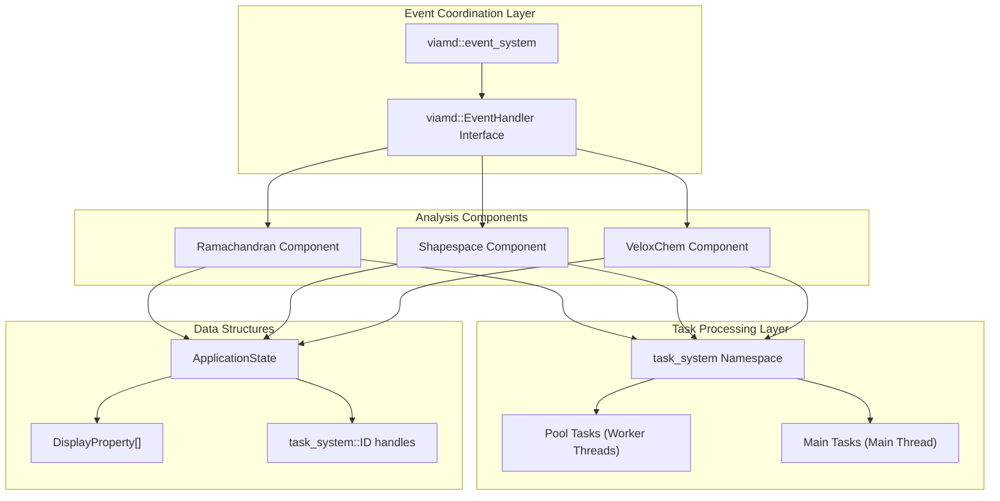
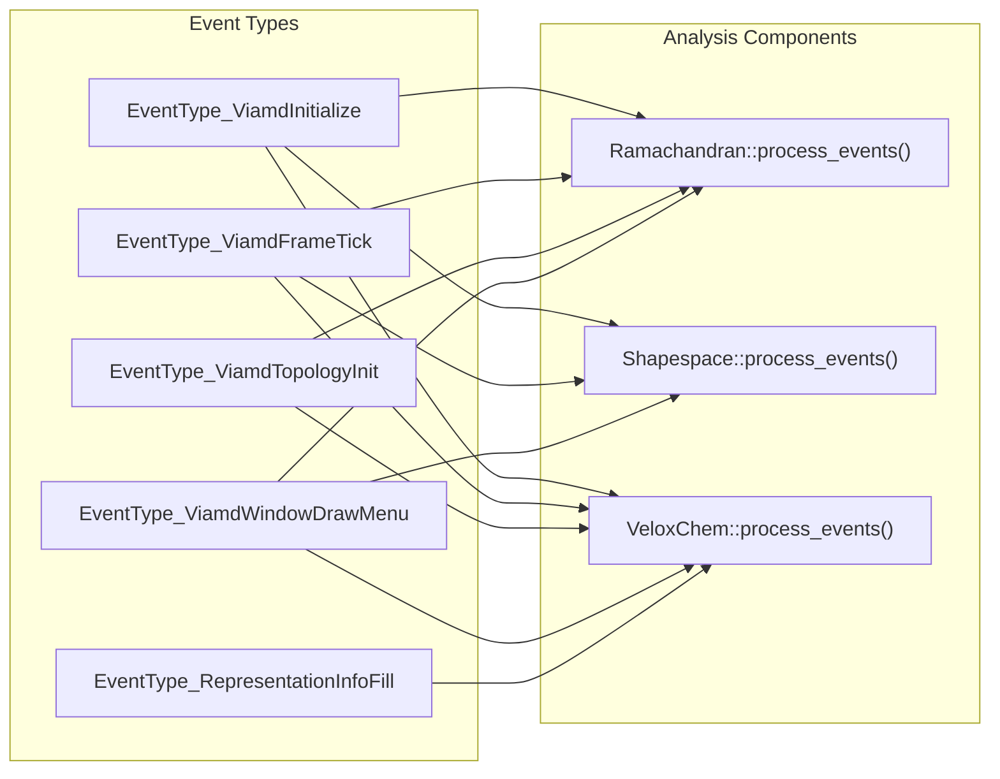
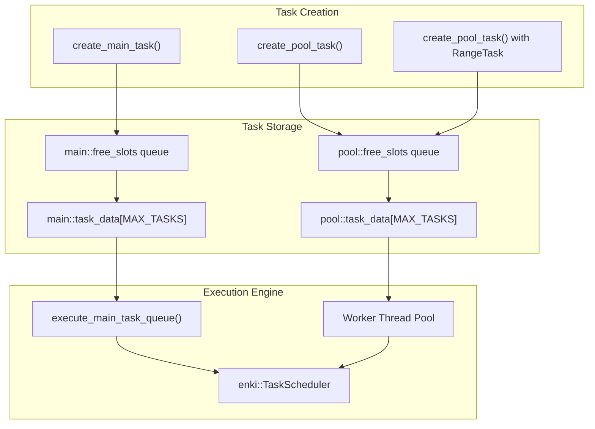
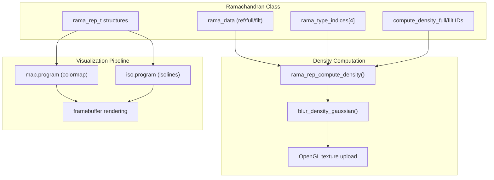
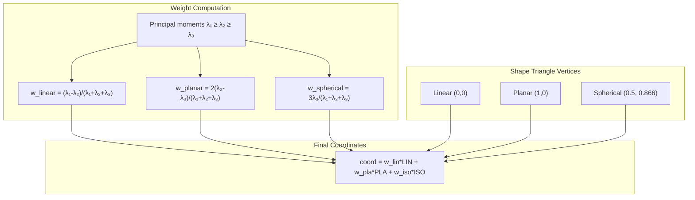
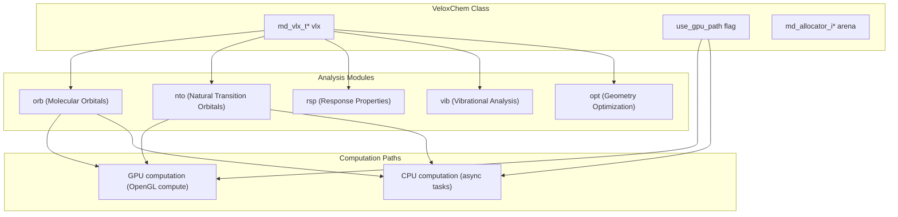
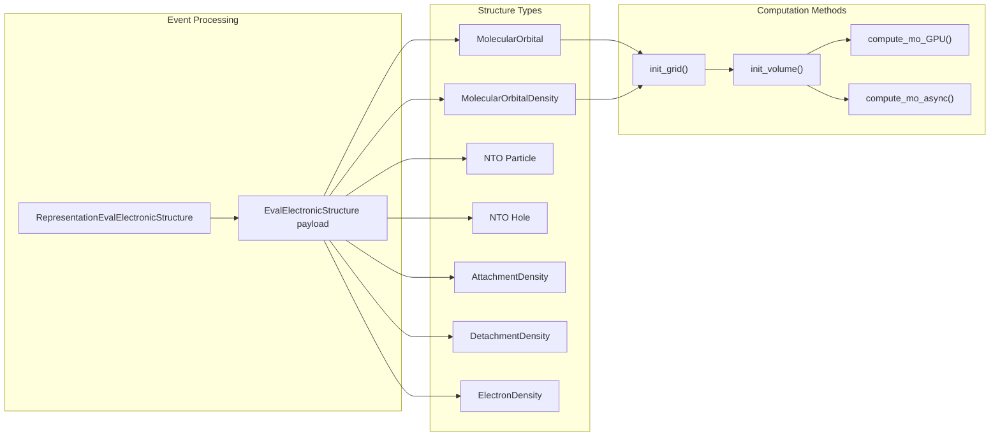
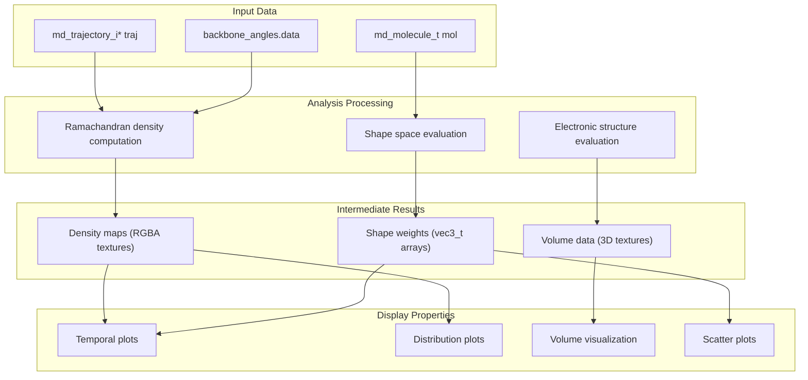

# Analysis and Computation

Relevant source files

The following files were used as context for generating this wiki page:

- [src/components/ramachandran/ramachandran.cpp](src/components/ramachandran/ramachandran.cpp)
- [src/components/shapespace/shapespace.cpp](src/components/shapespace/shapespace.cpp)
- [src/components/veloxchem/veloxchem.cpp](src/components/veloxchem/veloxchem.cpp)
- [src/event.h](src/event.h)
- [src/main.cpp](src/main.cpp)
- [src/task_system.cpp](src/task_system.cpp)
- [src/task_system.h](src/task_system.h)
- [src/viamd.h](src/viamd.h)

This document covers VIAMD's analysis and computation capabilities, including the parallel task system, molecular dynamics analysis components, and quantum chemistry integration. The analysis system provides specialized tools for protein structure analysis (Ramachandran plots), molecular shape characterization (shape space), and electronic structure visualization (VeloxChem integration).

For information about the graphics rendering pipeline, see [Graphics and Visualization Pipeline](#3). For details about the user interface components that display analysis results, see [User Interface Framework](#5).

## Analysis System Architecture

VIAMD's analysis system is built around an event-driven architecture with asynchronous task processing. The system coordinates multiple specialized analysis components through a centralized event system and executes computationally intensive work using a parallel task scheduler.

### Component Overview

**Sources:** [src/event.h:72-75](), [src/task_system.h:9-64](), [src/components/ramachandran/ramachandran.cpp:432](), [src/components/shapespace/shapespace.cpp:42](), [src/components/veloxchem/veloxchem.cpp:288]()

### Event-Driven Component Coordination

The analysis system uses a centralized event system to coordinate between components and the main application. Each analysis component implements the `viamd::EventHandler` interface and registers itself to receive relevant events.

**Sources:** [src/event.h:16-52](), [src/components/ramachandran/ramachandran.cpp:518-548](), [src/components/shapespace/shapespace.cpp:76-127](), [src/components/veloxchem/veloxchem.cpp:503-786]()

## Parallel Task System

The task system provides asynchronous computation capabilities through a thread pool architecture. It supports both main thread tasks (for UI updates) and worker pool tasks (for computation-intensive operations).

### Task Management Architecture

**Sources:** [src/task_system.cpp:22-296](), [src/task_system.h:9-64]()

### Task Lifecycle and Dependencies

The task system manages task lifecycles through unique IDs and supports dependency chains between tasks:

| Task State | Description | Key Functions |
|------------|-------------|---------------|
| Created | Task allocated but not queued | `create_main_task()`, `create_pool_task()` |
| Dependent | Waiting for dependency completion | `set_task_dependency()` |
| Queued | Ready for execution | `enqueue_task()` |
| Running | Currently executing | `task_is_running()` |
| Complete | Finished execution | Automatic cleanup |

**Sources:** [src/task_system.cpp:158-296](), [src/task_system.h:29-62]()

## Ramachandran Plot Analysis

The Ramachandran component analyzes protein backbone conformation by computing phi-psi angle distributions. It generates density maps for different residue types and provides interactive visualization.

### Ramachandran Component Structure

**Sources:** [src/components/ramachandran/ramachandran.cpp:432-476](), [src/components/ramachandran/ramachandran.cpp:390-431](), [src/components/ramachandran/ramachandran.cpp:550-611]()

### Ramachandran Types and Processing

The system classifies residues into four Ramachandran types and processes them separately:

| Type | Enum Value | Description |
|------|------------|-------------|
| General | `MD_RAMACHANDRAN_TYPE_GENERAL` | Standard amino acids |
| Glycine | `MD_RAMACHANDRAN_TYPE_GLYCINE` | Glycine residues |
| Proline | `MD_RAMACHANDRAN_TYPE_PROLINE` | Proline residues |
| Pre-Proline | `MD_RAMACHANDRAN_TYPE_PREPROL` | Residues before proline |

**Sources:** [src/components/ramachandran/ramachandran.cpp:637-645]()

## Shape Space Analysis

The shape space component characterizes molecular shapes using principal moment analysis, projecting structures onto a triangular shape space defined by linear, planar, and spherical extremes.

### Shape Space Computation Pipeline

```mermaid
graph LR
    subgraph "Input Processing"
        FILTER["md_filter_evaluate()"]
        BITFIELDS["md_bitfield_t structures"]
    end
    
    subgraph "Frame Analysis"
        LOAD["md_trajectory_load_frame()"]
        COM["md_util_com_compute_vec4()"]
        DEPBC["md_util_deperiodize_vec4()"]
        COV["mat3_covariance_matrix_vec4()"]
        SHAPE["md_util_shape_weights()"]
    end
    
    subgraph "Visualization"
        COORDS["triangular coordinates"]
        PLOT["ImPlot::PlotScatterG()"]
    end
    
    FILTER --> BITFIELDS
    BITFIELDS --> LOAD
    LOAD --> COM
    COM --> DEPBC
    DEPBC --> COV
    COV --> SHAPE
    SHAPE --> COORDS
    COORDS --> PLOT
```

**Sources:** [src/components/shapespace/shapespace.cpp:360-428](), [src/components/shapespace/shapespace.cpp:394-421]()

### Shape Weight Calculation

The system computes three shape descriptors that sum to 1.0:

**Sources:** [src/components/shapespace/shapespace.cpp:394-422]()

## VeloxChem Integration

The VeloxChem component integrates quantum chemistry calculations, providing molecular orbital visualization, natural transition orbital analysis, and electronic structure properties.

### VeloxChem Component Architecture

**Sources:** [src/components/veloxchem/veloxchem.cpp:288-491](), [src/components/veloxchem/veloxchem.cpp:683-748]()

### Electronic Structure Evaluation Pipeline

The VeloxChem component handles requests for electronic structure visualization through the event system:

**Sources:** [src/components/veloxchem/veloxchem.cpp:683-751](), [src/viamd.h:313-324]()

## Analysis Data Flow

The analysis system processes molecular dynamics data through several stages, from raw trajectory frames to interactive visualizations:

### Overall Data Processing Pipeline

**Sources:** [src/main.cpp:467-471](), [src/components/ramachandran/ramachandran.cpp:652-679](), [src/components/shapespace/shapespace.cpp:344-430](), [src/components/veloxchem/veloxchem.cpp:683-748]()

### Task Coordination and Dependencies

Analysis components coordinate their computations through the task system, ensuring proper dependency management and resource utilization:

| Component | Task Types | Dependencies | Output |
|-----------|------------|--------------|---------|
| Ramachandran | `compute_density_full`, `compute_density_filt` | Backbone angles data | Density textures |
| Shape Space | `evaluate_task` (range task) | Trajectory frames | Weight arrays |
| VeloxChem | Various async orbital tasks | VLX data loaded | Volume textures |

**Sources:** [src/components/ramachandran/ramachandran.cpp:511-512](), [src/components/shapespace/shapespace.cpp:70](), [src/components/veloxchem/veloxchem.cpp:325-358]()

---