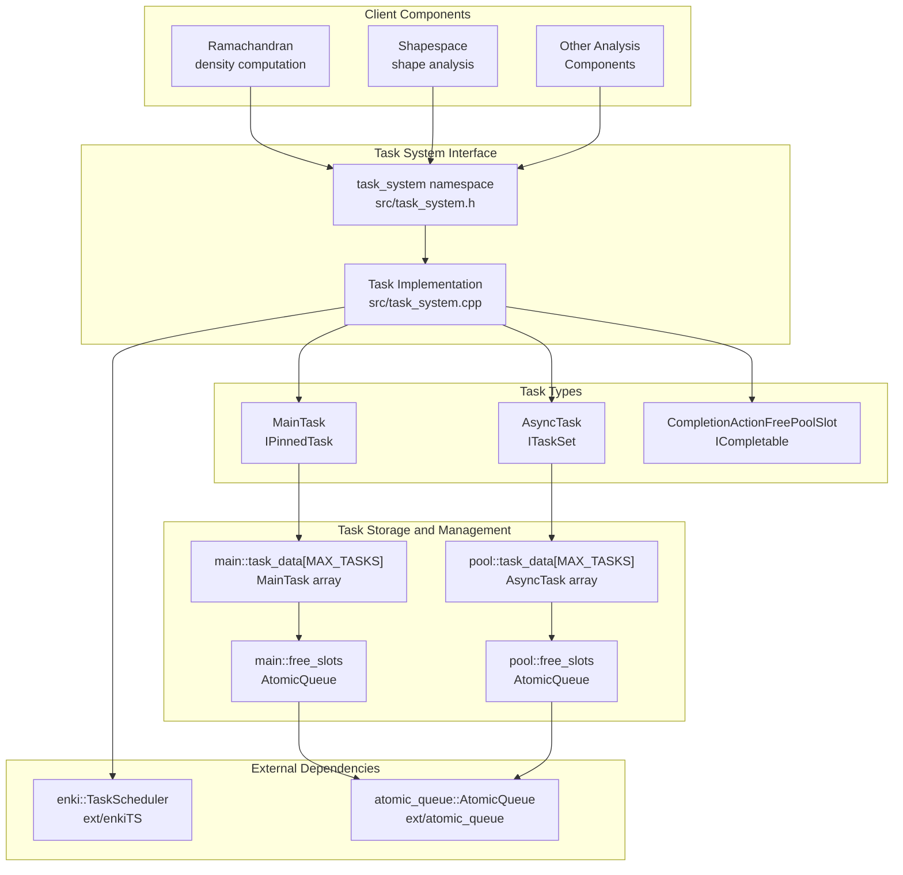

# Task System and Parallel Processing

<details>
<summary>Relevant source files</summary>

The following files were used as context for generating this wiki page:

- [src/components/ramachandran/ramachandran.cpp](src/components/ramachandran/ramachandran.cpp)
- [src/components/shapespace/shapespace.cpp](src/components/shapespace/shapespace.cpp)
- [src/event.h](src/event.h)
- [src/task_system.cpp](src/task_system.cpp)
- [src/task_system.h](src/task_system.h)

</details>


This document covers VIAMD's task system for parallel processing and asynchronous computation. The system provides a high-level interface for creating and managing background tasks, enabling compute-intensive operations like density calculations and molecular analysis to be performed without blocking the main thread.

For information about the event system that coordinates communication between components, see [Event System](#2.3). For details about specific analysis components that use the task system, see [Ramachandran Plot Analysis](#4.2) and [Shape Space Analysis](#4.3).

## Architecture Overview

VIAMD's task system is built on top of the enkiTS task scheduler, providing a simplified interface for creating, scheduling, and managing parallel tasks. The system supports both main thread execution and worker thread pools.



Sources: [src/task_system.h](), [src/task_system.cpp:1-296](), [src/components/ramachandran/ramachandran.cpp:622-684](), [src/components/shapespace/shapespace.cpp:382-430]()

## Task Types and Lifecycle

The task system supports two primary task types with distinct execution models and lifecycle management.

```mermaid
stateDiagram-v2
    [*] --> Created
    
    state "Task Creation" as Created {
        [*] --> MainTaskCreated: create_main_task()
        [*] --> PoolTaskCreated: create_pool_task()
        
        MainTaskCreated --> SlotAllocated: get main::free_slot
        PoolTaskCreated --> SlotAllocated: get pool::free_slot
        
        SlotAllocated --> IDGenerated: generate_id(slot_idx)
        IDGenerated --> TaskInitialized: PLACEMENT_NEW
    }
    
    Created --> DependencySet: set_task_dependency()
    Created --> Enqueued: enqueue_task()
    DependencySet --> Enqueued: enqueue_task()
    
    state "Task Execution" as Executing {
        Enqueued --> MainQueue: MainTask
        Enqueued --> PoolQueue: AsyncTask
        
        MainQueue --> MainExecution: execute_main_task_queue()
        PoolQueue --> PoolExecution: TaskScheduler.AddTaskSetToPipe()
        
        MainExecution --> [*]: Execute() + free slot
        PoolExecution --> [*]: ExecuteRange() + completion action
    }
    
    Enqueued --> Executing
    Executing --> [*]
    
    state "Task Control" as Control {
        Executing --> Interrupted: task_interrupt()
        Interrupted --> [*]: completion with interrupt flag
    }
```

Sources: [src/task_system.cpp:158-179](), [src/task_system.cpp:182-206](), [src/task_system.cpp:209-211](), [src/task_system.cpp:279-294]()

## Core Task Classes

### AsyncTask Class

The `AsyncTask` class extends `enki::ITaskSet` and handles parallel execution on worker threads:

| Property | Type | Purpose |
|----------|------|---------|
| `m_set_func` | `RangeTask` | Function executed across range |
| `m_func` | `Task` | Single function execution |
| `m_set_size` | `uint32_t` | Total work units |
| `m_grain_size` | `uint32_t` | Work units per execution |
| `m_set_complete` | `atomic_uint32_t` | Completed work tracking |
| `m_interrupt` | `atomic_bool` | Interruption flag |
| `m_completion_action` | `CompletionActionFreePoolSlot` | Cleanup handler |

Sources: [src/task_system.cpp:54-104]()

### MainTask Class

The `MainTask` class extends `enki::IPinnedTask` for main thread execution:

| Property | Type | Purpose |
|----------|------|---------|
| `m_function` | `Task` | Function to execute |
| `m_dependency` | `enki::Dependency` | Task dependency |
| `m_label` | `str_t` | Debug label |
| `m_id` | `ID` | Unique task identifier |

Sources: [src/task_system.cpp:106-125]()

## Task ID Management

Task IDs are generated using a combination of timestamp and slot index to ensure uniqueness:

```cpp
// ID generation combines timestamp and slot index
static inline ID generate_id(uint32_t slot_idx) {
    return (md_time_current() << 8) | (slot_idx & (MAX_TASKS - 1));
}

static inline uint32_t get_slot_idx(ID id) {
    return (uint32_t)(id & (MAX_TASKS - 1));
}
```

The system maintains fixed-size arrays for task storage with lock-free slot allocation using `atomic_queue::AtomicQueue`.

Sources: [src/task_system.cpp:27-33](), [src/task_system.cpp:36-41]()

## Task Dependencies and Scheduling

Tasks can have dependencies that must complete before execution begins. The dependency system uses enkiTS's built-in dependency management:

```mermaid
graph LR
    subgraph "Dependency Chain"
        TASK_A["Task A<br/>ID: 12345"]
        TASK_B["Task B<br/>ID: 12346"] 
        TASK_C["Task C<br/>ID: 12347"]
    end
    
    subgraph "Scheduling Flow"
        CREATE_A["create_pool_task()<br/>returns ID A"]
        CREATE_B["create_pool_task()<br/>returns ID B"]
        SET_DEP["set_task_dependency(B, A)<br/>B depends on A"]
        ENQUEUE_A["enqueue_task(A)"]
        ENQUEUE_B["enqueue_task(B)"]
        EXECUTE["TaskScheduler execution"]
    end
    
    CREATE_A --> TASK_A
    CREATE_B --> TASK_B
    SET_DEP --> TASK_B
    ENQUEUE_A --> EXECUTE
    ENQUEUE_B --> EXECUTE
    TASK_A --> TASK_B: "completion triggers"
    TASK_B --> TASK_C: "can depend on B"
```

Sources: [src/task_system.cpp:238-251](), [src/task_system.h:33-37]()

## Usage Patterns in VIAMD Components

### Ramachandran Analysis

The Ramachandran component uses the task system for density computation across trajectory frames:

```cpp
// Create range task for density computation
compute_density_full = rama_rep_compute_density(
    &rama_data.full, 
    state.trajectory_data.backbone_angles.data, 
    frame_beg, frame_end, frame_stride
);
```

The task iterates over frames in parallel, computing phi/psi angle densities for protein backbone analysis.

Sources: [src/components/ramachandran/ramachandran.cpp:664-665]()

### Shape Space Analysis

The ShapeSpace component creates range tasks for molecular shape analysis:

```cpp
evaluate_task = task_system::create_pool_task(
    STR_LIT("Eval Shape Space"), 
    (uint32_t)num_frames, 
    [shapespace = this](uint32_t range_beg, uint32_t range_end, uint32_t thread_num) {
        // Compute shape weights for frame range
        for (uint32_t frame_idx = range_beg; frame_idx < range_end; ++frame_idx) {
            // Load trajectory frame
            // Compute covariance matrix
            // Calculate shape weights
        }
    }
);
```

Sources: [src/components/shapespace/shapespace.cpp:382-425]()

## Thread Safety and Performance

### Lock-Free Slot Management

The task system uses lock-free atomic queues for slot allocation, minimizing contention between threads:

```cpp
// Lock-free slot allocation
namespace main {
    static atomic_queue::AtomicQueue<uint32_t, MAX_TASKS, 0xFFFFFFFF> free_slots;
}
namespace pool {
    static atomic_queue::AtomicQueue<uint32_t, MAX_TASKS, 0xFFFFFFFF> free_slots;
}
```

Sources: [src/task_system.cpp:35-41]()

### Task Interruption

Tasks can be interrupted for responsive cancellation of long-running operations:

| Function | Purpose |
|----------|---------|
| `task_interrupt(ID)` | Signal interruption flag |
| `task_interrupt_and_wait_for(ID)` | Interrupt and block until completion |
| `pool_interrupt_running_tasks()` | Interrupt all running tasks |

Tasks check the `m_interrupt` flag during execution to enable cooperative cancellation.

Sources: [src/task_system.cpp:279-294](), [src/task_system.cpp:226-232]()

### Progress Tracking

Range tasks provide progress information through completion counters:

```cpp
float task_fraction_complete(ID id) {
    uint32_t slot_idx = get_slot_idx(id);
    AsyncTask* Task = &pool::task_data[slot_idx];
    return Task->m_id == id ? 
        (float)Task->m_set_complete / (float)Task->m_SetSize : 0.f;
}
```

Sources: [src/task_system.cpp:265-269]()

## API Reference

### Task Creation Functions

| Function | Purpose | Returns |
|----------|---------|---------|
| `create_main_task(label, func)` | Create main thread task | Task ID |
| `create_pool_task(label, func)` | Create worker thread task | Task ID |
| `create_pool_task(label, range_size, func, grain_size)` | Create range task | Task ID |

### Task Control Functions

| Function | Purpose |
|----------|---------|
| `enqueue_task(ID)` | Queue task for execution |
| `set_task_dependency(task_id, dep_id)` | Set task dependency |
| `execute_main_task_queue()` | Execute main thread tasks |
| `pool_wait_for_completion()` | Wait for all pool tasks |

### Task Query Functions

| Function | Returns |
|----------|---------|
| `task_is_running(ID)` | `bool` - task running status |
| `task_label(ID)` | `str_t` - task debug label |
| `task_fraction_complete(ID)` | `float` - completion percentage |
| `pool_num_threads()` | `size_t` - worker thread count |

Sources: [src/task_system.h:22-62]()

---