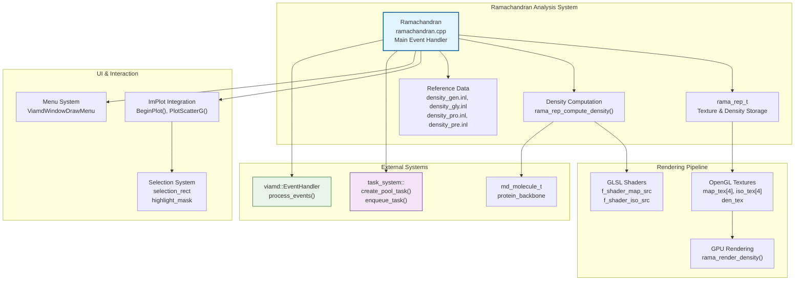
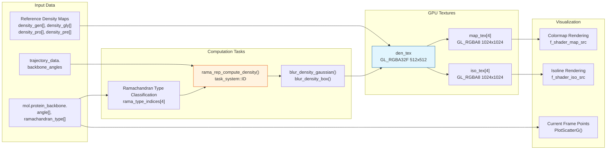
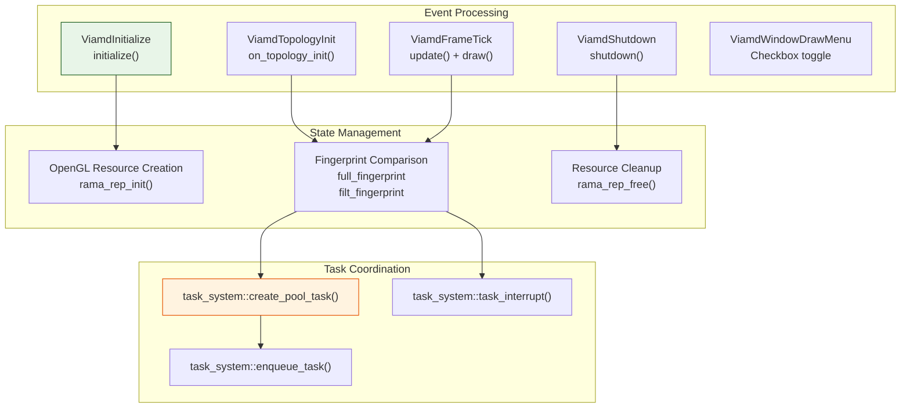
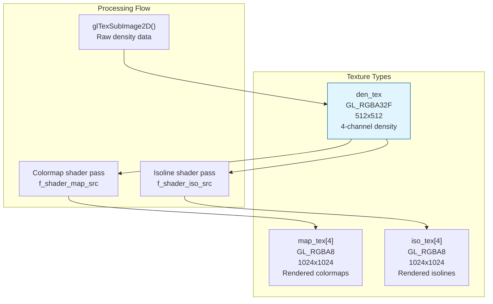
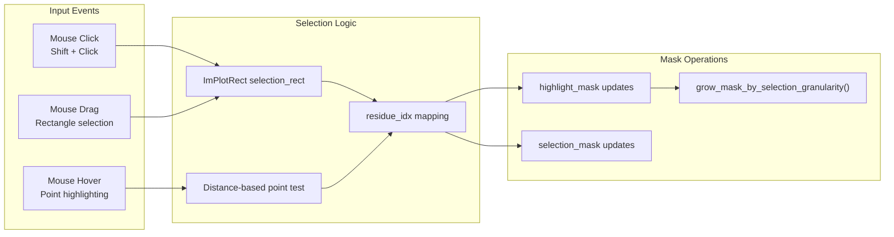

# Ramachandran Plot Analysis

<details>
<summary>Relevant source files</summary>

The following files were used as context for generating this wiki page:

- [src/components/ramachandran/ramachandran.cpp](src/components/ramachandran/ramachandran.cpp)
- [src/components/shapespace/shapespace.cpp](src/components/shapespace/shapespace.cpp)
- [src/event.h](src/event.h)
- [src/task_system.cpp](src/task_system.cpp)
- [src/task_system.h](src/task_system.h)

</details>


## Purpose and Scope

The Ramachandran Plot Analysis system provides interactive visualization and analysis of protein backbone dihedral angles (phi and psi) in molecular dynamics trajectories. This component generates density plots, reference comparisons, and enables interactive selection of protein conformations through 2D plot interfaces.

This system is part of the broader analysis framework and integrates with the parallel task system for computational performance. For general task scheduling and parallel processing, see [Task System and Parallel Processing](#4.1). For molecular visualization components, see [Molecular Data Structures and Display](#2.4).

## System Architecture

### High-Level Component Architecture



**Sources:** [src/components/ramachandran/ramachandran.cpp:432-1249](), [src/task_system.h:9-64](), [src/event.h:1-89]()

### Data Flow and Processing Pipeline



**Sources:** [src/components/ramachandran/ramachandran.cpp:651-684](), [src/components/ramachandran/ramachandran.cpp:1250-1450](), [src/components/ramachandran/ramachandran.cpp:369-388]()

## Core Components

### Ramachandran Main Class

The central `Ramachandran` class inherits from `viamd::EventHandler` and manages the entire analysis pipeline:

| Component | Type | Purpose |
|-----------|------|---------|
| `map.program` | `GLuint` | OpenGL shader program for colormap rendering |
| `iso.program` | `GLuint` | OpenGL shader program for isoline rendering |
| `rama_data.ref` | `rama_rep_t` | Reference density data and textures |
| `rama_data.full` | `rama_rep_t` | Full trajectory density data |
| `rama_data.filt` | `rama_rep_t` | Filtered trajectory density data |
| `rama_type_indices[4]` | `md_array(uint32_t)` | Indices for General, Glycine, Proline, Pre-Proline |

**Sources:** [src/components/ramachandran/ramachandran.cpp:432-516]()

### Density Representation Structure

The `rama_rep_t` structure encapsulates all GPU resources for ramachandran visualization:

```cpp
struct rama_rep_t {
    uint32_t map_tex[4];  // Colormap textures for 4 types
    uint32_t iso_tex[4];  // Isoline textures for 4 types  
    float    den_sum[4];  // Density normalization values
    uint32_t den_tex;     // Combined 4-channel density texture
};
```

**Sources:** [src/components/ramachandran/ramachandran.cpp:58-63]()

### Event-Driven Architecture Integration



**Sources:** [src/components/ramachandran/ramachandran.cpp:518-548](), [src/components/ramachandran/ramachandran.cpp:621-650](), [src/components/ramachandran/ramachandran.cpp:652-686]()

## Parallel Density Computation

### Task System Integration

The system leverages the task system for parallel density computation across trajectory frames:

```cpp
compute_density_full = rama_rep_compute_density(
    &rama_data.full, 
    state.trajectory_data.backbone_angles.data, 
    frame_beg, frame_end, frame_stride
);
```

This creates a `task_system::ID` that can be monitored, interrupted, and synchronized.

**Sources:** [src/components/ramachandran/ramachandran.cpp:664](), [src/task_system.h:29-31]()

### Density Computation Algorithm

| Phase | Function | Purpose |
|-------|----------|---------|
| Classification | Type assignment | Assigns residues to General/Glycine/Proline/Pre-Proline |
| Accumulation | Angle binning | Accumulates phi/psi angles into 180x180 density grid |
| Smoothing | `blur_density_gaussian()` | Applies Gaussian blur for smooth visualization |
| Normalization | Density scaling | Normalizes density values for texture upload |

**Sources:** [src/components/ramachandran/ramachandran.cpp:369-388](), [src/components/ramachandran/ramachandran.cpp:286-367]()

## GPU Rendering Pipeline

### Shader-Based Visualization

The system uses two specialized fragment shaders for different visualization modes:

#### Colormap Shader (`f_shader_map_src`)
- Maps density values to colors using configurable colormaps
- Supports 4 ramachandran types in single pass
- Handles viewport transformation and texture sampling

#### Isoline Shader (`f_shader_iso_src`)
- Generates contour lines at specified density levels
- Anti-aliased line rendering using `fwidth()` derivatives
- Supports both filled regions and contour outlines

**Sources:** [src/components/ramachandran/ramachandran.cpp:91-131](), [src/components/ramachandran/ramachandran.cpp:133-195]()

### Texture Management



**Sources:** [src/components/ramachandran/ramachandran.cpp:390-424](), [src/components/ramachandran/ramachandran.cpp:1467-1600]()

## Interactive Visualization

### ImPlot Integration

The visualization uses ImPlot for interactive 2D plotting with the following key features:

| Feature | Implementation | Purpose |
|---------|----------------|---------|
| Multiple layouts | `layout_mode` 0-4 | Side-by-side or individual ramachandran types |
| Layer control | `show_layer[4]` | Toggle reference/full/filtered/current display |
| Selection rectangles | `selection_rect` | Interactive region selection |
| Point highlighting | Scatter plot overlay | Current frame angle visualization |

**Sources:** [src/components/ramachandran/ramachandran.cpp:688-1023]()

### Selection and Highlighting System



**Sources:** [src/components/ramachandran/ramachandran.cpp:854-1014](), [src/components/ramachandran/ramachandran.cpp:920-935]()

## Performance Optimization

### Memory Management

The system uses arena allocators for efficient memory management:

```cpp
arena = md_arena_allocator_create(state.allocator.persistent, MEGABYTES(1));
```

### Computational Optimizations

| Technique | Implementation | Benefit |
|-----------|----------------|---------|
| Block transpose | `transpose()` function | Cache-efficient blur operations |
| Box filter approximation | `boxes_for_gauss()` | Fast Gaussian blur via separable box filters |
| Texture caching | Fingerprint comparison | Avoid redundant computation |
| Task interruption | `task_interrupt()` | Responsive UI during computation |

**Sources:** [src/components/ramachandran/ramachandran.cpp:317-332](), [src/components/ramachandran/ramachandran.cpp:334-345](), [src/components/ramachandran/ramachandran.cpp:622-627]()

---