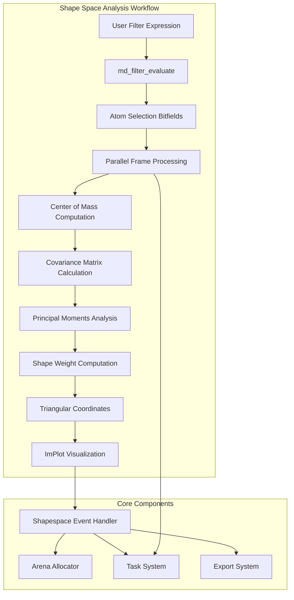
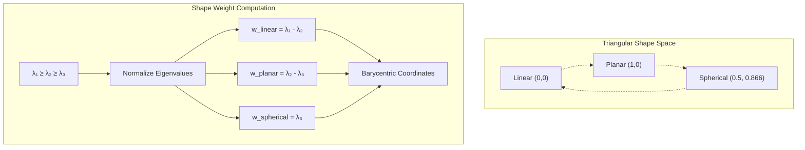
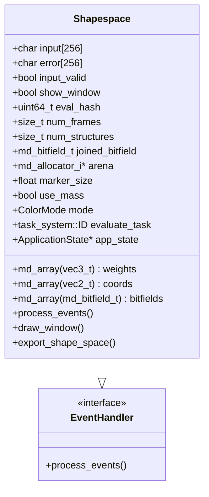
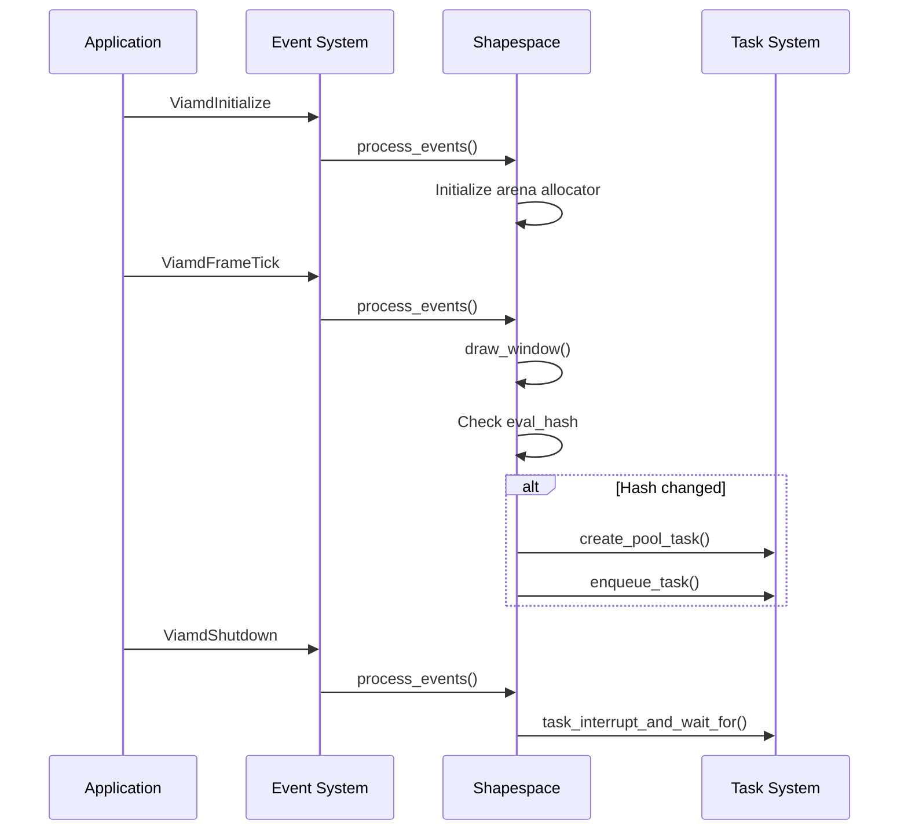
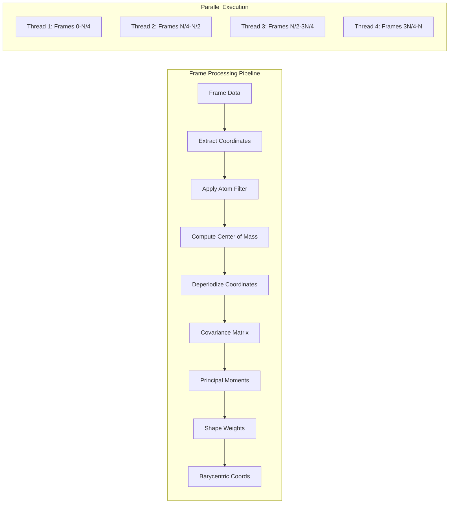
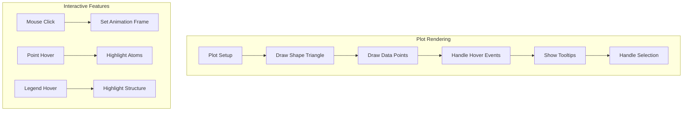
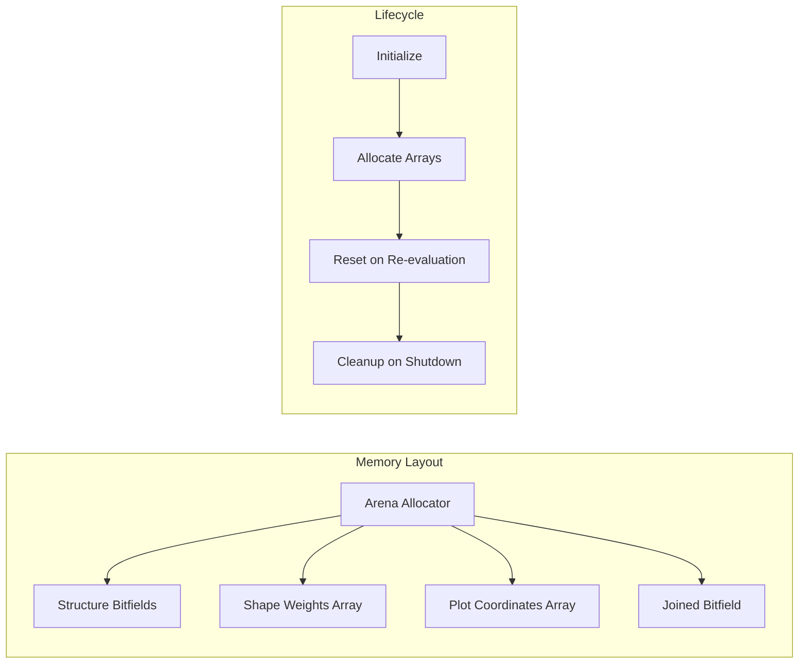
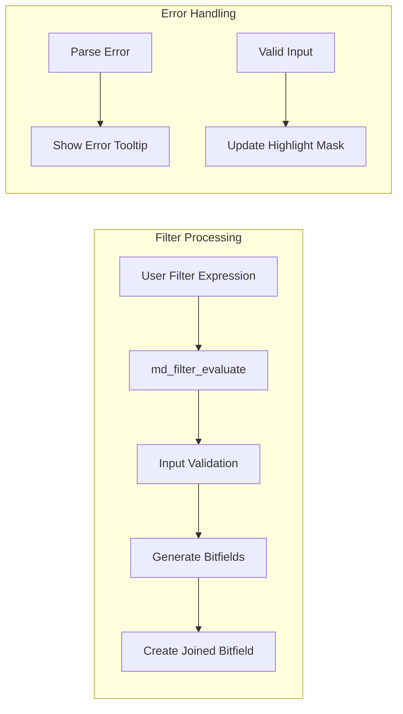
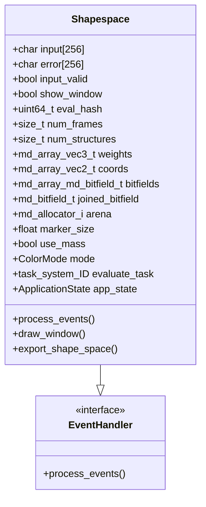

# Shape Space Analysis

<details>
<summary>Relevant source files</summary>

The following files were used as context for generating this wiki page:

- [src/components/ramachandran/ramachandran.cpp](src/components/ramachandran/ramachandran.cpp)
- [src/components/shapespace/shapespace.cpp](src/components/shapespace/shapespace.cpp)
- [src/event.h](src/event.h)
- [src/task_system.cpp](src/task_system.cpp)
- [src/task_system.h](src/task_system.h)

</details>


## Purpose and Scope

The Shape Space Analysis component provides real-time computation and visualization of molecular shape descriptors for trajectory analysis. It computes principal moments of inertia for selected atoms across trajectory frames and plots the resulting shape weights in a triangular coordinate system that represents the spectrum from linear to planar to spherical molecular conformations.

For general analysis and computation framework information, see [Analysis and Computation](#4). For parallel processing details used by this component, see [Task System and Parallel Processing](#4.1).

## Overview

The Shape Space Analysis system analyzes molecular shapes by computing three normalized shape weights (linear, planar, and isotropic) based on the eigenvalues of the covariance matrix of atomic coordinates. These weights are visualized in a triangular plot where the vertices represent idealized linear, planar, and spherical shapes.



**Shape Space Triangle Coordinate System**


Sources: [src/components/shapespace/shapespace.cpp:1-503]()

## Core Architecture

### Main Component Structure

The `Shapespace` struct serves as the primary component, inheriting from `viamd::EventHandler` to integrate with the event system:



The component maintains arrays for shape weights (`vec3_t`), 2D plot coordinates (`vec2_t`), and atom selection bitfields for each analyzed structure.

Sources: [src/components/shapespace/shapespace.cpp:42-74]()

### Event System Integration

The component responds to key application events through the event system:

| Event Type | Handler Function | Purpose |
|------------|------------------|---------|
| `ViamdInitialize` | Initialize arena allocator | Setup memory management |
| `ViamdShutdown` | Cleanup and task interruption | Resource cleanup |
| `ViamdFrameTick` | `draw_window()` | Update UI and trigger evaluation |
| `ViamdWindowDrawMenu` | Menu checkbox | Window visibility control |
| `ViamdSerialize/Deserialize` | State persistence | Save/load configuration |



Sources: [src/components/shapespace/shapespace.cpp:76-127]()

## Shape Computation Algorithm

### Parallel Frame Processing

The core computation is parallelized across trajectory frames using the task system:



The computation occurs in the lambda function passed to `task_system::create_pool_task()`:

- Allocates thread-local coordinate arrays
- Iterates through assigned frame range
- Loads frame coordinates using `md_trajectory_load_frame()`
- Processes each structure's atom selection
- Computes center of mass with `md_util_com_compute_vec4()`
- Calculates covariance matrix with `mat3_covariance_matrix_vec4()`
- Derives shape weights using `md_util_shape_weights()`

Sources: [src/components/shapespace/shapespace.cpp:382-426]()

### Mathematical Foundation

The shape analysis is based on the eigenvalue decomposition of the covariance matrix:

1. **Covariance Matrix**: Computed from deperiodized atomic coordinates
2. **Eigenvalues**: Ordered as λ₁ ≥ λ₂ ≥ λ₃  
3. **Shape Weights**: 
   - Linear: λ₁ - λ₂ (elongation along primary axis)
   - Planar: λ₂ - λ₃ (flattening in secondary plane) 
   - Spherical: λ₃ (isotropic distribution)
4. **Normalization**: Weights sum to 1.0
5. **Triangular Coordinates**: Barycentric mapping to triangle vertices

The triangular coordinate system maps shape weights to visualization coordinates:
```
p[0] = {0.0f, 0.0f}         // Linear vertex
p[1] = {1.0f, 0.0f}         // Planar vertex  
p[2] = {0.5f, 0.86602540378f} // Spherical vertex (equilateral triangle)
```

Sources: [src/components/shapespace/shapespace.cpp:394-422]()

## Visualization System

### ImPlot Integration

The component uses ImPlot for interactive 2D visualization:



Key visualization features:
- **Triangle Background**: Semi-transparent filled triangle with vertex labels
- **Data Points**: Scatter plot with configurable marker size
- **Interactive Hover**: Shows frame index and shape weights in tooltip
- **Frame Navigation**: Click to jump to specific trajectory frame
- **Structure Highlighting**: Hover effects update atom selection masks

Sources: [src/components/shapespace/shapespace.cpp:187-340]()

### Data Export

The system supports exporting computed shape data to standard formats:

| Format | Function | Contents |
|--------|----------|----------|
| CSV | `md_csv_write_to_file()` | Tabular data with headers |
| XVG | `md_xvg_format()` | GROMACS-style plot data |

Export columns include:
- Time/Frame index
- Linear, planar, and spherical weights for each structure

Sources: [src/components/shapespace/shapespace.cpp:433-499]()

## Memory Management

The component uses arena allocation for efficient memory management:



Memory allocation strategy:
- **Arena Size**: 1 MB allocated from persistent allocator
- **Array Sizing**: `num_frames * num_structures` elements
- **Reset Strategy**: Arena reset on filter expression changes
- **Thread Safety**: Separate heap allocations for worker threads

Sources: [src/components/shapespace/shapespace.cpp:82-84](), [src/components/shapespace/shapespace.cpp:354-356](), [src/components/shapespace/shapespace.cpp:387-388]()

## Integration Points

### Filter System Integration

The component integrates with the molecular filter system to define atom selections:



Filter evaluation produces bitfields for each structure that define which atoms participate in the shape analysis.

Sources: [src/components/shapespace/shapespace.cpp:360-376]()

### Task System Integration

The component leverages the task system for parallel computation across trajectory frames:

- **Task Creation**: `task_system::create_pool_task()` with frame-based parallelization
- **Task Management**: Interrupt running tasks on parameter changes
- **Thread Safety**: Each worker thread allocates separate coordinate arrays
- **Synchronization**: Task completion updates UI state

Sources: [src/components/shapespace/shapespace.cpp:346-348](), [src/components/shapespace/shapespace.cpp:382-427]()

# Shape Space Analysis

## Purpose and Scope

The Shape Space Analysis component provides real-time computation and visualization of molecular shape descriptors for trajectory analysis. It computes principal moments of inertia for selected atoms across trajectory frames and plots the resulting shape weights in a triangular coordinate system that represents the spectrum from linear to planar to spherical molecular conformations.

For general analysis and computation framework information, see [Analysis and Computation](#4). For parallel processing details used by this component, see [Task System and Parallel Processing](#4.1).

## Overview

The Shape Space Analysis system analyzes molecular shapes by computing three normalized shape weights (linear, planar, and isotropic) based on the eigenvalues of the covariance matrix of atomic coordinates. These weights are visualized in a triangular plot where the vertices represent idealized linear, planar, and spherical shapes.

**Shape Space Analysis Workflow**


**Shape Space Triangle Coordinate System**


Sources: [src/components/shapespace/shapespace.cpp:1-503]()

## Core Architecture

### Main Component Structure

The `Shapespace` struct serves as the primary component, inheriting from `viamd::EventHandler` to integrate with the event system:

**Shapespace Component Architecture**


The component maintains arrays for shape weights (`vec3_t`), 2D plot coordinates (`vec2_t`), and atom selection bitfields for each analyzed structure.

Sources: [src/components/shapespace/shapespace.cpp:42-74]()

### Event System Integration

The component responds to key application events through the event system:

| Event Type | Handler Function | Purpose |
|------------|------------------|---------|
| `ViamdInitialize` | Initialize arena allocator | Setup memory management |
| `ViamdShutdown` | Cleanup and task interruption | Resource cleanup |
| `ViamdFrameTick` | `draw_window()` | Update UI and trigger evaluation |
| `ViamdWindowDrawMenu` | Menu checkbox | Window visibility control |
| `ViamdSerialize/Deserialize` | State persistence | Save/load configuration |

**Event Processing Sequence**


Sources: [src/components/shapespace/shapespace.cpp:76-127]()

## Shape Computation Algorithm

### Parallel Frame Processing

The core computation is parallelized across trajectory frames using the task system:

**Frame Processing Pipeline**


The computation occurs in the lambda function passed to `task_system::create_pool_task()`:

- Allocates thread-local coordinate arrays
- Iterates through assigned frame range
- Loads frame coordinates using `md_trajectory_load_frame()`
- Processes each structure's atom selection
- Computes center of mass with `md_util_com_compute_vec4()`
- Calculates covariance matrix with `mat3_covariance_matrix_vec4()`
- Derives shape weights using `md_util_shape_weights()`

Sources: [src/components/shapespace/shapespace.cpp:382-426]()

### Mathematical Foundation

The shape analysis is based on the eigenvalue decomposition of the covariance matrix:

1. **Covariance Matrix**: Computed from deperiodized atomic coordinates
2. **Eigenvalues**: Ordered as λ₁ ≥ λ₂ ≥ λ₃  
3. **Shape Weights**: 
   - Linear: λ₁ - λ₂ (elongation along primary axis)
   - Planar: λ₂ - λ₃ (flattening in secondary plane) 
   - Spherical: λ₃ (isotropic distribution)
4. **Normalization**: Weights sum to 1.0
5. **Triangular Coordinates**: Barycentric mapping to triangle vertices

The triangular coordinate system maps shape weights to visualization coordinates:
```
p[0] = {0.0f, 0.0f}         // Linear vertex
p[1] = {1.0f, 0.0f}         // Planar vertex  
p[2] = {0.5f, 0.86602540378f} // Spherical vertex (equilateral triangle)
```

Sources: [src/components/shapespace/shapespace.cpp:394-422]()

## Visualization System

### ImPlot Integration

The component uses ImPlot for interactive 2D visualization:

**Visualization Rendering Pipeline**


Key visualization features:
- **Triangle Background**: Semi-transparent filled triangle with vertex labels
- **Data Points**: Scatter plot with configurable marker size
- **Interactive Hover**: Shows frame index and shape weights in tooltip
- **Frame Navigation**: Click to jump to specific trajectory frame
- **Structure Highlighting**: Hover effects update atom selection masks

Sources: [src/components/shapespace/shapespace.cpp:187-340]()

### Data Export

The system supports exporting computed shape data to standard formats:

| Format | Function | Contents |
|--------|----------|----------|
| CSV | `md_csv_write_to_file()` | Tabular data with headers |
| XVG | `md_xvg_format()` | GROMACS-style plot data |

Export columns include:
- Time/Frame index
- Linear, planar, and spherical weights for each structure

Sources: [src/components/shapespace/shapespace.cpp:433-499]()

## Memory Management

The component uses arena allocation for efficient memory management:

**Memory Management Architecture**


Memory allocation strategy:
- **Arena Size**: 1 MB allocated from persistent allocator
- **Array Sizing**: `num_frames * num_structures` elements
- **Reset Strategy**: Arena reset on filter expression changes
- **Thread Safety**: Separate heap allocations for worker threads

Sources: [src/components/shapespace/shapespace.cpp:82-84](), [src/components/shapespace/shapespace.cpp:354-356](), [src/components/shapespace/shapespace.cpp:387-388]()

## Integration Points

### Filter System Integration

The component integrates with the molecular filter system to define atom selections:

**Filter System Integration**


Filter evaluation produces bitfields for each structure that define which atoms participate in the shape analysis.

Sources: [src/components/shapespace/shapespace.cpp:360-376]()

### Task System Integration

The component leverages the task system for parallel computation across trajectory frames:

- **Task Creation**: `task_system::create_pool_task()` with frame-based parallelization
- **Task Management**: Interrupt running tasks on parameter changes
- **Thread Safety**: Each worker thread allocates separate coordinate arrays
- **Synchronization**: Task completion updates UI state

Sources: [src/components/shapespace/shapespace.cpp:346-348](), [src/components/shapespace/shapespace.cpp:382-427]()

---