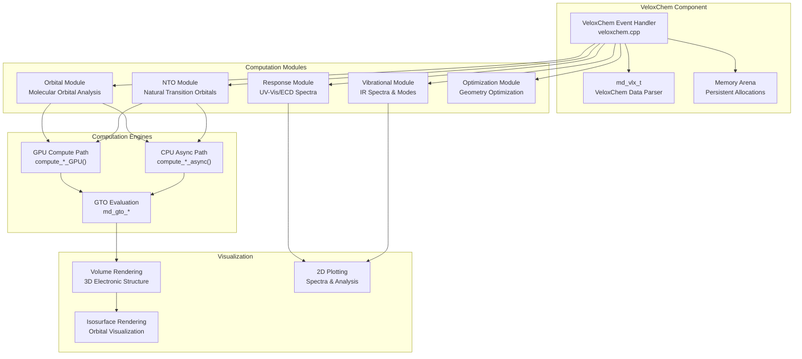
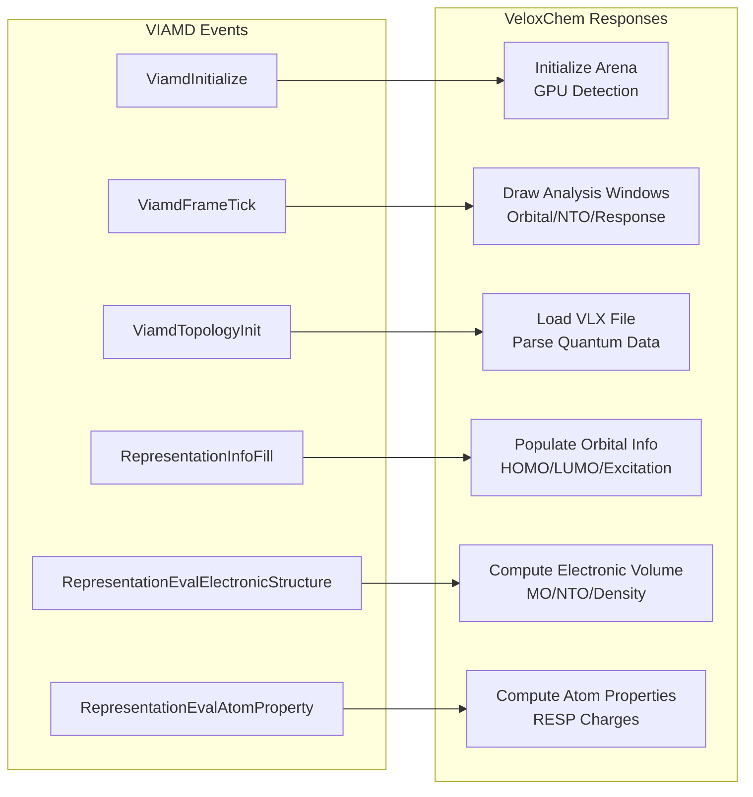
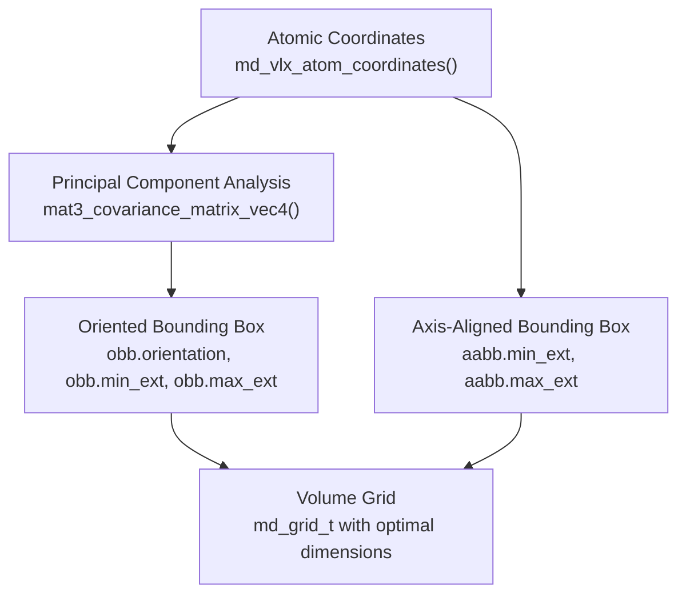
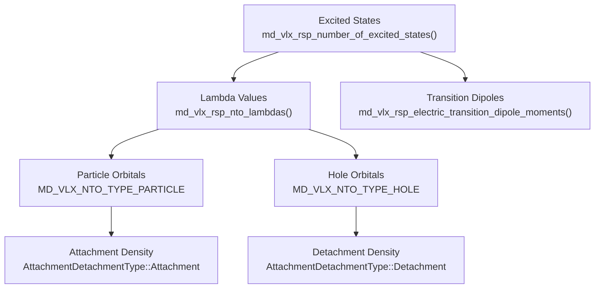
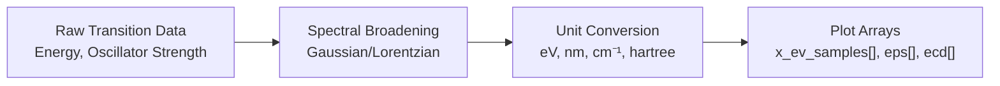
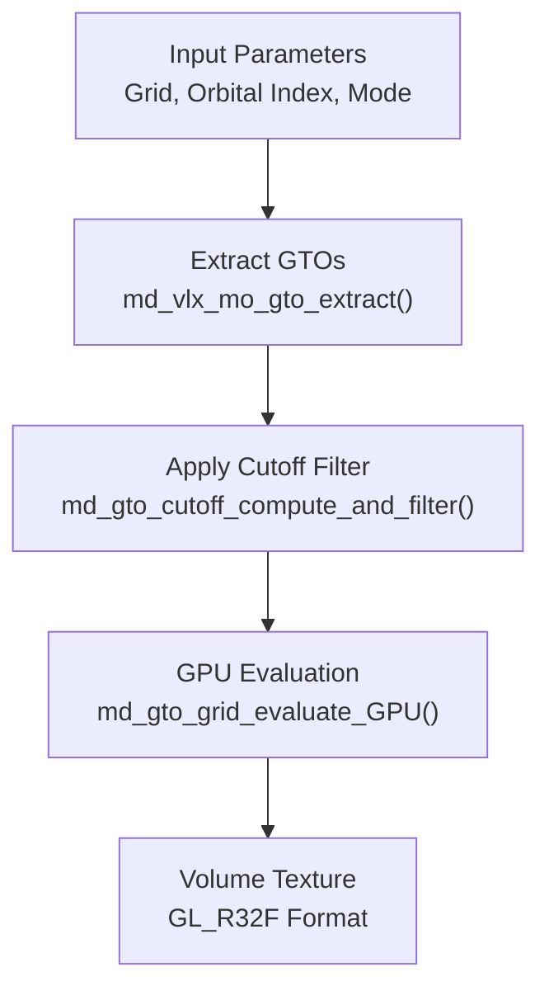
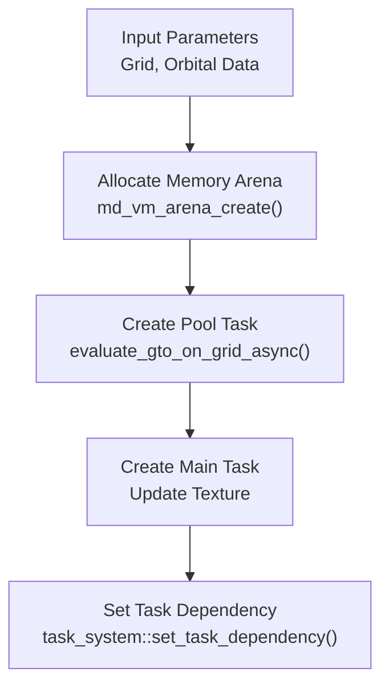
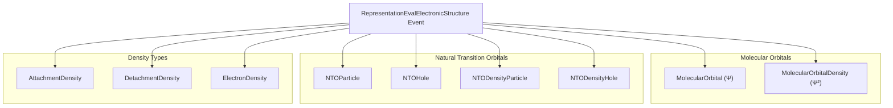
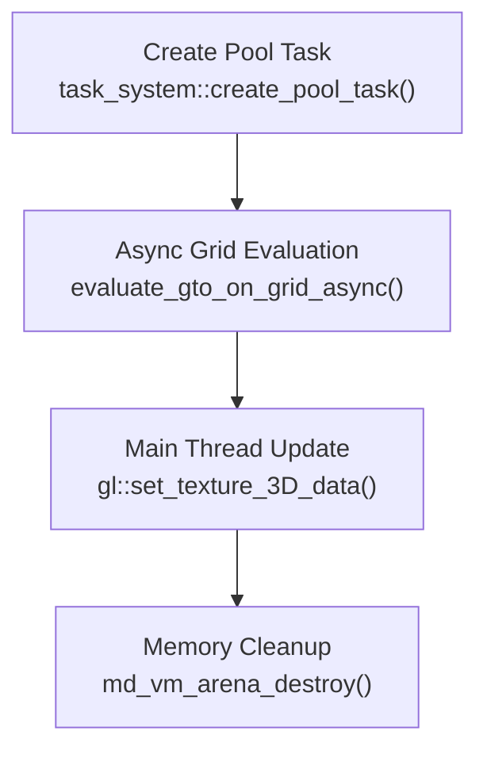

# VeloxChem Integration

<details>
<summary>Relevant source files</summary>

The following files were used as context for generating this wiki page:

- [src/components/veloxchem/veloxchem.cpp](src/components/veloxchem/veloxchem.cpp)
- [src/main.cpp](src/main.cpp)
- [src/viamd.h](src/viamd.h)

</details>


## Purpose and Scope

The VeloxChem Integration system provides comprehensive support for loading, processing, and visualizing quantum chemistry data from VeloxChem calculations within VIAMD. This integration enables users to analyze molecular orbitals, natural transition orbitals, electron densities, response properties, and vibrational modes through both 2D plots and 3D volume visualizations.

For information about the general visualization pipeline, see [Graphics and Visualization Pipeline](#3). For details about the task system used for computational work, see [Task System and Parallel Processing](#4.1).

## System Architecture

The VeloxChem integration is implemented as an event-driven component that responds to application lifecycle events and representation evaluation requests. The system supports both CPU and GPU computation paths for quantum mechanical function evaluation.

### Core Component Structure



Sources: [src/components/veloxchem/veloxchem.cpp:288-803](), [src/viamd.h:105-128]()

### Event-Driven Integration

The VeloxChem component integrates with VIAMD through the event system, responding to specific application events and providing quantum chemistry data to other components.



Sources: [src/components/veloxchem/veloxchem.cpp:503-790]()

## Data Structures and File Parsing

### VeloxChem Data Container

The core data structure `md_vlx_t` encapsulates all quantum chemistry data parsed from VeloxChem output files. The integration supports both text-based `.out` files and HDF5 `.h5` files.

Key data accessed through the VeloxChem API includes:
- **Molecular orbital coefficients and energies**: `md_vlx_scf_mo_energy()`, `md_vlx_scf_mo_occupancy()`
- **Natural transition orbital data**: `md_vlx_rsp_nto_lambdas()`, `md_vlx_nto_gto_extract()`
- **Response properties**: `md_vlx_rsp_absorption_ev()`, `md_vlx_rsp_electric_transition_dipole_moments()`
- **Atomic properties**: `md_vlx_scf_resp_charges()`, `md_vlx_atomic_numbers()`

### Orbital Bounding Volume Computation

The system computes oriented bounding boxes (OBB) and axis-aligned bounding boxes (AABB) to optimize volume rendering of electronic structure data:



Sources: [src/components/veloxchem/veloxchem.cpp:849-898]()

## Computational Modules

### Molecular Orbital Analysis

The orbital module handles visualization and analysis of molecular orbitals with support for both alpha and beta spin orbitals.

#### Orbital Types and Evaluation Modes

| Electronic Structure Type | Evaluation Mode | GPU Function | CPU Function |
|---------------------------|-----------------|--------------|---------------|
| Molecular Orbital (Ψ) | `MD_GTO_EVAL_MODE_PSI` | `compute_mo_GPU()` | `compute_mo_async()` |
| Molecular Orbital Density (Ψ²) | `MD_GTO_EVAL_MODE_PSI_SQUARED` | `compute_mo_GPU()` | `compute_mo_async()` |
| Electron Density (ρ) | `MD_GTO_EVAL_MODE_PSI_SQUARED` | `compute_electron_density_GPU()` | `compute_electron_density_async()` |

#### HOMO/LUMO Detection

The system automatically identifies HOMO and LUMO indices for both alpha and beta electrons:

```cpp
homo_idx[0] = (int)md_vlx_scf_homo_idx(vlx, MD_VLX_MO_TYPE_ALPHA);
lumo_idx[0] = (int)md_vlx_scf_lumo_idx(vlx, MD_VLX_MO_TYPE_ALPHA);
```

Sources: [src/components/veloxchem/veloxchem.cpp:837-841](), [src/components/veloxchem/veloxchem.cpp:1264-1403]()

### Natural Transition Orbital (NTO) Analysis

NTO analysis provides insight into electronic excitations by computing particle and hole densities, attachment/detachment densities, and transition matrices.

#### NTO Data Flow



#### Group-Based Analysis

The NTO module supports molecular fragment analysis through group assignments:

```cpp
nto.atom_group_idx = (uint32_t*)md_alloc(arena, sizeof(uint32_t) * mol.atom.count);
nto.group.count = 3;
for (size_t i = 0; i < mol.atom.count; ++i) {
    nto.atom_group_idx[i] = i < mol.atom.count / 2 ? 1 : 2;
}
```

Sources: [src/components/veloxchem/veloxchem.cpp:900-955](), [src/components/veloxchem/veloxchem.cpp:1038-1082]()

### Response Property Analysis

The response module handles UV-Vis absorption and ECD (Electronic Circular Dichroism) spectra computation with configurable broadening functions.

#### Spectral Broadening

| Broadening Type | Mathematical Form | Use Case |
|----------------|-------------------|----------|
| Gaussian | `exp(-(x-x₀)²/(2σ²))` | Natural line shapes |
| Lorentzian | `γ/((x-x₀)² + γ²)` | Lifetime broadening |

#### Response Data Processing



Sources: [src/components/veloxchem/veloxchem.cpp:958-976](), [src/components/veloxchem/veloxchem.cpp:93-110]()

## Volume Computation Pipeline

### GPU vs CPU Computation Paths

The system automatically selects between GPU and CPU computation based on OpenGL capability detection:

```cpp
use_gpu_path = (!FORCE_CPU_PATH && gl_major >= 4 && gl_minor >= 3);
```

#### GPU Computation Path



#### CPU Async Computation Path



Sources: [src/components/veloxchem/veloxchem.cpp:513-517](), [src/components/veloxchem/veloxchem.cpp:1264-1403]()

### Grid Generation and Volume Initialization

The system computes optimal grid dimensions based on molecular geometry and desired resolution:

```cpp
static inline void compute_dim(int out_dim[3], const vec3_t& in_ext, float samples_per_unit_length) {
    out_dim[0] = CLAMP(ALIGN_TO((int)(in_ext.x * samples_per_unit_length), 8), 8, 512);
    out_dim[1] = CLAMP(ALIGN_TO((int)(in_ext.y * samples_per_unit_length), 8), 8, 512);
    out_dim[2] = CLAMP(ALIGN_TO((int)(in_ext.z * samples_per_unit_length), 8), 8, 512);
}
```

Volume resolution settings map to different sampling densities:

| Resolution | Samples per Ångström | Typical Grid Size |
|------------|---------------------|-------------------|
| Low | 4.0 | 64³ to 128³ |
| Mid | 8.0 | 128³ to 256³ |
| High | 16.0 | 256³ to 512³ |

Sources: [src/components/veloxchem/veloxchem.cpp:224-228](), [src/components/veloxchem/veloxchem.cpp:1000-1018]()

## Integration with Representation System

### Electronic Structure Representation

The VeloxChem component integrates with VIAMD's representation system by responding to `RepresentationEvalElectronicStructure` events and populating volume data for rendering.

#### Supported Electronic Structure Types



### Atom Property Integration

The component provides atomic properties like RESP charges through the `RepresentationEvalAtomProperty` event:

```cpp
case ATOM_PROPERTY_RESP_CHARGE: {
    const double* resp_charges = md_vlx_scf_resp_charges(vlx);
    if (resp_charges) {
        for (size_t i = 0; i < num_atoms; ++i) {
            data.dst_values[i] = (float)resp_charges[i];
        }
        data.output_written = true;
    }
    break;
}
```

Sources: [src/components/veloxchem/veloxchem.cpp:683-748](), [src/components/veloxchem/veloxchem.cpp:753-783]()

## User Interface Components

### Analysis Windows

The VeloxChem integration provides several specialized analysis windows accessible through the main menu:

| Window | Purpose | Key Functions |
|--------|---------|---------------|
| Summary | Overview of quantum data | Basic molecular information |
| Response | UV-Vis/ECD spectra | Spectral analysis and export |
| Orbital Grid | Molecular orbital visualization | Interactive orbital browser |
| Transition Analysis | NTO analysis | Excitation analysis and dipoles |
| Export | Volume data export | High-resolution orbital export |

### Orbital Grid Interface

The orbital grid provides an interactive browser for molecular orbitals with configurable layout:

```cpp
struct Orb {
    Volume   vol[16] = {};
    int      vol_mo_idx[16] = {-1,-1,...};
    uint32_t iso_tex[16] = {};
    int num_x = 3;
    int num_y = 3;
    int mo_idx = -1;
};
```

Sources: [src/components/veloxchem/veloxchem.cpp:535-545](), [src/components/veloxchem/veloxchem.cpp:319-350]()

## Memory Management and Performance

### Arena-Based Allocation

The VeloxChem component uses arena-based memory management for efficient handling of large quantum chemistry datasets:

```cpp
arena = md_arena_allocator_create(state.allocator.persistent, MEGABYTES(4));
```

### Asynchronous Task Management

Large volume computations are handled asynchronously using the task system to prevent UI blocking:



### Performance Optimizations

- **GTO Cutoff Filtering**: Eliminates negligible basis functions using `md_gto_cutoff_compute_and_filter()`
- **Grid Alignment**: Ensures optimal memory access patterns with 8-byte alignment
- **GPU Memory Management**: Direct texture updates without CPU roundtrips for GPU path
- **Incremental Updates**: Only recomputes volumes when orbital indices change

Sources: [src/components/veloxchem/veloxchem.cpp:512](), [src/components/veloxchem/veloxchem.cpp:1351-1403]()

---