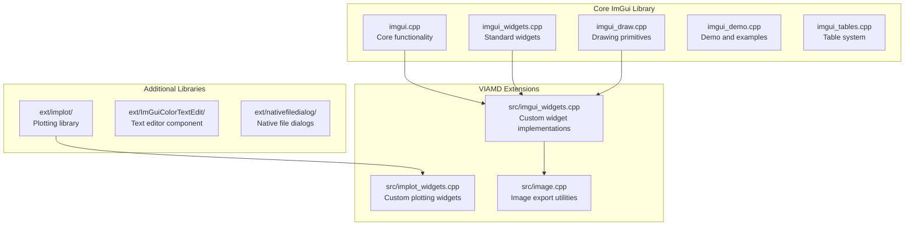
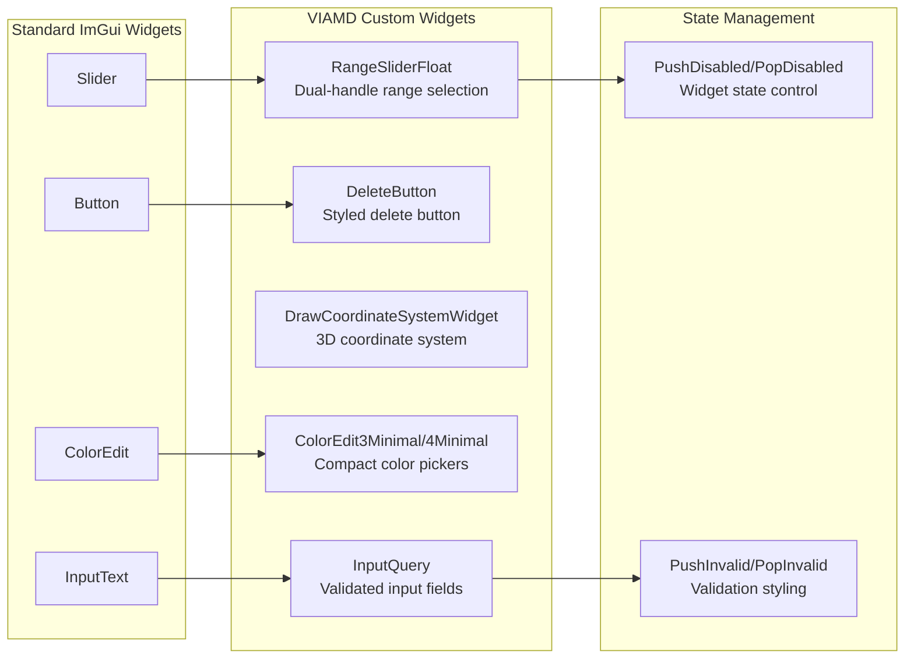
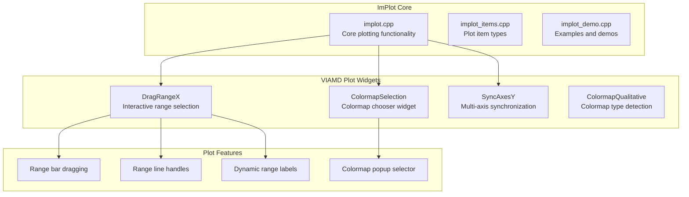
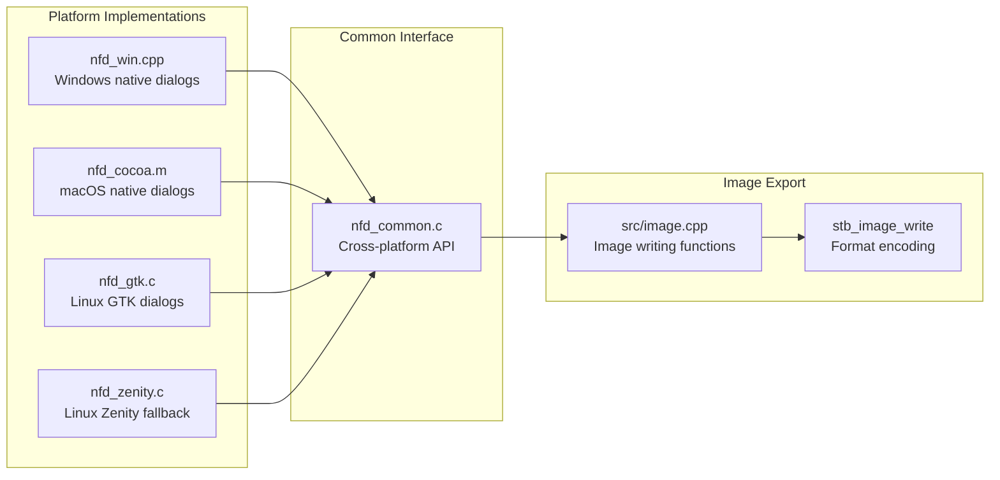
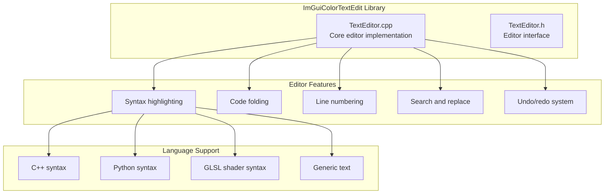
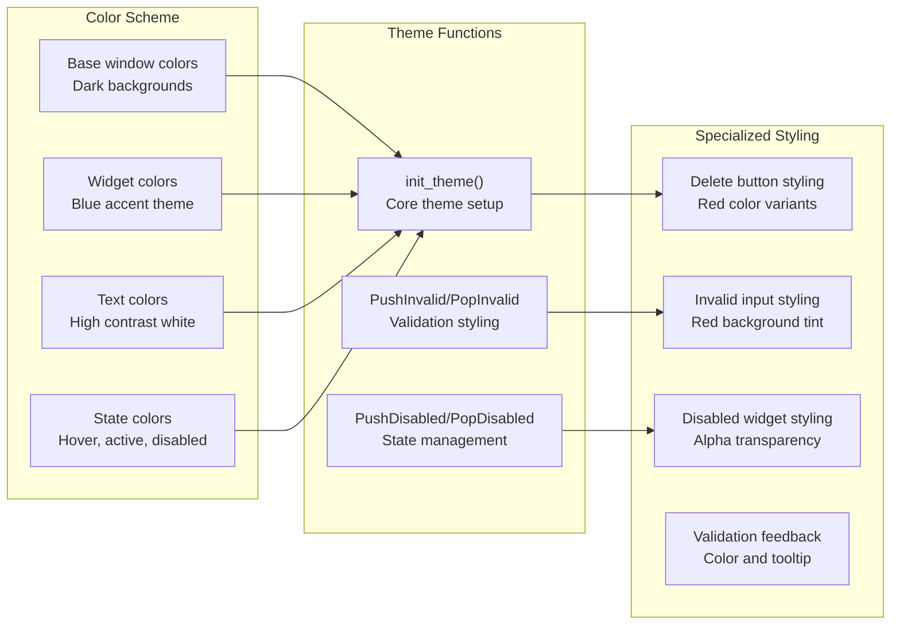
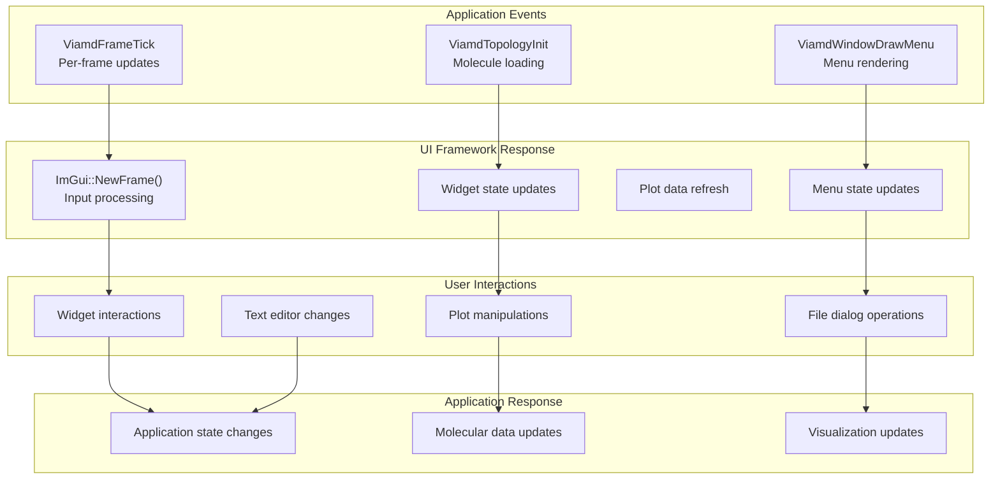

# User Interface Framework

Relevant source files

The following files were used as context for generating this wiki page:

- [ext/ImGuiColorTextEdit/CMakeLists.txt](ext/ImGuiColorTextEdit/CMakeLists.txt)
- [ext/imgui/CMakeLists.txt](ext/imgui/CMakeLists.txt)
- [ext/imgui/docs/CHANGELOG.txt](ext/imgui/docs/CHANGELOG.txt)
- [ext/imgui/docs/README.md](ext/imgui/docs/README.md)
- [ext/imgui/imgui.cpp](ext/imgui/imgui.cpp)
- [ext/imgui/imgui.h](ext/imgui/imgui.h)
- [ext/imgui/imgui_demo.cpp](ext/imgui/imgui_demo.cpp)
- [ext/imgui/imgui_draw.cpp](ext/imgui/imgui_draw.cpp)
- [ext/imgui/imgui_internal.h](ext/imgui/imgui_internal.h)
- [ext/imgui/imgui_tables.cpp](ext/imgui/imgui_tables.cpp)
- [ext/imgui/imgui_widgets.cpp](ext/imgui/imgui_widgets.cpp)
- [ext/imgui/misc/freetype/imgui_freetype.cpp](ext/imgui/misc/freetype/imgui_freetype.cpp)
- [ext/implot/CMakeLists.txt](ext/implot/CMakeLists.txt)
- [ext/nativefiledialog/CMakeLists.txt](ext/nativefiledialog/CMakeLists.txt)
- [ext/nativefiledialog/cmake/FindGTK3.cmake](ext/nativefiledialog/cmake/FindGTK3.cmake)
- [src/image.cpp](src/image.cpp)
- [src/image.h](src/image.h)
- [src/imgui_widgets.cpp](src/imgui_widgets.cpp)
- [src/imgui_widgets.h](src/imgui_widgets.h)
- [src/implot_widgets.cpp](src/implot_widgets.cpp)
- [src/implot_widgets.h](src/implot_widgets.h)

This document covers VIAMD's comprehensive user interface framework built on top of Dear ImGui. It includes the core ImGui integration, custom widget system, plotting capabilities, file dialogs, and text editing components that provide the interactive interface for molecular visualization and analysis.

For information about the main application event system that drives UI updates, see [Event System](#2.3). For details about the graphics rendering pipeline that displays the UI, see [Graphics and Visualization Pipeline](#3).

## Core ImGui Integration

VIAMD's user interface is built around Dear ImGui, an immediate-mode GUI library that provides efficient, code-driven UI creation. The core integration handles window management, input processing, and rendering coordination.

### ImGui Library Structure

**Application Layout Management**

The framework provides specialized layout functions for creating the main application structure:

- `CreateDockspace()` - Creates an invisible full-viewport dockspace for window management
- `BeginCanvas()` / `EndCanvas()` - Creates overlay canvases for rendering on top of the viewport
- Custom theme initialization through `init_theme()` with dark color scheme optimized for molecular visualization

Sources: [src/imgui_widgets.cpp:245-294](), [src/imgui_widgets.h:16-59](), [ext/imgui/CMakeLists.txt:1-31]()

## Custom Widget System

VIAMD extends ImGui with specialized widgets tailored for molecular analysis workflows, providing enhanced interactivity and domain-specific controls.

### Widget Architecture

**Core Custom Widgets:**

- **Range Slider**: `RangeSliderFloat()` provides dual-handle range selection with wheel scrolling support and drag behavior for both individual handles and range translation
- **Coordinate System Widget**: `DrawCoordinateSystemWidget()` renders an interactive 3D coordinate system gizmo with camera orientation control and axis highlighting
- **Delete Button**: `DeleteButton()` provides consistently styled deletion controls with distinctive red coloring
- **Minimal Color Editors**: Compact color pickers without labels or input fields for space-efficient interfaces

**Input Validation System:**

The `InputQuery()` function combines text input with visual validation feedback, automatically styling invalid inputs with colored backgrounds and providing tooltip error messages.

Sources: [src/imgui_widgets.cpp:13-189](), [src/imgui_widgets.cpp:300-566](), [src/imgui_widgets.h:16-59]()

## Plotting and Data Visualization  

ImPlot integration provides sophisticated plotting capabilities for molecular analysis data, enhanced with custom widgets for interactive data exploration.

### Plot Widget Extensions

**Interactive Range Selection:**

`DragRangeX()` provides sophisticated range selection within plots with:
- Individual handle dragging for range endpoints
- Unified range translation by dragging the range bar
- Visual feedback with highlighted range areas and dynamic labels
- Configurable styling through `ImPlotDragRangeStyle`

**Colormap Management:**

`ColormapSelection()` creates popup-based colormap choosers that display available colormaps as preview buttons, enabling quick colormap switching for data visualization.

**Axis Synchronization:**

`SyncAxesY()` synchronizes multiple Y-axes to use consistent ranges, essential for comparative molecular analysis plots.

Sources: [src/implot_widgets.cpp:1-179](), [src/implot_widgets.h:1-30](), [ext/implot/CMakeLists.txt:1-24]()

## File Operations and Dialogs

The framework integrates native file dialogs for seamless file operations across different operating systems, along with image export capabilities.

### File Dialog Integration

**Cross-Platform File Dialogs:**

The native file dialog system automatically selects the appropriate implementation:
- Windows: Win32 native dialogs
- macOS: Cocoa native dialogs  
- Linux: GTK3 dialogs with Zenity fallback

**Image Export System:**

The image export functionality supports multiple formats:
- `image_write_jpg()` - JPEG with quality control
- `image_write_png()` - PNG with transparency support
- `image_write_bmp()` - Bitmap format

All functions use a streaming interface that works with VIAMD's file I/O system.

Sources: [ext/nativefiledialog/CMakeLists.txt:1-73](), [src/image.cpp:1-52](), [src/image.h:1-10]()

## Text Editor Integration

VIAMD incorporates a sophisticated text editor component for script editing and text-based molecular data manipulation.

### Text Editor Architecture

The text editor provides a full-featured editing environment within the ImGui framework, supporting:
- Multi-language syntax highlighting
- Advanced text editing operations
- Integration with VIAMD's script execution system
- Customizable color schemes that match the application theme

Sources: [ext/ImGuiColorTextEdit/CMakeLists.txt:1-21](), [ext/ImGuiColorTextEdit/TextEditor.h](), [ext/ImGuiColorTextEdit/TextEditor.cpp]()

## Styling and Theming

VIAMD implements a consistent dark theme optimized for molecular visualization work, with specialized styling for different widget states and validation feedback.

### Theme System

**Core Theme Implementation:**

The `init_theme()` function establishes a comprehensive dark theme with:
- Dark gray/black background colors for reduced eye strain
- Blue accent colors for interactive elements
- High contrast white text for readability
- Consistent hover and active state feedback

**Dynamic State Styling:**

- `PushDisabled()` / `PopDisabled()` - Temporarily disables widgets with visual feedback
- `PushInvalid()` / `PopInvalid()` - Applies error styling to invalid inputs
- `DeleteButton()` - Uses distinctive red coloring for destructive actions

Sources: [src/imgui_widgets.cpp:191-243](), [src/imgui_widgets.cpp:296-330](), [src/imgui_widgets.h:26-50]()

## UI Framework Event Flow

The UI framework integrates with VIAMD's event system to provide responsive, real-time updates to the molecular visualization interface.

### Event Integration Architecture

The UI framework operates in tight integration with the main application loop, processing user inputs each frame and triggering appropriate application responses through the event system. This ensures that UI interactions immediately reflect in the molecular visualization and analysis components.

Sources: [src/main.cpp](), [src/event.cpp](), [src/imgui_widgets.cpp:245-294]()

---