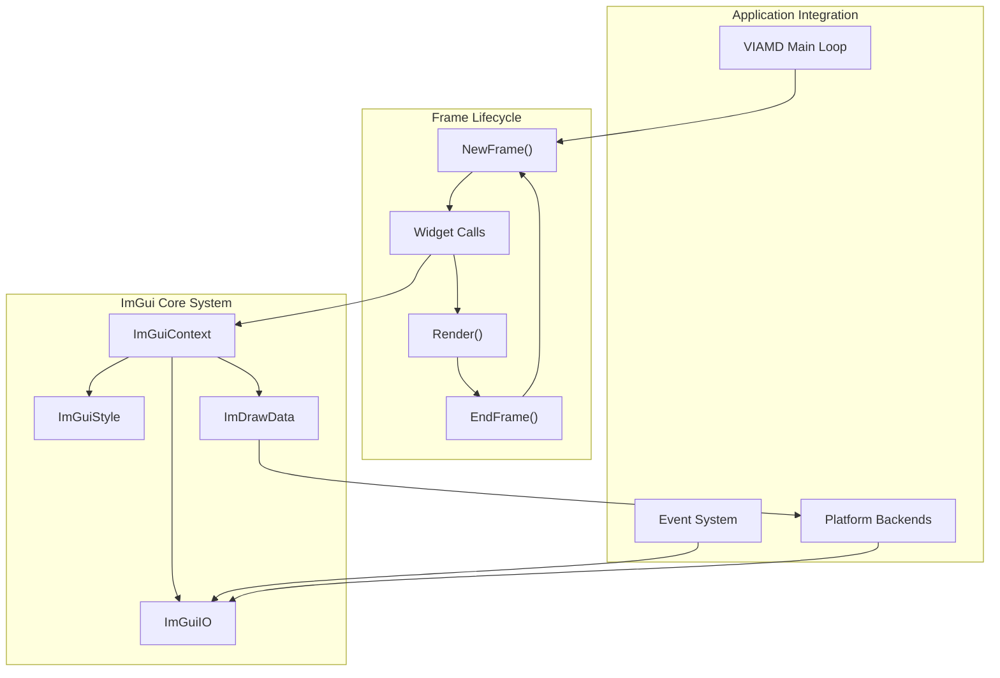
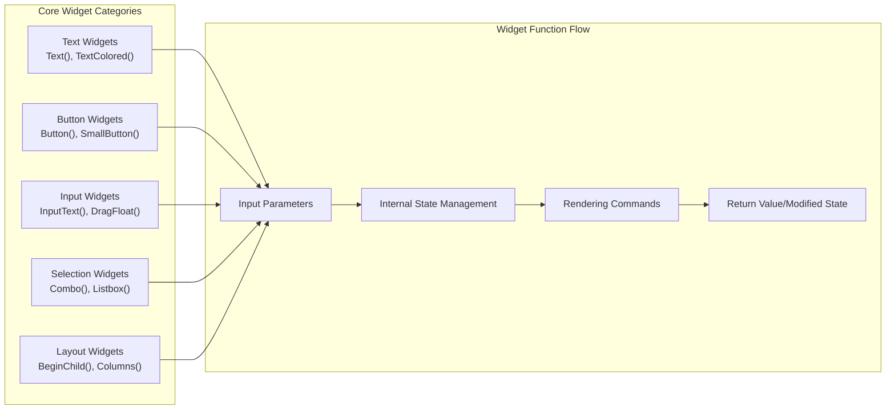
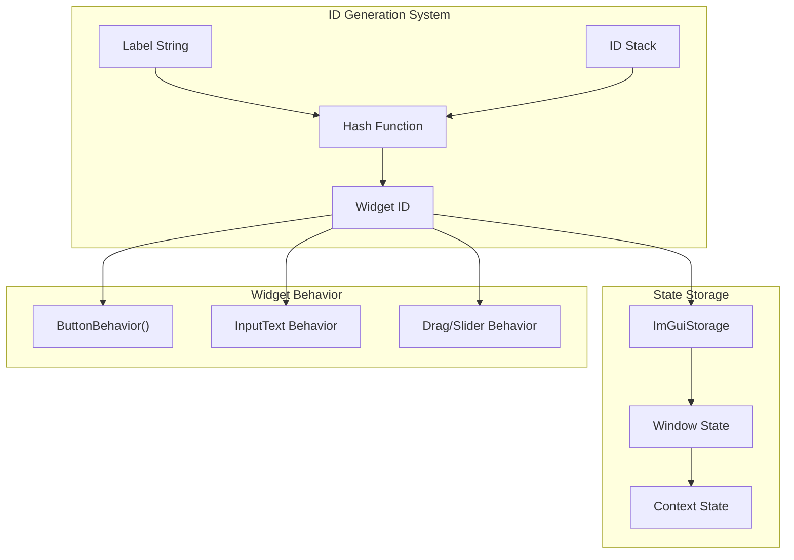
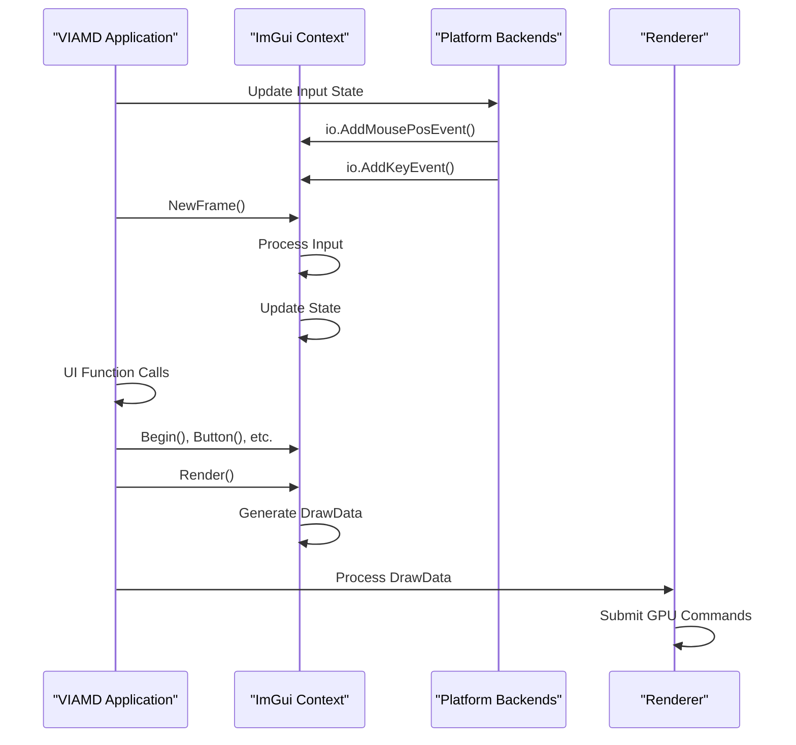
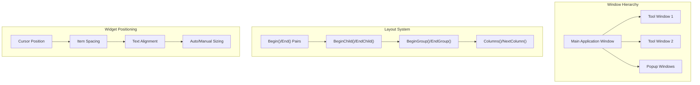
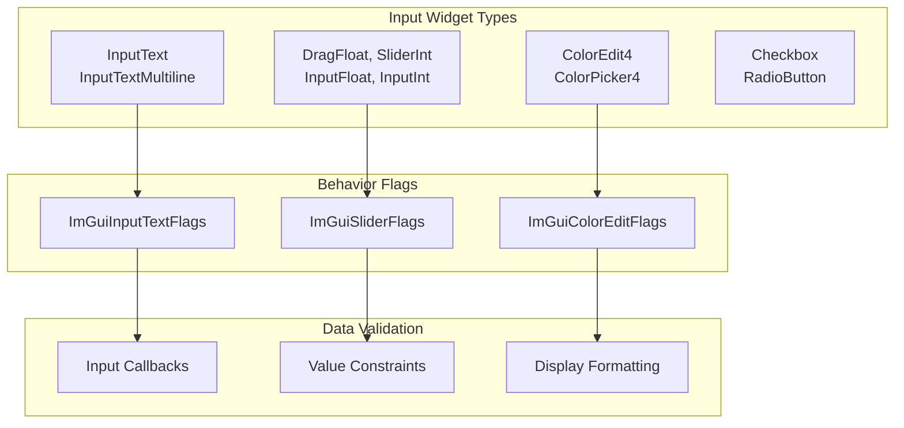
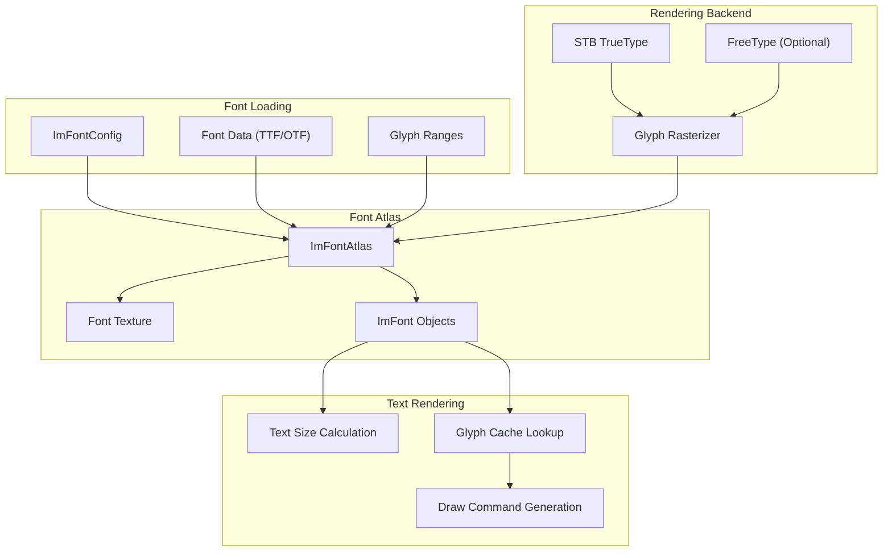
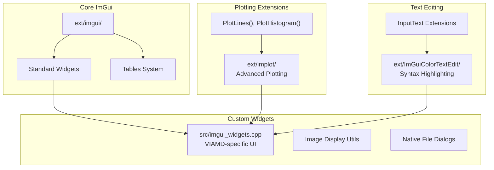

# ImGui Core and Widgets

Relevant source files

The following files were used as context for generating this wiki page:

- [ext/imgui/docs/CHANGELOG.txt](ext/imgui/docs/CHANGELOG.txt)
- [ext/imgui/docs/README.md](ext/imgui/docs/README.md)
- [ext/imgui/imgui.cpp](ext/imgui/imgui.cpp)
- [ext/imgui/imgui.h](ext/imgui/imgui.h)
- [ext/imgui/imgui_demo.cpp](ext/imgui/imgui_demo.cpp)
- [ext/imgui/imgui_draw.cpp](ext/imgui/imgui_draw.cpp)
- [ext/imgui/imgui_internal.h](ext/imgui/imgui_internal.h)
- [ext/imgui/imgui_tables.cpp](ext/imgui/imgui_tables.cpp)
- [ext/imgui/imgui_widgets.cpp](ext/imgui/imgui_widgets.cpp)
- [ext/imgui/misc/freetype/imgui_freetype.cpp](ext/imgui/misc/freetype/imgui_freetype.cpp)

This document covers the Dear ImGui immediate-mode graphical user interface integration within VIAMD, including the core widget system, application integration patterns, and the extended widget ecosystem. This encompasses the foundational GUI framework that powers all interactive elements in VIAMD's user interface.

For information about custom UI components and plotting extensions, see [Custom UI Components](#5.2). For text editing capabilities, see [Text Editor and Script Interface](#5.3).

## Core ImGui Architecture

VIAMD integrates Dear ImGui v1.90.5 as its primary GUI framework, providing an immediate-mode interface paradigm where UI elements are created and managed through function calls each frame rather than through persistent widget objects.

### ImGui Context and Lifecycle

The ImGui system operates through a global context that manages all GUI state, input handling, and rendering data. The core architecture revolves around frame-based processing where the entire UI is reconstructed each frame.

**Sources:** [ext/imgui/imgui.h:308-311](), [ext/imgui/imgui.cpp:4140-4180](), [ext/imgui/imgui_internal.h:1875-1950]()

### Core Data Structures

The ImGui system is built around several key data structures that manage state and rendering:

| Structure | Purpose | Key Members |
|-----------|---------|-------------|
| `ImGuiContext` | Global state container | `IO`, `Style`, `Windows`, `Tables`, `DrawData` |
| `ImGuiIO` | Input/output interface | `MousePos`, `KeysDown`, `DisplaySize`, `DeltaTime` |
| `ImGuiStyle` | Visual styling parameters | `Colors[]`, `FramePadding`, `ItemSpacing` |
| `ImGuiWindow` | Window state management | `Pos`, `Size`, `DrawList`, `IDStack` |
| `ImDrawData` | Rendering command output | `CmdLists[]`, `DisplayPos`, `DisplaySize` |

**Sources:** [ext/imgui/imgui.h:2015-2118](), [ext/imgui/imgui_internal.h:1875-2100]()

## Widget System Overview

The ImGui widget system follows an immediate-mode paradigm where widgets are stateless functions that return values indicating user interaction. Each widget function handles input processing, state management, and rendering in a single call.

### Widget Function Patterns

**Sources:** [ext/imgui/imgui_widgets.cpp:148-400](), [ext/imgui/imgui_widgets.cpp:693-748]()

### Widget State Management

ImGui manages widget state through a combination of ID-based tracking and immediate return values. The system uses string IDs and ID stacks to maintain state between frames while keeping the API stateless.

**Sources:** [ext/imgui/imgui_widgets.cpp:483-691](), [ext/imgui/imgui_internal.h:2900-3000]()

## Application Integration

VIAMD integrates ImGui through a frame-based rendering loop that coordinates with the application's event system and graphics pipeline.

### Frame Processing Integration

The ImGui integration follows a standard pattern where each frame begins with input collection, processes UI calls, and ends with command list generation for rendering.

**Sources:** [ext/imgui/imgui.cpp:4140-4220](), [ext/imgui/imgui.cpp:4580-4650]()

### Window and Layout Management

ImGui provides a hierarchical window system where the main application creates windows that contain widgets. VIAMD uses this for organizing different UI panels and tools.

**Sources:** [ext/imgui/imgui.cpp:6100-6300](), [ext/imgui/imgui_widgets.cpp:2500-2700]()

## Widget Categories and Usage Patterns

ImGui provides a comprehensive set of widgets organized into functional categories. Each category serves specific interaction patterns common in technical interfaces.

### Text and Display Widgets

Text widgets handle static and formatted text display with various styling options.

| Widget Function | Purpose | Return Type |
|----------------|---------|-------------|
| `Text()` | Basic text display | `void` |
| `TextColored()` | Colored text display | `void` |
| `TextWrapped()` | Word-wrapped text | `void` |
| `BulletText()` | Bulleted text items | `void` |
| `LabelText()` | Label-value pairs | `void` |

**Sources:** [ext/imgui/imgui_widgets.cpp:148-400]()

### Input and Control Widgets

Input widgets provide interactive controls for data entry and manipulation.

**Sources:** [ext/imgui/imgui_widgets.cpp:4000-5500](), [ext/imgui/imgui_widgets.cpp:2800-3500]()

### Selection and Navigation Widgets

Selection widgets handle choosing from sets of options and navigation between interface elements.

| Widget Category | Widgets | Use Cases |
|----------------|---------|-----------|
| **Buttons** | `Button()`, `SmallButton()`, `InvisibleButton()` | Actions, triggers |
| **Selection** | `Selectable()`, `ListBox()`, `Combo()` | Single/multi selection |
| **Trees** | `TreeNode()`, `CollapsingHeader()` | Hierarchical data |
| **Menus** | `BeginMenu()`, `MenuItem()` | Command organization |
| **Tables** | `BeginTable()`, `TableNextColumn()` | Tabular data display |

**Sources:** [ext/imgui/imgui_widgets.cpp:693-1500](), [ext/imgui/imgui_tables.cpp:300-800]()

## Font and Rendering System

ImGui uses a custom font atlas system that supports both raster and vector fonts through multiple rendering backends.

### Font Atlas Architecture

**Sources:** [ext/imgui/imgui_draw.cpp:1500-2000](), [ext/imgui/misc/freetype/imgui_freetype.cpp:150-300]()

### FreeType Integration

VIAMD supports enhanced font rendering through FreeType integration, providing improved glyph quality and additional font format support.

**Sources:** [ext/imgui/misc/freetype/imgui_freetype.cpp:177-253]()

## Extension Ecosystem

The ImGui ecosystem in VIAMD includes several specialized extensions that enhance the core widget functionality.

### Available Extensions

**Sources:** Based on architectural diagrams and file structure analysis

### Integration Patterns

Extensions follow consistent patterns for integration with the core ImGui system, typically providing additional widget functions that maintain the immediate-mode paradigm while adding specialized functionality.

**Sources:** [ext/imgui/imgui_demo.cpp:2000-3000]() for extension examples and patterns

---