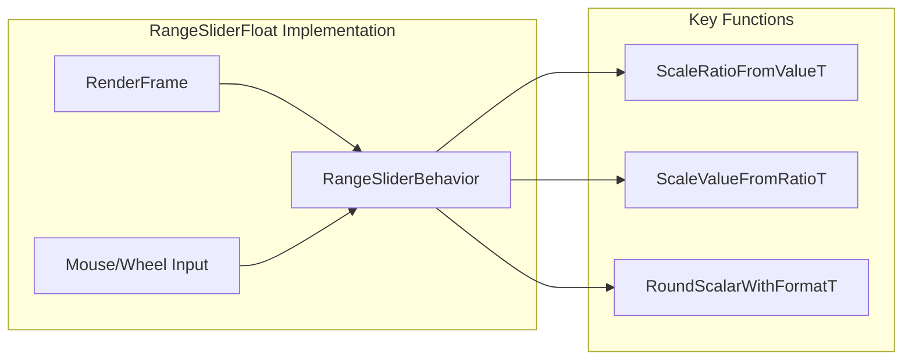
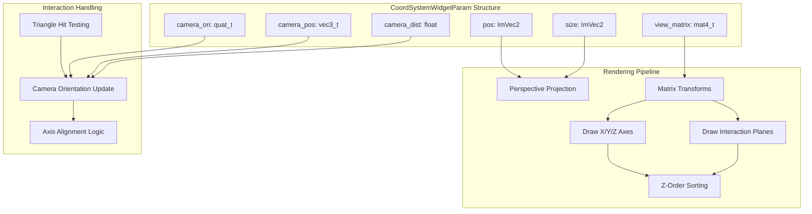
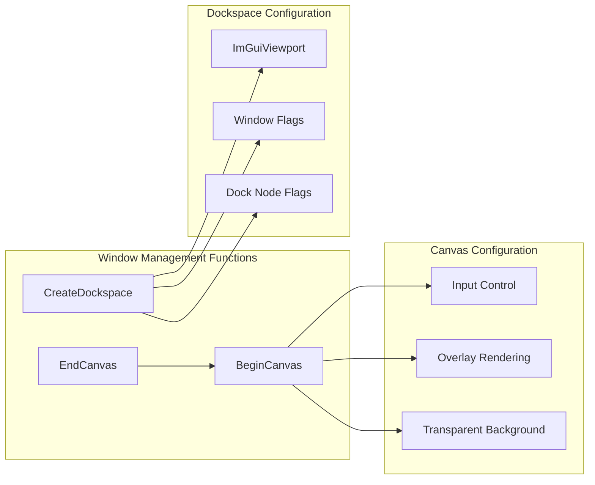
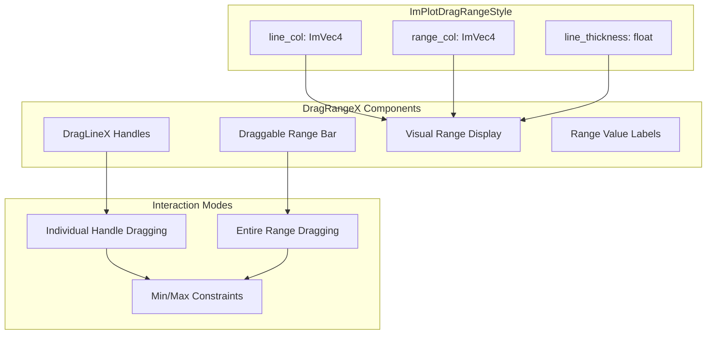
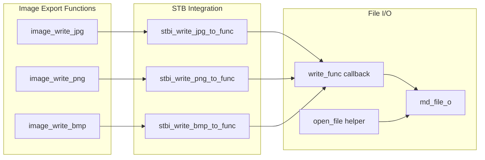
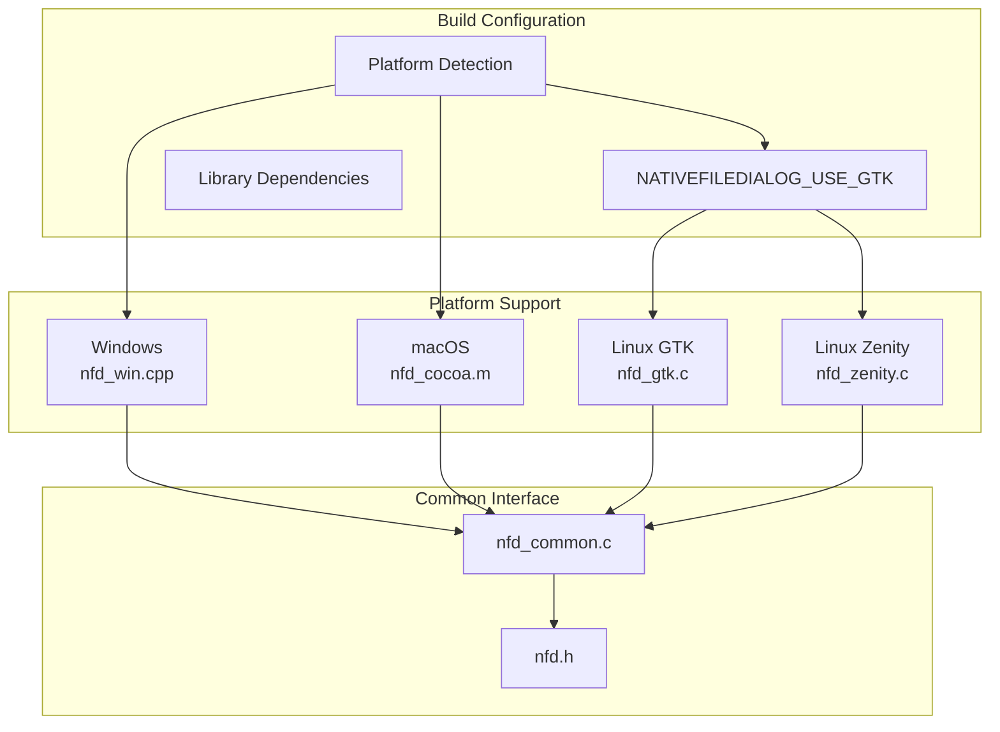

# Custom UI Components

Relevant source files

The following files were used as context for generating this wiki page:

- [ext/ImGuiColorTextEdit/CMakeLists.txt](ext/ImGuiColorTextEdit/CMakeLists.txt)
- [ext/imgui/CMakeLists.txt](ext/imgui/CMakeLists.txt)
- [ext/implot/CMakeLists.txt](ext/implot/CMakeLists.txt)
- [ext/nativefiledialog/CMakeLists.txt](ext/nativefiledialog/CMakeLists.txt)
- [ext/nativefiledialog/cmake/FindGTK3.cmake](ext/nativefiledialog/cmake/FindGTK3.cmake)
- [src/image.cpp](src/image.cpp)
- [src/image.h](src/image.h)
- [src/imgui_widgets.cpp](src/imgui_widgets.cpp)
- [src/imgui_widgets.h](src/imgui_widgets.h)
- [src/implot_widgets.cpp](src/implot_widgets.cpp)
- [src/implot_widgets.h](src/implot_widgets.h)

This document covers the custom UI components and utilities that extend the base ImGui and ImPlot functionality in VIAMD. These components provide specialized widgets, styling, image export capabilities, and native file dialog integration to create a cohesive molecular visualization interface.

For information about the core ImGui integration and widget system, see [ImGui Core and Widgets](#5.1). For text editing capabilities, see [Text Editor and Script Interface](#5.3).

## Custom Widget Architecture

VIAMD extends the base ImGui/ImPlot functionality through several custom widget implementations and utility functions that provide specialized molecular visualization UI components.

```mermaid
graph TB
    subgraph "Base Libraries"
        IMGUI["ImGui Core"]
        IMPLOT["ImPlot Core"]
        STB["STB Image"]
        NFD["Native File Dialog"]
    end
    
    subgraph "Custom ImGui Extensions"
        RANGE_SLIDER["RangeSliderFloat"]
        COORD_WIDGET["DrawCoordinateSystemWidget"]
        THEME["init_theme"]
        DOCKSPACE["CreateDockspace"]
        CANVAS["BeginCanvas/EndCanvas"]
        DELETE_BTN["DeleteButton"]
        COLOR_EDIT["ColorEdit3/4Minimal"]
        CHECKERBOARD["DrawCheckerboard"]
    end
    
    subgraph "Custom ImPlot Extensions"
        DRAG_RANGE["DragRangeX"]
        COLORMAP_SEL["ColormapSelection"]
        SYNC_AXES["SyncAxesY"]
    end
    
    subgraph "Image Utilities"
        IMG_JPG["image_write_jpg"]
        IMG_PNG["image_write_png"]
        IMG_BMP["image_write_bmp"]
    end
    
    subgraph "File Dialog Integration"
        NFD_WRAPPER["Native File Dialog\nCMake Integration"]
    end
    
    IMGUI --> RANGE_SLIDER
    IMGUI --> COORD_WIDGET
    IMGUI --> THEME
    IMGUI --> DOCKSPACE
    IMGUI --> CANVAS
    IMGUI --> DELETE_BTN
    IMGUI --> COLOR_EDIT
    IMGUI --> CHECKERBOARD
    
    IMPLOT --> DRAG_RANGE
    IMPLOT --> COLORMAP_SEL
    IMPLOT --> SYNC_AXES
    
    STB --> IMG_JPG
    STB --> IMG_PNG
    STB --> IMG_BMP
    
    NFD --> NFD_WRAPPER
    
    style IMGUI fill:#e1f5fe
    style IMPLOT fill:#f3e5f5
    style STB fill:#e8f5e8
    style NFD fill:#fff3e0
```

**Sources:** [src/imgui_widgets.cpp:1-569](), [src/implot_widgets.cpp:1-179](), [src/image.cpp:1-52](), [ext/nativefiledialog/CMakeLists.txt:1-73]()

## Custom ImGui Widget Components

The custom ImGui widgets provide specialized functionality for molecular visualization interfaces, including range controls, coordinate system visualization, and enhanced styling.

### Range Slider Widget

The `RangeSliderFloat` widget allows users to select a range of values with two handles, commonly used for filtering and parameter adjustment in molecular analysis.

**Sources:** [src/imgui_widgets.cpp:13-189](), [src/imgui_widgets.h:18-18]()

### Coordinate System Widget

The `DrawCoordinateSystemWidget` provides an interactive 3D coordinate system visualization that allows users to quickly orient the camera view by clicking on coordinate planes.

**Sources:** [src/imgui_widgets.cpp:351-566](), [src/imgui_widgets.h:6-14]()

### Theme and Styling Components

VIAMD provides a custom dark theme and styling utilities to maintain visual consistency across the interface.

| Function | Purpose | File Reference |
|----------|---------|----------------|
| `init_theme` | Sets up dark color scheme | [src/imgui_widgets.cpp:191-243]() |
| `ColorEdit3Minimal` | Minimal color picker without labels | [src/imgui_widgets.cpp:318-323]() |
| `ColorEdit4Minimal` | Minimal RGBA color picker | [src/imgui_widgets.cpp:325-330]() |
| `DrawCheckerboard` | Draws checkerboard pattern | [src/imgui_widgets.cpp:332-349]() |
| `DeleteButton` | Red-styled delete button | [src/imgui_widgets.cpp:300-307]() |

**Sources:** [src/imgui_widgets.cpp:191-349](), [src/imgui_widgets.h:21-53]()

### Layout and Window Management

Custom window management functions provide specialized layouts for molecular visualization.

**Sources:** [src/imgui_widgets.cpp:245-294](), [src/imgui_widgets.h:22-24]()

## Custom ImPlot Extensions

VIAMD extends ImPlot with specialized plotting widgets for molecular data visualization and analysis.

### Drag Range Widget

The `DragRangeX` widget provides interactive range selection on plot axes, commonly used for time series analysis and data filtering.

**Sources:** [src/implot_widgets.cpp:6-130](), [src/implot_widgets.h:3-21]()

### Colormap Selection Widget

The `ColormapSelection` widget provides a dropdown interface for choosing from available ImPlot colormaps.

| Function | Purpose | Return Type |
|----------|---------|-------------|
| `ColormapSelection` | Dropdown colormap selector | `bool` |
| `ColormapQualitative` | Check if colormap is qualitative | `bool` |
| `SyncAxesY` | Synchronize Y-axis ranges | `void` |

**Sources:** [src/implot_widgets.cpp:132-177](), [src/implot_widgets.h:23-27]()

## Image Export Utilities

VIAMD provides image export functionality using the STB image library for saving visualization results in multiple formats.

### Image Format Support

| Format | Function | Parameters | Quality Control |
|--------|----------|------------|-----------------|
| JPEG | `image_write_jpg` | `filename, rgba, width, height, quality` | 0-100 quality |
| PNG | `image_write_png` | `filename, rgba, width, height` | Lossless |
| BMP | `image_write_bmp` | `filename, rgba, width, height` | Uncompressed |

All functions expect 32-bit RGBA pixel data (8 bits per channel) and return `bool` success status.

**Sources:** [src/image.cpp:1-52](), [src/image.h:1-10]()

## Native File Dialog Integration

VIAMD integrates native file dialogs through a cross-platform wrapper that provides system-appropriate file selection interfaces.

### Platform-Specific Dependencies

| Platform | Implementation | Dependencies |
|----------|----------------|--------------|
| Windows | `nfd_win.cpp` | Win32 API |
| macOS | `nfd_cocoa.m` | AppKit Framework |
| Linux (GTK) | `nfd_gtk.c` | GTK3 libraries |
| Linux (Zenity) | `nfd_zenity.c` | Zenity command |

The build system automatically selects the appropriate implementation based on the target platform and available dependencies.

**Sources:** [ext/nativefiledialog/CMakeLists.txt:1-73](), [ext/nativefiledialog/cmake/FindGTK3.cmake:1-567]()

## Utility Functions and Helpers

Additional utility functions support the custom UI components with common operations and state management.

| Function | Purpose | Parameters |
|----------|---------|------------|
| `PushDisabled/PopDisabled` | Disable UI elements | None |
| `InputQuery` | Validated input field | `label, buf, is_valid, err_text` |
| `PushInvalid/PopInvalid` | Invalid state styling | None |

These utilities provide consistent behavior across the VIAMD interface for common UI patterns like input validation and element state management.

**Sources:** [src/imgui_widgets.cpp:309-316](), [src/imgui_widgets.h:26-43]()

---