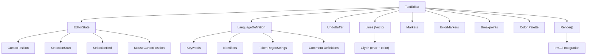
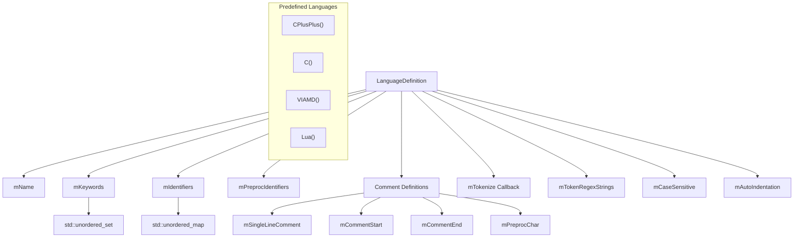
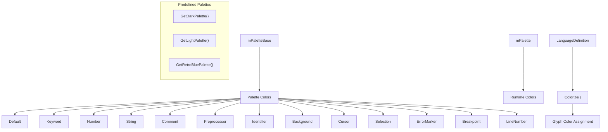
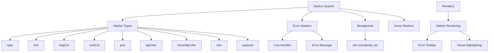
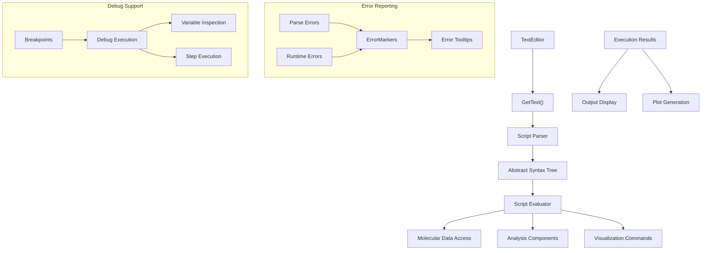
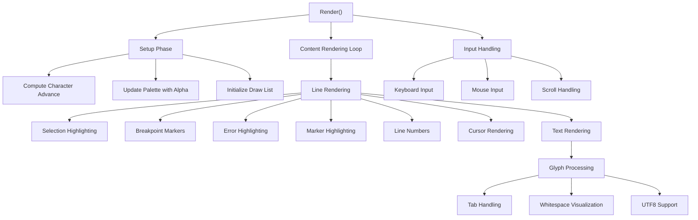

# Text Editor and Script Interface

<details>
<summary>Relevant source files</summary>

The following files were used as context for generating this wiki page:

- [ext/ImGuiColorTextEdit/TextEditor.cpp](ext/ImGuiColorTextEdit/TextEditor.cpp)
- [ext/ImGuiColorTextEdit/TextEditor.h](ext/ImGuiColorTextEdit/TextEditor.h)
- [ext/implot/implot.cpp](ext/implot/implot.cpp)
- [ext/implot/implot_internal.h](ext/implot/implot_internal.h)

</details>


This document covers VIAMD's integrated text editor and scripting interface capabilities. The system provides a full-featured code editor with syntax highlighting, error reporting, and interactive debugging features, specifically designed to support VIAMD's domain-specific scripting language and molecular analysis workflows.

For information about the broader UI framework, see [Custom UI Components](#5.2). For details about the core ImGui integration, see [ImGui Core and Widgets](#5.1).

## Overview

The text editor and script interface system consists of two main components:

- **TextEditor Component**: A sophisticated text editing widget based on the ImGuiColorTextEdit library, providing syntax highlighting, error markers, breakpoints, and advanced editing capabilities
- **VIAMD Script Language Support**: Custom language definitions and integration for VIAMD's molecular analysis scripting language

The system enables users to write, edit, and debug scripts for molecular dynamics analysis directly within the VIAMD interface, with full IDE-like features including syntax highlighting, error reporting, and interactive debugging.

## TextEditor Component Architecture

The `TextEditor` class serves as the core component, providing a complete code editing experience within the ImGui framework.

### Core TextEditor Architecture



Sources: [ext/ImGuiColorTextEdit/TextEditor.h:13-432](), [ext/ImGuiColorTextEdit/TextEditor.cpp:28-67]()

### Data Structures

The editor organizes text content using a hierarchical structure:

| Component | Type | Purpose |
|-----------|------|---------|
| `Lines` | `std::vector<Line>` | Container for all text lines |
| `Line` | `std::vector<Glyph>` | Single line of text |
| `Glyph` | Char + Color Index | Individual character with formatting |
| `EditorState` | Struct | Cursor and selection state |
| `UndoBuffer` | `std::vector<UndoRecord>` | Undo/redo operations |

Sources: [ext/ImGuiColorTextEdit/TextEditor.h:149-162](), [ext/ImGuiColorTextEdit/TextEditor.h:310-349]()

## Language Definition System

The TextEditor supports multiple programming languages through a flexible language definition system, with specific support for VIAMD's scripting language.

### Language Definition Architecture



Sources: [ext/ImGuiColorTextEdit/TextEditor.h:164-197](), [ext/ImGuiColorTextEdit/TextEditor.cpp:68-79]()

### VIAMD Language Support

The editor includes built-in support for VIAMD's domain-specific language:

```cpp
// Language definition initialization in constructor
SetLanguageDefinition(LanguageDefinition::VIAMD());
```

The VIAMD language definition provides:
- Syntax highlighting for molecular analysis keywords
- Error detection and reporting
- Auto-completion support
- Context-aware help

Sources: [ext/ImGuiColorTextEdit/TextEditor.cpp:60](), [ext/ImGuiColorTextEdit/TextEditor.h:193]()

## Syntax Highlighting and Colorization

The editor implements a sophisticated colorization system that applies syntax highlighting in real-time.

### Color Palette System



Sources: [ext/ImGuiColorTextEdit/TextEditor.h:16-40](), [ext/ImGuiColorTextEdit/TextEditor.h:303-306]()

### Colorization Process

The colorization system processes text in multiple phases:

1. **Tokenization**: Break text into semantic tokens
2. **Classification**: Assign color indices based on language rules
3. **Comment Detection**: Identify single-line and multi-line comments
4. **Preprocessor Handling**: Special handling for preprocessor directives
5. **Glyph Assignment**: Apply colors to individual characters

Sources: [ext/ImGuiColorTextEdit/TextEditor.cpp:703-722](), [ext/ImGuiColorTextEdit/TextEditor.cpp:354-356]()

## Interactive Features

The TextEditor provides advanced interactive features for script development and debugging.

### Markers and Error Reporting



Sources: [ext/ImGuiColorTextEdit/TextEditor.h:128-138](), [ext/ImGuiColorTextEdit/TextEditor.h:142-145](), [ext/ImGuiColorTextEdit/TextEditor.cpp:208-217]()

### Input Handling and Navigation

The editor supports comprehensive input handling:

| Feature | Implementation | Key Bindings |
|---------|---------------|--------------|
| Cursor Movement | `MoveUp()`, `MoveDown()`, `MoveLeft()`, `MoveRight()` | Arrow keys |
| Text Selection | `SetSelection()`, `SelectAll()` | Shift + movement |
| Copy/Cut/Paste | `Copy()`, `Cut()`, `Paste()` | Ctrl+C/X/V |
| Undo/Redo | `Undo()`, `Redo()` | Ctrl+Z/Y |
| Word Navigation | `FindWordStart()`, `FindWordEnd()` | Ctrl + arrows |
| Line Operations | `InsertLine()`, `RemoveLine()` | Enter, Delete |

Sources: [ext/ImGuiColorTextEdit/TextEditor.cpp:724-815](), [ext/ImGuiColorTextEdit/TextEditor.h:277-301]()

## Script Interface Integration

The TextEditor integrates with VIAMD's scripting system to provide a complete development environment.

### Script Execution Flow



Sources: [ext/ImGuiColorTextEdit/TextEditor.h:224-228](), [ext/ImGuiColorTextEdit/TextEditor.cpp:1267-1292]()

## Rendering and UI Integration

The TextEditor integrates seamlessly with ImGui's immediate-mode rendering system.

### Rendering Pipeline



Sources: [ext/ImGuiColorTextEdit/TextEditor.cpp:895-1225](), [ext/ImGuiColorTextEdit/TextEditor.cpp:1227-1265]()

### Performance Optimizations

The editor implements several optimizations for smooth performance:

- **Incremental Colorization**: Only recolors modified lines
- **Viewport Culling**: Only renders visible lines
- **Glyph Batching**: Combines consecutive characters with same color
- **Tab Visualization**: Efficient tab character rendering
- **UTF-8 Support**: Proper multi-byte character handling

Sources: [ext/ImGuiColorTextEdit/TextEditor.cpp:153-168](), [ext/ImGuiColorTextEdit/TextEditor.cpp:1103-1142]()

---