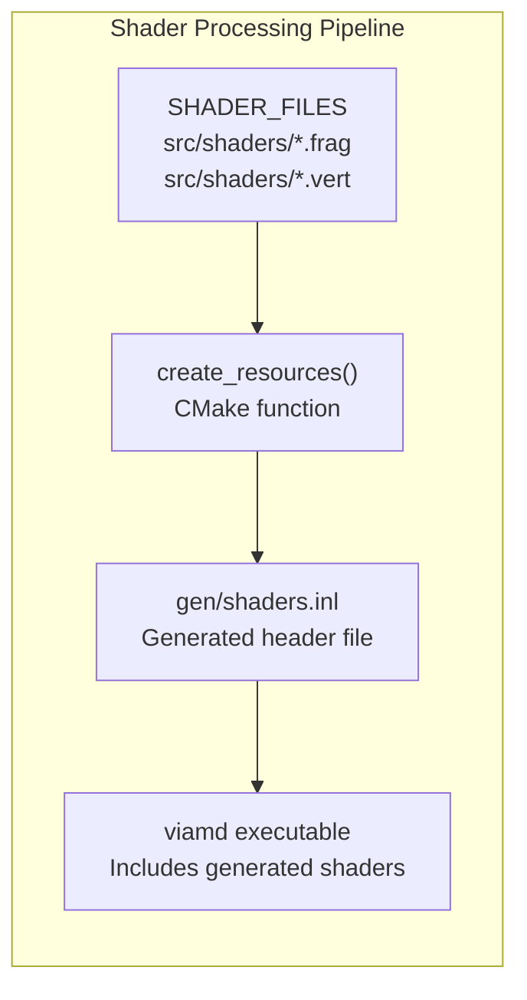

# Build System and Dependencies

Relevant source files

The following files were used as context for generating this wiki page:

- [.gitmodules](.gitmodules)
- [CMakeLists.txt](CMakeLists.txt)
- [TODO.md](TODO.md)

This document provides a comprehensive overview of VIAMD's build system architecture, dependency management, and build configuration. It covers the CMake-based build system, external library integration through Git submodules, and platform-specific build considerations. For detailed CMake configuration specifics, see [CMake Build Configuration](#6.1). For in-depth information about individual external libraries, see [External Libraries and Dependencies](#6.2). For information about automated builds and releases, see [CI/CD and Release Process](#6.3).

## Build System Overview

VIAMD uses CMake as its primary build system, requiring a minimum version of 3.20 and targeting C++20 standard. The build system is designed around a modular architecture that integrates multiple external dependencies through Git submodules and provides extensive configuration options for different platforms and use cases.

### Core Build Architecture

The build system centers around a single executable target `viamd` that links against multiple external libraries. The project version is currently 0.1.15 and inherits many build configurations from the `mdlib` dependency.

```mermaid
graph TD
    subgraph "CMake Build System"
        MAIN_CMAKE["CMakeLists.txt<br/>Project: viamd v0.1.15<br/>Requires: CMake 3.20+"]
        MDLIB_CMAKE["ext/mdlib/cmake/common.cmake<br/>Common build configurations"]
        
        MAIN_CMAKE --> MDLIB_CMAKE
    end
    
    subgraph "Source Organization"
        SRC_FILES["src/*.cpp, src/*.h<br/>Core application files"]
        APP_FILES["src/app/*.cpp, src/app/*.h<br/>Application layer"]
        GFX_FILES["src/gfx/*.cpp, src/gfx/*.h<br/>Graphics pipeline"]
        COMP_FILES["src/components/*<br/>Analysis components"]
        SHADER_FILES["src/shaders/*.frag, *.vert<br/>GLSL shaders"]
    end
    
    subgraph "External Dependencies"
        GLFW_DEP["glfw<br/>Windowing system"]
        IMGUI_DEP["imgui<br/>Immediate mode GUI"]
        MDLIB_DEP["mdlib<br/>Molecular data processing"]
        ENKITS_DEP["enkiTS<br/>Task scheduling"]
        NFD_DEP["nativefiledialog<br/>File dialogs"]
        STB_DEP["stb<br/>Image utilities"]
        IMPLOT_DEP["implot<br/>Plotting library"]
        TEXTEDIT_DEP["ImGuiColorTextEdit<br/>Text editor"]
        ATOMIC_DEP["atomic_queue<br/>Lock-free threading"]
        NOTIFY_DEP["imgui_notify<br/>Notification system"]
    end
    
    subgraph "Build Target"
        VIAMD_EXE["viamd executable<br/>Main application target"]
    end
    
    MAIN_CMAKE --> SRC_FILES
    MAIN_CMAKE --> APP_FILES
    MAIN_CMAKE --> GFX_FILES
    MAIN_CMAKE --> COMP_FILES
    MAIN_CMAKE --> SHADER_FILES
    
    SRC_FILES --> VIAMD_EXE
    APP_FILES --> VIAMD_EXE
    GFX_FILES --> VIAMD_EXE
    COMP_FILES --> VIAMD_EXE
    SHADER_FILES --> VIAMD_EXE
    
    GLFW_DEP --> VIAMD_EXE
    IMGUI_DEP --> VIAMD_EXE
    MDLIB_DEP --> VIAMD_EXE
    ENKITS_DEP --> VIAMD_EXE
    NFD_DEP --> VIAMD_EXE
    STB_DEP --> VIAMD_EXE
    IMPLOT_DEP --> VIAMD_EXE
    TEXTEDIT_DEP --> VIAMD_EXE
    ATOMIC_DEP --> VIAMD_EXE
    NOTIFY_DEP --> VIAMD_EXE
```

Sources: [CMakeLists.txt:1-231]()

### External Dependencies Management

VIAMD manages external dependencies primarily through Git submodules, providing version control over the exact versions of libraries used. The dependency hierarchy is designed to minimize conflicts and ensure reproducible builds across different platforms.

```mermaid
graph TD
    subgraph "Git Submodules"
        GLFW_SUB["ext/glfw<br/>github.com/glfw/glfw<br/>Windowing and input"]
        IMGUI_SUB["ext/imgui<br/>github.com/ocornut/imgui<br/>Immediate mode GUI"]
        ENKITS_SUB["ext/enkiTS<br/>github.com/dougbinks/enkiTS<br/>Task scheduling system"]
        MDLIB_SUB["ext/mdlib<br/>github.com/scanberg/mdlib<br/>Molecular data processing"]
    end
    
    subgraph "CMake Add Subdirectory Targets"
        GLFW_TARGET["add_subdirectory(ext/glfw)"]
        IMGUI_TARGET["add_subdirectory(ext/imgui)"]
        NFD_TARGET["add_subdirectory(ext/nativefiledialog)"]
        STB_TARGET["add_subdirectory(ext/stb)"]
        ENKITS_TARGET["add_subdirectory(ext/enkiTS)"]
        TEXTEDIT_TARGET["add_subdirectory(ext/ImGuiColorTextEdit)"]
        IMPLOT_TARGET["add_subdirectory(ext/implot)"]
        ATOMIC_TARGET["add_subdirectory(ext/atomic_queue)"]
        NOTIFY_TARGET["add_subdirectory(ext/imgui_notify)"]
        MDLIB_TARGET["add_subdirectory(ext/mdlib)"]
    end
    
    subgraph "Target Link Libraries"
        LINK_GLFW["target_link_libraries(viamd glfw)"]
        LINK_IMGUI["target_link_libraries(viamd imgui)"]
        LINK_MDLIB["target_link_libraries(viamd mdlib)"]
        LINK_OTHERS["target_link_libraries(viamd<br/>nativefiledialog stb enkiTS<br/>ImGuiColorTextEdit implot<br/>atomic_queue imgui_notify)"]
    end
    
    GLFW_SUB --> GLFW_TARGET
    IMGUI_SUB --> IMGUI_TARGET
    ENKITS_SUB --> ENKITS_TARGET
    MDLIB_SUB --> MDLIB_TARGET
    
    GLFW_TARGET --> LINK_GLFW
    IMGUI_TARGET --> LINK_IMGUI
    MDLIB_TARGET --> LINK_MDLIB
    NFD_TARGET --> LINK_OTHERS
    STB_TARGET --> LINK_OTHERS
    ENKITS_TARGET --> LINK_OTHERS
    TEXTEDIT_TARGET --> LINK_OTHERS
    IMPLOT_TARGET --> LINK_OTHERS
    ATOMIC_TARGET --> LINK_OTHERS
    NOTIFY_TARGET --> LINK_OTHERS
```

Sources: [.gitmodules:1-13](), [CMakeLists.txt:73-83](), [CMakeLists.txt:218-230]()

## Build Configuration Options

VIAMD provides extensive build-time configuration through CMake options that control feature availability, platform-specific behaviors, and resource management. These options are defined as CMake cache variables and affect compile-time definitions.

### Core Configuration Options

| Option | Default | Description |
|--------|---------|-------------|
| `VIAMD_ENABLE_DEFAULT_DATASET` | ON | Include default molecular datasets |
| `VIAMD_IMGUI_ENABLE_VIEWPORTS` | OFF | Enable ImGui multi-viewport support |
| `VIAMD_IMGUI_ENABLE_DOCKSPACE` | OFF | Enable ImGui docking in main window |
| `VIAMD_CREATE_MACOSX_BUNDLE` | OFF | Build macOS application bundle |
| `VIAMD_LINK_STDLIB_STATIC` | ON | Static linking of standard library |
| `VIAMD_ENABLE_VELOXCHEM` | OFF | Enable VeloxChem quantum chemistry module |

Sources: [CMakeLists.txt:42-48]()

### Resource Configuration

The build system includes configurable resource limits and worker thread counts:

- `VIAMD_FRAME_CACHE_SIZE_MB`: Frame cache size in megabytes (default: 2048)
- `VIAMD_NUM_WORKER_THREADS`: Number of worker threads (default: 8)

These values are compiled into the application as preprocessor definitions and affect runtime behavior.

Sources: [CMakeLists.txt:49-50](), [CMakeLists.txt:194-195]()

### Shader Resource Management

The build system implements automatic shader compilation and embedding through a resource generation system. GLSL shaders are compiled into a single header file during the build process.

Sources: [CMakeLists.txt:118-143]()

## Platform-Specific Considerations

The build system accommodates three primary target platforms with specific configurations for each.

### Windows (Win32)

- Uses MSVC runtime library configurations
- Supports both static and dynamic runtime linking
- Includes Windows-specific resource files (`icon.rc`)
- Handles Debug/Release configuration differences

### macOS

- Optional application bundle creation
- Icon resource management (`viamd.icns`)
- Architecture-specific considerations (Intel/Apple Silicon)

### Linux

- Desktop integration files (`viamd.desktop`, `viamd.metainfo.xml`)
- Icon installation to system directories
- Wayland support configuration through GLFW options

Sources: [CMakeLists.txt:60-69](), [CMakeLists.txt:160-174]()

## Development Dependencies and Requirements

### Build Requirements

| Requirement | Version | Purpose |
|-------------|---------|---------|
| CMake | 3.20+ | Build system generator |
| C++ Compiler | C++20 support | Language standard compliance |
| OpenGL | 3.3+ | Graphics API |
| Git | Any recent | Submodule management |

### External Library Dependencies

The project maintains dependencies through Git submodules that point to specific repositories:

- **GLFW**: Cross-platform windowing and input handling
- **ImGui**: Immediate mode graphical user interface
- **enkiTS**: Task scheduling and thread pool management  
- **mdlib**: Core molecular data processing library

Additional dependencies are included as source code within the external directory structure and built as part of the main build process.

Sources: [CMakeLists.txt:71](), [CMakeLists.txt:204](), [.gitmodules:1-13]()

---