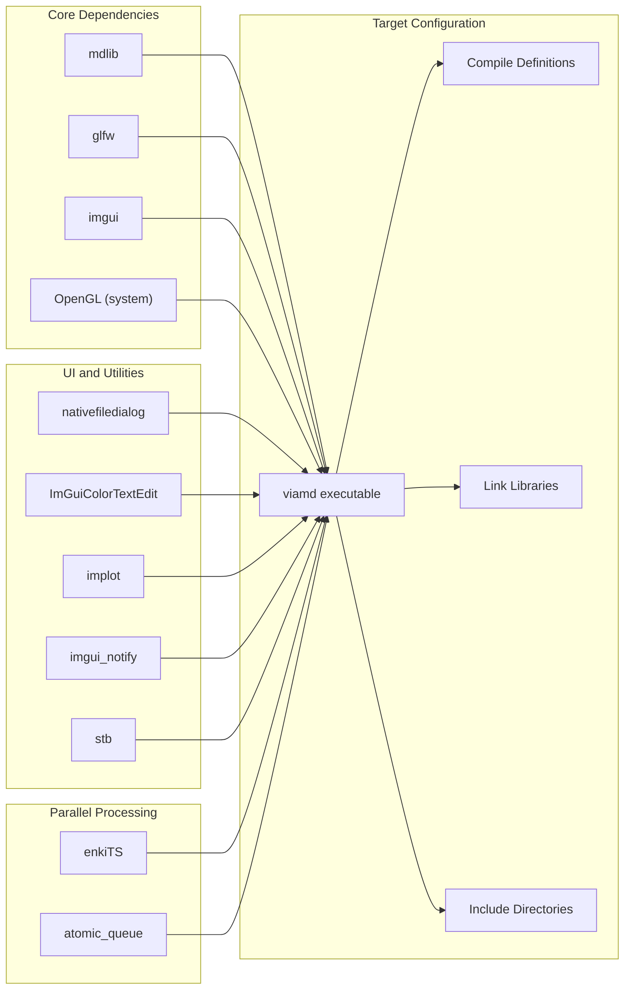
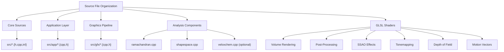
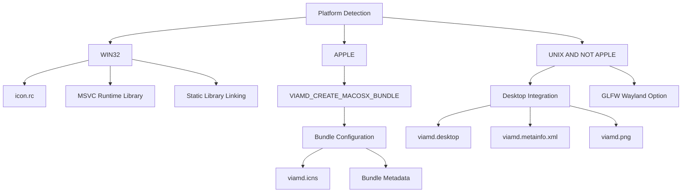
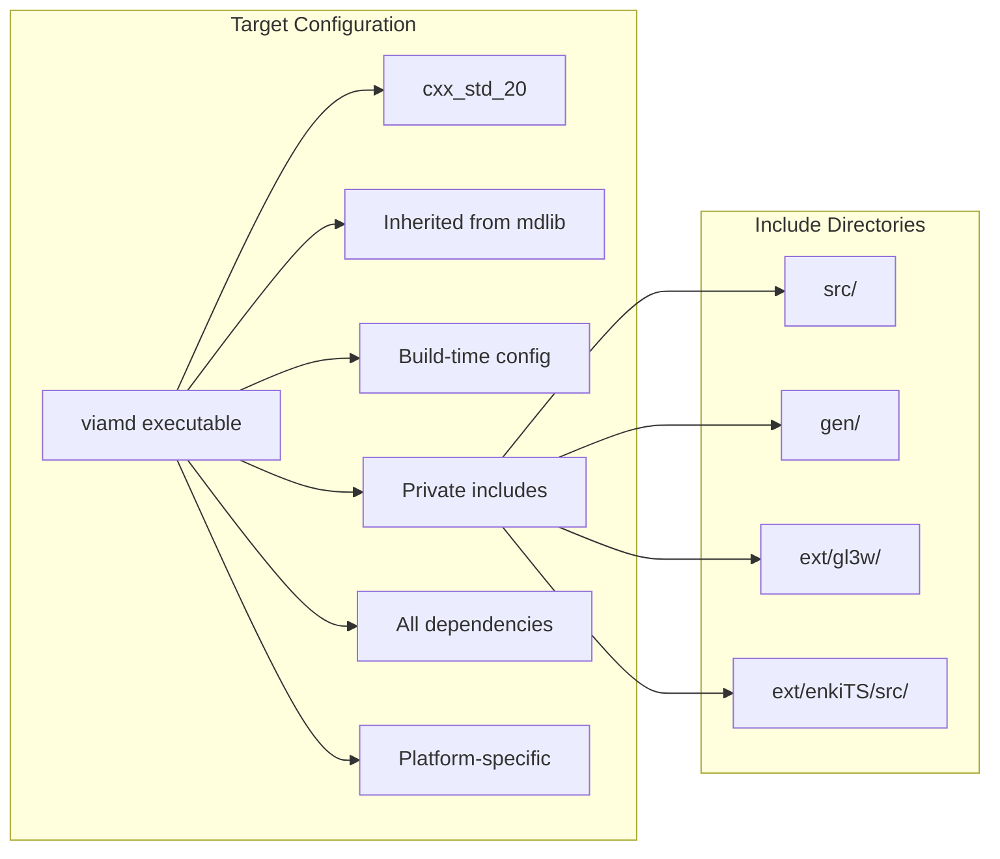

# CMake Build Configuration

<details>
<summary>Relevant source files</summary>

The following files were used as context for generating this wiki page:

- [CMakeLists.txt](CMakeLists.txt)

</details>


This document describes the CMake build system configuration for VIAMD, including build options, dependency management, source file organization, and platform-specific configurations. The primary configuration is defined in the root `CMakeLists.txt` file, which orchestrates the entire build process.

For information about external library dependencies and Git submodules, see [External Libraries and Dependencies](#6.2). For CI/CD workflows and automated builds, see [CI/CD and Release Process](#6.3).

## Project Configuration and Versioning

VIAMD is configured as a CMake project with version 0.1.15, requiring CMake 3.20 or higher. The project uses C++20 features and includes the MDLib common CMake configuration.

```
Project: viamd
Version: 0.1.15
Languages: CXX
CMake Minimum: 3.20
```

The build system automatically sets the default build type to Release for single-configuration generators when no previous build exists. This ensures optimal performance for end users while allowing developers to explicitly choose Debug builds when needed.

**Build Configuration Structure:**

```mermaid
graph TD
    CMakeLists["CMakeLists.txt"] --> ProjectConfig["Project Configuration"]
    CMakeLists --> BuildOptions["Build Options"]
    CMakeLists --> Dependencies["External Dependencies"]
    CMakeLists --> SourceOrg["Source Organization"]
    
    ProjectConfig --> Version["viamd VERSION 0.1.15"]
    ProjectConfig --> CXXStd["cxx_std_20"]
    ProjectConfig --> DefaultBuild["Default Release Build"]
    
    BuildOptions --> ViamdOptions["VIAMD_* Options"]
    BuildOptions --> GLFWOptions["GLFW_* Options"]
    BuildOptions --> EnkiOptions["ENKITS_* Options"]
    BuildOptions --> MDLibOptions["MD_* Options"]
    
    Dependencies --> mdlib["ext/mdlib"]
    Dependencies --> glfw["ext/glfw"]
    Dependencies --> imgui["ext/imgui"]
    Dependencies --> enkiTS["ext/enkiTS"]
    Dependencies --> Others["8 other libraries"]
    
    SourceOrg --> SrcFiles["src/*.{h,cpp,inl}"]
    SourceOrg --> AppFiles["src/app/*"]
    SourceOrg --> GfxFiles["src/gfx/*"]
    SourceOrg --> CompFiles["src/components/*"]
    SourceOrg --> ShaderFiles["src/shaders/*"]
```



Sources: [CMakeLists.txt:1-12]()

## Build Options and Configuration

The CMake configuration provides numerous options to customize the build process, from basic functionality toggles to performance tuning parameters.

### Core VIAMD Options

| Option | Default | Description |
|--------|---------|-------------|
| `VIAMD_ENABLE_DEFAULT_DATASET` | ON | Include sample molecular datasets |
| `VIAMD_IMGUI_ENABLE_VIEWPORTS` | OFF | Enable ImGui multi-viewport support |
| `VIAMD_IMGUI_ENABLE_DOCKSPACE` | OFF | Enable ImGui dockspace in main window |
| `VIAMD_CREATE_MACOSX_BUNDLE` | OFF | Create macOS application bundle |
| `VIAMD_LINK_STDLIB_STATIC` | ON | Statically link C++ standard library |
| `VIAMD_ENABLE_VELOXCHEM` | OFF | Enable VeloxChem quantum chemistry integration |

### Performance and Memory Options

The build system includes configurable parameters for runtime performance tuning:

- `VIAMD_FRAME_CACHE_SIZE_MB`: Sets trajectory frame cache size (default: 2048 MB)
- `VIAMD_NUM_WORKER_THREADS`: Configures parallel processing threads (default: 8)

These values are compiled into the executable as preprocessor definitions, allowing the application to allocate appropriate resources at startup.

### External Library Options

The configuration also manages options for external dependencies:

**GLFW Configuration:**
- Disables examples, tests, documentation, and installation
- Optionally disables Wayland support on Linux
- Configures Vulkan static linking behavior

**EnkiTS Configuration:**
- Disables C interface, examples, and shared library builds
- Prevents installation of EnkiTS components

Sources: [CMakeLists.txt:42-58]()

## Dependency Management and External Libraries

The build system manages 11 external libraries through Git submodules, each added as a CMake subdirectory with specific configuration options.

**Dependency Integration Flow:**



The build inherits compilation flags and linking options from MDLib, ensuring consistency across the molecular dynamics components. Platform-specific configurations handle static library linking, especially for GCC where `static-libgcc` and `static-libstdc++` flags are applied.

Sources: [CMakeLists.txt:71-82](), [CMakeLists.txt:84-103]()

## Source File Organization and Compilation

The build system organizes source files into logical groups using CMake's `file(GLOB)` patterns and `source_group` commands for IDE organization.

### Source File Categories



### Shader Resource Compilation

A key feature of the build system is the automatic compilation of GLSL shaders into C++ header resources:

```
create_resources("${SHADER_FILES}" "gen/shaders.inl")
```

This process embeds all 20 shader files as string literals in a generated header file, eliminating the need to distribute separate shader files with the executable. The generated `gen/shaders.inl` file is included in the build and accessible at runtime.

**Shader Categories:**
- Volume rendering: entry/exit point generation, raycasting
- Post-processing: temporal anti-aliasing, FXAA, depth of field
- SSAO: screen-space ambient occlusion and blur
- Tonemapping: multiple tonemapping operators (ACES, Uncharted, exposure/gamma)
- Velocity: motion vector generation for temporal effects

Sources: [CMakeLists.txt:105-150]()

## Platform-Specific Configurations

The build system includes specialized handling for Windows, macOS, and Linux platforms, addressing platform-specific requirements and deployment scenarios.

### Windows Configuration

Windows builds include several specific configurations:
- Icon resource compilation via `icon.rc`
- MSVC runtime library selection (static vs. dynamic)
- Conditional static linking based on `VIAMD_LINK_STDLIB_STATIC`

### macOS Bundle Support

macOS builds can optionally create application bundles:
```cmake
if (VIAMD_CREATE_MACOSX_BUNDLE)
    set(OSX_BUNDLE "MACOSX_BUNDLE")
    set(MACOSX_BUNDLE_ICON_FILE viamd.icns)
```

The bundle configuration includes proper icon resource handling and metadata setup for macOS integration.

### Linux Desktop Integration

Linux builds install desktop environment integration files:
- `viamd.desktop`: Application launcher entry
- `viamd.metainfo.xml`: AppStream metadata
- `viamd.png`: Application icon

**Platform-Specific Build Flow:**



Sources: [CMakeLists.txt:60-69](), [CMakeLists.txt:160-174]()

## Resource Management and Deployment

The build system includes sophisticated resource management for datasets and basis sets, with automatic copying to the output directory during build.

### Dataset and Basis Set Deployment

When `VIAMD_ENABLE_DEFAULT_DATASET` is enabled, the build system creates custom targets to copy sample datasets to the binary output directory:

```cmake
create_copy_resource_dir_target(viamd_copy_datasets 
    "${CMAKE_CURRENT_SOURCE_DIR}/datasets" 
    "${VIAMD_BIN_DIR}/datasets")
```

Similarly, VeloxChem integration requires basis set files:

```cmake
create_copy_resource_dir_target(viamd_copy_basis 
    "${CMAKE_CURRENT_SOURCE_DIR}/ext/mdlib/ext/veloxchem/basis" 
    "${VIAMD_BIN_DIR}/basis")
```

### Compile-Time Configuration

The build system passes numerous preprocessor definitions to configure runtime behavior:

```cmake
target_compile_definitions(viamd PRIVATE
    VIAMD_NUM_WORKER_THREADS=${VIAMD_NUM_WORKER_THREADS}
    VIAMD_FRAME_CACHE_SIZE=${VIAMD_FRAME_CACHE_SIZE_MB}
    VIAMD_IMGUI_ENABLE_VIEWPORTS=$<BOOL:${VIAMD_IMGUI_ENABLE_VIEWPORTS}>
    VIAMD_IMGUI_ENABLE_DOCKSPACE=$<BOOL:${VIAMD_IMGUI_ENABLE_DOCKSPACE}>
)
```

These definitions allow the application to adapt its behavior based on build-time configuration choices, optimizing performance and memory usage for specific deployment scenarios.

Sources: [CMakeLists.txt:181-199](), [CMakeLists.txt:192-198]()

## Installation and Target Configuration

The final build configuration establishes the executable target with appropriate linking, include directories, and installation rules.

### Target Properties and Linking

The `viamd` executable target is configured with:
- C++20 standard requirement
- Private include directories for source and generated files
- Debug working directory configuration for Visual Studio
- Complete dependency linking chain

### Installation Rules

The build system provides platform-appropriate installation:
- Executable installation to `bin` directory
- Linux desktop integration file installation
- Optional dataset installation (currently disabled for Linux)

**Build Target Configuration:**



The executable links against all external dependencies in the correct order, ensuring proper symbol resolution and avoiding circular dependencies.

Sources: [CMakeLists.txt:151-231]()

---