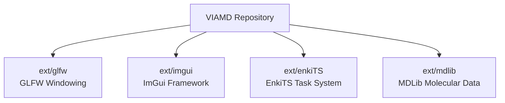
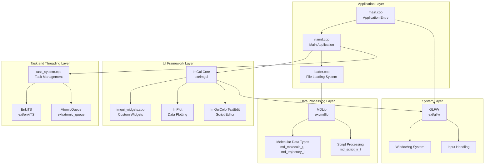
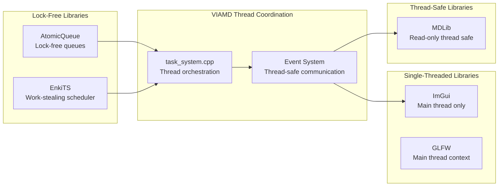

# External Libraries and Dependencies

Relevant source files

The following files were used as context for generating this wiki page:

- [.gitmodules](.gitmodules)
- [TODO.md](TODO.md)
- [ext/atomic_queue/CMakeLists.txt](ext/atomic_queue/CMakeLists.txt)
- [ext/atomic_queue/LICENSE](ext/atomic_queue/LICENSE)
- [ext/atomic_queue/README.md](ext/atomic_queue/README.md)
- [ext/atomic_queue/atomic_queue.h](ext/atomic_queue/atomic_queue.h)
- [ext/atomic_queue/atomic_queue_mutex.h](ext/atomic_queue/atomic_queue_mutex.h)
- [ext/atomic_queue/barrier.h](ext/atomic_queue/barrier.h)
- [ext/atomic_queue/defs.h](ext/atomic_queue/defs.h)
- [ext/atomic_queue/spinlock.h](ext/atomic_queue/spinlock.h)

This page documents the external libraries and dependencies that VIAMD relies on, their integration patterns, and management through Git submodules. For information about the CMake build configuration that orchestrates these dependencies, see [CMake Build Configuration](#6.1).

## Dependency Overview

VIAMD leverages several external libraries to provide core functionality including windowing, GUI, task scheduling, molecular data processing, and specialized data structures. These dependencies are managed primarily through Git submodules and are organized in the `ext/` directory.

## Git Submodule Dependencies

The following libraries are managed as Git submodules and form the core external dependencies:

| Library | Path | Repository | Purpose |
|---------|------|------------|---------|
| GLFW | `ext/glfw` | https://github.com/glfw/glfw | Windowing and input handling |
| ImGui | `ext/imgui` | https://github.com/ocornut/imgui | Immediate mode GUI framework |
| EnkiTS | `ext/enkiTS` | https://github.com/dougbinks/enkiTS | Task scheduling and parallel processing |
| MDLib | `ext/mdlib` | https://github.com/scanberg/mdlib | Molecular data processing and analysis |

**Git Submodule Configuration**

Sources: [.gitmodules:1-13]()

## Core Library Integration

The external libraries integrate into VIAMD's architecture at different levels, from low-level system services to high-level application features:

**Dependency Architecture and Integration Points**

Sources: [.gitmodules:1-13](), [ext/atomic_queue/README.md:1-260](), [TODO.md:1-78]()

## Library-Specific Integration Details

### GLFW - Windowing and Input System
GLFW provides the foundational windowing and input handling capabilities. It interfaces directly with the operating system to create OpenGL contexts and handle user input events.

**Key Integration Points:**
- Window creation and management
- OpenGL context initialization
- Keyboard and mouse input processing
- Event polling and callback systems

### ImGui - Immediate Mode GUI Framework
ImGui serves as the primary user interface framework, providing immediate-mode GUI capabilities with minimal state management overhead.

**Key Components:**
- Core rendering and widget system (`ext/imgui`)
- Custom widget extensions ([imgui_widgets.cpp]())
- Data plotting capabilities (ImPlot)
- Text editing functionality (ImGuiColorTextEdit)

### EnkiTS - Task Scheduling System
EnkiTS provides the parallel processing foundation for VIAMD's computational tasks, enabling efficient multi-threaded execution of analysis operations.

**Integration Pattern:**
- Task system wrapper ([task_system.cpp]())
- Parallel processing for molecular analysis
- Background computation scheduling

### MDLib - Molecular Data Processing
MDLib is a specialized library for molecular data structures and algorithms, providing the core molecular processing capabilities.

**Key Data Types:**
- `md_molecule_t` - Molecular structure representation
- `md_trajectory_i` - Trajectory data interface
- `md_script_ir_t` - Script intermediate representation

### Atomic Queue - Lock-Free Threading
The atomic queue library provides high-performance, lock-free data structures for inter-thread communication.

**Queue Types Available:**
- `AtomicQueue` - Fixed size ring-buffer for atomic elements
- `AtomicQueue2` - Fixed size ring-buffer for non-atomic elements
- `OptimistAtomicQueue` - High-throughput variant with busy-waiting
- `AtomicQueueB` - Dynamic size variant with custom allocators

**Performance Characteristics:**
- Lock-free multiple-producer-multiple-consumer queues
- Minimized cache line contention through index shuffling
- Sub-microsecond latency for push/pop operations

Sources: [ext/atomic_queue/atomic_queue.h:18-646](), [ext/atomic_queue/README.md:18-44]()

## Thread Safety and Memory Management

The external libraries implement different thread safety models that VIAMD coordinates:

**Thread Safety Models by Library**

Sources: [ext/atomic_queue/README.md:163-177](), [ext/atomic_queue/defs.h:1-108]()

## Performance Considerations

Several libraries are specifically chosen for performance-critical operations:

### Atomic Queue Performance Features
- **Cache Line Optimization**: Index shuffling to minimize false sharing ([ext/atomic_queue/atomic_queue.h:52-63]())
- **Memory Ordering**: Configurable memory ordering for different consistency requirements ([ext/atomic_queue/defs.h:95-99]())
- **SPSC Optimization**: Single-producer-single-consumer mode eliminates atomic read-modify-write operations

### EnkiTS Task Scheduling
- Work-stealing algorithm for load balancing
- Minimal overhead task creation
- Integration with VIAMD's computational pipeline

Sources: [ext/atomic_queue/atomic_queue.h:352-386](), [ext/atomic_queue/README.md:105-135]()

## Build Integration

The external libraries integrate into VIAMD's build system through CMake configurations that handle:

- Submodule initialization and updates
- Library-specific compilation flags
- Cross-platform compatibility settings
- Dependency resolution and linking

For detailed build configuration information, see [CMake Build Configuration](#6.1).

Sources: [ext/atomic_queue/CMakeLists.txt:1-5]()

---