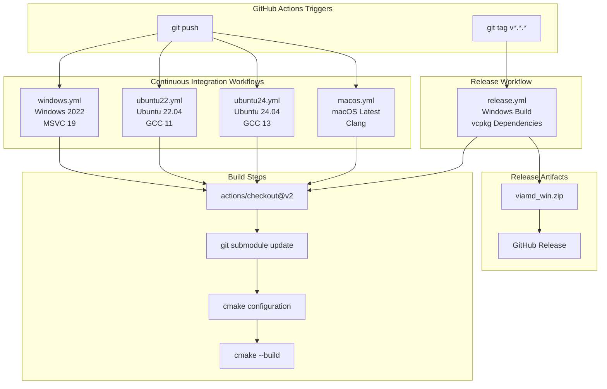

# CI/CD and Release Process

<details>
<summary>Relevant source files</summary>

The following files were used as context for generating this wiki page:

- [.github/workflows/macos.yml](.github/workflows/macos.yml)
- [.github/workflows/release.yml](.github/workflows/release.yml)
- [.github/workflows/ubuntu22.yml](.github/workflows/ubuntu22.yml)
- [.github/workflows/windows.yml](.github/workflows/windows.yml)
- [README.md](README.md)

</details>


This document covers the continuous integration and continuous deployment (CI/CD) infrastructure for VIAMD, including automated testing workflows, release procedures, and platform-specific build configurations. For information about CMake build configuration and compilation options, see [6.1](#6.1). For details about external dependencies and library management, see [6.2](#6.2).

## Overview

VIAMD employs a comprehensive CI/CD system built on GitHub Actions that provides automated testing across multiple platforms and streamlined release management. The system ensures code quality through continuous testing and delivers pre-built binaries for end users through automated releases.

## Continuous Integration Workflows

The CI system consists of four primary workflows that test VIAMD across different operating systems and compiler combinations. Each workflow is triggered on every push to the repository and provides immediate feedback on build status.

### CI Workflow Architecture



**Sources:** [.github/workflows/windows.yml](), [.github/workflows/ubuntu22.yml](), [.github/workflows/macos.yml](), [.github/workflows/release.yml]()

### Platform-Specific CI Configurations

| Platform | Workflow File | Runner | Compiler | Key Dependencies |
|----------|---------------|--------|----------|------------------|
| Windows | `windows.yml` | `windows-2022` | MSVC 19 | Built-in dependencies |
| Ubuntu 22.04 | `ubuntu22.yml` | `ubuntu-22.04` | GCC 11 | `libx11-dev`, `libxrandr-dev`, `libxinerama-dev`, `libxcursor-dev`, `libgtk-3-dev`, `pkgconf` |
| Ubuntu 24.04 | `ubuntu24.yml` | `ubuntu-24.04` | GCC 13 | Same as Ubuntu 22.04 |
| macOS | `macos.yml` | `macos-latest` | Clang | Built-in dependencies |

### Common CI Build Steps

All CI workflows follow a standardized build process:

1. **Repository Checkout**: Uses `actions/checkout@v2` to fetch the source code
2. **Submodule Initialization**: Executes `git submodule update --init --recursive` to fetch all external dependencies
3. **Platform Dependencies**: Installs platform-specific system packages (Ubuntu only)
4. **CMake Configuration**: Runs `cmake .` with default settings
5. **Compilation**: Executes platform-specific build commands

**Sources:** [.github/workflows/windows.yml:10-18](), [.github/workflows/ubuntu22.yml:10-20](), [.github/workflows/macos.yml:10-18]()

## Release Process

VIAMD implements an automated release process that triggers on version tags and produces distribution-ready binaries. The release workflow is specifically designed for Windows builds with static linking for maximum compatibility.

### Release Workflow Details

```mermaid
graph LR
    subgraph "Release Trigger"
        TAG_PUSH["git tag v*.*.*<br/>push to origin"]
    end
    
    subgraph "Build Environment"
        RUNNER["windows-2022"]
        VCPKG_ACTION["johnwason/vcpkg-action@v6"]
        HDF5_PKG["hdf5 package<br/>x64-windows-static-release"]
    end
    
    subgraph "CMake Configuration"
        CMAKE_OPTS["CMAKE_TOOLCHAIN_FILE<br/>VCPKG_TARGET_TRIPLET<br/>BUILD_SHARED_LIBS=OFF<br/>USE_MSVC_RUNTIME_LIBRARY_DLL=OFF<br/>VIAMD_ENABLE_VELOXCHEM=ON<br/>MD_ENABLE_VLX=ON"]
    end
    
    subgraph "Build Process"
        BUILD_CMD["cmake --build . --config Release<br/>/nologo /verbosity:minimal /maxcpucount:4"]
        BIN_OUTPUT["bin/Release/"]
    end
    
    subgraph "Packaging"
        ZIP_ACTION["thedoctor0/zip-release@main"]
        ZIP_FILE["viamd_win.zip"]
    end
    
    subgraph "Publication"
        RELEASE_ACTION["softprops/action-gh-release@v1"]
        GITHUB_RELEASE["GitHub Release Page"]
    end
    
    TAG_PUSH --> RUNNER
    RUNNER --> VCPKG_ACTION
    VCPKG_ACTION --> HDF5_PKG
    HDF5_PKG --> CMAKE_OPTS
    CMAKE_OPTS --> BUILD_CMD
    BUILD_CMD --> BIN_OUTPUT
    BIN_OUTPUT --> ZIP_ACTION
    ZIP_ACTION --> ZIP_FILE
    ZIP_FILE --> RELEASE_ACTION
    RELEASE_ACTION --> GITHUB_RELEASE
```



**Sources:** [.github/workflows/release.yml:1-41]()

### Release Configuration Parameters

The release build uses specific CMake configuration parameters optimized for distribution:

- **Static Linking**: `BUILD_SHARED_LIBS=OFF` and `USE_MSVC_RUNTIME_LIBRARY_DLL=OFF` ensure the binary runs without external dependencies
- **VeloxChem Support**: `VIAMD_ENABLE_VELOXCHEM=ON` and `MD_ENABLE_VLX=ON` enable quantum chemistry integration
- **Testing Disabled**: `MD_UNITTEST=OFF` and `MD_BENCHMARK=OFF` exclude development tools from the release build
- **vcpkg Integration**: Uses vcpkg toolchain with `x64-windows-static-release` triplet for HDF5 dependency

**Sources:** [.github/workflows/release.yml:24]()

## Build Status Integration

The project's build status is prominently displayed in the main README file through GitHub Actions badges. These badges provide real-time feedback on the health of different platform builds:

```markdown
[]
[]
[]
[]
```

**Sources:** [README.md:11-14]()

## Platform-Specific Considerations

### Windows Builds
- Uses MSVC 2022 compiler with `/nologo`, `/verbosity:minimal`, and `/maxcpucount:4` flags for optimized compilation
- Relies on vcpkg for dependency management, specifically requiring HDF5
- Produces statically-linked executables for maximum portability

### Linux Builds
- Requires explicit installation of X11 and GTK development libraries
- Uses system package manager (`apt-get`) for dependency installation
- Supports both GCC 11 (Ubuntu 22.04) and GCC 13 (Ubuntu 24.04)
- Uses standard `make -j 4` for parallel compilation

### macOS Builds
- Uses the latest available macOS runner with Clang compiler
- Relies on system-provided dependencies without additional package installation
- Uses standard `make -j 4` for parallel compilation

**Sources:** [.github/workflows/windows.yml:17-18](), [.github/workflows/ubuntu22.yml:13-20](), [.github/workflows/macos.yml:17-18]()

## Dependency Management in CI

The CI system handles dependencies differently across platforms:

- **Windows**: Uses vcpkg with GitHub binary cache for efficient dependency management
- **Linux**: Uses system package manager with explicit library installation
- **macOS**: Relies on system-provided libraries and frameworks

All platforms initialize Git submodules to fetch external source dependencies before building.

**Sources:** [.github/workflows/release.yml:14-21](), [.github/workflows/ubuntu22.yml:13-14](), [.github/workflows/windows.yml:11-12]()

---