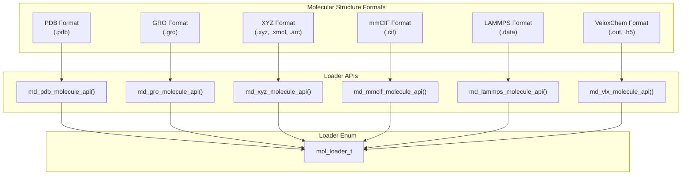
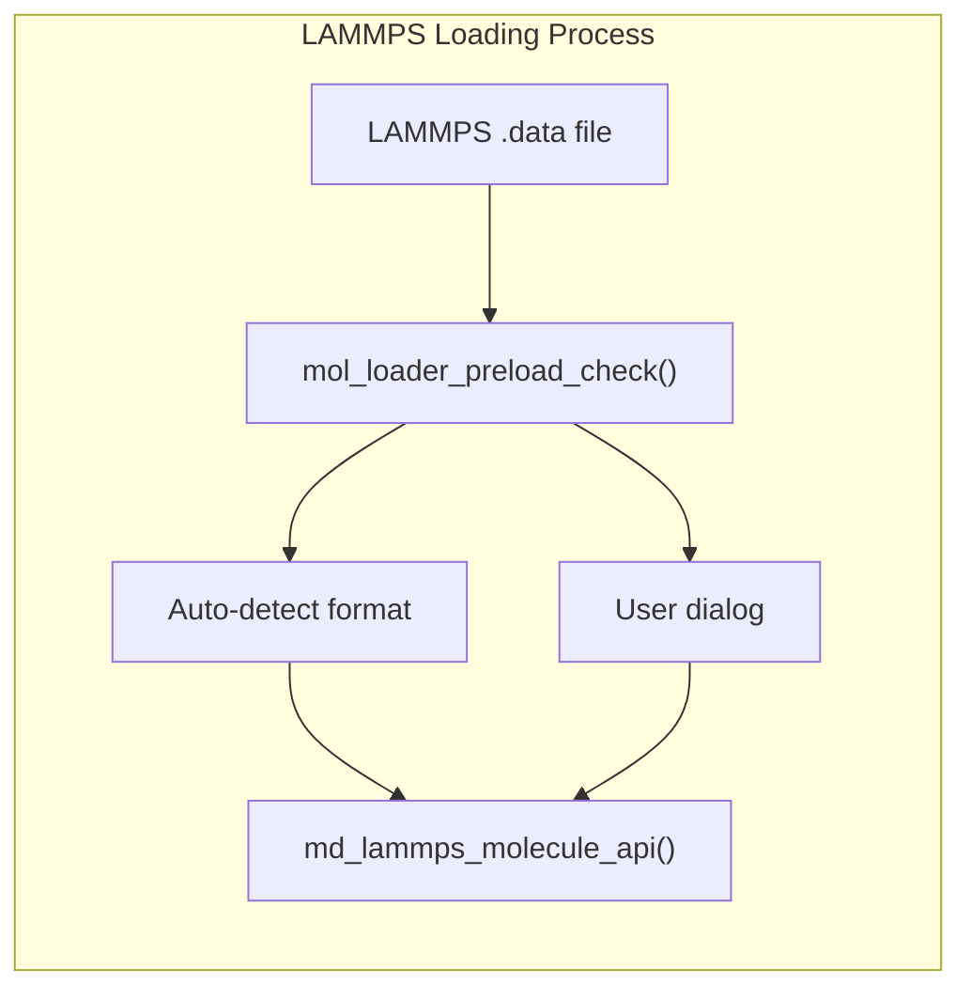
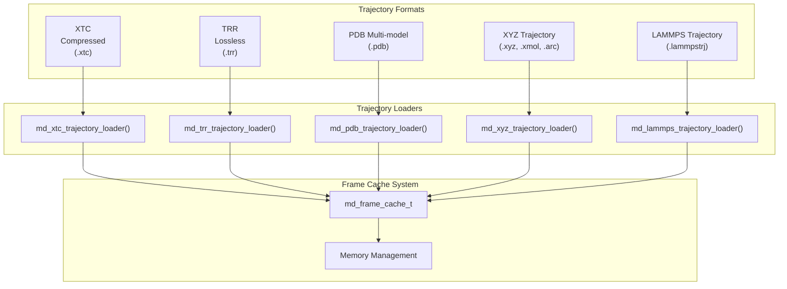
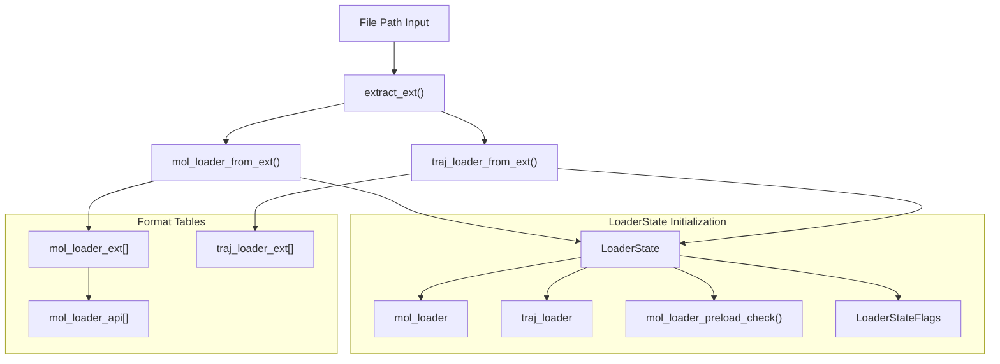
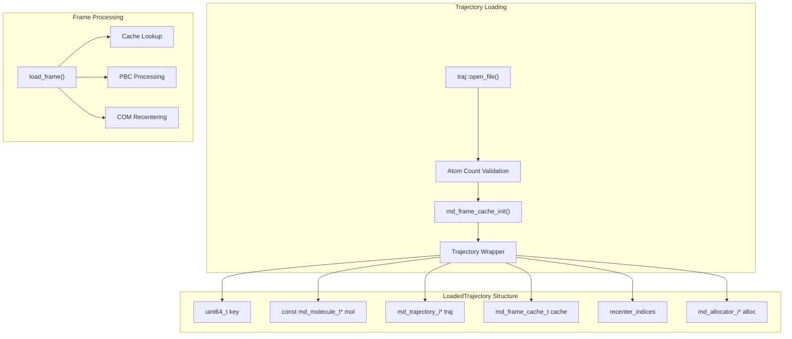
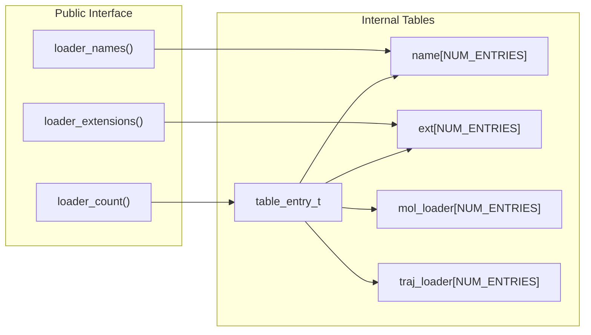

# Data Formats and Sample Data

<details>
<summary>Relevant source files</summary>

The following files were used as context for generating this wiki page:

- [datasets/1ALA-500.pdb](datasets/1ALA-500.pdb)
- [src/app/application.cpp](src/app/application.cpp)
- [src/color_utils.cpp](src/color_utils.cpp)
- [src/color_utils.h](src/color_utils.h)
- [src/event.cpp](src/event.cpp)
- [src/loader.cpp](src/loader.cpp)
- [src/loader.h](src/loader.h)

</details>


This document describes the molecular data formats supported by VIAMD and the file loading infrastructure. It covers structure formats, trajectory formats, format detection mechanisms, and the loader architecture that handles various molecular dynamics file types.

For information about the file loading system implementation and caching mechanisms, see [File Loading System](#2.2). For details about molecular data structures used internally, see [Molecular Data Structures and Display](#2.4).

## Supported Molecular Structure Formats

VIAMD supports loading molecular structure data from multiple standard formats through a unified loader interface. Each format is handled by a specific loader implementation within the MDLib library.

### Structure Format Overview

| Format | Extension(s) | Description | Loader Type |
|--------|-------------|-------------|-------------|
| PDB | `.pdb` | Standard Protein Data Bank format | `MOL_LOADER_PDB` |
| GRO | `.gro` | Gromacs structure format | `MOL_LOADER_GRO` |
| XYZ | `.xyz`, `.xmol`, `.arc` | Simple coordinate format | `MOL_LOADER_XYZ` |
| mmCIF | `.cif` | PDBx/mmCIF crystallographic format | `MOL_LOADER_CIF` |
| LAMMPS | `.data` | LAMMPS data format | `MOL_LOADER_LAMMPS` |
| VeloxChem | `.out`, `.h5` | Quantum chemistry output | `MOL_LOADER_VELOXCHEM` |



Sources: [src/loader.cpp:29-76]()

### Format-Specific Features

The **LAMMPS loader** requires additional configuration and supports automatic atom format detection. When loading LAMMPS data files, the system performs a preload check to determine the atom format automatically, or prompts the user for configuration if needed.



Sources: [src/loader.cpp:190-210]()

The **VeloxChem loader** is conditionally compiled and only available when `MD_VLX` is defined, providing integration with quantum chemistry calculations.

## Supported Trajectory Formats

Trajectory formats store time-series coordinate data for molecular dynamics simulations. VIAMD supports both compressed and uncompressed trajectory formats.

### Trajectory Format Overview

| Format | Extension | Description | Compression | Loader Type |
|--------|-----------|-------------|------------|-------------|
| XTC | `.xtc` | Gromacs compressed trajectory | Lossy | `TRAJ_LOADER_XTC` |
| TRR | `.trr` | Gromacs full-precision trajectory | Lossless | `TRAJ_LOADER_TRR` |
| PDB | `.pdb` | Multi-model PDB trajectory | None | `TRAJ_LOADER_PDB` |
| XYZ | `.xyz`, `.xmol`, `.arc` | Simple coordinate trajectory | None | `TRAJ_LOADER_XYZ` |
| LAMMPSTRJ | `.lammpstrj` | LAMMPS trajectory (ASCII) | None | `TRAJ_LOADER_LAMMPSTRJ` |



Sources: [src/loader.cpp:78-113](), [src/loader.cpp:561-615]()

## File Format Detection and Loading Pipeline

VIAMD uses a unified loading pipeline that automatically detects file formats based on extensions and initializes appropriate loaders.

### Format Detection Process



Sources: [src/loader.cpp:330-352](), [src/loader.cpp:302-328]()

### Loader State Management

The `LoaderState` structure encapsulates all information needed to load a file, including format-specific arguments and configuration flags.

```cpp
struct LoaderState {
    md_molecule_loader_i*   mol_loader = 0;
    md_trajectory_loader_i* traj_loader = 0;
    const void*             mol_loader_arg = 0;
    LoaderStateFlags        flags = LoaderStateFlag_None;
    size_t data_size = 0;
    void* data_ptr = 0;
};
```

Key functions for loader state management:
- `init_loader_state()` - Initialize loader based on file path
- `free_loader_state()` - Clean up allocated loader arguments
- `mol_loader_preload_check()` - Format-specific preprocessing

Sources: [src/loader.h:29-37](), [src/loader.cpp:330-361]()

## Trajectory Loading and Caching

VIAMD implements sophisticated trajectory handling with frame caching, periodic boundary condition (PBC) processing, and memory management optimizations.

### Trajectory Instance Management



Sources: [src/loader.cpp:561-615](), [src/loader.cpp:115-129](), [src/loader.cpp:490-559]()

### Frame Cache Configuration

The frame cache system automatically determines optimal cache size based on available system memory and trajectory characteristics:

- **Cache Size**: Clamped between 4MB minimum and 25% of physical RAM
- **Frame Estimation**: Based on `atom_count × 3 × sizeof(float)` per frame
- **Cache Frames**: `MIN(total_frames, max_cache_frames)`

Sources: [src/loader.cpp:599-607]()

## Unified Format Interface

VIAMD provides a unified interface for accessing both molecule and trajectory formats through common API functions.

### Format Enumeration Interface



Sources: [src/loader.cpp:218-301](), [src/loader.cpp:363-373]()

The system maintains a unified table structure that maps format names, extensions, and loader implementations, enabling consistent access to format information across the application.

## Sample Data and Testing

While specific sample data files are not visible in the current codebase analysis, VIAMD's comprehensive format support suggests it can handle standard molecular dynamics and structural biology datasets. The loader system is designed to work with:

- **Protein structures** from the Protein Data Bank (PDB format)
- **Molecular dynamics trajectories** from simulation packages like Gromacs
- **Quantum chemistry calculations** through VeloxChem integration
- **Molecular dynamics simulations** from LAMMPS

The robust error handling and validation in the loader system ensures reliable processing of real-world molecular data files with varying formats and quality.

Sources: [src/loader.cpp:1-684]()