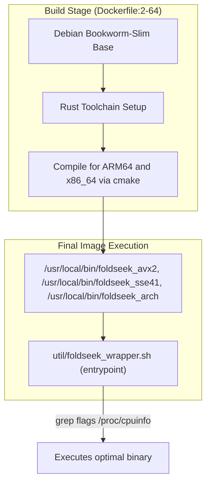
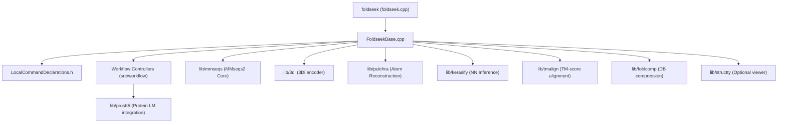
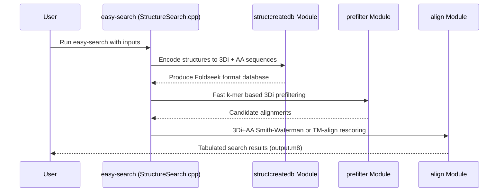

# Installation and Getting Started

<details>
<summary>Relevant source files</summary>

The following files were used as context for generating this wiki page:

- [.github/results.png](.github/results.png)
- [.github/workflows/Dockerfile.GPU-buster-cross-sbsa](.github/workflows/Dockerfile.GPU-buster-cross-sbsa)
- [.github/workflows/Dockerfile.GPU-manylinux2014](.github/workflows/Dockerfile.GPU-manylinux2014)
- [.github/workflows/docker.yml](.github/workflows/docker.yml)
- [Dockerfile](Dockerfile)
- [README.md](README.md)
- [azure-pipelines.yml](azure-pipelines.yml)
- [lib/mmseqs/Dockerfile](lib/mmseqs/Dockerfile)
- [src/strucclustutils/LoLAlign.cpp](src/strucclustutils/LoLAlign.cpp)
- [src/strucclustutils/LoLAlign.h](src/strucclustutils/LoLAlign.h)
- [src/strucclustutils/LoLAlignProbability.h](src/strucclustutils/LoLAlignProbability.h)
- [src/strucclustutils/LoLAlignProbabilityWeights.h](src/strucclustutils/LoLAlignProbabilityWeights.h)
- [util/build_osx.sh](util/build_osx.sh)
- [util/foldseek_wrapper.sh](util/foldseek_wrapper.sh)

</details>


This page provides comprehensive technical instructions for installing Foldseek on multiple platforms, outlines system requirements, explains the internal build and runtime architecture, and guides initial setup including database preparation and running example searches.

Foldseek is built on top of the MMseqs2 framework and offers fast, sensitive protein structure searching, clustering, and supports GPU acceleration and sequence input via protein language models.

---

## System Requirements

### Hardware Requirements

| Component | Details |
|-----------|---------|
| **CPU** | x86_64 with at least SSE4.1 support; AVX2 highly recommended for optimal performance in 3Di encoding and alignment. ARM64 (AArch64) supported on Linux and Apple Silicon. |
| **GPU** | Optional NVIDIA GPU: Ampere generation or newer for full GPU acceleration; Turing generation supported at reduced speed. Requires `glibc >= 2.17` and NVIDIA driver `>= 525.60.13`. Not all binaries support older GPUs. |
| **RAM** | Memory needs depend on the database size and search mode. Refer to the modes below. |

### Memory Modes and Formulas

| Mode | Description | RAM Formula | RAM Example (54M AFDB50) |
|---|---|---|---|
| Default | With Cα coordinate info (default) | `(6 bytes Cα + 1 byte 3Di + 1 byte AA) * database residues` | ~151 GB |
| Light | Without Cα coordinate info, disables `--sort-by-structure-bits 0` | `(1 byte 3Di + 1 byte AA) * database residues` | ~35 GB |
| Single Query Prefilter | Uses `--prefilter-mode 1`, not memory-limited and multithreaded | N/A (depends on query) | Variable |

> The default mode retains structural coordinate information and is recommended for best hit ranking quality.

Sources: [README.md:71-102]()

---

## Installation Methods

### 1. Pre-built Binaries (Recommended for Most Users)

Foldseek offers statically linked, platform-specific binaries for quick installation without compilation.

```bash
# Linux AVX2 (x86_64)
wget https://mmseqs.com/foldseek/foldseek-linux-avx2.tar.gz
tar xvzf foldseek-linux-avx2.tar.gz
export PATH=$(pwd)/foldseek/bin/:$PATH

# Linux ARM64
wget https://mmseqs.com/foldseek/foldseek-linux-arm64.tar.gz
tar xvzf foldseek-linux-arm64.tar.gz
export PATH=$(pwd)/foldseek/bin/:$PATH

# Linux AVX2 + GPU build (glibc >= 2.17, Nvidia driver >= 525.60.13)
wget https://mmseqs.com/foldseek/foldseek-linux-gpu.tar.gz
tar xvfz foldseek-linux-gpu.tar.gz
export PATH=$(pwd)/foldseek/bin/:$PATH

# MacOS Universal (Intel + Apple Silicon)
wget https://mmseqs.com/foldseek/foldseek-osx-universal.tar.gz
tar xvzf foldseek-osx-universal.tar.gz
export PATH=$(pwd)/foldseek/bin/:$PATH
```

More binaries are available at [https://mmseqs.com/foldseek](https://mmseqs.com/foldseek).

#### Notes:
* Static linking minimizes dependency issues.
* GPU binaries require compatible hardware and software stack.

Sources: [README.md:74-88](), [Dockerfile:1-83]()

---

### 2. Conda Package Manager

Foldseek is available on Bioconda channel for Linux and macOS.

```bash
conda install -c conda-forge -c bioconda foldseek
```

Sources: [README.md:86-88]()

---

### 3. Docker

Pre-built multi-architecture Docker images simplify environment setup, including GPU-enabled variants.

- Standard Foldseek: `ghcr.io/steineggerlab/foldseek:latest`
- GPU-enabled Foldseek (CUDA 12): `ghcr.io/steineggerlab/foldseek:latest-cuda12`

The Dockerfile uses a multi-stage build that compiles SSE4.1 and AVX2 optimized binaries separately, then selects the appropriate one at runtime via the `entrypoint` wrapper script (`util/foldseek_wrapper.sh`), detecting CPU capabilities by inspecting `/proc/cpuinfo`.

This ensures performance tuning for diverse hardware automatically.

Title: "Docker Build and Runtime Flow"


Sources: [Dockerfile:1-83](), [.github/workflows/docker.yml:1-141](), [util/foldseek_wrapper.sh:1-10]()

---

### 4. Building From Source

For developers or advanced users needing customization.

#### Prerequisites

- C++ compiler with C++11 support
- Rust toolchain (required for `block-aligner`)
- CMake (>=3.15)
- Optional: CUDA toolkit for GPU support

#### Build System Overview

Foldseek uses CMake to integrate multiple submodules and libraries:

- Core MMseqs2 framework (`lib/mmseqs`)
- 3Di structural encoding (`lib/3di`)
- Structural tools (`lib/pulchra`, `lib/tmalign`)
- Neural network inference (`lib/kerasify`)
- ProstT5 protein language model (`lib/prostt5`)
- Database compression support (`lib/foldcomp`)
- Optional: StructTTY viewer (`lib/structty`)

Title: "Foldseek Component and Library Dependencies"


Sources: [src/CMakeLists.txt:3-25](), [CMakeLists.txt:31-118]()

#### Build Instructions

1. Clone repository with submodules:

```bash
git clone --recursive https://github.com/steineggerlab/foldseek.git
cd foldseek
```

2. Configure build with CMake:

- CPU-only build (default):

```bash
cmake -DCMAKE_BUILD_TYPE=Release .
```

- Enable GPU support (if CUDA toolkit installed):

```bash
cmake -DENABLE_CUDA=1 -DCMAKE_BUILD_TYPE=Release .
```

- Static linking of dependencies:

```bash
cmake -DFORCE_STATIC_DEPS=1 -DCMAKE_BUILD_TYPE=Release .
```

3. Build executable(s):

```bash
make -j$(nproc)
```

4. The executable `foldseek` will be in `src/`.

**Build Verification**

Run regression tests:

```bash
./regression/run_regression.sh ./src/foldseek examples
```

Sources: [azure-pipelines.yml:45-69](), [util/build_osx.sh:1-120](), [CMakeLists.txt:10-25]()

---

## Getting Started

### Database Preparation

Foldseek requires input structure databases in its own format, encoding structures to 3Di and sequence representations.

The `databases` command manages downloading and formatting of popular structural databases like PDB or AlphaFoldDB.

Example: Download and prepare PDB database

```bash
foldseek databases PDB pdb_dir tmp_dir
```

- `pdb_dir`: destination directory for database files
- `tmp_dir`: temporary working directory for intermediate files

This step encodes the structures into fast searchable formats for Foldseek.

Sources: [README.md:41-44]()

---

### Running a Simple Search

Convenience commands like `easy-search` automate the full pipeline of encoding, prefiltering, alignment, and output formatting.

Example command:

```bash
foldseek easy-search query.pdb target_db output.m8 tmp_dir
```

- `query.pdb`: input query structure(s)
- `target_db`: target Foldseek database directory
- `output.m8`: tab-separated result output
- `tmp_dir`: temporary directory for intermediate files

Title: "Easy-Search Workflow Data Flow"


This process efficiently finds structural homologs with high sensitivity.

Sources: [README.md:31-38](), [src/workflow/StructureSearch.cpp:1-50]()

---

### Verification and Version Check

Verify correct installation and hardware support by querying the Foldseek version and enabled CPU features:

```bash
foldseek version
```

This outputs build information including CPU SIMD flags (SSE4.1, AVX2) and CUDA support.

Sources: [src/CMakeLists.txt:40-45]()

---

## Summary Table for Installation Options

| Installation Method | Command / Notes | Benefits | Notes |
|---------------------|-----------------|----------|-------|
| Pre-built binaries | Download and extract tarballs from mmseqs.com/foldseek | Fast setup, no build required | Use correct architecture binary |
| Conda | `conda install -c conda-forge -c bioconda foldseek` | Easy dependency management | Suitable for Linux/macOS |
| Docker (standard) | `docker pull ghcr.io/steineggerlab/foldseek:latest` | Containerized environment | Multi-arch support |
| Docker (GPU) | `docker pull ghcr.io/steineggerlab/foldseek:latest-cuda12` | GPU-accelerated searches | Requires NVIDIA GPU and drivers |
| Build from source | `cmake` + `make` in foldseek repo | Custom builds, development | Requires build tools and dependencies |

---

By following these detailed instructions, users can install Foldseek on a variety of platforms, prepare structure databases, and run efficient structure searches with high sensitivity leveraging CPU and GPU resources as available.

---

Sources:
- [README.md:2-102]()
- [azure-pipelines.yml:10-113]()
- [CMakeLists.txt:1-118]()
- [src/CMakeLists.txt:1-50]()
- [Dockerfile:1-83]()
- [.github/workflows/docker.yml:1-141]()
- [util/foldseek_wrapper.sh:1-10]()
- [util/build_osx.sh:1-120]()
- [src/workflow/StructureSearch.cpp:1-50]()

---